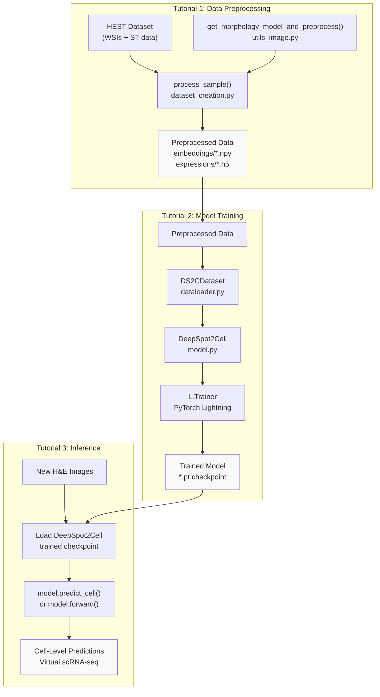
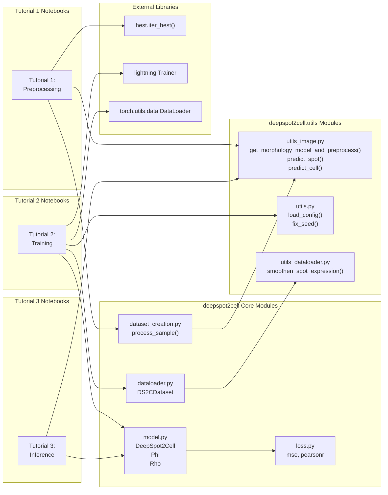
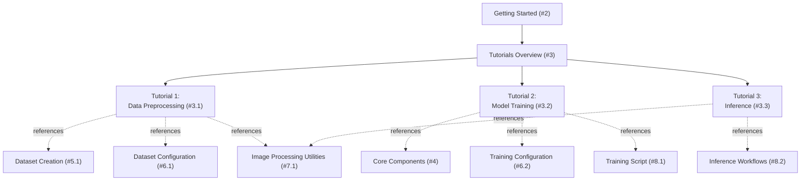

# Tutorials

<details>
<summary>Relevant source files</summary>

The following files were used as context for generating this wiki page:

- [README.md](README.md)
- [tutorials/GettingStartedWithDeepSpot2Cell_1_preprocessing.ipynb](tutorials/GettingStartedWithDeepSpot2Cell_1_preprocessing.ipynb)
- [tutorials/GettingStartedWithDeepSpot2Cell_2_training.ipynb](tutorials/GettingStartedWithDeepSpot2Cell_2_training.ipynb)
- [tutorials/GettingStartedWithDeepSpot2Cell_3_inference.ipynb](tutorials/GettingStartedWithDeepSpot2Cell_3_inference.ipynb)

</details>


## Purpose and Scope

This page provides an overview of the three-part tutorial series that guides users through the complete DeepSpot2Cell workflow, from raw HEST data to cell-level predictions. Each tutorial is implemented as a Jupyter notebook and covers a distinct phase of the pipeline. For installation and initial setup instructions, see [Getting Started](#2). For detailed technical documentation of individual components, see [Core Components](#4) and subsequent sections.

The tutorials are designed to be followed sequentially, with each building upon the outputs of the previous one. They provide hands-on, interactive examples of the key workflows described in the system architecture.

## Overview

DeepSpot2Cell provides three tutorial notebooks located in the [tutorials/]() directory that demonstrate the complete workflow:

| Tutorial | Notebook File | Purpose | Key Outputs |
|----------|--------------|---------|-------------|
| Tutorial 1 | `GettingStartedWithDeepSpot2Cell_1_preprocessing.ipynb` | Data preprocessing and feature extraction | Embeddings (`.npy`), Expressions (`.h5`) |
| Tutorial 2 | `GettingStartedWithDeepSpot2Cell_2_training.ipynb` | Model training and validation | Trained model checkpoint (`.pt`) |
| Tutorial 3 | `GettingStartedWithDeepSpot2Cell_3_inference.ipynb` | Inference and cell-level prediction | Virtual single-cell transcriptomics |

Each tutorial is self-contained with code examples, explanations, and expected outputs. Users can run them in sequence to experience the full pipeline or jump to specific tutorials if they have already completed previous steps.

Sources: [README.md:24-33]()

## Tutorial Workflow

The following diagram illustrates how the three tutorials form a sequential pipeline, showing the data flow and key code entities involved at each stage:



**Tutorial Progression**: Each tutorial produces concrete outputs that serve as inputs to the next stage. Tutorial 1 performs computationally expensive preprocessing once, Tutorial 2 can be run multiple times with different hyperparameters using the cached preprocessed data, and Tutorial 3 applies trained models to new data for inference.

Sources: [README.md:24-33](), [tutorials/GettingStartedWithDeepSpot2Cell_1_preprocessing.ipynb:1-131](), [tutorials/GettingStartedWithDeepSpot2Cell_2_training.ipynb:1-145]()

## Tutorial-to-Module Mapping

The following diagram maps each tutorial to the specific code modules and classes it utilizes, bridging the natural language tutorial descriptions to concrete code entities:



**Code Entity Bridge**: This diagram shows the primary code entities (classes, functions, modules) that users interact with in each tutorial. Tutorial 1 focuses on data processing modules, Tutorial 2 on the model and training infrastructure, and Tutorial 3 on inference utilities.

Sources: [tutorials/GettingStartedWithDeepSpot2Cell_1_preprocessing.ipynb:18-54](), [tutorials/GettingStartedWithDeepSpot2Cell_2_training.ipynb:14-87]()

## Tutorial Summaries

### Tutorial 1: Data Preprocessing

**Location**: [tutorials/GettingStartedWithDeepSpot2Cell_1_preprocessing.ipynb]()

**Primary Goal**: Convert raw HEST-1k spatial transcriptomics data into training-ready embeddings and expression files.

**Key Steps**:
1. Load HEST datasets using `iter_hest()`
2. Initialize pathology foundation model (UNI, H-optimus-0, or Phikon v2) using `get_morphology_model_and_preprocess()`
3. Extract cell tiles, spot tiles, and neighbor tiles from WSIs
4. Compute morphology embeddings via PFM
5. Process and normalize spot-level gene expression data
6. Save embeddings as `.npy` files and expressions as `.h5` files

**Configuration**: Users specify parameters via a config dictionary or YAML file:
- `data_folder`: Path to HEST data
- `dataset_variant`: Version suffix (e.g., `_v1`)
- `model_name`: PFM identifier (e.g., `phikonv2`)
- `spot_diameter_px`: Spot size in pixels (default: 160)
- `patch_size_px`: Tile size for PFM input (default: 224)

**Script Alternative**: For batch processing, use `python -m deepspot2cell.dataset_creation --config configs/dataset.example.yaml --dataset lung`

For detailed technical documentation, see [Tutorial 1: Data Preprocessing](#3.1).

Sources: [tutorials/GettingStartedWithDeepSpot2Cell_1_preprocessing.ipynb:1-131](), [README.md:29]()

### Tutorial 2: Model Training

**Location**: [tutorials/GettingStartedWithDeepSpot2Cell_2_training.ipynb]()

**Primary Goal**: Train a `DeepSpot2Cell` model using preprocessed embeddings and expression data.

**Key Steps**:
1. Instantiate `DS2CDataset` objects for training and validation splits
2. Create PyTorch `DataLoader` instances with appropriate batch size and workers
3. Determine input/output dimensions from sample batch
4. Initialize `DeepSpot2Cell` model with correct dimensions
5. Configure PyTorch Lightning `Trainer` with callbacks and logging
6. Execute training loop via `trainer.fit()`
7. Save trained model checkpoint

**Dataset Configuration**:
```python
train_dataset = DS2CDataset(
    dataset_variant="_v1",
    ids_list=["NCBI864", "NCBI873", "NCBI856", "NCBI860"],
    data_path="hest_data",
    model_name="phikonv2",
    shuffle=True,
    normalize=True,
    neighb_degree=1
)
```

**Model Instantiation**: [tutorials/GettingStartedWithDeepSpot2Cell_2_training.ipynb:78]()

```python
model = DeepSpot2Cell(input_size=input_size, output_size=output_size)
```

**Training Parameters**: Batch size (256), max epochs (400), number of workers (4), and accelerator selection are configurable. The notebook demonstrates minimal configuration; for advanced options, see [Training Configuration](#6.2).

For detailed technical documentation, see [Tutorial 2: Model Training](#3.2).

Sources: [tutorials/GettingStartedWithDeepSpot2Cell_2_training.ipynb:1-145](), [README.md:31]()

### Tutorial 3: Inference and Prediction

**Location**: [tutorials/GettingStartedWithDeepSpot2Cell_3_inference.ipynb]()

**Primary Goal**: Apply trained `DeepSpot2Cell` models to predict cell-level gene expression from new H&E images.

**Key Operations**:
1. Load trained model checkpoint
2. Extract cell tiles and context (spot tile + neighbors) from new images
3. Compute PFM embeddings for inference tiles
4. Run forward pass to generate cell-level predictions
5. Visualize and analyze virtual single-cell profiles

**Inference Modes**:
- **Single-cell prediction**: Predict expression for individual cells using `predict_cell()`
- **Spot-level prediction**: Predict at spot resolution using `predict_spot()`
- **Batch inference**: Process multiple cells or regions simultaneously

**Key Functions** from [deepspot2cell/utils/utils_image.py]():
- `predict_cell()`: Cell-level inference
- `predict_spot()`: Spot-level inference
- `compute_cell_tile()`: Extract cell morphology tile
- `compute_spot_tile()`: Extract spot context tile

For detailed technical documentation, see [Tutorial 3: Inference and Prediction](#3.3).

Sources: [README.md:33]()

## Accessing the Tutorials

### Notebook Locations

All tutorial notebooks are located in the [tutorials/]() directory of the repository:

```
tutorials/
├── GettingStartedWithDeepSpot2Cell_1_preprocessing.ipynb
├── GettingStartedWithDeepSpot2Cell_2_training.ipynb
└── GettingStartedWithDeepSpot2Cell_3_inference.ipynb
```

### Running the Tutorials

**Prerequisites**:
1. Complete installation as described in [Installation and Setup](#2.1)
2. Activate the `deepspot2cell` conda environment
3. Have Jupyter installed (included in environment)

**Launch Command**:
```bash
conda activate deepspot2cell
jupyter notebook tutorials/
```

**Execution Order**: Tutorials should be run sequentially (1 → 2 → 3) for first-time users. Advanced users can skip to specific tutorials if they have intermediate outputs from previous steps.

Sources: [README.md:16-22](), [README.md:24-33]()

## Tutorial Data Requirements

The following table summarizes the data requirements for each tutorial:

| Tutorial | Input Data | Expected Location | Download Required |
|----------|-----------|-------------------|-------------------|
| Tutorial 1 | HEST-1k dataset (WSIs + ST data) | User-specified `data_folder` | Yes - see [HEST-1k Dataset](#10.1) |
| Tutorial 1 | PFM model weights | User-specified `model_path` | Yes - see [Pathology Foundation Models](#10.2) |
| Tutorial 2 | Preprocessed embeddings | `{data_folder}/embeddings{variant}/{model_name}/` | No - generated by Tutorial 1 |
| Tutorial 2 | Preprocessed expressions | `{data_folder}/expressions{variant}/` | No - generated by Tutorial 1 |
| Tutorial 3 | Trained model checkpoint | User-specified path | No - generated by Tutorial 2 |
| Tutorial 3 | New H&E images (optional) | User-specified | Optional for inference |

**Data Paths**: All file paths are configurable via config dictionaries or YAML files. The tutorials use example paths that users should adjust for their local environment.

Sources: [tutorials/GettingStartedWithDeepSpot2Cell_1_preprocessing.ipynb:32-54](), [tutorials/GettingStartedWithDeepSpot2Cell_2_training.ipynb:26-36]()

## Configuration Overview

### Notebook Configuration

Tutorials use inline configuration dictionaries. Example from Tutorial 1:

```python
config = {
    'data': {
        'data_folder': 'hest_data',
        'dataset_variant': '_v1',
        'spot_diameter_px': 160,
        'patch_size_px': 224,
        'qv_thr': 20
    },
    'dataset': 'lung'
}
```

### Script Configuration

For production use, tutorials reference YAML configuration files:
- [configs/dataset.example.yaml]() for preprocessing (Tutorial 1)
- [configs/training.example.yaml]() for training (Tutorial 2)

These config files provide more extensive options including:
- Dataset splits (train/validation/test)
- Gene selection and ordering
- Data augmentation parameters
- Model hyperparameters
- Training callbacks and logging

For detailed configuration documentation, see [Dataset Configuration](#6.1) and [Training Configuration](#6.2).

Sources: [tutorials/GettingStartedWithDeepSpot2Cell_1_preprocessing.ipynb:39-48](), [tutorials/GettingStartedWithDeepSpot2Cell_1_preprocessing.ipynb:78-110]()

## Relationship to Other Documentation



**Documentation Hierarchy**: The Tutorials page (#3) serves as a practical, hands-on complement to the technical documentation. While tutorials demonstrate workflows through executable examples, the referenced technical pages provide detailed API documentation, configuration schemas, and architectural explanations.

Users typically start with tutorials for practical experience, then consult technical pages for customization and advanced usage. The tutorials intentionally use simplified configurations to emphasize workflow over details; production users should refer to the linked technical pages for comprehensive options.

Sources: [README.md:24-33]()

---