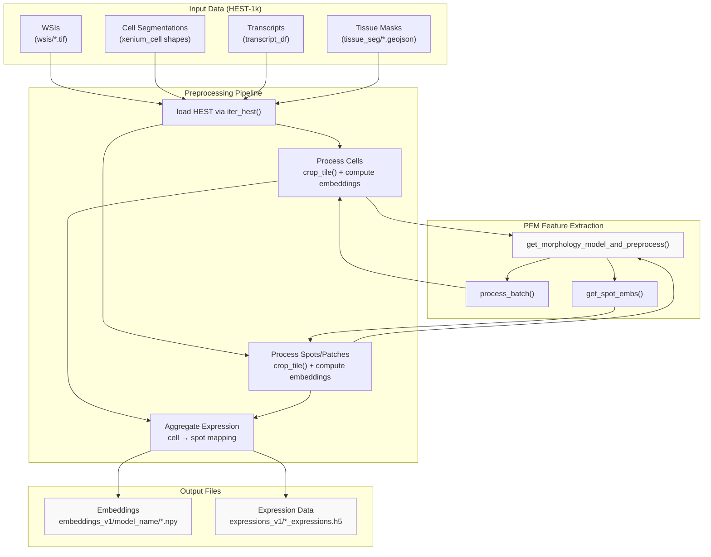
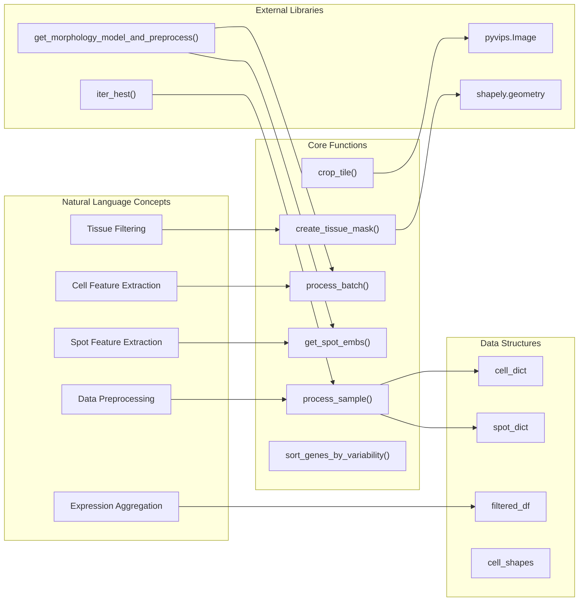

# Tutorial 1: Data Preprocessing

<details>
<summary>Relevant source files</summary>

The following files were used as context for generating this wiki page:

- [configs/dataset.example.yaml](configs/dataset.example.yaml)
- [deepspot2cell/dataset_creation.py](deepspot2cell/dataset_creation.py)
- [tutorials/GettingStartedWithDeepSpot2Cell_1_preprocessing.ipynb](tutorials/GettingStartedWithDeepSpot2Cell_1_preprocessing.ipynb)

</details>


This tutorial guides you through the data preprocessing step of DeepSpot2Cell, which transforms raw HEST-1k spatial transcriptomics data into training-ready embeddings and expression files. Preprocessing is a one-time, computationally intensive operation that extracts morphological features from H&E images using Pathology Foundation Models (PFMs) and organizes the corresponding gene expression data.

For information about training models with preprocessed data, see [Tutorial 2: Model Training](#3.2). For details about the dataset creation implementation, see [Dataset Creation](#5.1).

---

## Overview

The preprocessing pipeline performs the following operations:

1. **Load HEST data**: Read whole slide images (WSIs), cell segmentations, and transcript data
2. **Extract image tiles**: Generate cell tiles, spot tiles, and neighbor tiles from WSIs
3. **Compute morphological embeddings**: Process tiles through a PFM to extract features
4. **Aggregate gene expression**: Compute spot-level and cell-level expression vectors
5. **Save outputs**: Store embeddings as `.npy` files and expression data as `.h5` files



**Sources:** [deepspot2cell/dataset_creation.py:1-536](), [tutorials/GettingStartedWithDeepSpot2Cell_1_preprocessing.ipynb:1-131]()

---

## Prerequisites

Before running preprocessing, ensure you have:

1. **HEST-1k dataset**: Downloaded and organized with the expected structure (see [HEST-1k Dataset](#10.1))
2. **PFM weights**: Downloaded model weights for your chosen PFM (see [Pathology Foundation Models](#10.2))
3. **Environment setup**: Installed DeepSpot2Cell and dependencies (see [Installation and Setup](#2.1))
4. **GPU resources**: Recommended for efficient processing (CPU fallback available)

**Sources:** [deepspot2cell/dataset_creation.py:514-524]()

---

## Quick Start: Jupyter Notebook

The fastest way to get started is using the provided notebook:

```python
import os
os.chdir('../')

from deepspot2cell.dataset_creation import process_sample
from deepspot2cell.utils.utils_image import get_morphology_model_and_preprocess
from hest import iter_hest
import torch

# Configuration
dataset_variant = "_v1"
data_folder = "hest_data"
model_name = "phikonv2"
model_path = "/path/to/phikonv2"
samples_to_process = ["NCBI864", "NCBI873"]
batch_size = 32

config = {
    'data': {
        'data_folder': data_folder,
        'dataset_variant': dataset_variant,
        'spot_diameter_px': 160,
        'patch_size_px': 224,
        'qv_thr': 20
    },
    'dataset': 'lung'
}

# Load PFM
device = torch.device('cuda' if torch.cuda.is_available() else 'cpu')
model, preprocess, _ = get_morphology_model_and_preprocess(
    model_name, device.type, model_path=model_path
)

# Create output directories
os.makedirs(f'{data_folder}/embeddings{dataset_variant}/{model_name}', exist_ok=True)
os.makedirs(f'{data_folder}/expressions{dataset_variant}', exist_ok=True)

# Process samples
for i, st in enumerate(iter_hest(data_folder, id_list=samples_to_process, load_transcripts=True)):
    sample_id = samples_to_process[i]
    process_sample(sample_id, st, model, preprocess, device, batch_size, config)
```

**Sources:** [tutorials/GettingStartedWithDeepSpot2Cell_1_preprocessing.ipynb:17-68]()

---

## Command-Line Usage

For production use with large datasets, use the command-line script:

```bash
python -m deepspot2cell.dataset_creation \
    --config configs/dataset.example.yaml \
    --dataset lung \
    --indices 0 1 2
```

### Command-Line Arguments

| Argument | Type | Default | Description |
|----------|------|---------|-------------|
| `--config` | `str` | `configs/dataset.example.yaml` | Path to YAML configuration file |
| `--dataset` | `str` | `lung` | Dataset name (must match key in config file) |
| `--indices` | `int[]` | All samples | Specific sample indices to process |

**Sources:** [deepspot2cell/dataset_creation.py:495-511]()

---

## Configuration File

Create a YAML configuration file (e.g., `configs/dataset.example.yaml`):

```yaml
data:
  data_folder: /absolute/path/to/hest_data
  dataset_variant: _v1
  model_name: phikonv2
  model_path: /absolute/path/to/phikonv2
  
  # Spatial dimensions (use either pixel-based or micron-based)
  spot_diameter_px: 160
  patch_size_px: 224
  # spot_diameter: 55.0
  # patch_size: 110.0
  
  qv_thr: 20
  
  lung:
    ordered_genes_file: lung_ordered_genes.json
    train:
      dataset_ids:
        - SAMPLE_ID_1
        - SAMPLE_ID_2
    ood:
      dataset_ids: []

processing:
  gpu_batch_size: 32
  cpu_batch_size: 8
```

### Configuration Parameters

| Parameter | Type | Description |
|-----------|------|-------------|
| `data_folder` | `str` | Absolute path to HEST data directory |
| `dataset_variant` | `str` | Version suffix for output directories (e.g., `_v1`) |
| `model_name` | `str` | PFM identifier (`phikonv2`, `uni`, `hoptimus0`) |
| `model_path` | `str` | Absolute path to PFM weights |
| `spot_diameter_px` | `int` | Spot diameter in pixels (typically 160) |
| `patch_size_px` | `int` | Patch size in pixels (typically 224) |
| `spot_diameter` | `float` | Alternative: spot diameter in microns (typically 55.0) |
| `patch_size` | `float` | Alternative: patch size in microns (typically 110.0) |
| `qv_thr` | `int` | Quality value threshold for transcript filtering |
| `ordered_genes_file` | `str` | Gene ordering file (generated if missing) |
| `dataset_ids` | `list[str]` | Sample IDs to process |
| `gpu_batch_size` | `int` | Batch size for GPU processing |
| `cpu_batch_size` | `int` | Batch size for CPU processing |

**Sources:** [configs/dataset.example.yaml:1-27](), [deepspot2cell/dataset_creation.py:165-183]()

---

## Preprocessing Pipeline Details

The `process_sample()` function orchestrates the entire preprocessing workflow. Here's a detailed breakdown:

```mermaid
graph TB
    START["process_sample(sample_id, st, model, preprocess, device, batch_size, config)"]
    
    subgraph "Step 1: Load Metadata and Configuration"
        META["Load metadata.json"]
        PIXEL["Calculate pixel size (um_per_px)"]
        DIMS["Compute spot_diameter and patch_size in pixels"]
        GENES["sort_genes_by_variability()"]
    end
    
    subgraph "Step 2: Load Tissue and Cell Data"
        TISSUE_LOAD["Load tissue_seg/*.geojson"]
        TISSUE_MASK["create_tissue_mask()"]
        CELL_SHAPES["Load st.get_shapes('xenium_cell')"]
        TRANSCRIPTS["Filter transcript_df by qv > qv_thr"]
    end
    
    subgraph "Step 3: Process Cells"
        CELL_LOOP["Loop over filtered_df.groupby('cell_id')"]
        CELL_EXPR["Aggregate gene_expression per cell"]
        CELL_GEOM["Get cell_shape, centroid, bounds"]
        CELL_FILTER["Filter: inside tissue, valid geometry"]
        CELL_CROP["crop_tile() - extract cell image"]
        CELL_BATCH["Batch cells for PFM inference"]
        CELL_EMB["process_batch() - compute embeddings"]
        CELL_DICT["Store in cell_dict"]
    end
    
    subgraph "Step 4: Process Patches/Spots"
        PATCH_LOOP["Loop over patch grid (h_idx, w_idx)"]
        PATCH_FILTER["Filter: patch centroid inside tissue"]
        PATCH_CROP["crop_tile() - extract patch image"]
        NEARBY["Find nearby_cells within search_radius"]
        SPOT_CIRCLE["Create circular spot (55μm radius)"]
        CELL_ASSIGN["Tag cells: '_in' if ≥60% inside spot, '_out' otherwise"]
        SPOT_EXPR["Aggregate spot_expression from '_in' cells"]
        SPOT_EMB["get_spot_embs() - compute spot embedding"]
    end
    
    subgraph "Step 5: Save Outputs"
        SAVE_NPY["Save embeddings to *.npy:<br/>[spot_emb, cell1_emb, cell2_emb, ...]"]
        SAVE_H5["Save expressions to *.h5:<br/>spot_expression, cell_expressions, cell_ids, cell_centroids, cell_bbxs"]
    end
    
    START --> META
    META --> PIXEL
    PIXEL --> DIMS
    DIMS --> GENES
    
    GENES --> TISSUE_LOAD
    TISSUE_LOAD --> TISSUE_MASK
    TISSUE_MASK --> CELL_SHAPES
    CELL_SHAPES --> TRANSCRIPTS
    
    TRANSCRIPTS --> CELL_LOOP
    CELL_LOOP --> CELL_EXPR
    CELL_EXPR --> CELL_GEOM
    CELL_GEOM --> CELL_FILTER
    CELL_FILTER --> CELL_CROP
    CELL_CROP --> CELL_BATCH
    CELL_BATCH --> CELL_EMB
    CELL_EMB --> CELL_DICT
    
    CELL_DICT --> PATCH_LOOP
    PATCH_LOOP --> PATCH_FILTER
    PATCH_FILTER --> PATCH_CROP
    PATCH_CROP --> NEARBY
    NEARBY --> SPOT_CIRCLE
    SPOT_CIRCLE --> CELL_ASSIGN
    CELL_ASSIGN --> SPOT_EXPR
    SPOT_EXPR --> SPOT_EMB
    
    SPOT_EMB --> SAVE_NPY
    SPOT_EXPR --> SAVE_H5
```



**Sources:** [deepspot2cell/dataset_creation.py:165-491]()

### Step 1: Metadata and Gene Ordering

The pipeline begins by loading sample metadata and determining spatial dimensions:

- **Pixel size calculation**: Reads `pixel_size_um_estimated` from metadata (default: 0.2125 μm/px)
- **Dimension conversion**: Converts `spot_diameter` and `patch_size` from pixels or microns to pixels
- **Gene ordering**: Loads or generates `ordered_genes_file` using `sort_genes_by_variability()`

**Sources:** [deepspot2cell/dataset_creation.py:165-186]()

### Step 2: Tissue Mask and Transcript Filtering

The pipeline loads spatial annotations and filters low-quality data:

- **Tissue mask creation**: Parses `tissue_seg/*.geojson` using `create_tissue_mask()` with robust geometry error handling
- **Cell shape loading**: Retrieves cell segmentations from `st.get_shapes('xenium_cell', 'he')`
- **Transcript filtering**: Filters `transcript_df` by `qv > qv_thr` and excludes `UNASSIGNED` or `-1` cell IDs

**Sources:** [deepspot2cell/dataset_creation.py:188-226]()

### Step 3: Cell Processing

The pipeline processes each cell to extract morphological embeddings:

1. **Group transcripts by cell**: `filtered_df.groupby('cell_id')`
2. **Compute gene expression**: Aggregate transcript counts into `gene_expression` vector
3. **Get cell geometry**: Extract `cell_shape`, `centroid`, `bounds` from segmentation
4. **Spatial filtering**: Skip cells outside `tissue_mask` or with invalid geometry
5. **Image extraction**: Use `crop_tile()` to extract square cell image from WSI
6. **Batch processing**: Accumulate cells into batches of size `batch_size`
7. **Embedding computation**: Call `process_batch()` to run PFM inference
8. **Storage**: Store results in `cell_dict[f"{sample_id}_{cell_id}"]`

**Sources:** [deepspot2cell/dataset_creation.py:227-327]()

### Step 4: Patch/Spot Processing

The pipeline divides the WSI into a regular grid and processes each patch:

1. **Grid generation**: Divide WSI into `num_patches_h × num_patches_w` patches
2. **Spatial filtering**: Skip patches whose centroid is outside `tissue_mask`
3. **Nearby cell search**: Find cells within `search_radius = patch_size` of patch center
4. **Image extraction**: Use `crop_tile()` to extract patch image
5. **Spot definition**: Create circular spot with radius `spot_diameter // 2` centered on patch
6. **Cell-spot assignment**: Tag cells as `_in` if ≥60% of cell area is inside spot, else `_out`
7. **Expression aggregation**: Sum `cell_expression` from all `_in` cells to get `spot_expression`
8. **Embedding computation**: Call `get_spot_embs()` to extract spot-level embedding
9. **Coordinate normalization**: Normalize cell centroids and bboxes to `[0, 1]` relative to patch

**Sources:** [deepspot2cell/dataset_creation.py:331-468]()

### Step 5: Output Saving

The pipeline saves two types of output files:

1. **Embeddings (`.npy`)**: Each patch gets one file at `embeddings{dataset_variant}/{model_name}/{patch_barcode}.npy`
   - Structure: `[spot_embedding, cell1_embedding, cell2_embedding, ...]` (stacked as float16)
   
2. **Expression data (`.h5`)**: Each sample gets one HDF5 file at `expressions{dataset_variant}/{sample_id}_expressions.h5`
   - Groups: One group per patch (keyed by `patch_barcode`)
   - Datasets per group:
     - `spot_expression`: Spot-level gene expression vector
     - `cell_expressions`: Array of cell-level gene expression vectors
     - `cell_ids`: Cell IDs (tagged with `_in` or `_out`)
     - `cell_centroids`: Normalized cell centroids `(x, y)`
     - `cell_bbxs`: Normalized cell bounding boxes `(minx, miny, maxx, maxy)`
   - Attributes: `spot_diameter`, `patch_size`, `um_per_px`

**Sources:** [deepspot2cell/dataset_creation.py:458-488]()

---

## Code Entity Mapping

Understanding the relationship between natural language concepts and code functions:



**Sources:** [deepspot2cell/dataset_creation.py:1-536]()

---

## Understanding Key Functions

### `process_sample()`

Main orchestration function that processes a single HEST sample.

**Signature:** `process_sample(sample_id, st, model, preprocess, device, batch_size, config)`

**Parameters:**
- `sample_id` (str): Sample identifier (e.g., "NCBI864")
- `st` (STObject): HEST spatial transcriptomics object
- `model` (torch.nn.Module): PFM model
- `preprocess` (callable): PFM preprocessing function
- `device` (torch.device): Computation device
- `batch_size` (int): Batch size for PFM inference
- `config` (dict): Configuration dictionary

**Output files:**
- `embeddings{dataset_variant}/{model_name}/patch_{h}_{w}_{sample_id}.npy`
- `expressions{dataset_variant}/{sample_id}_expressions.h5`

**Sources:** [deepspot2cell/dataset_creation.py:165-491]()

### `crop_tile()`

Extracts a square image tile from a WSI using PyVips.

**Signature:** `crop_tile(image, x_pixel, y_pixel, spot_diameter)`

**Parameters:**
- `image` (pyvips.Image): Input WSI
- `x_pixel` (int/float): Top-left x coordinate
- `y_pixel` (int/float): Top-left y coordinate  
- `spot_diameter` (int): Tile size (width and height)

**Returns:** `np.ndarray` with shape `[height, width, 3]` (RGB)

**Sources:** [deepspot2cell/dataset_creation.py:87-93]()

### `process_batch()`

Processes a batch of image patches through the PFM.

**Signature:** `process_batch(batch_patches, model, preprocess, device)`

**Parameters:**
- `batch_patches` (list[np.ndarray]): List of image patches
- `model` (torch.nn.Module): PFM model
- `preprocess` (callable): Preprocessing function
- `device` (torch.device): Computation device

**Returns:** `torch.Tensor` of embeddings (CPU, detached)

**Implementation details:**
- Resizes non-square patches to square
- Uses `torch.autocast` with float16 on CUDA for efficiency
- Returns embeddings on CPU to free GPU memory

**Sources:** [deepspot2cell/dataset_creation.py:23-40]()

### `get_spot_embs()`

Computes embedding for a single spot/patch image.

**Signature:** `get_spot_embs(X_spot, morphology_model, preprocess, device, dtype_to_use=torch.float16)`

**Parameters:**
- `X_spot` (np.ndarray): Spot image
- `morphology_model` (torch.nn.Module): PFM model
- `preprocess` (callable): Preprocessing function
- `device` (torch.device): Computation device
- `dtype_to_use` (torch.dtype): Data type for inference

**Returns:** `np.ndarray` embedding (CPU, numpy)

**Sources:** [deepspot2cell/dataset_creation.py:43-58]()

### `create_tissue_mask()`

Creates a unified tissue mask from GeoJSON with robust error handling.

**Signature:** `create_tissue_mask(tissue_mask_json, sample_id)`

**Parameters:**
- `tissue_mask_json` (dict): Parsed GeoJSON tissue annotation
- `sample_id` (str): Sample identifier for logging

**Returns:** `shapely.geometry.Polygon` or `None` if no valid polygons

**Error handling:**
- Attempts `buffer(0)` to fix invalid geometries
- Falls back to iterative union if `unary_union()` fails
- Logs warnings for invalid polygons

**Sources:** [deepspot2cell/dataset_creation.py:113-162]()

---

## Output File Formats

### Embeddings (.npy)

Each `.npy` file stores embeddings for one patch and its associated cells.

**File path:** `{data_folder}/embeddings{dataset_variant}/{model_name}/{patch_barcode}.npy`

**Structure:**
```
[
    spot_embedding,      # Shape: (feature_dim,)
    cell_1_embedding,    # Shape: (feature_dim,)
    cell_2_embedding,    # Shape: (feature_dim,)
    ...
]
```

**Data type:** `np.float16` (to reduce disk usage)

**Example patch barcode:** `patch_15_23_NCBI864`

**Sources:** [deepspot2cell/dataset_creation.py:458-468]()

### Expressions (.h5)

Each `.h5` file stores expression and metadata for all patches in one sample.

**File path:** `{data_folder}/expressions{dataset_variant}/{sample_id}_expressions.h5`

**Structure:**
```
sample_id_expressions.h5
├── patch_0_0_sample_id/
│   ├── spot_expression         # Dataset: (n_genes,)
│   ├── cell_expressions        # Dataset: (n_cells, n_genes)
│   ├── cell_ids               # Dataset: (n_cells,) strings
│   ├── cell_centroids         # Dataset: (n_cells, 2) float32
│   ├── cell_bbxs              # Dataset: (n_cells, 4) float32
│   └── Attributes:
│       ├── spot_diameter
│       ├── patch_size
│       └── um_per_px
├── patch_0_1_sample_id/
│   └── ...
└── ...
```

**Cell IDs format:** `{sample_id}_{cell_id}_in` or `{sample_id}_{cell_id}_out`
- `_in`: Cell has ≥60% area inside spot
- `_out`: Cell is nearby but <60% inside spot

**Coordinate normalization:** All coordinates are normalized to [0, 1] relative to patch size

**Sources:** [deepspot2cell/dataset_creation.py:474-487]()

---

## Performance Considerations

### Memory Management

The pipeline uses several strategies to manage memory efficiently:

1. **Batch processing**: Processes cells and patches in batches to limit GPU memory
2. **Embedding cleanup**: Deletes cell embeddings from `cell_dict` after saving to `.npy`
3. **Garbage collection**: Calls `gc.collect()` after processing each sample
4. **Float16 precision**: Uses `torch.float16` on CUDA to reduce memory footprint
5. **Autocast**: Leverages `torch.autocast` for mixed precision inference

**Sources:** [deepspot2cell/dataset_creation.py:308-316, 465-466, 490-491]()

### Batch Size Selection

The script automatically selects batch size based on available hardware:

| Hardware | Auto Batch Size | Rationale |
|----------|----------------|-----------|
| GPU (>13 GB VRAM) | `int(VRAM_GB * 32 / 14)` | Scales with available VRAM |
| GPU (<13 GB VRAM) | 16 | Conservative default |
| CPU | 8 | Smaller batches for CPU efficiency |

You can override this by setting `gpu_batch_size` or `cpu_batch_size` in the config.

**Sources:** [deepspot2cell/dataset_creation.py:514-524]()

### Progress Monitoring

The script prints progress updates:

- **Cell processing**: Every 10,000 cells with ETA calculation
- **Patch processing**: Every 1,000 patches with ETA calculation
- **Filtering statistics**: Reports cells/patches inside tissue vs. total

**Sources:** [deepspot2cell/dataset_creation.py:234-246, 344-349]()

---

## Troubleshooting

### Common Issues

| Issue | Cause | Solution |
|-------|-------|----------|
| "Already processed, skipping" | Output file exists | Delete existing `.h5` file or change `dataset_variant` |
| Invalid geometry warnings | Corrupted segmentation polygons | Script auto-fixes with `buffer(0)`, check logs for extent |
| CUDA out of memory | Batch size too large | Reduce `gpu_batch_size` in config |
| Missing ordered genes file | First run for dataset | Script auto-generates, ensure write permissions |
| Zero cells inside tissue | Tissue mask issues | Check `tissue_seg/*.geojson` quality |

### Verifying Outputs

After preprocessing, verify outputs:

```python
import h5py
import numpy as np

# Check expression file
with h5py.File('hest_data/expressions_v1/NCBI864_expressions.h5', 'r') as f:
    print(f"Patches: {len(f.keys())}")
    patch = f['patch_0_0_NCBI864']
    print(f"Spot expression shape: {patch['spot_expression'].shape}")
    print(f"Cell expressions shape: {patch['cell_expressions'].shape}")
    print(f"Attributes: {dict(patch.attrs)}")

# Check embedding file
emb = np.load('hest_data/embeddings_v1/phikonv2/patch_0_0_NCBI864.npy')
print(f"Embedding file shape: {emb.shape}")  # (1 + n_cells, feature_dim)
```

**Sources:** [deepspot2cell/dataset_creation.py:474-487]()

---

## Next Steps

After preprocessing is complete, you can:

1. **Inspect outputs**: Verify `.npy` and `.h5` files are created correctly
2. **Configure training**: Edit `configs/training.example.yaml` to reference preprocessed data
3. **Train models**: Proceed to [Tutorial 2: Model Training](#3.2)

For advanced preprocessing customization, see [Dataset Creation](#5.1) and [Data Preprocessing and Normalization](#5.2).

---