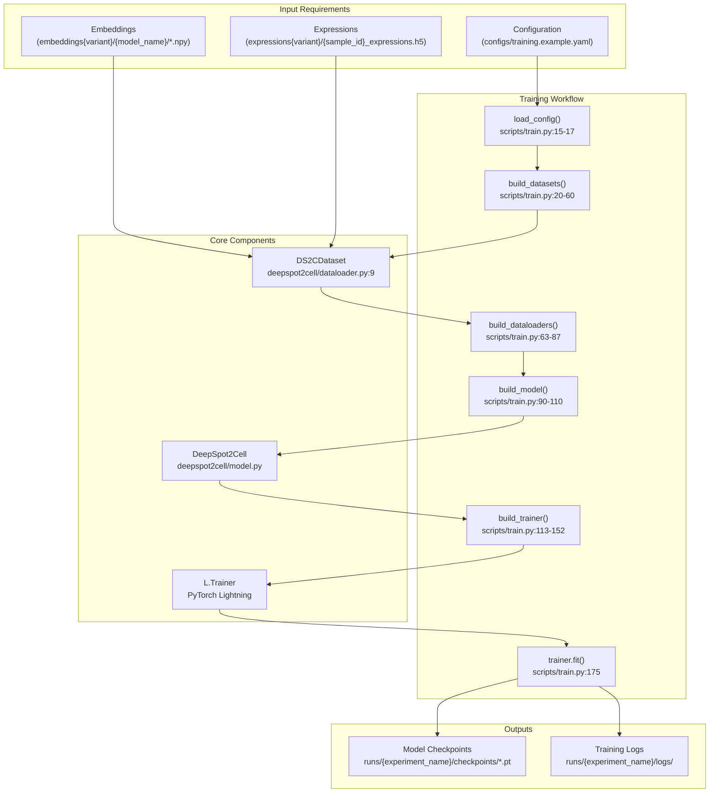
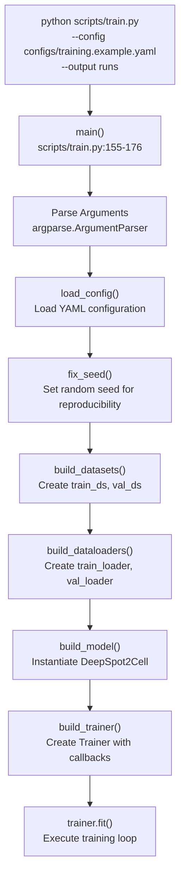
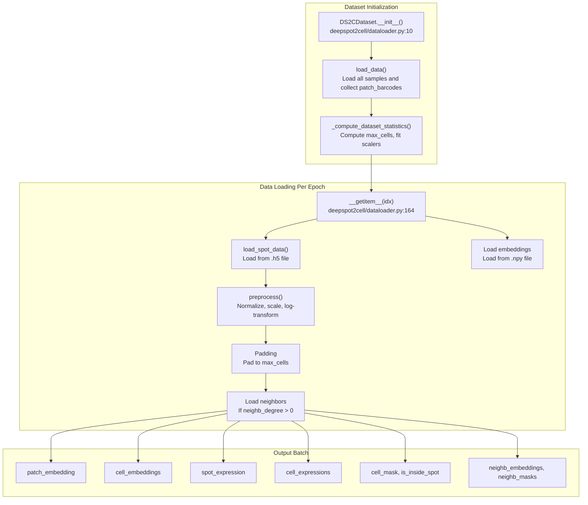
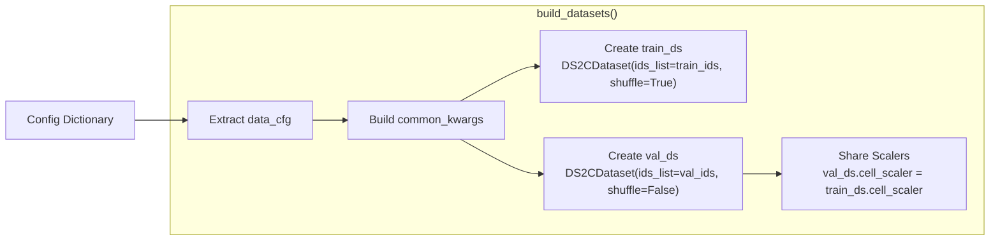
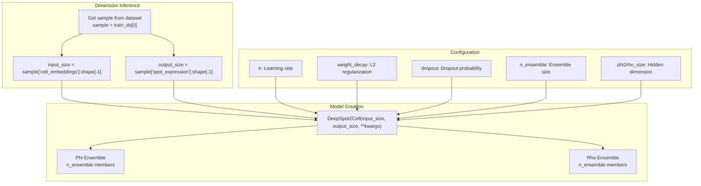
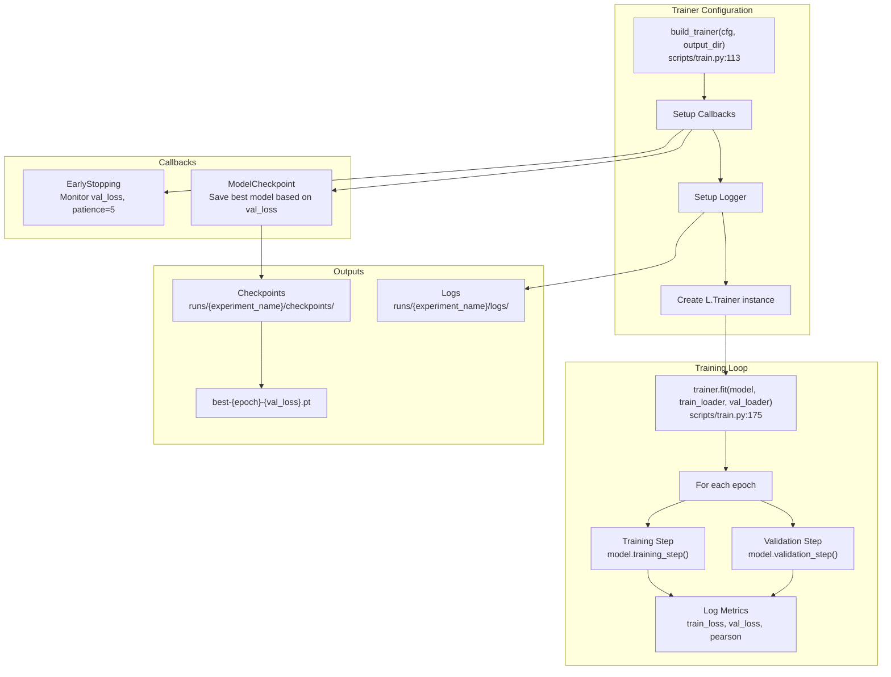
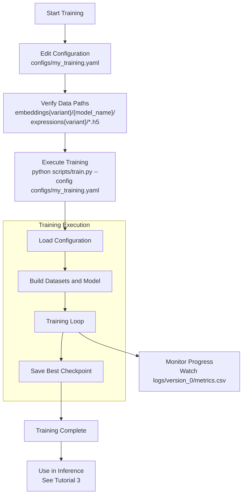

# Tutorial 2: Model Training

<details>
<summary>Relevant source files</summary>

The following files were used as context for generating this wiki page:

- [configs/training.example.yaml](configs/training.example.yaml)
- [deepspot2cell/dataloader.py](deepspot2cell/dataloader.py)
- [scripts/train.py](scripts/train.py)
- [tutorials/GettingStartedWithDeepSpot2Cell_2_training.ipynb](tutorials/GettingStartedWithDeepSpot2Cell_2_training.ipynb)

</details>


This tutorial guides you through training a DeepSpot2Cell model on preprocessed spatial transcriptomics data. After completing this tutorial, you will have a trained model checkpoint ready for cell-level gene expression prediction.

**Prerequisites**: Complete [Tutorial 1: Data Preprocessing](#3.1) to generate the required embeddings and expression files. For detailed information about the model architecture, see [DeepSpot2Cell Model Architecture](#4.1). For complete configuration reference, see [Training Configuration](#6.2).

---

## Overview

Training involves three main steps:
1. **Configuration**: Define training parameters via YAML configuration files
2. **Dataset Loading**: Load preprocessed embeddings and expressions using `DS2CDataset`
3. **Training Execution**: Train the model using PyTorch Lightning's `Trainer`

The system supports two training workflows: interactive Jupyter notebooks for experimentation and command-line scripts for production training.



**Sources**: [scripts/train.py](), [deepspot2cell/dataloader.py](), [configs/training.example.yaml]()

---

## Training Approaches

### Notebook-Based Training

The interactive notebook approach is ideal for experimentation and visualization.

```mermaid
graph LR
    NOTEBOOK["Tutorial Notebook<br/>tutorials/GettingStartedWithDeepSpot2Cell_2_training.ipynb"]
    
    subgraph "Cell 1: Setup and Dataset"
        IMPORTS["Import Libraries<br/>torch, lightning, DS2CDataset, DeepSpot2Cell"]
        PARAMS["Define Parameters<br/>batch_size, max_epochs, train_ids, val_ids"]
        CREATE_DS["Create DS2CDataset instances<br/>train_dataset, val_dataset"]
        CREATE_DL["Create DataLoader instances<br/>train_loader, val_loader"]
    end
    
    subgraph "Cell 2: Model and Training"
        INFER_SIZE["Infer Dimensions<br/>input_size, output_size"]
        CREATE_MODEL["Instantiate DeepSpot2Cell<br/>model = DeepSpot2Cell(...)"]
        CREATE_TRAINER["Create L.Trainer<br/>trainer = L.Trainer(...)"]
        TRAIN["Execute Training<br/>trainer.fit(model, train_loader, val_loader)"]
    end
    
    subgraph "Cell 3: Save and Evaluate"
        SAVE["Save Model Weights<br/>torch.save(model.state_dict(), path)"]
        METRICS["Display Metrics<br/>trainer.logged_metrics"]
    end
    
    NOTEBOOK --> IMPORTS
    IMPORTS --> PARAMS
    PARAMS --> CREATE_DS
    CREATE_DS --> CREATE_DL
    CREATE_DL --> INFER_SIZE
    INFER_SIZE --> CREATE_MODEL
    CREATE_MODEL --> CREATE_TRAINER
    CREATE_TRAINER --> TRAIN
    TRAIN --> SAVE
    TRAIN --> METRICS
```



**Sources**: [tutorials/GettingStartedWithDeepSpot2Cell_2_training.ipynb:1-145]()

### Script-Based Training

The command-line script approach is recommended for production training and hyperparameter sweeps.



**Sources**: [scripts/train.py:155-179]()

---

## Configuration Setup

Training configuration is managed through YAML files. Create a configuration file based on the provided example.

### Configuration Structure

The configuration file has five main sections:

| Section | Purpose | Key Parameters |
|---------|---------|----------------|
| `experiment` | Experiment metadata | `name`, `random_seed` |
| `data` | Dataset paths and preprocessing | `data_folder`, `train_ids`, `val_ids`, `normalize`, `neighb_degree` |
| `dataloader` | DataLoader settings | `batch_size`, `num_workers` |
| `model` | Model hyperparameters | `lr`, `weight_decay`, `dropout`, `n_ensemble` |
| `trainer` | Training loop settings | `max_epochs`, `accelerator`, `early_stopping` |

**Sources**: [configs/training.example.yaml:1-54]()

### Example Configuration

```yaml
experiment:
  name: ds2c_baseline
  random_seed: 2024

data:
  data_folder: /absolute/path/to/data_root
  dataset_variant: _v1
  model_name: phikonv2
  
  train_ids:
    - SAMPLE_ID_1
    - SAMPLE_ID_2
  val_ids:
    - SAMPLE_ID_VAL
  
  normalize: true
  standard_scaling: false
  minmax: false
  norm_counts: 10000
  neighb_degree: 1

dataloader:
  batch_size: 4
  num_workers: 4

model:
  lr: 1.0e-4
  weight_decay: 1.0e-6
  dropout: 0.3
  n_ensemble: 8
  phi2rho_size: 512
  cell_gt_available: true

trainer:
  max_epochs: 50
  accelerator: auto
  devices: 1
  precision: 32
  log_every_n_steps: 50
  
  early_stopping:
    enabled: true
    monitor: val_loss
    patience: 5
    mode: min
```

**Sources**: [configs/training.example.yaml:1-54]()

### Critical Configuration Parameters

#### Data Parameters

- **`data_folder`**: Absolute path to preprocessed data root directory containing `embeddings{variant}/` and `expressions{variant}/` subdirectories
- **`dataset_variant`**: Suffix for data directories (e.g., `_v1`, `_test`)
- **`model_name`**: PFM model name matching preprocessing (e.g., `phikonv2`, `uni`, `hoptimus0`)
- **`train_ids`**: List of sample IDs for training (e.g., `["NCBI864", "NCBI873"]`)
- **`val_ids`**: List of sample IDs for validation (optional but recommended)
- **`normalize`**: Apply log-normalization to expression data (recommended: `true`)
- **`neighb_degree`**: Number of neighboring spots to load (0=none, 1=8 neighbors, 2=24 neighbors)

#### Model Parameters

- **`n_ensemble`**: Number of ensemble members in both Phi and Rho (default: 8)
- **`phi2rho_size`**: Hidden dimension size between Phi and Rho modules (default: 512)
- **`dropout`**: Dropout probability applied to both Phi and Rho (default: 0.3)
- **`lr`**: Learning rate for Adam optimizer (default: 1e-4)
- **`cell_gt_available`**: Whether cell-level ground truth is available for loss computation (typically `true`)

**Sources**: [configs/training.example.yaml:5-38](), [scripts/train.py:20-33, 96-110]()

---

## Dataset Preparation

The `DS2CDataset` class handles loading preprocessed embeddings and expressions during training.



**Sources**: [deepspot2cell/dataloader.py:9-390]()

### Dataset Loading in Code

#### Notebook Approach

```python
from deepspot2cell import DS2CDataset

train_dataset = DS2CDataset(
    dataset_variant="_v1",
    ids_list=["NCBI864", "NCBI873"],
    data_path="hest_data",
    model_name="phikonv2",
    shuffle=True,
    normalize=True,
    neighb_degree=1,
)

val_dataset = DS2CDataset(
    dataset_variant="_v1",
    ids_list=["NCBI865"],
    data_path="hest_data",
    model_name="phikonv2",
    shuffle=False,
    normalize=True,
    neighb_degree=1,
)
```

**Sources**: [tutorials/GettingStartedWithDeepSpot2Cell_2_training.ipynb:38-55]()

#### Script Approach

The `build_datasets()` function constructs datasets from configuration:



**Sources**: [scripts/train.py:20-60]()

### Normalization and Scaling

The dataset applies preprocessing in `preprocess()`:

1. **Normalization**: Scale counts to `norm_counts` (default: 10,000) per spot/cell
2. **Log-transform**: Apply `log1p()` to normalized counts
3. **Standard scaling** (optional): Z-score normalization using `StandardScaler`
4. **Min-max scaling** (optional): Scale to [0, 1] range

Scalers are fit once during initialization and shared between train/val splits:

**Sources**: [deepspot2cell/dataloader.py:37-144, 280-319](), [scripts/train.py:46-58]()

---

## Model Instantiation

The `DeepSpot2Cell` model is instantiated with dimensions inferred from the dataset.



**Sources**: [scripts/train.py:90-110](), [tutorials/GettingStartedWithDeepSpot2Cell_2_training.ipynb:73-78]()

### Model Parameters

The model accepts the following key parameters:

| Parameter | Description | Default | Notes |
|-----------|-------------|---------|-------|
| `input_size` | Dimension of PFM embeddings | Inferred | Typically 1024 or 1536 |
| `output_size` | Number of genes to predict | Inferred | Typically 300-1000 |
| `lr` | Learning rate | 1e-4 | Adam optimizer |
| `weight_decay` | L2 regularization | 1e-6 | Applied to all weights |
| `p` | Global dropout probability | 0.3 | Applied if `p_phi`/`p_rho` not set |
| `p_phi` | Dropout for Phi ensemble | `p` | Can override global dropout |
| `p_rho` | Dropout for Rho ensemble | `p` | Can override global dropout |
| `n_ensemble` | Global ensemble size | 8 | Applied if `n_ensemble_phi`/`n_ensemble_rho` not set |
| `n_ensemble_phi` | Phi ensemble size | `n_ensemble` | Can override global size |
| `n_ensemble_rho` | Rho ensemble size | `n_ensemble` | Can override global size |
| `phi2rho_size` | Hidden dimension | 512 | Size between Phi and Rho |
| `cell_gt_available` | Cell ground truth available | `true` | Affects loss computation |

**Sources**: [configs/training.example.yaml:28-38](), [scripts/train.py:96-110]()

---

## Training Execution

Training is executed using PyTorch Lightning's `Trainer` class with callbacks for checkpointing and early stopping.



**Sources**: [scripts/train.py:113-152, 175]()

### Trainer Setup

The `build_trainer()` function configures the trainer with callbacks:

#### Early Stopping Configuration

```yaml
early_stopping:
  enabled: true
  monitor: val_loss        # Metric to monitor
  patience: 5              # Epochs to wait before stopping
  mode: min                # 'min' for loss, 'max' for accuracy
  min_delta: 0.001         # Minimum change to qualify as improvement
```

#### Checkpoint Configuration

Checkpoints are automatically saved for the best model based on `monitor` metric. The filename format is `best-{epoch}-{val_loss:.4f}.pt`.

**Sources**: [configs/training.example.yaml:48-53](), [scripts/train.py:117-138]()

### Training Metrics

During training, the following metrics are logged:

| Metric | Description | Computed In |
|--------|-------------|-------------|
| `train_loss` | Training MSE loss | `DeepSpot2Cell.training_step()` |
| `train_pearson` | Training Pearson correlation | `DeepSpot2Cell.training_step()` |
| `val_loss` | Validation MSE loss | `DeepSpot2Cell.validation_step()` |
| `val_pearson` | Validation Pearson correlation | `DeepSpot2Cell.validation_step()` |

For detailed loss function implementation, see [Loss Functions](#4.3).

**Sources**: [scripts/train.py:140-152]()

---

## Command-Line Usage

### Basic Training

```bash
python scripts/train.py \
    --config configs/training.example.yaml \
    --output runs
```

This creates the following directory structure:

```
runs/
└── ds2c_baseline/              # experiment.name from config
    ├── checkpoints/
    │   └── best-epoch=42-val_loss=0.1234.pt
    └── logs/
        └── version_0/
            └── metrics.csv
```

### Custom Configuration

Create a custom configuration file:

```bash
cp configs/training.example.yaml configs/my_experiment.yaml
# Edit configs/my_experiment.yaml
python scripts/train.py --config configs/my_experiment.yaml
```

### Output Directory

The `--output` flag specifies where to save results:

```bash
python scripts/train.py \
    --config configs/training.example.yaml \
    --output /path/to/results
```

Results are organized as: `{output}/{experiment.name}/`

**Sources**: [scripts/train.py:155-176]()

---

## Monitoring Training Progress

### CSV Logs

Training metrics are saved to CSV files in the logs directory:

```
runs/{experiment_name}/logs/version_0/metrics.csv
```

The CSV contains columns: `epoch`, `step`, `train_loss`, `train_pearson`, `val_loss`, `val_pearson`

### Accessing Metrics in Notebooks

```python
# During training
trainer_logs = trainer.logged_metrics
for key, value in trainer_logs.items():
    if isinstance(value, torch.Tensor):
        print(f"{key}: {value.item()}")
    else:
        print(f"{key}: {value}")
```

**Sources**: [tutorials/GettingStartedWithDeepSpot2Cell_2_training.ipynb:110-120]()

### Loading Checkpoints

After training, load the best checkpoint:

```python
model = DeepSpot2Cell(input_size=input_size, output_size=output_size)
checkpoint_path = "runs/ds2c_baseline/checkpoints/best-epoch=42-val_loss=0.1234.pt"
model.load_state_dict(torch.load(checkpoint_path))
```

For using trained models for inference, see [Tutorial 3: Inference and Prediction](#3.3).

---

## Complete Training Example

### Script-Based Workflow



**Sources**: [scripts/train.py](), [configs/training.example.yaml]()

### Notebook-Based Workflow

```python
import torch
import lightning as L
from deepspot2cell import DS2CDataset, DeepSpot2Cell

# 1. Dataset Setup
train_dataset = DS2CDataset(
    dataset_variant="_v1",
    ids_list=["SAMPLE_1", "SAMPLE_2"],
    data_path="hest_data",
    model_name="phikonv2",
    shuffle=True,
    normalize=True,
    neighb_degree=1,
)

val_dataset = DS2CDataset(
    dataset_variant="_v1",
    ids_list=["SAMPLE_VAL"],
    data_path="hest_data",
    model_name="phikonv2",
    shuffle=False,
    normalize=True,
    neighb_degree=1,
)

# 2. DataLoaders
train_loader = torch.utils.data.DataLoader(
    train_dataset,
    batch_size=256,
    shuffle=True,
    num_workers=4,
    pin_memory=True
)

val_loader = torch.utils.data.DataLoader(
    val_dataset,
    batch_size=256,
    shuffle=False,
    num_workers=4,
    pin_memory=True
)

# 3. Model
sample_batch = next(iter(train_loader))
input_size = sample_batch['cell_embeddings'].shape[-1]
output_size = sample_batch['spot_expression'].shape[-1]

model = DeepSpot2Cell(
    input_size=input_size,
    output_size=output_size,
    lr=1e-4,
    weight_decay=1e-6,
    dropout=0.3,
    n_ensemble=8,
    phi2rho_size=512
)

# 4. Trainer
trainer = L.Trainer(
    max_epochs=50,
    accelerator='auto',
    devices=1,
    logger=True
)

# 5. Train
trainer.fit(model, train_loader, val_loader)

# 6. Save
torch.save(model.state_dict(), "results/final_model.pt")
```

**Sources**: [tutorials/GettingStartedWithDeepSpot2Cell_2_training.ipynb:18-121]()

---

## Troubleshooting

### Common Issues

#### Out of Memory (OOM)

**Symptom**: CUDA out of memory error during training

**Solutions**:
- Reduce `batch_size` in configuration
- Reduce `n_ensemble` (fewer ensemble members)
- Use `precision: 16` for mixed precision training
- Reduce number of genes in preprocessing

#### No Validation Samples

**Symptom**: Warning about empty validation set

**Solution**: Ensure `val_ids` is specified in configuration and corresponding data files exist.

#### Dimension Mismatch

**Symptom**: Shape mismatch errors during model initialization

**Cause**: Using different PFM models between preprocessing and training

**Solution**: Verify `model_name` in training config matches preprocessing:
- Check embedding files: `embeddings{variant}/{model_name}/`
- Verify PFM used in preprocessing (see [Tutorial 1](#3.1))

#### Slow Data Loading

**Symptom**: Training stalls waiting for data

**Solutions**:
- Increase `num_workers` in configuration
- Verify data is on fast storage (SSD)
- Check that `.h5` and `.npy` files are not corrupted

#### Loss Not Decreasing

**Symptom**: Training and validation losses remain high or increase

**Possible Causes and Solutions**:
- Learning rate too high: Reduce `lr` (try 1e-5)
- Learning rate too low: Increase `lr` (try 1e-3)
- Insufficient normalization: Verify `normalize: true` in configuration
- Wrong scaling: Try different combinations of `standard_scaling` and `minmax`

**Sources**: [configs/training.example.yaml](), [deepspot2cell/dataloader.py]()

---

## Next Steps

After completing training:

1. **Evaluate Model**: Review validation metrics in CSV logs
2. **Checkpoint Selection**: Identify best checkpoint based on `val_loss` or `val_pearson`
3. **Inference**: Use trained model for cell-level predictions (see [Tutorial 3: Inference and Prediction](#3.3))

For detailed model architecture information, see [DeepSpot2Cell Model Architecture](#4.1).

For advanced configuration options, see [Training Configuration](#6.2).

**Sources**: [tutorials/GettingStartedWithDeepSpot2Cell_2_training.ipynb](), [scripts/train.py]()

---