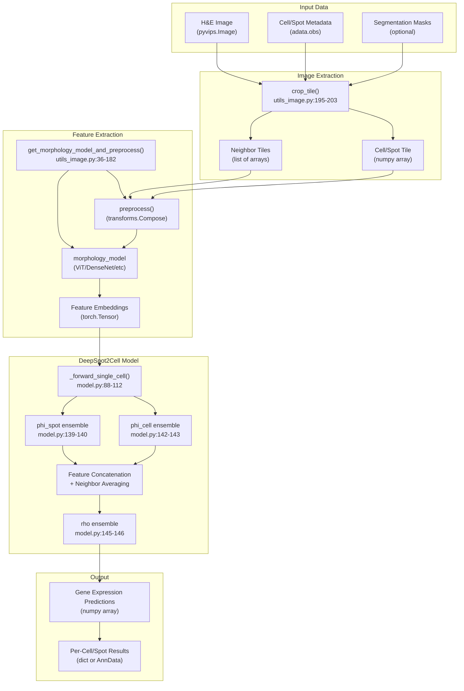
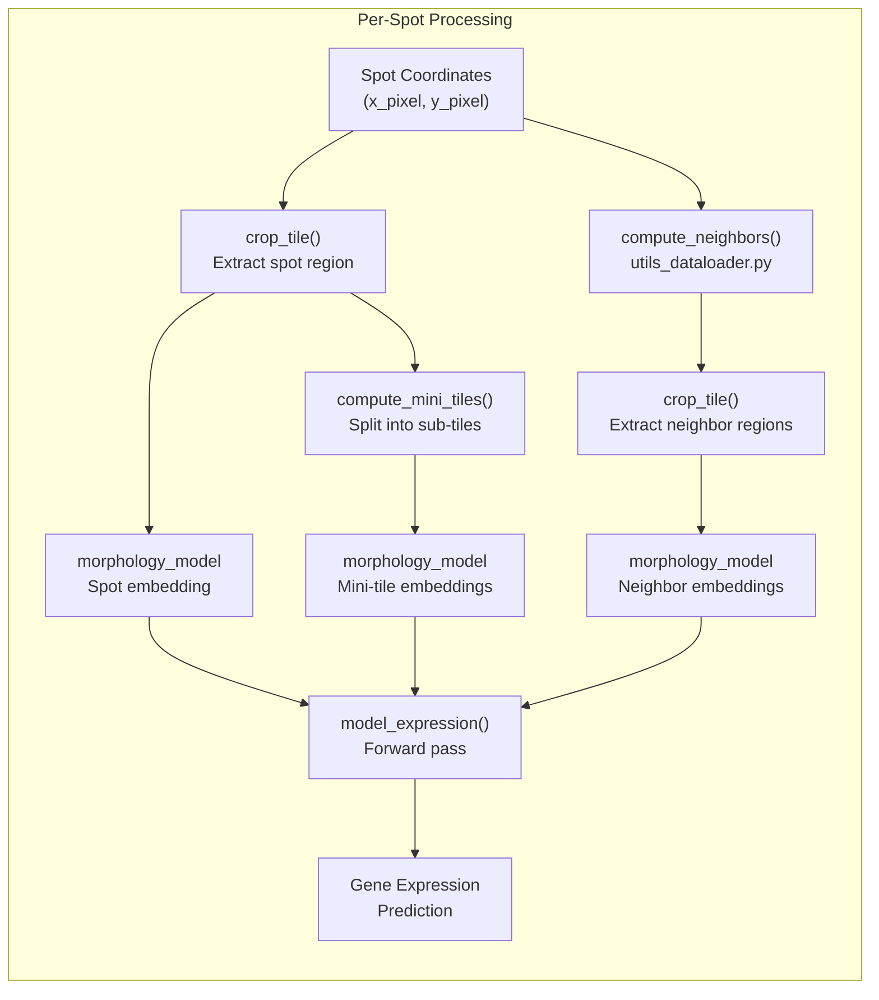
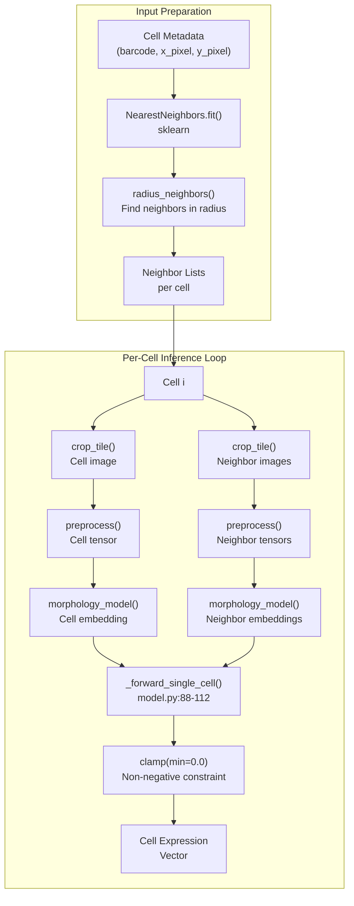
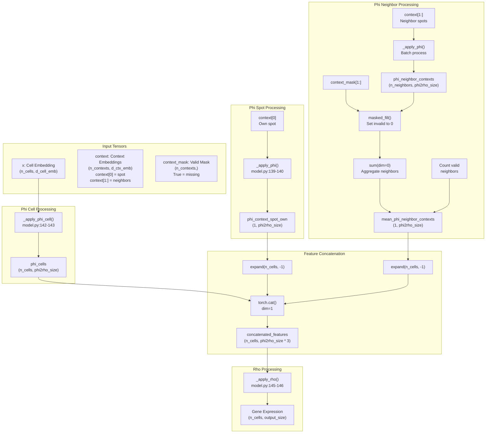

# Tutorial 3: Inference and Prediction

<details>
<summary>Relevant source files</summary>

The following files were used as context for generating this wiki page:

- [deepspot2cell/model.py](deepspot2cell/model.py)
- [deepspot2cell/utils/utils_image.py](deepspot2cell/utils/utils_image.py)
- [tutorials/GettingStartedWithDeepSpot2Cell_3_inference.ipynb](tutorials/GettingStartedWithDeepSpot2Cell_3_inference.ipynb)

</details>


## Purpose and Scope

This tutorial guides users through using trained DeepSpot2Cell models to predict cell-level gene expression from H&E histology images. After completing training (see [Tutorial 2: Model Training](#3.2)), this tutorial demonstrates how to apply the model to new images and generate virtual single-cell spatial transcriptomics data.

This page covers three inference workflows:
1. **Spot-level prediction** - Predicting aggregated expression for 55μm spots
2. **Cell-level prediction** - Predicting individual cell expression profiles  
3. **DeepSpot2Cell-specific inference** - Using the `_forward_single_cell` method directly

For information about preprocessing images before inference, see [Data Processing Pipeline](#5). For details on the model architecture, see [DeepSpot2Cell Model Architecture](#4.1).

---

## Prerequisites

Before running inference, ensure you have:
- A trained DeepSpot2Cell model checkpoint (`.pt` file) from [Tutorial 2](#3.2)
- A pathology foundation model (PFM) - same model used during training
- H&E histology images for inference
- Cell segmentation masks or spot coordinates (depending on inference mode)
- Python environment with DeepSpot2Cell installed (see [Installation and Setup](#2.1))

---

## Inference Architecture Overview

The following diagram illustrates how the trained model processes inputs during inference to generate cell-level predictions:



**Sources:** [deepspot2cell/model.py:88-112](), [deepspot2cell/utils/utils_image.py:36-182](), [deepspot2cell/utils/utils_image.py:195-203]()

---

## Loading a Trained Model

### Model Checkpoint Structure

A trained model checkpoint contains:
- Model weights for `phi_spot`, `phi_cell`, and `rho` ensembles
- Hyperparameters (input size, output size, ensemble counts, dropout rates)
- Training state (optimizer state, epoch number, loss history)

### Loading Process

```python
import torch
from deepspot2cell import DeepSpot2Cell

# Load the checkpoint
checkpoint_path = "path/to/model_checkpoint.pt"
checkpoint = torch.load(checkpoint_path, map_location='cuda:0')

# Extract hyperparameters
hparams = checkpoint['hyper_parameters']

# Instantiate the model
model = DeepSpot2Cell(
    input_size=hparams['input_size'],
    output_size=hparams['output_size'],
    n_ensemble=hparams.get('n_ensemble', 10),
    phi2rho_size=hparams.get('phi2rho_size', 512),
    p=hparams.get('p', 0.3)
)

# Load weights
model.load_state_dict(checkpoint['state_dict'])
model.eval()  # Set to evaluation mode
model = model.to('cuda:0')
```

**Sources:** [deepspot2cell/model.py:43-82]()

---

## Inference Workflows

### Workflow 1: Spot-Level Prediction

The `predict_spot_spatial_transcriptomics_from_image_path` function predicts gene expression for 55μm spots from whole-slide images.

#### Input Requirements

| Parameter | Type | Description |
|-----------|------|-------------|
| `image_path` | str | Path to H&E whole-slide image file |
| `adata` | AnnData | Contains spot coordinates in `obs` (columns: `barcode`, `x_pixel`, `y_pixel`) |
| `spot_diameter` | int | Spot diameter in pixels (e.g., 224 for 55μm at 0.5μm/pixel) |
| `n_mini_tiles` | int | Number of sub-tiles for multi-scale processing (e.g., 4 or 9) |
| `preprocess` | function | PFM preprocessing function |
| `morphology_model` | torch.nn.Module | Pre-trained PFM |
| `model_expression` | DeepSpot2Cell | Trained DeepSpot2Cell model |
| `device` | str | Computation device ('cuda' or 'cpu') |
| `neighbor_radius` | int | Number of neighboring spots to include (default: 1) |

#### Processing Flow



#### Example Usage

```python
from deepspot2cell.utils.utils_image import (
    predict_spot_spatial_transcriptomics_from_image_path,
    get_morphology_model_and_preprocess
)
import scanpy as sc

# Load metadata with spot coordinates
adata = sc.read_h5ad("spot_metadata.h5ad")

# Load PFM
morphology_model, preprocess, feature_dim = get_morphology_model_and_preprocess(
    model_name="phikonv2",
    device="cuda:0",
    model_path="/path/to/phikonv2"
)

# Load trained model (see previous section)
# model = ... (loaded DeepSpot2Cell model)

# Run inference
predictions = predict_spot_spatial_transcriptomics_from_image_path(
    image_path="/path/to/wsi.tif",
    adata=adata,
    spot_diameter=224,
    n_mini_tiles=9,
    preprocess=preprocess,
    morphology_model=morphology_model,
    model_expression=model,
    device="cuda:0",
    neighbor_radius=1
)

# predictions shape: (n_spots, n_genes)
print(f"Predicted expression for {predictions.shape[0]} spots, {predictions.shape[1]} genes")
```

**Sources:** [deepspot2cell/utils/utils_image.py:246-297](), [deepspot2cell/utils/utils_dataloader.py:20]()

---

### Workflow 2: Cell-Level Prediction

The `predict_cell_spatial_transcriptomics_from_image_path` function predicts gene expression for individual cells using the trained DeepSpot2Cell model.

#### Key Differences from Spot-Level

| Aspect | Spot-Level | Cell-Level |
|--------|-----------|-----------|
| Input coordinates | Spot centers | Cell centroids from segmentation |
| Tile size | Spot diameter (55μm) | Cell diameter (typically smaller) |
| Neighbor computation | Fixed radius or adjacency | k-nearest neighbors in pixel space |
| Output resolution | Per spot (~10-20 cells) | Per individual cell |
| Forward method | `_forward_superspot` | `_forward_single_cell` |

#### Processing Pipeline



#### Example Usage

```python
from deepspot2cell.utils.utils_image import (
    predict_cell_spatial_transcriptomics_from_image_path,
    get_morphology_model_and_preprocess
)
import scanpy as sc

# Load cell metadata with coordinates
adata = sc.read_h5ad("cell_metadata.h5ad")
# Required columns: barcode, x_pixel, y_pixel

# Load PFM
morphology_model, preprocess, feature_dim = get_morphology_model_and_preprocess(
    model_name="phikonv2",
    device="cuda:0",
    model_path="/path/to/phikonv2"
)

# Load trained model
# model = ... (loaded DeepSpot2Cell model)

# Run cell-level inference
cell_predictions = predict_cell_spatial_transcriptomics_from_image_path(
    image_path="/path/to/wsi.tif",
    adata=adata,
    cell_diameter=112,  # Adjust based on cell size
    radius_neighbors=150,  # Pixels
    preprocess=preprocess,
    morphology_model=morphology_model,
    model_expression=model,
    device="cuda:0"
)

# cell_predictions shape: (n_cells, n_genes)
print(f"Predicted expression for {cell_predictions.shape[0]} cells")

# Add to AnnData
adata.X = cell_predictions
```

**Sources:** [deepspot2cell/utils/utils_image.py:300-361](), [deepspot2cell/model.py:88-112]()

---

### Workflow 3: DeepSpot2Cell-Specific Inference

The `predict_spot2cell_from_image_paths` function provides a lower-level interface for DeepSpot2Cell inference when you have pre-cropped image tiles.

#### Architecture: Single-Cell Forward Pass

The `_forward_single_cell` method implements the core inference logic for individual cells:



#### Input Format

The function expects:
- `cell_image_path`: Path to cropped cell tile image
- `spot_image_path`: Path to full spot tile containing the cell
- `neighbor_image_paths`: List of paths to neighboring spot tiles
- `deepspot2cell_model`: Trained model instance
- `morphology_model`: PFM for embedding extraction
- `preprocess`: PFM preprocessing function
- `device`: Computation device
- `gene_names`: Optional list of gene names for output mapping

#### Example Usage

```python
from deepspot2cell.utils.utils_image import predict_spot2cell_from_image_paths

# Paths to pre-cropped tiles
cell_tile = "/data/tiles/cell_001.png"
spot_tile = "/data/tiles/spot_A1.png"
neighbor_tiles = [
    "/data/tiles/spot_A2.png",
    "/data/tiles/spot_B1.png",
    "/data/tiles/spot_B2.png"
]

# Load gene names (same order as training)
gene_names = ["CD3D", "CD8A", "CD4", "FOXP3", ...]  # n_genes entries

# Run inference
results = predict_spot2cell_from_image_paths(
    cell_image_path=cell_tile,
    spot_image_path=spot_tile,
    neighbor_image_paths=neighbor_tiles,
    deepspot2cell_model=model,
    morphology_model=morphology_model,
    preprocess=preprocess,
    device="cuda:0",
    gene_names=gene_names
)

# results is a dictionary: {gene_name: expression_value}
print(f"CD3D expression: {results['CD3D']:.4f}")
```

**Sources:** [deepspot2cell/utils/utils_image.py:364-457](), [deepspot2cell/model.py:88-112](), [deepspot2cell/model.py:139-146]()

---

## Image Preprocessing Functions

### Tile Extraction

The `crop_tile` function extracts square image regions centered at specific coordinates:

```python
def crop_tile(image, x_pixel, y_pixel, cell_diameter):
    """
    Extract a square tile from a pyvips image.
    
    Args:
        image: pyvips.Image object
        x_pixel: Center x coordinate
        y_pixel: Center y coordinate
        cell_diameter: Tile width/height in pixels
        
    Returns:
        numpy.ndarray: RGB image tile (H, W, 3)
    """
```

Implementation details:
- Centers the crop at `(x_pixel, y_pixel)`
- Extracts a square region of size `cell_diameter × cell_diameter`
- Returns RGB channels only (drops alpha if present)
- Uses pyvips for efficient memory handling with large WSIs

**Sources:** [deepspot2cell/utils/utils_image.py:195-203]()

### Multi-Scale Tile Generation

The `compute_mini_tiles` function splits a tile into smaller sub-tiles for multi-resolution processing:

```python
def compute_mini_tiles(image, n_tiles, super_resolution_mode=False):
    """
    Split an image into n_tiles sub-tiles.
    
    Args:
        image: numpy.ndarray (H, W, C)
        n_tiles: Number of sub-tiles (must be perfect square: 4, 9, 16, etc.)
        super_resolution_mode: If True, extract central tile only
        
    Returns:
        list: List of numpy.ndarray sub-tiles
    """
```

Tiling strategy:
- For `n_tiles=9`: Creates 3×3 grid of equal-sized tiles
- For `n_tiles=4`: Creates 2×2 grid
- In super-resolution mode: Extracts only the central region

**Sources:** [deepspot2cell/utils/utils_image.py:206-239]()

---

## Pathology Foundation Model Loading

### Supported Models

| Model Name | Architecture | Feature Dimension | Configuration |
|-----------|--------------|-------------------|---------------|
| `uni` | ViT-Large/16 | 1024 | [deepspot2cell/utils/utils_image.py:38-58]() |
| `hoptimus0` | ViT-Giant/14 | 1536 | [deepspot2cell/utils/utils_image.py:59-80]() |
| `phikon` | ViT-Base | 768 | [deepspot2cell/utils/utils_image.py:82-105]() |
| `phikonv2` | ViT-Large | 1024 | [deepspot2cell/utils/utils_image.py:107-135]() |
| `inception` | InceptionV3 | 2048 | [deepspot2cell/utils/utils_image.py:137-150]() |
| `resnet50` | ResNet50 | 2048 | [deepspot2cell/utils/utils_image.py:152-165]() |
| `densenet121` | DenseNet121 | 1024 | [deepspot2cell/utils/utils_image.py:167-180]() |

### Loading Example

```python
from deepspot2cell.utils.utils_image import get_morphology_model_and_preprocess

model_name = "phikonv2"
model_path = "/path/to/phikonv2_weights"
device = "cuda:0"

morphology_model, preprocess, feature_dim = get_morphology_model_and_preprocess(
    model_name=model_name,
    device=device,
    model_path=model_path
)

# morphology_model: torch.nn.Module in eval mode
# preprocess: Callable that transforms PIL/numpy images to tensors
# feature_dim: int, dimensionality of output features
```

**Sources:** [deepspot2cell/utils/utils_image.py:36-182]()

---

## Output Interpretation

### Expression Value Format

Inference functions return gene expression predictions as:
- **Data type**: `numpy.ndarray` with `dtype=float32`
- **Shape**: `(n_samples, n_genes)` where `n_samples` is number of cells/spots
- **Value range**: Non-negative reals (clamped with `.clamp(min=0.0)`)
- **Normalization**: Depends on training configuration (typically log1p-transformed counts)

### Post-Processing Pipeline


### Converting to AnnData

```python
import scanpy as sc
import pandas as pd

# Assuming predictions shape: (n_cells, n_genes)
# And gene_names: list of gene names
# And cell_metadata: DataFrame with cell info

adata = sc.AnnData(
    X=predictions,
    obs=cell_metadata,
    var=pd.DataFrame(index=gene_names)
)

# Add spatial coordinates if available
if 'x_pixel' in cell_metadata.columns:
    adata.obsm['spatial'] = cell_metadata[['x_pixel', 'y_pixel']].values

# Save
adata.write_h5ad("cell_predictions.h5ad")
```

**Sources:** [deepspot2cell/model.py:176](), [deepspot2cell/model.py:206](), [deepspot2cell/model.py:218]()

---

## Performance Optimization

### GPU Memory Management

For large-scale inference:

```python
import torch

# Use mixed precision for faster inference
with torch.autocast(device_type="cuda", dtype=torch.float16):
    with torch.inference_mode():
        predictions = predict_cell_spatial_transcriptomics_from_image_path(
            # ... parameters
        )
```

**Key settings:**
- `torch.autocast`: Automatic mixed precision (FP16)
- `torch.inference_mode()`: Disables gradient tracking (faster than `torch.no_grad()`)
- Batch processing: Process multiple cells simultaneously when possible

### Batch Inference Strategy

For processing many cells:

```python
# Process in batches to balance memory and speed
batch_size = 32
n_cells = len(cell_metadata)

all_predictions = []
for i in range(0, n_cells, batch_size):
    batch_cells = cell_metadata.iloc[i:i+batch_size]
    batch_preds = predict_batch(batch_cells)  # Custom batch function
    all_predictions.append(batch_preds)

predictions = np.concatenate(all_predictions, axis=0)
```

**Sources:** [deepspot2cell/utils/utils_image.py:260](), [deepspot2cell/utils/utils_image.py:327]()

---

## Common Inference Patterns

### Pattern 1: Predict and Visualize

```python
import scanpy as sc
import matplotlib.pyplot as plt

# Run inference
predictions = predict_cell_spatial_transcriptomics_from_image_path(...)

# Create AnnData
adata = sc.AnnData(X=predictions, obs=cell_metadata)
adata.obsm['spatial'] = cell_metadata[['x_pixel', 'y_pixel']].values

# Visualize gene expression spatially
sc.pl.spatial(
    adata, 
    color=['CD3D', 'CD8A'], 
    spot_size=10
)
```

### Pattern 2: Compare Predictions with Ground Truth

```python
from deepspot2cell.loss import safe_pearson

# If ground truth is available
ground_truth = adata_gt.X  # (n_cells, n_genes)
predictions = model_predictions  # (n_cells, n_genes)

# Compute per-gene Pearson correlation
gt_tensor = torch.tensor(ground_truth, dtype=torch.float32)
pred_tensor = torch.tensor(predictions, dtype=torch.float32)

correlations = safe_pearson(pred_tensor, gt_tensor)
print(f"Mean correlation: {correlations.mean():.4f}")
print(f"Median correlation: {correlations.median():.4f}")
```

### Pattern 3: Batch Processing Multiple Samples

```python
import glob

# Process all samples in a directory
sample_paths = glob.glob("/data/samples/*/image.tif")

for sample_path in sample_paths:
    sample_id = sample_path.split('/')[-2]
    
    # Load metadata for this sample
    adata = sc.read_h5ad(f"/data/samples/{sample_id}/metadata.h5ad")
    
    # Run inference
    predictions = predict_cell_spatial_transcriptomics_from_image_path(
        image_path=sample_path,
        adata=adata,
        # ... other parameters
    )
    
    # Save results
    adata.X = predictions
    adata.write_h5ad(f"/results/{sample_id}_predictions.h5ad")
```

**Sources:** [deepspot2cell/loss.py:40-70](), [deepspot2cell/model.py:242]()

---

## Troubleshooting

### Common Issues

| Issue | Cause | Solution |
|-------|-------|----------|
| CUDA out of memory | Batch size too large or image too large | Reduce batch size, use smaller tiles, or enable gradient checkpointing |
| Missing neighbors | Insufficient cells in radius | Reduce `radius_neighbors` or handle empty neighbor lists |
| Dimension mismatch | PFM mismatch between training and inference | Ensure same PFM model and feature_dim |
| NaN predictions | Invalid input or normalization issue | Check input images, verify preprocessing matches training |
| Slow inference | CPU mode or inefficient loading | Use GPU, enable mixed precision, use pyvips for large images |

### Debugging Single-Cell Forward Pass

```python
# Enable detailed logging
import logging
logging.basicConfig(level=logging.DEBUG)

# Test with a single cell
cell_embedding = torch.randn(1, 1024)  # Example embedding
context = torch.randn(7, 1024)  # Spot + 6 neighbors
context_mask = torch.tensor([False, False, False, True, True, True, True])

# Run forward pass
with torch.no_grad():
    output = model._forward_single_cell(
        cell_embedding,
        context,
        context_mask
    )
    print(f"Output shape: {output.shape}")
    print(f"Output range: [{output.min():.4f}, {output.max():.4f}]")
```

**Sources:** [deepspot2cell/model.py:88-112]()

---

## Next Steps

After completing inference:
- **Analyze results**: Use standard single-cell analysis tools (scanpy, seurat) on the predicted expression data
- **Validate predictions**: Compare with known markers or ground truth data if available
- **Integrate with spatial context**: Combine predictions with tissue morphology for spatial analysis
- **Fine-tune model**: If predictions are suboptimal, consider fine-tuning on domain-specific data (see [General Utilities](#7.3))

For advanced usage and customization, see:
- [Inference Workflows](#8.2) for programmatic inference pipelines
- [API Reference](#9) for detailed function signatures
- [Development Guide](#11) for extending inference capabilities

**Sources:** [deepspot2cell/utils/utils.py:120-140]()

---