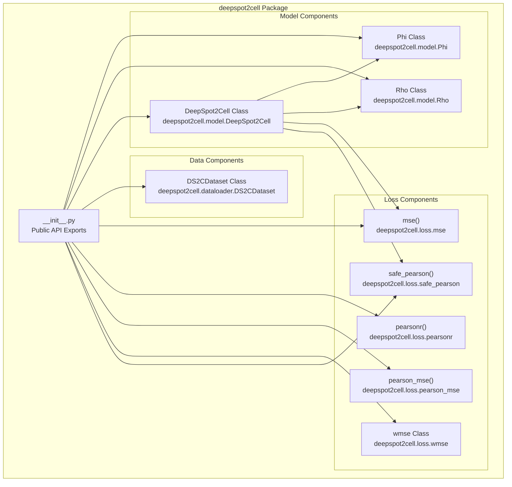
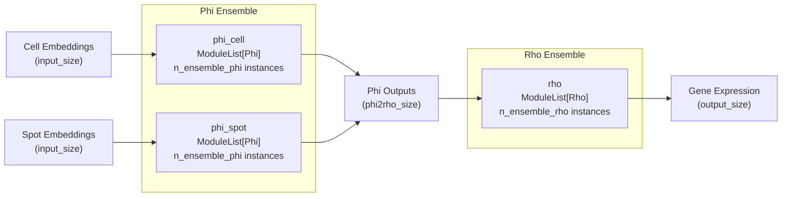
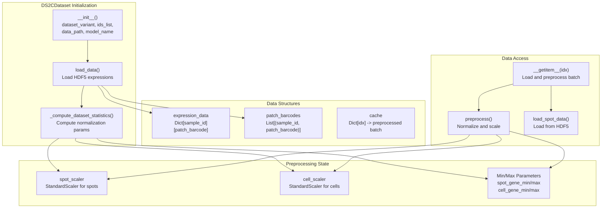
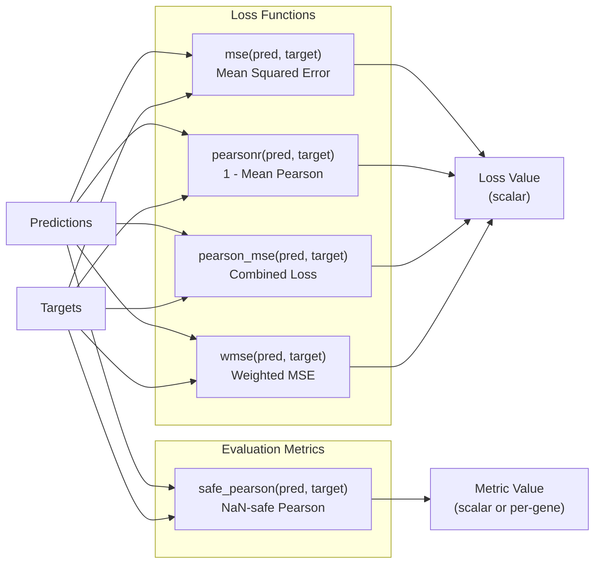
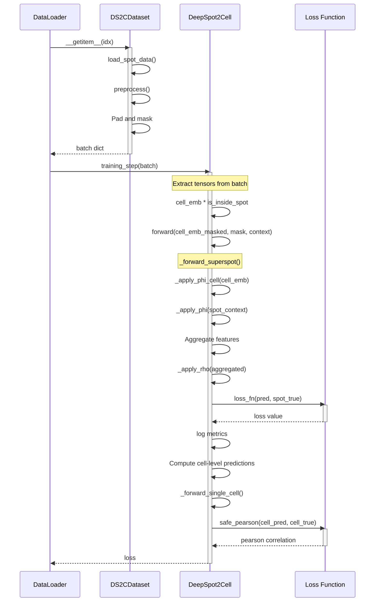

# Core Components

<details>
<summary>Relevant source files</summary>

The following files were used as context for generating this wiki page:

- [deepspot2cell/__init__.py](deepspot2cell/__init__.py)
- [deepspot2cell/dataloader.py](deepspot2cell/dataloader.py)
- [deepspot2cell/loss.py](deepspot2cell/loss.py)
- [deepspot2cell/model.py](deepspot2cell/model.py)

</details>


## Purpose and Scope

This page provides an overview of the three primary architectural components that form the foundation of the DeepSpot2Cell system: the model architecture, the dataset/data loading infrastructure, and the loss functions. These components work together to enable spot-supervised training for cell-level prediction.

For detailed information about data preprocessing and feature extraction, see [Dataset Creation](#5.1). For configuration of these components, see [Training Configuration](#6.2) and [Dataset Configuration](#6.1). For the complete training workflow that orchestrates these components, see [Training Script](#8.1).

**Sources:** [deepspot2cell/__init__.py:1-4]()

---

## Component Architecture Overview

The DeepSpot2Cell system is built on three tightly integrated components that are exposed through the public API:



**Component Relationships**

| Component | File | Primary Classes/Functions | Role |
|-----------|------|---------------------------|------|
| **Model** | `deepspot2cell/model.py` | `DeepSpot2Cell`, `Phi`, `Rho` | Neural network architecture for prediction |
| **Dataset** | `deepspot2cell/dataloader.py` | `DS2CDataset` | Data loading, preprocessing, batching |
| **Loss** | `deepspot2cell/loss.py` | `mse`, `pearsonr`, `wmse`, `safe_pearson` | Training objectives and evaluation metrics |

**Sources:** [deepspot2cell/__init__.py:1-4](), [deepspot2cell/model.py:1-281](), [deepspot2cell/dataloader.py:1-390](), [deepspot2cell/loss.py:1-48]()

---

## Model Architecture Component

### Core Classes

The model architecture consists of three neural network classes that work together as an ensemble:



### Phi Class

The `Phi` class is a two-layer feedforward network with dropout and ReLU activations. It projects embeddings from pathology foundation models to an intermediate feature space.

**Architecture:** [deepspot2cell/model.py:11-24]()
- Input → Linear(input_size, input_size) → Dropout → ReLU
- → Linear(input_size, output_size) → Dropout → ReLU
- Default dropout rate: `p=0.0` (configurable)

### Rho Class

The `Rho` class is a two-layer network that aggregates Phi outputs and produces gene expression predictions.

**Architecture:** [deepspot2cell/model.py:27-40]()
- Dropout → Linear(input_size, input_size) → ReLU
- → Linear(input_size, output_size) → ReLU → Dropout(0.1)

### DeepSpot2Cell Class

The `DeepSpot2Cell` class is a PyTorch Lightning module that orchestrates the ensemble of Phi and Rho networks.

**Key Features:**
- Inherits from `L.LightningModule` [deepspot2cell/model.py:43]()
- Maintains separate Phi ensembles for spot and cell embeddings [deepspot2cell/model.py:75-78]()
- Uses median aggregation for Phi outputs [deepspot2cell/model.py:139-143]()
- Uses mean aggregation for Rho outputs [deepspot2cell/model.py:145-146]()
- Supports two forward modes: superspot prediction and single-cell prediction [deepspot2cell/model.py:84-137]()

**Hyperparameters Table:**

| Parameter | Type | Default | Description |
|-----------|------|---------|-------------|
| `input_size` | int | - | Dimension of PFM embeddings |
| `output_size` | int | - | Number of genes to predict |
| `lr` | float | 1e-4 | Learning rate |
| `p` | float | 0.3 | Default dropout rate |
| `p_phi` | float | None | Phi-specific dropout (defaults to `p`) |
| `p_rho` | float | None | Rho-specific dropout (defaults to `p`) |
| `n_ensemble` | int | 10 | Default ensemble size |
| `n_ensemble_phi` | int | None | Phi ensemble size (defaults to `n_ensemble`) |
| `n_ensemble_rho` | int | None | Rho ensemble size (defaults to `n_ensemble`) |
| `phi2rho_size` | int | 512 | Intermediate feature dimension |
| `weight_decay` | float | 1e-6 | AdamW weight decay |

**Sources:** [deepspot2cell/model.py:11-146]()

---

## Dataset and Data Loading Component

### DS2CDataset Class

The `DS2CDataset` class implements PyTorch's `Dataset` interface and handles all data loading, preprocessing, and batching logic.



### Key Responsibilities

**1. Data Loading** [deepspot2cell/dataloader.py:146-159]()
- Loads expression data from HDF5 files organized by sample ID
- Builds a list of `(sample_id, patch_barcode)` tuples for indexing
- Supports optional shuffling

**2. Normalization and Scaling** [deepspot2cell/dataloader.py:37-144]()
- **Library size normalization:** Normalizes raw counts to `norm_counts` (default: 10,000) [deepspot2cell/dataloader.py:69-94]()
- **Log transformation:** Applies `log1p` transformation [deepspot2cell/dataloader.py:72,100]()
- **Standard scaling:** Optional per-gene z-score normalization using `StandardScaler` [deepspot2cell/dataloader.py:55-124]()
- **Min-max scaling:** Optional scaling to [0, 1] range [deepspot2cell/dataloader.py:45-144]()
- **Separate normalization:** Maintains separate scalers and parameters for spots vs. cells

**3. Batch Construction** [deepspot2cell/dataloader.py:164-277]()
- Pads cell data to `max_cells` per batch [deepspot2cell/dataloader.py:211-224]()
- Creates binary masks for valid cells [deepspot2cell/dataloader.py:223-224]()
- Tracks inside/outside spot status [deepspot2cell/dataloader.py:190]()
- Loads neighboring spot embeddings when `neighb_degree > 0` [deepspot2cell/dataloader.py:238-259]()

**4. Caching** [deepspot2cell/dataloader.py:20-21,165-166,268-269]()
- Maintains an in-memory cache of preprocessed batches (default size: 1000)
- Speeds up training by avoiding repeated preprocessing

### Batch Structure

Each batch returned by `__getitem__()` is a dictionary with the following tensors:

| Key | Shape | Type | Description |
|-----|-------|------|-------------|
| `patch_embedding` | `(emb_dim,)` | float32 | Spot-level PFM embedding |
| `cell_embeddings` | `(max_cells, emb_dim)` | float32 | Cell-level PFM embeddings (padded) |
| `spot_expression` | `(num_genes,)` | float32 | Spot-level gene expression (target) |
| `cell_expressions` | `(max_cells, num_genes)` | float32 | Cell-level gene expressions (padded) |
| `cell_mask` | `(max_cells,)` | float32 | Binary mask (1=valid cell, 0=padding) |
| `is_inside_spot` | `(max_cells,)` | float32 | Binary indicator (1=inside spot, 0=outside) |
| `num_cells` | scalar | int | Number of valid cells (before padding) |
| `cell_centroids` | `(max_cells, 2)` | float32 | Cell centroid coordinates (padded) |
| `patch_barcode` | string | - | Patch identifier |
| `neighb_embeddings` | `(n_neighbors+1, emb_dim)` | float32 | Neighboring spot embeddings (optional) |
| `neighb_masks` | `(n_neighbors+1,)` | bool | Masks for missing neighbors (optional) |

**Sources:** [deepspot2cell/dataloader.py:1-390]()

---

## Loss Functions and Metrics Component

The loss module provides multiple options for training objectives and evaluation metrics:

### Loss Functions



### Function Descriptions

**1. `mse(pred, target)`** [deepspot2cell/loss.py:5-6]()
- Standard mean squared error loss
- Wraps PyTorch's `F.mse_loss`
- Used as default loss in `DeepSpot2Cell` [deepspot2cell/model.py:60]()

**2. `pearsonr(pred, target, eps=1e-8)`** [deepspot2cell/loss.py:9-18]()
- Computes `1 - mean(pearson_correlation)` across genes
- Custom implementation with numerical stability via `eps`
- Centers predictions and targets before computing correlation
- Returns a loss value (lower is better)

**3. `pearson_mse(pred, target)`** [deepspot2cell/loss.py:21-22]()
- Combines Pearson and MSE losses with equal weight
- Useful for balancing correlation and absolute error

**4. `wmse` class** [deepspot2cell/loss.py:25-40]()
- Weighted MSE where each gene has a different weight
- Weights computed as `1 / rank^power`, where rank is gene importance
- Parameters:
  - `n_genes`: Number of genes
  - `upweight_hvg`: If True, highly variable genes get higher weight (default: True)
  - `power`: Exponent for weight calculation (default: 0.1)
- Weights are normalized to sum to `n_genes`

**5. `safe_pearson(pred, target, sample_wise=False)`** [deepspot2cell/loss.py:43-48]()
- Evaluation metric (not a loss function)
- Uses `torchmetrics.functional.pearson_corrcoef`
- Replaces NaN values with 0.0 for numerical stability
- Can compute gene-wise (default) or sample-wise correlations
- Used in `DeepSpot2Cell` for validation metrics [deepspot2cell/model.py:242-271]()

### Loss Function Comparison

| Function | Use Case | Output | Advantages | Disadvantages |
|----------|----------|--------|------------|---------------|
| `mse` | Default training | Scalar | Simple, stable | Ignores correlation structure |
| `pearsonr` | Correlation-focused | Scalar | Captures gene relationships | Can be unstable with small batches |
| `pearson_mse` | Balanced | Scalar | Combines benefits | Treats both equally (no tuning) |
| `wmse` | HVG-focused | Scalar | Prioritizes important genes | Requires gene ranking |
| `safe_pearson` | Evaluation | Per-gene or mean | Handles NaN gracefully | Metric only (not differentiable for loss) |

**Sources:** [deepspot2cell/loss.py:1-48]()

---

## Component Interaction During Training

The following diagram shows how the three core components interact during a typical training iteration:



### Training Step Breakdown

**1. Data Loading Phase** [deepspot2cell/dataloader.py:164-277]()
- `DS2CDataset.__getitem__()` loads and preprocesses a patch
- Applies normalization, scaling, padding, and masking
- Loads neighboring spot embeddings if configured
- Returns batch dictionary

**2. Forward Pass Phase** [deepspot2cell/model.py:148-192]()
- `training_step()` extracts tensors from batch
- Masks out cells outside the spot for supervision [deepspot2cell/model.py:158-160]()
- Calls `forward()` → `_forward_superspot()` for spot prediction
- Aggregates cell features using Phi and Rho ensembles

**3. Loss Computation Phase** [deepspot2cell/model.py:163]()
- Computes loss between predicted and true spot expression
- Uses `mse` by default (configurable)
- Logs training loss

**4. Cell-Level Metrics Phase** [deepspot2cell/model.py:169-190]()
- If cell ground truth available, computes cell-level predictions using `_forward_single_cell()`
- Separates inside/outside cells [deepspot2cell/model.py:181-190]()
- Accumulates predictions and targets for epoch-end metrics

**5. Epoch End Phase** [deepspot2cell/model.py:236-256]()
- `on_train_epoch_end()` aggregates all cell predictions
- Computes `safe_pearson` correlation for inside and outside cells
- Logs per-epoch metrics
- Clears accumulated predictions

**Sources:** [deepspot2cell/model.py:43-281](), [deepspot2cell/dataloader.py:164-277](), [deepspot2cell/loss.py:1-48]()

---

## Component Configuration

Each component exposes configuration parameters that control its behavior:

### Model Configuration Parameters

Configured via constructor arguments to `DeepSpot2Cell` [deepspot2cell/model.py:44-49]():

```python
model = DeepSpot2Cell(
    input_size=1024,              # PFM embedding dimension
    output_size=256,              # Number of genes
    lr=1e-4,                      # Learning rate
    p=0.3,                        # Dropout rate
    n_ensemble=10,                # Ensemble size
    phi2rho_size=512,             # Intermediate dimension
    weight_decay=1e-6,            # Weight decay
    random_seed=2024,             # Random seed
    cell_gt_available=True        # Whether cell GT is available
)
```

### Dataset Configuration Parameters

Configured via constructor arguments to `DS2CDataset` [deepspot2cell/dataloader.py:10]():

```python
dataset = DS2CDataset(
    dataset_variant="",           # Dataset variant suffix
    ids_list=["sample1", ...],    # List of sample IDs
    data_path="/path/to/data",    # Base data directory
    model_name="UNI",             # PFM model name
    standard_scaling=False,       # Enable z-score normalization
    shuffle=True,                 # Shuffle patches
    normalize=True,               # Enable normalization
    norm_counts=1e4,              # Target library size
    minmax=False,                 # Enable min-max scaling
    neighb_degree=0,              # Neighbor radius (0=no neighbors)
    scellst=False,                # Use scellst embeddings
    load_cell_types=False         # Load cell type annotations
)
```

### Loss Configuration

Loss functions are selected programmatically in the training script:

```python
# Default MSE loss
model.loss_fn = mse

# Or weighted MSE
model.loss_fn = wmse(n_genes=256, upweight_hvg=True, power=0.1)

# Or combined loss
model.loss_fn = pearson_mse
```

**Sources:** [deepspot2cell/model.py:44-49](), [deepspot2cell/dataloader.py:10](), [deepspot2cell/loss.py:1-48]()

---

## Summary

The three core components form a cohesive architecture:

1. **`DS2CDataset`** handles data loading, preprocessing, normalization, padding, and batching from HDF5 files
2. **`DeepSpot2Cell`** implements the neural network architecture with Phi and Rho ensembles, supporting both spot-level and cell-level prediction modes
3. **Loss functions** provide training objectives (MSE, Pearson, weighted MSE) and evaluation metrics (safe Pearson)

These components are designed to be modular and configurable, allowing users to customize preprocessing strategies, model hyperparameters, and training objectives through constructor arguments and configuration files. For detailed usage examples, see [Tutorial 2: Model Training](#3.2).

**Sources:** [deepspot2cell/__init__.py:1-4](), [deepspot2cell/model.py:1-281](), [deepspot2cell/dataloader.py:1-390](), [deepspot2cell/loss.py:1-48]()

---