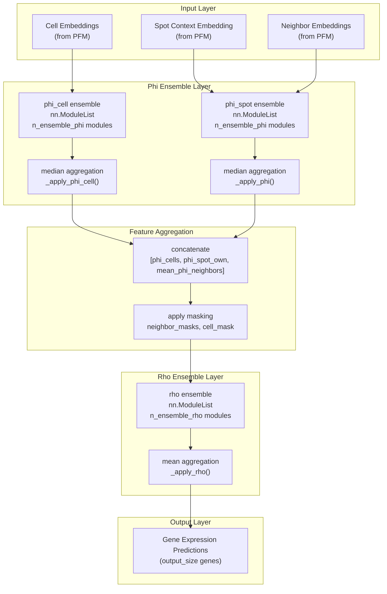
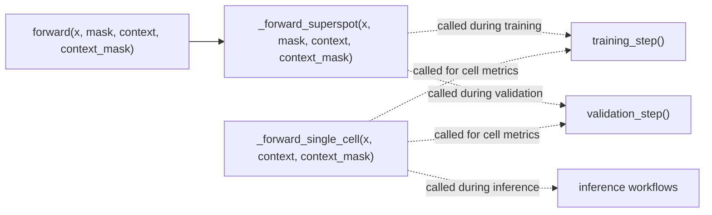
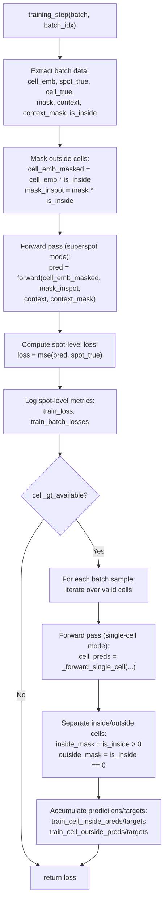

# DeepSpot2Cell Model Architecture

<details>
<summary>Relevant source files</summary>

The following files were used as context for generating this wiki page:

- [README.md](README.md)
- [deepspot2cell/model.py](deepspot2cell/model.py)

</details>


## Purpose and Scope

This document provides a detailed technical explanation of the DeepSpot2Cell model architecture as implemented in [deepspot2cell/model.py](). It covers the neural network modules (`Phi` and `Rho`), the main `DeepSpot2Cell` class, forward pass logic for both training and inference modes, and training/validation mechanics.

For information about data loading and preprocessing that feeds into this model, see [DS2CDataset and Data Loading](#4.2). For loss function implementations, see [Loss Functions](#4.3). For the complete training pipeline, see [Training Script](#8.1).

---

## Architecture Overview

The DeepSpot2Cell model uses an ensemble-based architecture with two types of neural network modules:

- **Phi modules**: Transform input embeddings (from pathology foundation models) into intermediate representations
- **Rho modules**: Combine transformed features to produce gene expression predictions

The model operates in two distinct modes:
- **Superspot mode** (training): Aggregates multiple cells within a spot to predict spot-level expression
- **Single-cell mode** (inference): Predicts expression for individual cells

Sources: [deepspot2cell/model.py:43-281]()

---

## High-Level Component Diagram



This diagram shows the data flow from PFM embeddings through the Phi ensembles, feature concatenation, and Rho ensembles to final predictions. The model uses median aggregation for Phi ensembles and mean aggregation for Rho ensembles.

Sources: [deepspot2cell/model.py:74-80](), [deepspot2cell/model.py:139-146]()

---

## Module Components

### Phi Module

The `Phi` class is a simple feedforward network that transforms embeddings into intermediate representations.

**Architecture**:
- Input layer: `Linear(input_size, input_size)`
- Dropout layer (configurable rate `p`)
- ReLU activation
- Output layer: `Linear(input_size, output_size)`
- Dropout layer
- ReLU activation

**Parameters**:
| Parameter | Type | Description |
|-----------|------|-------------|
| `input_size` | int | Dimensionality of input embeddings (typically PFM embedding size) |
| `output_size` | int | Dimensionality of output features (typically `phi2rho_size`) |
| `p` | float | Dropout probability (default: 0.0) |

Sources: [deepspot2cell/model.py:11-24]()

### Rho Module

The `Rho` class combines multiple feature streams (cells, spot context, neighbors) to produce gene expression predictions.

**Architecture**:
- Input dropout layer
- Hidden layer: `Linear(input_size, input_size)`
- ReLU activation
- Output layer: `Linear(input_size, output_size)`
- ReLU activation
- Output dropout layer (fixed rate: 0.1)

**Parameters**:
| Parameter | Type | Description |
|-----------|------|-------------|
| `input_size` | int | Dimensionality of concatenated features (3 × `phi2rho_size`) |
| `output_size` | int | Number of genes to predict |
| `p` | float | Dropout probability for input layer (default: 0.0) |

Sources: [deepspot2cell/model.py:27-40]()

---

## DeepSpot2Cell Class

The `DeepSpot2Cell` class is a PyTorch Lightning module that orchestrates the ensemble architecture and implements training/validation logic.

### Initialization Parameters

| Parameter | Type | Default | Description |
|-----------|------|---------|-------------|
| `input_size` | int | - | PFM embedding dimensionality |
| `output_size` | int | - | Number of genes to predict |
| `lr` | float | 1e-4 | Learning rate |
| `p` | float | 0.3 | Default dropout probability |
| `p_phi` | float | None | Dropout for Phi modules (defaults to `p`) |
| `p_rho` | float | None | Dropout for Rho modules (defaults to `p`) |
| `n_ensemble` | int | 10 | Default ensemble size |
| `n_ensemble_phi` | int | None | Number of Phi ensemble members (defaults to `n_ensemble`) |
| `n_ensemble_rho` | int | None | Number of Rho ensemble members (defaults to `n_ensemble`) |
| `phi2rho_size` | int | 512 | Intermediate feature dimensionality |
| `weight_decay` | float | 1e-6 | AdamW weight decay |
| `random_seed` | int | 2024 | Random seed for reproducibility |
| `cell_gt_available` | bool | True | Whether cell-level ground truth is available for metrics |

### Ensemble Configuration

The model creates three separate ensembles:
- **`phi_cell`**: `n_ensemble_phi` modules processing cell embeddings
- **`phi_spot`**: `n_ensemble_phi` modules processing spot and neighbor embeddings
- **`rho`**: `n_ensemble_rho` modules producing final predictions

```python
# From lines 75-80 of deepspot2cell/model.py
mult = 3
self.phi_spot = nn.ModuleList([Phi(input_size, phi2rho_size, self.p_phi)
                               for _ in range(self.n_ensemble_phi)])
self.phi_cell = nn.ModuleList([Phi(input_size, phi2rho_size, self.p_phi)
                               for _ in range(self.n_ensemble_phi)])
self.rho = nn.ModuleList([Rho(phi2rho_size * mult, output_size, self.p_rho)
                          for _ in range(self.n_ensemble_rho)])
```

The multiplier `mult = 3` accounts for the three feature streams: cell features, spot context, and aggregated neighbor contexts.

Sources: [deepspot2cell/model.py:43-82]()

---

## Forward Pass Modes

### Forward Pass Method Dispatch



The main `forward()` method delegates to `_forward_superspot()` by default. The `_forward_single_cell()` method is explicitly called when predicting individual cell expressions.

Sources: [deepspot2cell/model.py:84-137]()

### Superspot Forward Pass

The `_forward_superspot()` method aggregates features from multiple cells within a spot to predict spot-level expression. This is the primary mode used during training.

**Input Dimensions**:
- `x`: `[batch_size, max_cells, embedding_dim]` - Cell embeddings
- `mask`: `[batch_size, max_cells]` - Binary mask indicating valid cells
- `context`: `[batch_size, num_contexts, embedding_dim]` - Spot and neighbor embeddings
- `context_mask`: `[batch_size, num_contexts - 1]` - Mask for neighbor contexts

**Processing Steps**:
1. **Transform cell embeddings**: Apply `phi_cell` ensemble to all cells, reshape to `[batch_size, max_cells, phi2rho_size]`
2. **Transform spot context**: Apply `phi_spot` ensemble to own spot embedding (first context)
3. **Transform and aggregate neighbors**: 
   - Apply `phi_spot` to all neighbor embeddings
   - Mask invalid neighbors (set to 0)
   - Sum and average to get mean neighbor representation
4. **Concatenate per-cell features**: For each cell, concatenate [phi_cell, phi_spot_own, mean_phi_neighbors]
5. **Apply cell mask**: Multiply by cell mask to zero out invalid cells
6. **Aggregate across cells**: Sum all cell features to get spot-level representation
7. **Apply Rho ensemble**: Transform aggregated features to gene predictions

**Neighbor Masking Logic**:
```python
# From lines 124-129 of deepspot2cell/model.py
phi_neighbor_contexts_flat = self._apply_phi(neighbor_contexts.reshape(-1, d_ctx_emb))
phi_neighbor_contexts = phi_neighbor_contexts_flat.view(b, n_total_ctx - 1, self.hparams.phi2rho_size)
phi_neighbor_contexts_masked_for_sum = phi_neighbor_contexts.masked_fill(neighbor_masks.unsqueeze(-1), 0.0)
sum_phi_neighbor_contexts = phi_neighbor_contexts_masked_for_sum.sum(dim=1)
num_valid_neighbors = (~neighbor_masks).sum(dim=1, keepdim=True).float().clamp(min=1)
mean_phi_neighbor_contexts = sum_phi_neighbor_contexts / num_valid_neighbors
```

This ensures that missing neighbors don't contribute to the mean calculation.

Sources: [deepspot2cell/model.py:114-137]()

### Single-Cell Forward Pass

The `_forward_single_cell()` method predicts gene expression for individual cells. This is used during inference and for computing cell-level metrics during training/validation.

**Input Dimensions**:
- `x`: `[num_cells, embedding_dim]` or `[embedding_dim]` - Cell embedding(s)
- `context`: `[num_contexts, embedding_dim]` - Spot and neighbor embeddings
- `context_mask`: `[num_contexts - 1]` - Mask for neighbor contexts

**Processing Steps**:
1. **Expand single cell to batch**: If input is 1D, add batch dimension
2. **Transform cell embeddings**: Apply `phi_cell` ensemble to each cell
3. **Transform own spot context**: Apply `phi_spot` to first context (own spot)
4. **Transform and aggregate neighbors**: Same masking and averaging as superspot mode
5. **Expand context features**: Broadcast spot and neighbor features to match number of cells
6. **Concatenate features**: For each cell, concatenate [phi_cell, phi_spot_own, mean_phi_neighbors]
7. **Apply Rho ensemble**: Transform concatenated features to gene predictions

**Key Difference from Superspot**: No aggregation across cells. Each cell gets an independent prediction based on its own morphology plus shared spatial context.

Sources: [deepspot2cell/model.py:88-112]()

---

## Ensemble Aggregation Methods

### Phi Ensemble: Median Aggregation

```python
# From lines 139-143 of deepspot2cell/model.py
def _apply_phi(self, x):  
    return torch.median(torch.stack([p(x) for p in self.phi_spot], 1), 1).values

def _apply_phi_cell(self, x):  
    return torch.median(torch.stack([p(x) for p in self.phi_cell], 1), 1).values
```

Both `phi_spot` and `phi_cell` ensembles use **median aggregation**:
1. Pass input through all ensemble members
2. Stack outputs along dimension 1
3. Compute median across ensemble dimension
4. Extract values (discard indices)

**Rationale**: Median is robust to outliers in the ensemble, providing stable feature representations.

### Rho Ensemble: Mean Aggregation

```python
# From line 145-146 of deepspot2cell/model.py
def _apply_rho(self, x):  
    return torch.stack([r(x) for r in self.rho], 1).mean(1)
```

The `rho` ensemble uses **mean aggregation**:
1. Pass input through all ensemble members
2. Stack outputs along dimension 1
3. Compute mean across ensemble dimension

**Rationale**: Mean aggregation provides smooth predictions by averaging across ensemble member outputs.

Sources: [deepspot2cell/model.py:139-146]()

---

## Training and Validation Logic

### Training Step Flow



**Key Points**:
- **Spot-level supervision**: Loss computed on aggregated spot predictions
- **Inside/outside masking**: Only cells marked as inside the spot contribute to the spot prediction
- **Cell-level metrics**: Computed separately but don't contribute to the loss
- **Inside/outside separation**: Metrics tracked separately for cells inside vs outside the spot boundary

Sources: [deepspot2cell/model.py:148-192]()

### Training Step Details

The `training_step()` method handles both spot-level supervision and optional cell-level metric tracking.

**Spot-Level Prediction**:
```python
# From lines 158-163 of deepspot2cell/model.py
is_inside = batch['is_inside_spot'].float()
cell_emb_masked = cell_emb * is_inside.unsqueeze(-1)
mask_inspot = mask * is_inside

pred = self(cell_emb_masked, mask_inspot, context, context_mask)
loss = self.loss_fn(pred, spot_true)
```

Only cells marked as inside the spot (`is_inside=1`) contribute to the spot-level prediction. Outside cells are zeroed out.

**Cell-Level Metric Collection** (if `cell_gt_available=True`):
```python
# From lines 169-190 of deepspot2cell/model.py
for b in range(cell_emb.size(0)):
    valid = mask[b] > 0
    if valid.any():
        spot_context = context[b]
        spot_context_mask = context_mask[b]
        
        cell_preds = self._forward_single_cell(cell_emb[b, valid], spot_context, spot_context_mask).clamp_(min=0.0)
        cell_targets = cell_true[b, valid]
        is_inside_batch = is_inside[b, valid]
        
        # Separate inside and outside cells
        inside_mask = is_inside_batch > 0
        outside_mask = is_inside_batch == 0
        
        if inside_mask.any():
            self.train_cell_inside_preds.append(cell_preds[inside_mask])
            self.train_cell_inside_targets.append(cell_targets[inside_mask])
        
        if outside_mask.any():
            self.train_cell_outside_preds.append(cell_preds[outside_mask])
            self.train_cell_outside_targets.append(cell_targets[outside_mask])
```

For each batch, the model:
1. Identifies valid cells (non-padding)
2. Predicts cell-level expression for each valid cell
3. Separates predictions into inside/outside groups
4. Accumulates predictions and targets for epoch-end metrics

Sources: [deepspot2cell/model.py:148-192]()

### Validation Step

The `validation_step()` method has identical logic to `training_step()`, but logs to different metric names (`val_*` instead of `train_*`) and accumulates to separate buffers.

**Key differences**:
- Applies `.clamp_(min=0.0)` to spot predictions to ensure non-negative outputs
- No gradient computation (handled automatically by PyTorch Lightning)

Sources: [deepspot2cell/model.py:195-234]()

### Epoch-End Callbacks

After each training or validation epoch, the model computes Pearson correlations for accumulated cell-level predictions.

**Training Epoch End**:
```python
# From lines 236-255 of deepspot2cell/model.py
def on_train_epoch_end(self):
    if self.cell_gt_available:
        # Compute cell pearson correlations for inside cells
        if self.train_cell_inside_preds:
            all_preds = torch.cat(self.train_cell_inside_preds, dim=0)
            all_targets = torch.cat(self.train_cell_inside_targets, dim=0)
            pearson = safe_pearson(all_preds, all_targets)
            self.log('train_cell_inside_pearson', pearson.mean(), prog_bar=True)
        
        # Compute cell pearson correlations for outside cells
        if self.train_cell_outside_preds:
            all_preds = torch.cat(self.train_cell_outside_preds, dim=0)
            all_targets = torch.cat(self.train_cell_outside_targets, dim=0)
            pearson = safe_pearson(all_preds, all_targets)
            self.log('train_cell_outside_pearson', pearson.mean(), prog_bar=True)
    
    self.train_cell_inside_preds.clear()
    self.train_cell_inside_targets.clear()
    self.train_cell_outside_preds.clear()
    self.train_cell_outside_targets.clear()
```

The method:
1. Concatenates all cell predictions and targets from the epoch
2. Computes gene-wise Pearson correlations using `safe_pearson()` (see [Loss Functions](#4.3))
3. Logs the mean Pearson correlation across genes
4. Clears the accumulation buffers for the next epoch

Validation epoch end (`on_validation_epoch_end()`) has identical logic with `val_*` prefixes.

Sources: [deepspot2cell/model.py:236-276]()

---

## Metrics Tracked During Training

### Logged Metrics

| Metric Name | Description | Computed When |
|-------------|-------------|---------------|
| `train_loss` | MSE loss on spot-level predictions | Every training step |
| `val_loss` | MSE loss on spot-level predictions | Every validation step |
| `train_cell_inside_pearson` | Mean Pearson correlation for cells inside spots | End of training epoch (if cell GT available) |
| `train_cell_outside_pearson` | Mean Pearson correlation for cells outside spots | End of training epoch (if cell GT available) |
| `val_cell_inside_pearson` | Mean Pearson correlation for cells inside spots | End of validation epoch (if cell GT available) |
| `val_cell_outside_pearson` | Mean Pearson correlation for cells outside spots | End of validation epoch (if cell GT available) |

### Inside vs Outside Cells

The model distinguishes between:
- **Inside cells**: Cells whose centroids fall within the spot boundary (55μm radius)
- **Outside cells**: Cells in the padded region outside the spot but within the tile

**During training**: Only inside cells contribute to the spot-level prediction (via masking)

**During metrics**: Both inside and outside cells are evaluated separately to assess:
- Model performance on cells used for supervision (inside)
- Model generalization to unsupervised cells (outside)

This separation helps evaluate the model's ability to transfer knowledge from spot-level supervision to individual cells.

Sources: [deepspot2cell/model.py:148-276]()

---

## Optimizer Configuration

```python
# From lines 278-280 of deepspot2cell/model.py
def configure_optimizers(self) -> dict:
    optimizer = torch.optim.AdamW(self.parameters(), lr=self.lr, weight_decay=self.weight_decay)
    return {"optimizer": optimizer}
```

The model uses **AdamW** optimizer with:
- Learning rate: specified by `lr` hyperparameter (default: 1e-4)
- Weight decay: specified by `weight_decay` hyperparameter (default: 1e-6)

No learning rate scheduling is implemented in the base model. Schedulers can be added through PyTorch Lightning configuration.

Sources: [deepspot2cell/model.py:278-280]()

---

## Architecture Summary Table

| Component | Class | Input Size | Output Size | Aggregation | Count |
|-----------|-------|------------|-------------|-------------|-------|
| Cell feature extractor | `Phi` | `input_size` | `phi2rho_size` | Median | `n_ensemble_phi` |
| Spot feature extractor | `Phi` | `input_size` | `phi2rho_size` | Median | `n_ensemble_phi` |
| Expression predictor | `Rho` | `3 × phi2rho_size` | `output_size` | Mean | `n_ensemble_rho` |

**Default Configuration**:
- `input_size`: Typically 1024 (UNI) or 768 (other PFMs)
- `output_size`: Number of genes (e.g., 100-1000)
- `phi2rho_size`: 512
- `n_ensemble_phi`: 10
- `n_ensemble_rho`: 10

Sources: [deepspot2cell/model.py:43-80]()

---