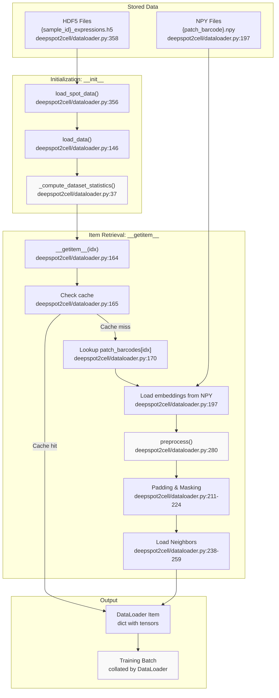
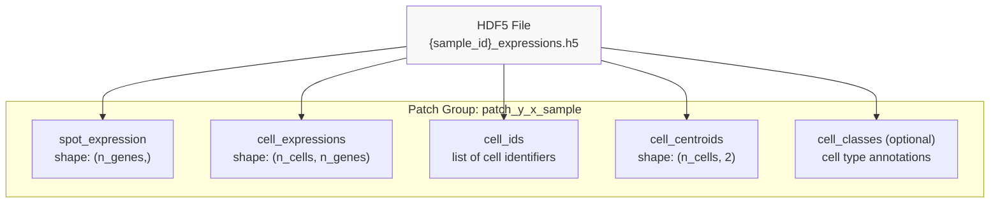
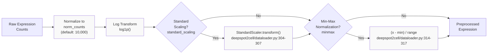
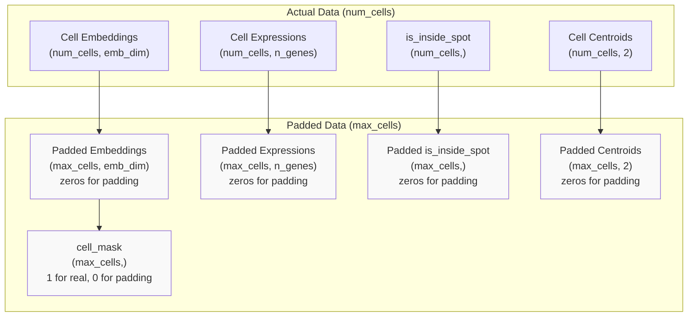
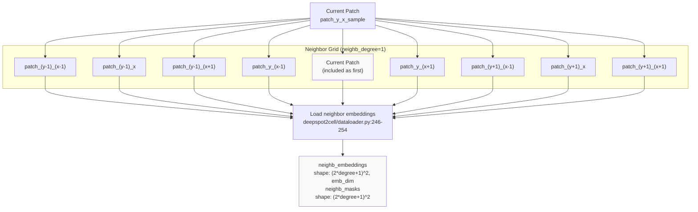
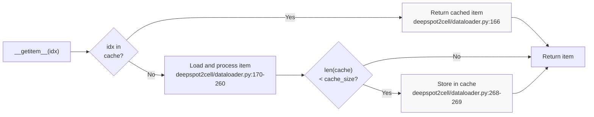

# DS2CDataset and Data Loading

<details>
<summary>Relevant source files</summary>

The following files were used as context for generating this wiki page:

- [deepspot2cell/__init__.py](deepspot2cell/__init__.py)
- [deepspot2cell/dataloader.py](deepspot2cell/dataloader.py)

</details>


## Purpose and Scope

This document describes the `DS2CDataset` class and the data loading pipeline in DeepSpot2Cell. The `DS2CDataset` class ([deepspot2cell/dataloader.py:9-390]()) is a PyTorch `Dataset` that loads preprocessed morphological embeddings and gene expression data, applies normalization and preprocessing, and prepares batched data for model training and validation.

For information about how the raw data is initially processed and embeddings are generated, see [Dataset Creation](#5.1). For details on the model that consumes this data, see [DeepSpot2Cell Model Architecture](#4.1).

**Sources:** [deepspot2cell/dataloader.py:1-390]()

---

## DS2CDataset Class Overview

The `DS2CDataset` class is the primary data loading interface in DeepSpot2Cell. It implements the PyTorch `Dataset` interface and handles:

- Loading expression data from HDF5 files
- Loading morphological embeddings from NPY files
- Computing dataset statistics for normalization
- Applying various preprocessing transformations
- Managing padding and masking for variable-length data
- Loading neighboring spot embeddings for spatial context
- Caching frequently accessed items

### Key Attributes

| Attribute | Type | Purpose |
|-----------|------|---------|
| `expression_data` | dict | In-memory storage of all expression data loaded from HDF5 files |
| `patch_barcodes` | list | List of `(sample_id, patch_barcode)` tuples identifying all patches |
| `max_cells` | int | Maximum number of cells across all patches (for padding) |
| `cache` | dict | LRU cache for frequently accessed items |
| `spot_scaler` | StandardScaler | Sklearn scaler for spot-level expressions |
| `cell_scaler` | StandardScaler | Sklearn scaler for cell-level expressions |
| `neighb_degree` | int | Degree of neighborhood for loading neighboring spots |

**Sources:** [deepspot2cell/dataloader.py:9-35]()

---

## Data Loading Pipeline

The following diagram shows the complete data loading pipeline from stored files to a training batch:



**Data Loading Process:**

1. **Initialization Phase** ([deepspot2cell/dataloader.py:146-159]()): 
   - `load_data()` loads all HDF5 expression files via `load_spot_data()`
   - Builds `patch_barcodes` list containing all valid patches
   - Optionally shuffles patches for training
   - Calls `_compute_dataset_statistics()` to compute normalization parameters

2. **Item Retrieval Phase** ([deepspot2cell/dataloader.py:164-277]()): 
   - `__getitem__(idx)` checks cache first
   - Looks up sample ID and patch barcode from index
   - Loads corresponding embeddings from NPY file
   - Applies preprocessing via `preprocess()`
   - Pads to `max_cells` and creates masks
   - Optionally loads neighboring spot embeddings
   - Returns dictionary of tensors

**Sources:** [deepspot2cell/dataloader.py:9-390]()

---

## File Format and Structure

### HDF5 Expression Files

Expression data is stored in HDF5 files with the naming convention `{sample_id}_expressions.h5`. Each file contains groups keyed by patch barcodes.



The `load_spot_data()` method ([deepspot2cell/dataloader.py:356-390]()) reads from these HDF5 files. It can load either a specific patch or all patches from a sample.

### NPY Embedding Files

Morphological embeddings are stored as NPY files with naming convention `{patch_barcode}.npy`. Each file contains:
- Index 0: Spot-level embedding (full 55μm region)
- Indices 1+: Cell-level embeddings (one per cell)

The embeddings are loaded at line [deepspot2cell/dataloader.py:197-201]().

**Sources:** [deepspot2cell/dataloader.py:146-159](), [deepspot2cell/dataloader.py:356-390](), [deepspot2cell/dataloader.py:197-201]()

---

## Preprocessing and Normalization

The `preprocess()` method ([deepspot2cell/dataloader.py:280-319]()) applies a sequence of transformations to expression data:



### Normalization Strategy

The normalization differs between spots and cells:

**Spot-Level Normalization** ([deepspot2cell/dataloader.py:282-283]()):
```
normalized = norm_counts * expression / sum(expression)
```

**Cell-Level Normalization** ([deepspot2cell/dataloader.py:285-294]()):
```
inspot_total = sum(cell_sums[cells_inside_spot])
normalized[inside_spot] = norm_counts * expression[inside_spot] / inspot_total
normalized[outside_spot] = norm_counts * expression[outside_spot] / inspot_total
```

Cells are normalized by the total counts of cells inside the spot. Cells outside the spot (with ID suffix `_out`) are normalized by the same total for consistency.

### Standard Scaling

When `standard_scaling=True`, the dataset computes separate `StandardScaler` instances for spots and cells during initialization ([deepspot2cell/dataloader.py:111-124]()):

| Scaler | Fitted On | Applied To |
|--------|-----------|------------|
| `spot_scaler` | All log-normalized spot expressions | Spot expressions during `preprocess()` |
| `cell_scaler` | All log-normalized non-zero cell expressions | Cell expressions during `preprocess()` |

The scalers transform data to have zero mean and unit variance per gene.

### Min-Max Normalization

When `minmax=True`, the dataset computes per-gene minimum and maximum values separately for spots and cells during initialization ([deepspot2cell/dataloader.py:45-144]()), then applies:

```
normalized = (log_expression - gene_min) / gene_range
```

This scales each gene to the [0, 1] range.

### Inverse Transform

The `inverse_transform()` method ([deepspot2cell/dataloader.py:321-348]()) reverses the preprocessing pipeline, converting from normalized space back to log space. This is useful during inference to obtain interpretable expression values.

**Sources:** [deepspot2cell/dataloader.py:280-348](), [deepspot2cell/dataloader.py:37-144]()

---

## Padding and Masking Strategy

Since patches contain variable numbers of cells, the dataset pads all patches to `max_cells` ([deepspot2cell/dataloader.py:126-133]()):



The padding logic is implemented at [deepspot2cell/dataloader.py:211-224]():

1. Create zero-filled arrays of shape `(max_cells, ...)`
2. Fill first `num_cells` positions with actual data
3. Create `cell_mask` with 1.0 for real cells, 0.0 for padding

The model uses `cell_mask` to ignore padded positions during training. The `is_inside_spot` tensor indicates which cells are within the spot boundary (value 1.0) versus outside it (value 0.0, suffix `_out` in cell ID).

**Sources:** [deepspot2cell/dataloader.py:211-224]()

---

## Neighbor Loading for Spatial Context

When `neighb_degree > 0`, the dataset loads embeddings from neighboring spots to provide spatial context ([deepspot2cell/dataloader.py:238-259]()):



**Neighbor Loading Algorithm:**

1. Parse current patch barcode to extract coordinates `(y, x)` ([deepspot2cell/dataloader.py:239-240]())
2. Generate neighbor coordinates within `neighb_degree` range ([deepspot2cell/dataloader.py:241-243]())
3. Construct neighbor barcodes (excluding current patch)
4. For each neighbor:
   - If NPY file exists: Load embedding from index 0 (spot embedding)
   - If NPY file missing: Use zero vector and mark mask as `True`
5. Stack all embeddings and masks into tensors ([deepspot2cell/dataloader.py:256-259]())

The current patch embedding is included as the first element. Missing neighbors are represented by zero vectors with corresponding mask values set to `True`, allowing the model to ignore them.

**Sources:** [deepspot2cell/dataloader.py:238-259]()

---

## Data Item Structure

Each call to `__getitem__` returns a dictionary with the following structure:

```mermaid
graph TB
    ITEM["DataLoader Item<br/>dict"]
    
    PATCH_EMB["patch_embedding<br/>torch.Tensor (emb_dim,)<br/>Spot-level morphology"]
    CELL_EMB["cell_embeddings<br/>torch.Tensor (max_cells, emb_dim)<br/>Cell-level morphology"]
    SPOT_EXPR["spot_expression<br/>torch.Tensor (n_genes,)<br/>Target spot expression"]
    CELL_EXPR["cell_expressions<br/>torch.Tensor (max_cells, n_genes)<br/>Pseudo cell expressions"]
    CELL_MASK["cell_mask<br/>torch.Tensor (max_cells,)<br/>1=real, 0=padding"]
    INSIDE["is_inside_spot<br/>torch.Tensor (max_cells,)<br/>1=inside, 0=outside"]
    NUM["num_cells<br/>int<br/>Actual number of cells"]
    CENT["cell_centroids<br/>torch.Tensor (max_cells, 2)<br/>Spatial coordinates"]
    BARCODE["patch_barcode<br/>str<br/>Patch identifier"]
    
    NEIGHB_EMB["neighb_embeddings<br/>torch.Tensor ((2*d+1)^2, emb_dim)<br/>Neighbor spot embeddings"]
    NEIGHB_MASK["neighb_masks<br/>torch.Tensor ((2*d+1)^2,)<br/>True if neighbor missing"]
    
    CELL_TYPES["cell_classes<br/>list[str] (max_cells,)<br/>Cell type annotations"]
    
    ITEM --> PATCH_EMB
    ITEM --> CELL_EMB
    ITEM --> SPOT_EXPR
    ITEM --> CELL_EXPR
    ITEM --> CELL_MASK
    ITEM --> INSIDE
    ITEM --> NUM
    ITEM --> CENT
    ITEM --> BARCODE
    
    ITEM -.->|"if neighb_degree > 0"| NEIGHB_EMB
    ITEM -.->|"if neighb_degree > 0"| NEIGHB_MASK
    
    ITEM -.->|"if load_cell_types"| CELL_TYPES
    
    style ITEM fill:#f9f9f9
```



The structure is defined at [deepspot2cell/dataloader.py:226-266]().

### Core Fields (Always Present)

| Field | Shape | Description |
|-------|-------|-------------|
| `patch_embedding` | `(emb_dim,)` | Morphological embedding of full spot tile |
| `cell_embeddings` | `(max_cells, emb_dim)` | Morphological embeddings of individual cells |
| `spot_expression` | `(n_genes,)` | Preprocessed spot-level gene expression (target) |
| `cell_expressions` | `(max_cells, n_genes)` | Preprocessed pseudo cell expressions |
| `cell_mask` | `(max_cells,)` | Binary mask: 1 for real cells, 0 for padding |
| `is_inside_spot` | `(max_cells,)` | Binary mask: 1 if cell inside spot, 0 if outside |
| `num_cells` | scalar | Actual number of cells (before padding) |
| `cell_centroids` | `(max_cells, 2)` | Spatial coordinates (x, y) of cell centroids |
| `patch_barcode` | string | Patch identifier (e.g., `"patch_10_15_SAMPLE123"`) |

### Optional Fields

| Field | Condition | Shape | Description |
|-------|-----------|-------|-------------|
| `neighb_embeddings` | `neighb_degree > 0` | `((2*d+1)^2, emb_dim)` | Embeddings of neighboring spots |
| `neighb_masks` | `neighb_degree > 0` | `((2*d+1)^2,)` | Boolean mask: True if neighbor missing |
| `cell_classes` | `load_cell_types=True` | `(max_cells,)` | Cell type annotations as strings |

**Sources:** [deepspot2cell/dataloader.py:226-266]()

---

## Caching Mechanism

The dataset implements a simple cache to avoid reloading frequently accessed items ([deepspot2cell/dataloader.py:20-21](), [deepspot2cell/dataloader.py:165-166](), [deepspot2cell/dataloader.py:268-269]()):



- Cache size is configurable via `cache_size` attribute (default: 1000)
- Only successfully loaded items are cached
- Cache is not LRU; it fills up to `cache_size` and then stops storing new items
- Useful for validation sets which are repeatedly accessed

**Sources:** [deepspot2cell/dataloader.py:20-21](), [deepspot2cell/dataloader.py:165-169](), [deepspot2cell/dataloader.py:268-269]()

---

## Handling Edge Cases

### Zero Expression Filtering

The dataset filters out cells with all-zero expression ([deepspot2cell/dataloader.py:192-201]()):

```python
nonzero_mask = cell_expressions.sum(axis=1) > 0
```

Only cells with non-zero total expression are included. This filtering happens after loading from HDF5 but before padding.

### Zero Spot Expression

If a spot has zero total expression, the dataset randomly samples a different patch ([deepspot2cell/dataloader.py:180-188]()):

```python
spot_sum = np.sum(spot_expression)
if spot_sum == 0:
    idx = np.random.randint(0, len(self.patch_barcodes))
    # Retry with new index
```

This ensures the model never trains on invalid data. After 50 attempts, it raises a `RuntimeError`.

### Missing Neighbor Files

When loading neighbors, missing NPY files are handled gracefully ([deepspot2cell/dataloader.py:247-250]()):

```python
if not os.path.exists(f"{path}/{neighb_barcode}.npy"):
    neighb_embeddings.append(np.zeros(emb_dim, dtype=np.float32))
    neighb_masks.append(True)
```

Missing neighbors are represented as zero vectors with their mask set to `True`, signaling to the model to ignore them.

**Sources:** [deepspot2cell/dataloader.py:180-201](), [deepspot2cell/dataloader.py:247-250]()

---

## Usage Example

The `DS2CDataset` is typically instantiated by the training script using configuration parameters:

```python
# Typical usage in training script
dataset = DS2CDataset(
    dataset_variant='',  # Dataset variant suffix
    ids_list=['SAMPLE123', 'SAMPLE456'],  # Sample IDs to load
    data_path='/path/to/data',  # Root data directory
    model_name='UNI',  # PFM model used for embeddings
    standard_scaling=True,  # Apply standard scaling
    normalize=True,  # Apply normalization pipeline
    norm_counts=10000,  # Normalization target count
    neighb_degree=1,  # Load 3x3 neighborhood
    shuffle=True  # Shuffle patches
)

# Use with PyTorch DataLoader
from torch.utils.data import DataLoader
loader = DataLoader(dataset, batch_size=32, shuffle=False, num_workers=4)
```

The dataset integrates seamlessly with PyTorch's `DataLoader` for batching and parallel loading. See [Training Script](#8.1) for complete training examples.

**Sources:** [deepspot2cell/dataloader.py:10-35]()

---