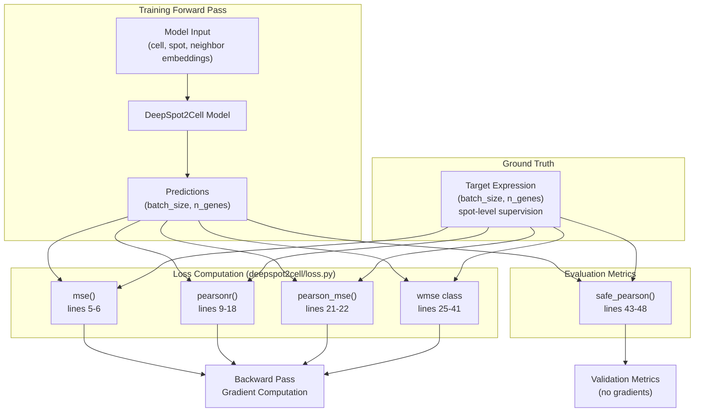
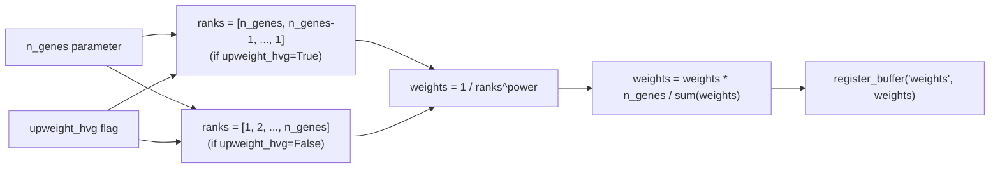
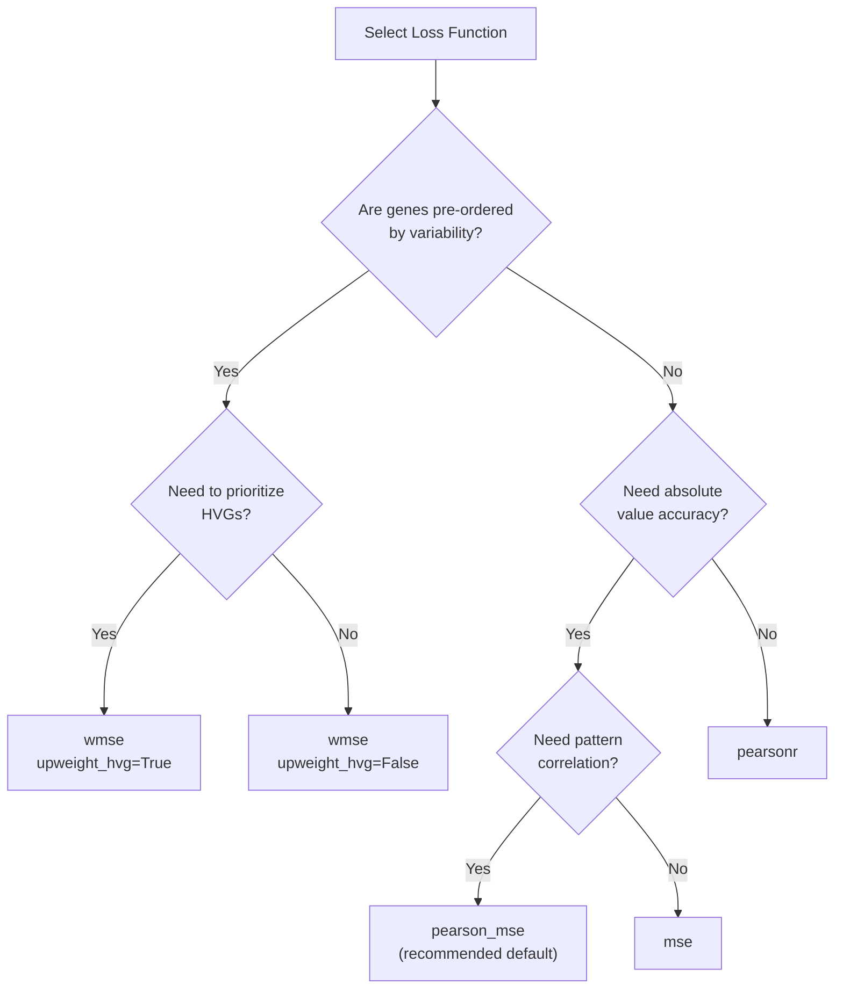
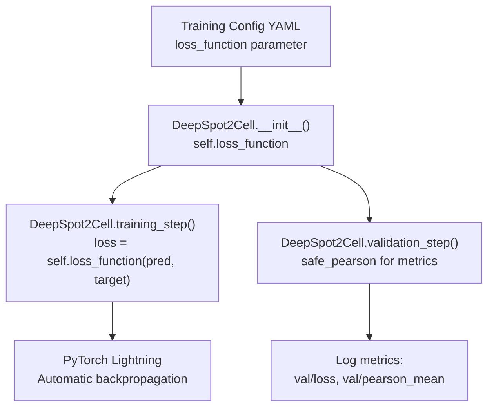

# Loss Functions

<details>
<summary>Relevant source files</summary>

The following files were used as context for generating this wiki page:

- [deepspot2cell/__init__.py](deepspot2cell/__init__.py)
- [deepspot2cell/loss.py](deepspot2cell/loss.py)

</details>


## Purpose and Scope

This document covers the loss functions and evaluation metrics available in DeepSpot2Cell for training and evaluating models. Loss functions quantify the difference between model predictions and ground truth spot-level gene expression values during training. The system provides several loss functions optimized for gene expression prediction tasks, including standard regression losses and correlation-based losses.

For information about how these losses are integrated into the model training loop, see [Model Architecture](#4.1). For configuration options to select and customize loss functions, see [Training Configuration](#6.2).

**Sources:** [deepspot2cell/loss.py:1-48]()

---

## Overview of Available Loss Functions

DeepSpot2Cell provides five loss/metric functions in the `deepspot2cell.loss` module:

| Function | Type | Primary Use | Key Characteristic |
|----------|------|-------------|-------------------|
| `mse` | Loss | Training | Standard mean squared error for regression |
| `pearsonr` | Loss | Training | Correlation-based loss optimizing gene expression patterns |
| `pearson_mse` | Loss | Training | Combines MSE and Pearson for balanced optimization |
| `wmse` | Loss | Training | Weighted MSE that prioritizes highly variable genes |
| `safe_pearson` | Metric | Evaluation | NaN-safe Pearson correlation for validation/testing |

All functions are exposed through the package's public API in [deepspot2cell/__init__.py:3]().

**Sources:** [deepspot2cell/__init__.py:1-4](), [deepspot2cell/loss.py:1-48]()

---

## Loss Function Architecture

The following diagram illustrates the relationship between loss functions and the training pipeline:



**Sources:** [deepspot2cell/loss.py:1-48]()

---

## Mean Squared Error (mse)

### Function Signature

```python
def mse(pred, target)
```

### Description

Standard mean squared error loss implemented as a thin wrapper around PyTorch's built-in MSE loss. Computes the average squared difference between predicted and target gene expression values across all genes and samples.

### Mathematical Formulation

$$\text{MSE} = \frac{1}{N \times G} \sum_{i=1}^{N} \sum_{j=1}^{G} (y_{ij}^{pred} - y_{ij}^{target})^2$$

where:
- $N$ = batch size
- $G$ = number of genes
- $y_{ij}^{pred}$ = predicted expression for sample $i$, gene $j$
- $y_{ij}^{target}$ = target expression for sample $i$, gene $j$

### Implementation

The function directly delegates to PyTorch's functional API:

```python
# deepspot2cell/loss.py:5-6
def mse(pred, target):
    return torch.nn.functional.mse_loss(pred, target)
```

### Use Cases

- Baseline loss function for gene expression prediction
- Optimizes absolute expression values
- Treats all genes equally (no weighting)
- Best when absolute expression magnitudes are important

**Sources:** [deepspot2cell/loss.py:5-6]()

---

## Pearson Correlation Loss (pearsonr)

### Function Signature

```python
def pearsonr(pred, target, eps = 1e-8)
```

### Description

Custom implementation of Pearson correlation coefficient converted to a loss (1 - correlation). Computes per-gene correlations across the batch and returns the mean loss. This loss function optimizes the linear relationship between predictions and targets rather than absolute values.

### Mathematical Formulation

For each gene $j$:

$$r_j = \frac{\sum_{i=1}^{N} (y_{ij}^{pred} - \bar{y}_j^{pred})(y_{ij}^{target} - \bar{y}_j^{target})}{\sqrt{\sum_{i=1}^{N} (y_{ij}^{pred} - \bar{y}_j^{pred})^2 + \epsilon} \cdot \sqrt{\sum_{i=1}^{N} (y_{ij}^{target} - \bar{y}_j^{target})^2 + \epsilon}}$$

Loss:

$$\text{Loss} = \frac{1}{G} \sum_{j=1}^{G} (1 - r_j)$$

### Implementation Details

The function implements Pearson correlation from scratch:

1. **Centering**: Subtract mean along batch dimension [line 10-11]()
2. **Covariance**: Compute sum of products [line 13]()
3. **Standard Deviations**: Compute with epsilon for numerical stability [line 14-15]()
4. **Correlation**: Divide covariance by product of standard deviations [line 17]()
5. **Loss Conversion**: Return mean of (1 - correlation) [line 18]()

The `eps` parameter prevents division by zero for genes with zero variance.

### Use Cases

- Optimizes gene expression patterns rather than absolute magnitudes
- Robust to global scaling differences between predictions and targets
- Particularly effective for spatial transcriptomics where relative expression patterns matter more than absolute counts
- Used in combination with MSE for balanced optimization

**Sources:** [deepspot2cell/loss.py:9-18]()

---

## Combined Pearson-MSE Loss (pearson_mse)

### Function Signature

```python
def pearson_mse(pred, target)
```

### Description

Combines both MSE and Pearson correlation losses with equal weighting. This hybrid approach balances absolute expression prediction (MSE) with pattern correlation (Pearson).

### Mathematical Formulation

$$\text{Loss} = \text{pearsonr}(pred, target) + \text{mse}(pred, target)$$

### Implementation

Simple addition of the two component losses:

```python
# deepspot2cell/loss.py:21-22
def pearson_mse(pred, target):
    return (pearsonr(pred, target) + mse(pred, target))
```

### Use Cases

- **Recommended default loss** for most DeepSpot2Cell training scenarios
- Ensures predictions match both absolute values and expression patterns
- Prevents the model from learning only scaling relationships (which Pearson alone would allow)
- Provides more stable training than using either loss alone

**Sources:** [deepspot2cell/loss.py:21-22]()

---

## Weighted Mean Squared Error (wmse)

### Class Definition

```python
class wmse(torch.nn.Module):
    """MSE with each gene j is weighted by f(rank_j)."""
    def __init__(self, n_genes, upweight_hvg=True, power=0.1, device=None, dtype=torch.float32)
    def forward(self, pred, target)
```

### Description

A weighted MSE loss that assigns different importance to different genes based on their rank order. Unlike standard MSE, `wmse` can prioritize highly variable genes (HVGs) or low-abundance genes depending on configuration.

### Weight Computation

The class computes per-gene weights during initialization:



### Parameters

| Parameter | Type | Default | Description |
|-----------|------|---------|-------------|
| `n_genes` | int | Required | Number of genes in the dataset |
| `upweight_hvg` | bool | True | If True, gene 0 gets highest weight (assumes genes ordered by variability) |
| `power` | float | 0.1 | Exponent for weight scaling; higher values create more dramatic weighting |
| `device` | torch.device | None | Device for weight tensor |
| `dtype` | torch.dtype | float32 | Data type for weights |

### Mathematical Formulation

Weight computation [lines 30-36]():

If `upweight_hvg=True`:
$$w_j = \frac{n_{genes}}{(n_{genes} - j + 1)^{power}}$$

If `upweight_hvg=False`:
$$w_j = \frac{n_{genes}}{j^{power}}$$

Weights are normalized so that: $\sum_{j=1}^{G} w_j = G$

Weighted loss [lines 38-40]():
$$\text{WMSE} = \frac{1}{N \times G} \sum_{i=1}^{N} \sum_{j=1}^{G} w_j (y_{ij}^{pred} - y_{ij}^{target})^2$$

### Use Cases

- **Prioritizing highly variable genes**: Use default `upweight_hvg=True` when genes are pre-ordered by variability (e.g., from Scanpy's HVG selection)
- **Balancing rare genes**: Set `upweight_hvg=False` to give more weight to genes at the end of the list
- **Fine-tuning weight distribution**: Adjust `power` parameter (higher = more extreme weighting)

### Implementation Notes

Weights are stored as a registered buffer [line 36](), meaning they:
- Move with the model to GPU/CPU
- Are included in `state_dict()` for checkpointing
- Do not receive gradients during backpropagation

**Sources:** [deepspot2cell/loss.py:25-41]()

---

## Safe Pearson Correlation Metric (safe_pearson)

### Function Signature

```python
def safe_pearson(pred, target, sample_wise = False)
```

### Description

NaN-safe Pearson correlation metric used for validation and evaluation. Unlike `pearsonr` (the loss function), this returns actual correlation coefficients rather than a loss value, and handles NaN values gracefully.

### Implementation Details

The function uses `torchmetrics` library for correlation computation:

1. **Optional Transpose**: If `sample_wise=True`, transposes inputs to compute per-sample correlations instead of per-gene [lines 45-46]()
2. **Correlation Computation**: Uses `pearson_corrcoef` from torchmetrics [line 47]()
3. **NaN Handling**: Replaces any NaN values with 0.0 [line 48]()

```python
# deepspot2cell/loss.py:43-48
def safe_pearson(pred, target, sample_wise = False):
    """Torch-native Pearson along feature-dim (or sample-wise after transpose)."""
    if sample_wise:
        pred, target = pred.T, target.T
    r = pearson_corrcoef(pred, target)
    return torch.nan_to_num(r, nan=0.0)
```

### Parameters

| Parameter | Type | Default | Description |
|-----------|------|---------|-------------|
| `pred` | Tensor | Required | Predictions (batch_size, n_genes) |
| `target` | Tensor | Required | Ground truth (batch_size, n_genes) |
| `sample_wise` | bool | False | If True, compute per-sample correlations instead of per-gene |

### Output

Returns a tensor of Pearson correlation coefficients:
- If `sample_wise=False`: Shape `(n_genes,)` - correlation per gene
- If `sample_wise=True`: Shape `(batch_size,)` - correlation per sample

### Use Cases

- **Validation metric**: Compute per-gene correlations on validation set without affecting gradients
- **Model evaluation**: Report correlation statistics (mean, median, etc.) during testing
- **Per-sample analysis**: Use `sample_wise=True` to identify which spots/cells are well-predicted
- **Robust to edge cases**: NaN handling prevents crashes on genes/samples with zero variance

### Difference from pearsonr Loss

| Aspect | `pearsonr` (loss) | `safe_pearson` (metric) |
|--------|-------------------|-------------------------|
| Purpose | Training loss | Evaluation metric |
| Output | Scalar loss (1 - mean correlation) | Tensor of correlations |
| Gradients | Computes gradients | Typically used with `torch.no_grad()` |
| NaN handling | Uses epsilon for stability | Explicitly replaces NaNs with 0.0 |
| Implementation | Custom | Uses torchmetrics library |

**Sources:** [deepspot2cell/loss.py:43-48]()

---

## Loss Function Selection Guide

The following diagram shows the decision tree for selecting appropriate loss functions:



### Recommendations by Scenario

| Scenario | Recommended Loss | Rationale |
|----------|------------------|-----------|
| **Standard training** | `pearson_mse` | Balances absolute values and patterns |
| **HVG-focused analysis** | `wmse` with `upweight_hvg=True` | Prioritizes biologically informative genes |
| **Global expression levels matter** | `mse` | Directly optimizes magnitude prediction |
| **Relative patterns only** | `pearsonr` | Invariant to scaling, focuses on patterns |
| **Imbalanced gene importance** | `wmse` with custom weighting | Flexible per-gene prioritization |

**Sources:** [deepspot2cell/loss.py:1-48]()

---

## Integration with Model Training

Loss functions are integrated into the DeepSpot2Cell model through the training configuration and model class:



### Configuration Example

In training configuration YAML (see [Training Configuration](#6.2)):

```yaml
model:
  loss_function: pearson_mse  # Options: mse, pearsonr, pearson_mse
  # Or for weighted MSE:
  loss_function: wmse
  wmse_power: 0.1
  wmse_upweight_hvg: true
```

### Model Implementation

The loss function is stored as an instance attribute and called during training:

- **Initialization**: Loss function is set based on configuration
- **Training step**: Computes loss between predictions and targets
- **Validation step**: Uses `safe_pearson` for evaluation metrics
- **Logging**: Both loss values and correlation metrics are logged

**Sources:** [deepspot2cell/loss.py:1-48](), [deepspot2cell/__init__.py:3]()

---

## Code Entity Reference

The following table maps all loss-related code entities to their locations:

| Entity | Type | Location | Description |
|--------|------|----------|-------------|
| `mse` | Function | [deepspot2cell/loss.py:5-6]() | Standard MSE loss |
| `pearsonr` | Function | [deepspot2cell/loss.py:9-18]() | Pearson correlation loss |
| `pearson_mse` | Function | [deepspot2cell/loss.py:21-22]() | Combined loss function |
| `wmse` | Class | [deepspot2cell/loss.py:25-41]() | Weighted MSE loss module |
| `wmse.__init__` | Method | [deepspot2cell/loss.py:27-36]() | Initializes weight tensor |
| `wmse.forward` | Method | [deepspot2cell/loss.py:38-40]() | Computes weighted loss |
| `safe_pearson` | Function | [deepspot2cell/loss.py:43-48]() | NaN-safe Pearson metric |

All functions are exported through [deepspot2cell/__init__.py:3]().

**Sources:** [deepspot2cell/loss.py:1-48](), [deepspot2cell/__init__.py:1-4]()

---