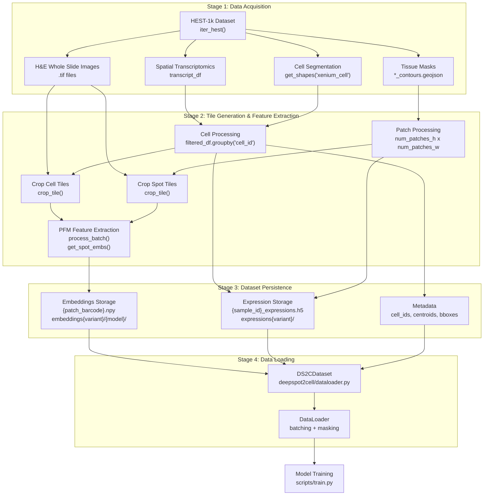
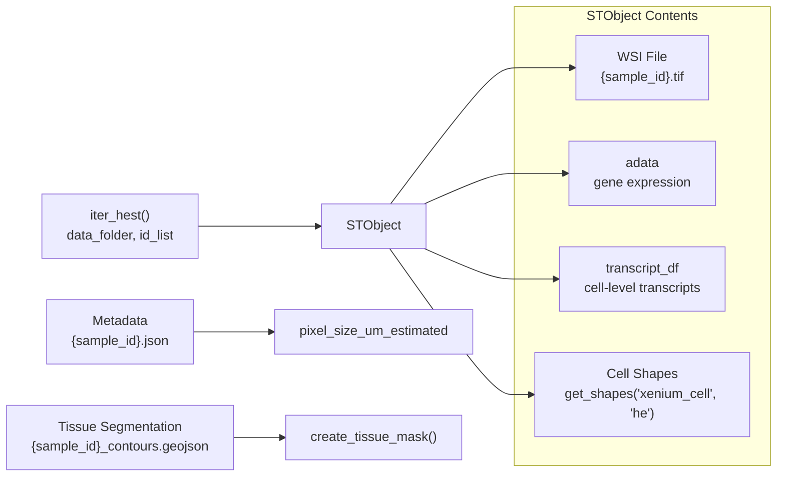
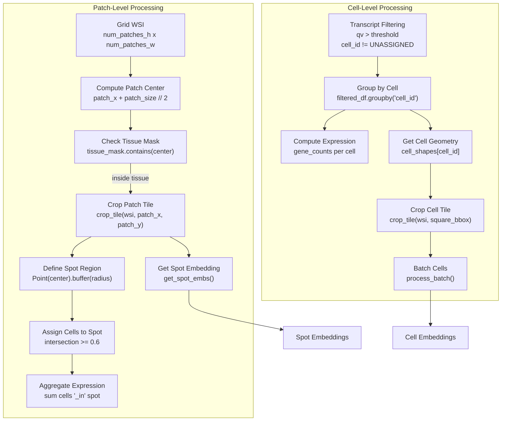
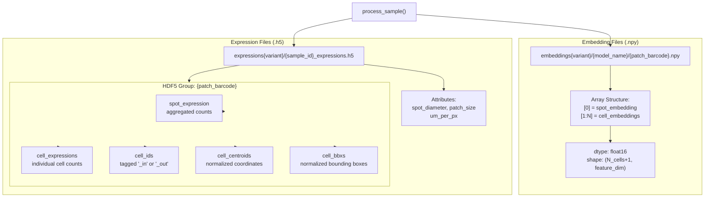
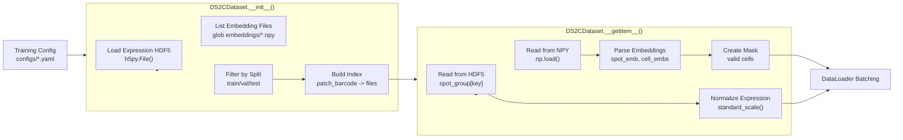

# Data Processing Pipeline

<details>
<summary>Relevant source files</summary>

The following files were used as context for generating this wiki page:

- [README.md](README.md)
- [deepspot2cell/dataset_creation.py](deepspot2cell/dataset_creation.py)

</details>


## Purpose and Scope

This page provides an overview of the end-to-end data processing workflow in DeepSpot2Cell, from raw HEST-1k data to training-ready datasets. The pipeline transforms whole slide images (WSI) and spatial transcriptomics data into pre-computed embeddings and expression matrices that can be efficiently loaded during model training and inference.

For detailed implementation of dataset creation, see [Dataset Creation](#5.1). For information about data preprocessing and normalization strategies, see [Data Preprocessing and Normalization](#5.2). For information about how the processed data is loaded during training, see [DS2CDataset and Data Loading](#4.2).

**Sources**: [README.md:1-70](), [deepspot2cell/dataset_creation.py:1-536]()

---

## Overview

The data processing pipeline consists of four main stages that separate computationally expensive preprocessing from model training:

1. **Data Acquisition**: Access raw data from HEST-1k dataset including H&E whole slide images, spatial transcriptomics measurements, and cell segmentation masks
2. **Tile Generation and Feature Extraction**: Extract cell and spot tiles from WSI, compute morphological embeddings using Pathology Foundation Models (PFMs)
3. **Dataset Persistence**: Save pre-computed embeddings and expression data in efficient formats (.npy and .h5 files)
4. **Data Loading for Training**: Load and batch the processed data during model training with optional augmentation

This modular design allows the expensive PFM feature extraction (Stage 2) to be performed once, with the pre-computed embeddings reused across multiple training experiments.

**Sources**: [deepspot2cell/dataset_creation.py:165-492]()

---

## End-to-End Pipeline Architecture



**Diagram 1: End-to-End Data Processing Pipeline** - This diagram shows the complete data flow from HEST-1k acquisition through to model training, highlighting the key processing functions and file formats at each stage.

**Sources**: [deepspot2cell/dataset_creation.py:165-536](), [README.md:24-33]()

---

## Pipeline Stages

### Stage 1: Data Acquisition

The pipeline begins by accessing data from the HEST-1k dataset using the HEST library's iterator:



**Diagram 2: Data Acquisition Components** - Shows how raw data is accessed from HEST-1k and auxiliary metadata files.

| Data Component | Source | Purpose |
|---------------|--------|---------|
| WSI Image | `{data_folder}/wsis/{sample_id}.tif` | Source for tile extraction |
| Transcript Data | `st.transcript_df` | Cell-level gene expression counts |
| Cell Shapes | `st.get_shapes('xenium_cell', 'he')` | Cell boundaries for cropping |
| Metadata | `{data_folder}/metadata/{sample_id}.json` | Pixel size calibration |
| Tissue Mask | `{data_folder}/tissue_seg/{sample_id}_contours.geojson` | Spatial filtering |

**Sources**: [deepspot2cell/dataset_creation.py:165-203](), [deepspot2cell/dataset_creation.py:188-190]()

---

### Stage 2: Tile Generation and Feature Extraction

This stage performs the computationally intensive operations: extracting image tiles and computing PFM embeddings.



**Diagram 3: Tile Generation and Feature Extraction** - Details the parallel processing of cells and patches, including geometric operations and PFM embedding computation.

#### Cell Processing

The cell processing loop [deepspot2cell/dataset_creation.py:238-327]() performs the following operations for each cell:

1. **Filter transcripts** by quality value (`qv > qv_thr`) and valid cell assignment
2. **Compute gene expression vector** by counting transcripts per gene for each cell
3. **Extract cell geometry** from segmentation masks and validate
4. **Compute square bounding box** centered on cell centroid to contain entire cell
5. **Crop cell tile** from WSI using `crop_tile()`
6. **Batch process** cells through PFM using `process_batch()` for efficiency

#### Patch Processing

The patch processing loop [deepspot2cell/dataset_creation.py:340-469]() divides the WSI into a regular grid:

1. **Grid generation**: WSI divided into patches of size `patch_size` (typically 55μm)
2. **Tissue filtering**: Skip patches whose center falls outside tissue mask
3. **Cell assignment**: Find cells within patch using spatial bounding box queries
4. **Spot definition**: Create circular spot region (radius = `spot_diameter/2`) centered on patch
5. **Cell tagging**: Tag cells as "in" spot if >60% overlap, "out" otherwise
6. **Expression aggregation**: Sum expression of all cells tagged "in" to get spot expression
7. **Spot embedding**: Compute embedding of full patch tile using `get_spot_embs()`

**Sources**: [deepspot2cell/dataset_creation.py:23-59](), [deepspot2cell/dataset_creation.py:208-327](), [deepspot2cell/dataset_creation.py:340-469]()

---

### Stage 3: Dataset Persistence

Processed data is saved in two file formats optimized for different access patterns:



**Diagram 4: Data Persistence Structure** - Shows the file organization and data structures used for storing processed datasets.

#### Embedding Files (.npy)

One `.npy` file is created per patch, containing embeddings for the spot and all associated cells [deepspot2cell/dataset_creation.py:458-468]():

- **Location**: `{data_folder}/embeddings{dataset_variant}/{model_name}/{patch_barcode}.npy`
- **Format**: NumPy array with shape `(N_cells + 1, feature_dim)`
- **Content**: 
  - Index 0: Spot (patch) embedding from PFM
  - Indices 1 to N: Cell embeddings from PFM, one per cell in patch
- **Data type**: `float16` for space efficiency

#### Expression Files (.h5)

One `.h5` file is created per sample, containing all patches for that sample [deepspot2cell/dataset_creation.py:474-487]():

- **Location**: `{data_folder}/expressions{dataset_variant}/{sample_id}_expressions.h5`
- **Format**: HDF5 with hierarchical group structure
- **Groups**: One group per patch, named by `patch_barcode`
- **Datasets per group**:
  - `spot_expression`: Aggregated gene expression for the spot
  - `cell_expressions`: Individual gene expression vectors for each cell
  - `cell_ids`: Cell identifiers with `_in`/`_out` tags indicating spot membership
  - `cell_centroids`: Normalized (x, y) coordinates relative to patch
  - `cell_bbxs`: Normalized bounding boxes (minx, miny, maxx, maxy)
- **Attributes**: `spot_diameter`, `patch_size`, `um_per_px` for spatial calibration

**Sources**: [deepspot2cell/dataset_creation.py:458-487]()

---

### Stage 4: Data Loading for Training

The `DS2CDataset` class loads the pre-computed data during training:



**Diagram 5: Data Loading Pipeline** - Shows how `DS2CDataset` loads and preprocesses the persistent data during training.

The dataset class handles:
- **Lazy loading**: Files are opened but data read only when requested via `__getitem__()`
- **Indexing**: Maps patch barcodes to file locations for efficient lookup
- **Filtering**: Applies dataset splits (train/val/test) based on configuration
- **Preprocessing**: Normalizes expression data and creates attention masks
- **Batching**: Integrates with PyTorch `DataLoader` for mini-batch training

For detailed implementation, see [DS2CDataset and Data Loading](#4.2).

**Sources**: [deepspot2cell/dataloader.py]() (referenced but not provided in full)

---

## File Organization

The data processing pipeline creates the following directory structure:

```
{data_folder}/
├── wsis/
│   └── {sample_id}.tif                    # H&E whole slide images
├── metadata/
│   └── {sample_id}.json                   # Pixel size and other metadata
├── tissue_seg/
│   └── {sample_id}_contours.geojson       # Tissue segmentation masks
├── embeddings{dataset_variant}/
│   └── {model_name}/
│       └── patch_{h}_{w}_{sample_id}.npy  # Pre-computed embeddings
└── expressions{dataset_variant}/
    └── {sample_id}_expressions.h5         # Gene expression data
```

The `{dataset_variant}` suffix (e.g., `_v1`, `_test`) allows multiple processed versions of the same raw data to coexist.

**Sources**: [deepspot2cell/dataset_creation.py:529-531]()

---

## Processing Configuration

The data processing pipeline is controlled via YAML configuration files (typically `configs/dataset.*.yaml`):

| Configuration Parameter | Location | Purpose |
|------------------------|----------|---------|
| `data_folder` | `data.data_folder` | Root directory for all data |
| `model_name` | `data.model_name` | PFM identifier (e.g., "UNI", "hoptimus0") |
| `model_path` | `data.model_path` | Path to PFM checkpoint |
| `dataset_variant` | `data.dataset_variant` | Suffix for output directories |
| `spot_diameter` | `data.spot_diameter` | Spot diameter in micrometers (default: 55) |
| `patch_size` | `data.patch_size` | Patch size in micrometers |
| `qv_thr` | `data.qv_thr` | Quality value threshold for transcript filtering |
| `dataset_ids` | `data.{dataset}.train.dataset_ids` | List of sample IDs to process |
| `ordered_genes_file` | `data.{dataset}.ordered_genes_file` | Gene ordering specification |
| `gpu_batch_size` | `processing.gpu_batch_size` | Batch size for GPU processing |
| `cpu_batch_size` | `processing.cpu_batch_size` | Batch size for CPU processing |

For complete configuration details, see [Dataset Configuration](#6.1).

**Sources**: [deepspot2cell/dataset_creation.py:495-536](), [deepspot2cell/utils/utils.py]() (referenced)

---

## Key Processing Functions

### `process_sample()`

The main processing function that orchestrates the entire pipeline for a single sample.

**Signature**: `process_sample(sample_id, st, model, preprocess, device, batch_size, config)`

**Location**: [deepspot2cell/dataset_creation.py:165-492]()

**Workflow**:
1. Load metadata and compute spatial parameters
2. Sort genes by variability
3. Create tissue mask from GeoJSON
4. Process all cells: extract tiles, compute embeddings
5. Process all patches: assign cells, aggregate expression, compute embeddings
6. Save embeddings as `.npy` files
7. Save expression data as `.h5` file

### `process_batch()`

Batch processes image tiles through the PFM for efficient GPU utilization.

**Signature**: `process_batch(batch_patches, model, preprocess, device)`

**Location**: [deepspot2cell/dataset_creation.py:23-40]()

**Details**:
- Handles image preprocessing and tensor conversion
- Uses automatic mixed precision (AMP) on CUDA devices
- Processes in batches to maximize GPU throughput
- Returns embeddings on CPU for memory efficiency

### `get_spot_embs()`

Computes embedding for a single spot tile.

**Signature**: `get_spot_embs(X_spot, morphology_model, preprocess, device, dtype_to_use=torch.float16)`

**Location**: [deepspot2cell/dataset_creation.py:43-58]()

### `crop_tile()`

Extracts a rectangular tile from the whole slide image using PyVips.

**Signature**: `crop_tile(image, x_pixel, y_pixel, spot_diameter)`

**Location**: [deepspot2cell/dataset_creation.py:87-93]()

**Note**: Returns tiles as NumPy arrays with shape `(height, width, 3)` for RGB channels.

### `create_tissue_mask()`

Creates a unified tissue mask from GeoJSON polygons with robust error handling.

**Signature**: `create_tissue_mask(tissue_mask_json, sample_id)`

**Location**: [deepspot2cell/dataset_creation.py:113-162]()

**Features**:
- Validates and fixes invalid polygon geometries
- Merges multiple tissue polygons using `unary_union`
- Provides fallback strategies if union fails
- Reports statistics on valid/invalid polygons

**Sources**: [deepspot2cell/dataset_creation.py:23-162]()

---

## Performance Considerations

The data processing pipeline is designed for efficiency:

1. **One-time computation**: PFM embeddings are computed once and reused across training runs
2. **Batch processing**: Cells and spots are processed in batches to maximize GPU utilization
3. **Memory management**: Embeddings stored as `float16` to reduce disk space
4. **Compression**: Expression data in HDF5 uses gzip compression (level 4)
5. **Lazy loading**: Training dataset loads data on-demand rather than all at once
6. **Progress tracking**: Processing functions report progress with ETA estimates

Typical processing times on GPU (example from code output):
- **Cell processing**: ~10-30 seconds per 10,000 cells
- **Patch processing**: ~1-5 seconds per 1,000 patches
- **Complete sample**: 5-20 minutes depending on tissue size

**Sources**: [deepspot2cell/dataset_creation.py:234-246](), [deepspot2cell/dataset_creation.py:344-349]()

---

## Command Line Usage

The dataset creation script can be invoked from the command line:

```bash
python -m deepspot2cell.dataset_creation \
    --config configs/dataset.example.yaml \
    --dataset lung \
    --indices 0 1 2
```

**Arguments**:
- `--config`: Path to configuration file (default: `configs/dataset.example.yaml`)
- `--dataset`: Dataset identifier matching config file keys (default: `lung`)
- `--indices`: Optional list of specific sample indices to process (processes all if omitted)

The script automatically detects available hardware and sets batch sizes accordingly [deepspot2cell/dataset_creation.py:514-524]().

**Sources**: [deepspot2cell/dataset_creation.py:495-536]()

---