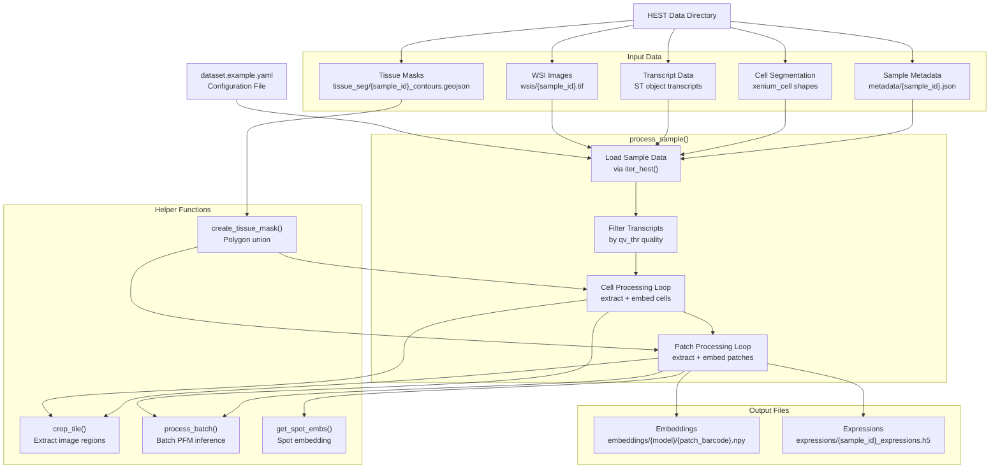
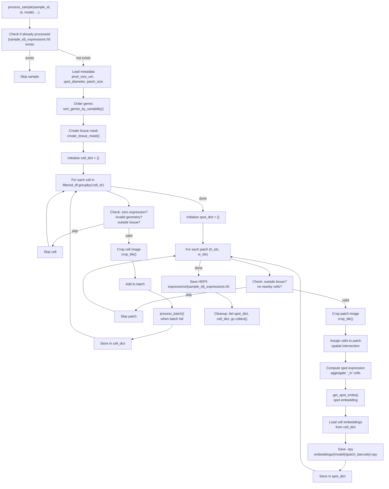
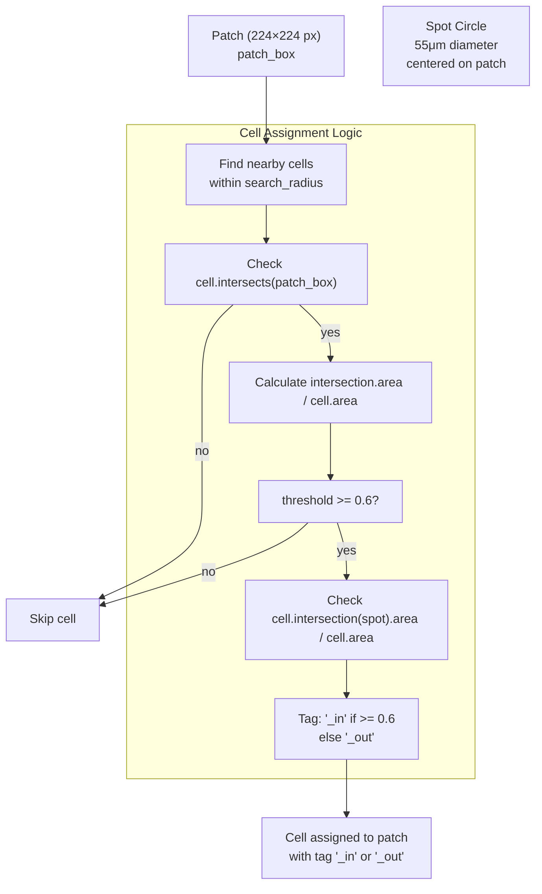
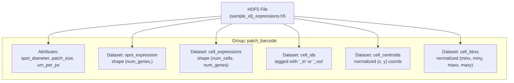

# Dataset Creation

<details>
<summary>Relevant source files</summary>

The following files were used as context for generating this wiki page:

- [configs/dataset.example.yaml](configs/dataset.example.yaml)
- [deepspot2cell/dataset_creation.py](deepspot2cell/dataset_creation.py)

</details>


## Purpose and Scope

This document describes the dataset creation pipeline that transforms raw HEST-1k spatial transcriptomics data into training-ready embeddings and expression files. The pipeline processes whole-slide H&E images and cell-level transcript data to generate morphological embeddings using Pathology Foundation Models (PFMs) and organize gene expression data at both cell and spot levels.

For information about using these preprocessed datasets during training, see [DS2CDataset and Data Loading](#4.2). For details on the HEST-1k dataset structure and access, see [HEST-1k Dataset](#10.1). For configuration options, see [Dataset Configuration](#6.1).

**Sources:** [deepspot2cell/dataset_creation.py:1-536](), [configs/dataset.example.yaml:1-27]()

## Overview

The dataset creation process is implemented in [deepspot2cell/dataset_creation.py]() and is typically run once per dataset as a preprocessing step before training. It performs computationally intensive operations—PFM feature extraction, spatial filtering, and data organization—that would be inefficient to repeat during each training run.



**Sources:** [deepspot2cell/dataset_creation.py:165-536](), [deepspot2cell/dataset_creation.py:495-536]()

## Input Requirements

The dataset creation pipeline expects a HEST-formatted data directory with the following structure:

| Directory/File | Description | Used By |
|----------------|-------------|---------|
| `wsis/{sample_id}.tif` | Whole-slide H&E image (PyVips format) | [crop_tile():87-93]() |
| `metadata/{sample_id}.json` | Sample metadata (pixel size, cell counts) | [process_sample():173-183]() |
| `tissue_seg/{sample_id}_contours.geojson` | Tissue segmentation polygons | [create_tissue_mask():113-162]() |
| HEST ST object | Spatial transcriptomics data (transcripts, cell shapes) | [process_sample():193-208]() |

The configuration file (`configs/dataset.example.yaml`) specifies:

```yaml
data:
  data_folder: /path/to/hest_data
  dataset_variant: _v1                    # Output directory suffix
  model_name: phikonv2                    # PFM to use
  model_path: /path/to/phikonv2
  
  spot_diameter_px: 160                   # Spot diameter (pixels)
  patch_size_px: 224                      # Patch size (pixels)
  qv_thr: 20                              # Transcript quality threshold
  
  lung:
    ordered_genes_file: lung_ordered_genes.json
    train:
      dataset_ids: [SAMPLE_ID_1, ...]    # Samples to process
```

**Sources:** [configs/dataset.example.yaml:1-27](), [deepspot2cell/dataset_creation.py:166-183]()

## Processing Pipeline

### Configuration and Initialization

The main script parses command-line arguments and loads the configuration:

```bash
python deepspot2cell/dataset_creation.py \
    --config configs/dataset.example.yaml \
    --dataset lung \
    --indices 0 1 2
```

The script automatically selects the device and batch size based on available hardware:

**Sources:** [deepspot2cell/dataset_creation.py:495-527]()

### Sample Processing Workflow

The `process_sample()` function [deepspot2cell/dataset_creation.py:165-492]() implements the core processing logic for each sample:



**Sources:** [deepspot2cell/dataset_creation.py:165-492]()

### Cell Processing

The cell processing loop [deepspot2cell/dataset_creation.py:238-327]() extracts individual cell data and morphological embeddings:

#### Transcript Filtering

Before processing cells, transcripts are filtered by quality:

```python
filtered_df = st.transcript_df[~st.transcript_df.cell_id.isin(['UNASSIGNED', -1])]
filtered_df = filtered_df[filtered_df['qv'] > qv_thr]  # Quality value threshold
```

**Sources:** [deepspot2cell/dataset_creation.py:207-225]()

#### Cell Data Extraction

For each cell identified by `cell_id`:

1. **Gene Expression Aggregation**: Count transcripts per gene [deepspot2cell/dataset_creation.py:248-255]()
2. **Cell Shape**: Extract polygon from `cell_shapes` [deepspot2cell/dataset_creation.py:257-267]()
3. **Spatial Filtering**: Check if cell centroid is inside tissue mask [deepspot2cell/dataset_creation.py:272-275]()
4. **Bounding Box**: Compute smallest square containing the cell [deepspot2cell/dataset_creation.py:278-288]()
5. **Image Cropping**: Extract cell image region using `crop_tile()` [deepspot2cell/dataset_creation.py:290-294]()

#### Batch Embedding

Cells are processed in batches through the PFM:


The `process_batch()` function [deepspot2cell/dataset_creation.py:23-40]() handles:
- Image preprocessing (resize to square if needed)
- Conversion to tensors with appropriate dtype (float16 for GPU, float32 for CPU)
- Automatic mixed precision (AMP) when using CUDA
- Batch inference with gradient disabled

**Sources:** [deepspot2cell/dataset_creation.py:23-40](), [deepspot2cell/dataset_creation.py:306-316]()

### Patch/Spot Processing

The patch processing loop [deepspot2cell/dataset_creation.py:340-488]() divides the WSI into a grid and processes each patch as a spot:

#### Spatial Grid

The WSI is divided into non-overlapping patches:

```python
num_patches_h = wsi_height // patch_size
num_patches_w = wsi_width // patch_size
```

Each patch is identified by `patch_barcode = f"patch_{h_idx}_{w_idx}_{sample_id}"`

**Sources:** [deepspot2cell/dataset_creation.py:200-205](), [deepspot2cell/dataset_creation.py:351]()

#### Cell-to-Patch Assignment

For each patch, nearby cells are identified and assigned based on spatial relationships:



Key criteria [deepspot2cell/dataset_creation.py:390-434]():
- Cell must have at least 60% of its area within the patch bounds
- Cells are tagged `_in` if ≥60% overlaps with the spot circle (55μm diameter)
- Cells are tagged `_out` if <60% overlaps with the spot circle
- Only `_in` cells contribute to spot-level gene expression

**Sources:** [deepspot2cell/dataset_creation.py:362-454]()

#### Spot Expression Aggregation

The spot-level gene expression is computed by summing expression from all `_in` cells:

```python
spot_expression = np.zeros(len(ordered_gene_names))
for i, cell_id in enumerate(cell_ids_tagged):
    if '_in' in cell_id:
        spot_expression += cell_expressions[i]
```

This aggregated spot expression serves as the training target during model training.

**Sources:** [deepspot2cell/dataset_creation.py:439-444]()

#### Embedding Extraction

For each patch, two types of embeddings are computed:

1. **Spot Embedding**: Full patch processed through PFM using `get_spot_embs()` [deepspot2cell/dataset_creation.py:43-58]()
2. **Cell Embeddings**: Previously computed embeddings retrieved from `cell_dict` [deepspot2cell/dataset_creation.py:460-466]()

These are stacked and saved as a single `.npy` file:

```python
patch_embeddings = [spot_embeddings.astype(np.float16)]  # First row: spot
for cell_id in cell_ids:
    emb = cell_dict[cell_id]['cell_embedding']
    patch_embeddings.append(emb.astype(np.float16))      # Subsequent rows: cells
patch_embeddings = np.vstack(patch_embeddings)
np.save(f'{data_folder}/embeddings{dataset_variant}/{model_name}/{patch_barcode}.npy', 
        patch_embeddings)
```

**Sources:** [deepspot2cell/dataset_creation.py:456-468]()

## Output Format

### Embedding Files (.npy)

Each patch generates one `.npy` file at `embeddings{dataset_variant}/{model_name}/{patch_barcode}.npy`:

| Row Index | Content | Shape |
|-----------|---------|-------|
| 0 | Spot embedding (full patch) | `(feature_dim,)` |
| 1 | Cell 0 embedding | `(feature_dim,)` |
| 2 | Cell 1 embedding | `(feature_dim,)` |
| ... | ... | ... |
| N | Cell N-1 embedding | `(feature_dim,)` |

The array shape is `(1 + num_cells, feature_dim)` where `feature_dim` depends on the PFM (e.g., 1024 for Phikon v2).

**Sources:** [deepspot2cell/dataset_creation.py:458-468]()

### Expression Files (.h5)

Each sample generates one HDF5 file at `expressions{dataset_variant}/{sample_id}_expressions.h5`:



The HDF5 structure [deepspot2cell/dataset_creation.py:475-487]():

| Group/Dataset | Data Type | Compression | Description |
|---------------|-----------|-------------|-------------|
| `{patch_barcode}/` | Group | - | One group per patch |
| `.attrs['spot_diameter']` | int | - | Spot diameter in pixels |
| `.attrs['patch_size']` | int | - | Patch size in pixels |
| `.attrs['um_per_px']` | float | - | Microns per pixel |
| `spot_expression` | float | gzip (level 4) | Aggregated spot-level expression `(num_genes,)` |
| `cell_expressions` | float | gzip (level 4) | Cell-level expressions `(num_cells, num_genes)` |
| `cell_ids` | string | - | Cell IDs with `_in`/`_out` tags |
| `cell_centroids` | float32 | gzip (level 4) | Normalized centroids `(num_cells, 2)` |
| `cell_bbxs` | float32 | gzip (level 4) | Normalized bounding boxes `(num_cells, 4)` |

**Sources:** [deepspot2cell/dataset_creation.py:474-487]()

## Spatial Filtering and Quality Control

The pipeline implements multiple levels of spatial filtering to ensure data quality:

### Tissue Mask Creation

The `create_tissue_mask()` function [deepspot2cell/dataset_creation.py:113-162]() builds a tissue mask from GeoJSON polygons with robust error handling:

1. **Geometry Validation**: Each polygon is validated and fixed using `buffer(0)` if invalid
2. **Union Operation**: Multiple tissue polygons are combined using `unary_union()` with fallback to iterative union if the operation fails
3. **Error Recovery**: Invalid polygons are skipped with warnings

**Sources:** [deepspot2cell/dataset_creation.py:113-162]()

### Cell Filtering

Cells are filtered at multiple stages [deepspot2cell/dataset_creation.py:238-327]():

| Filter Stage | Condition | Purpose |
|--------------|-----------|---------|
| Transcript quality | `qv > qv_thr` | Remove low-quality transcript detections |
| Zero expression | `sum(gene_expression) > 0` | Remove cells with no detected transcripts |
| Invalid geometry | `cell_shape.is_valid` | Remove cells with malformed polygons |
| Tissue boundary | `tissue_mask.contains(centroid)` | Remove cells outside tissue |

### Patch Filtering

Patches are filtered to focus on tissue regions [deepspot2cell/dataset_creation.py:340-454]():

| Filter | Condition | Impact |
|--------|-----------|--------|
| Tissue centroid | `tissue_mask.contains(patch_center)` | Skip patches outside tissue |
| No cells | `len(nearby_cells) == 0` | Skip empty patches |
| Zero expression | `len(cell_expressions) == 0` | Skip patches with no valid cells |

**Sources:** [deepspot2cell/dataset_creation.py:207-215](), [deepspot2cell/dataset_creation.py:253-275](), [deepspot2cell/dataset_creation.py:358-437]()

## Performance Optimization

The pipeline includes several optimizations for processing large WSIs:

### Batching Strategy

- **Cell batching**: Cells are accumulated and processed in batches (default: 32 GPU, 8 CPU) [deepspot2cell/dataset_creation.py:306-316]()
- **Automatic batch sizing**: GPU batch size scales with VRAM (32 per 14GB) [deepspot2cell/dataset_creation.py:514-520]()
- **Memory management**: Cell embeddings are deleted from `cell_dict` after being saved to reduce memory [deepspot2cell/dataset_creation.py:465-466]()

### Spatial Optimization

- **Search radius**: Only cells within `search_radius` of patch center are considered [deepspot2cell/dataset_creation.py:362-367]()
- **Bounds check**: Quick bbox intersection check before expensive geometry operations [deepspot2cell/dataset_creation.py:395-398]()

### Progress Tracking

The pipeline prints progress every 10,000 cells and 1,000 patches with ETA estimates:

```
Processed 10000/200000 cells (5.0%) - ETA: 0:5:30/1:45:00
Processed 1000/10000 patches (10.0%) - ETA: 0:2:15/0:18:30
```

**Sources:** [deepspot2cell/dataset_creation.py:241-246](), [deepspot2cell/dataset_creation.py:344-349]()

## Command-Line Usage

### Basic Usage

```bash
python deepspot2cell/dataset_creation.py \
    --config configs/dataset.example.yaml \
    --dataset lung
```

### Processing Specific Samples

```bash
# Process only samples at indices 0, 1, 2
python deepspot2cell/dataset_creation.py \
    --config configs/dataset.example.yaml \
    --dataset lung \
    --indices 0 1 2
```

### Configuration Options

The script reads sample IDs from the configuration:

```yaml
data:
  lung:
    train:
      dataset_ids:
        - SAMPLE_ID_1
        - SAMPLE_ID_2
    ood:
      dataset_ids:
        - SAMPLE_ID_3
```

All samples from both `train` and `ood` splits are processed unless `--indices` is specified.

**Sources:** [deepspot2cell/dataset_creation.py:495-536]()

## Helper Functions

### crop_tile()

Extracts a square image region from a PyVips image:

```python
def crop_tile(image, x_pixel, y_pixel, spot_diameter):
    spot = image.crop(x_pixel, y_pixel, spot_diameter, spot_diameter)
    main_tile = np.ndarray(buffer=spot.write_to_memory(),
                           dtype=format_to_dtype[spot.format],
                           shape=[spot.height, spot.width, spot.bands])
    return main_tile[:, :, :3]  # Return only RGB channels
```

**Sources:** [deepspot2cell/dataset_creation.py:87-93]()

### fix_invalid_geometry()

Attempts to repair invalid Shapely geometries:

```python
def fix_invalid_geometry(geom):
    if not geom.is_valid:
        fixed = geom.buffer(0)  # Standard fix
        if fixed.is_valid:
            return fixed
        # Fallback to make_valid() if available
    return geom
```

**Sources:** [deepspot2cell/dataset_creation.py:96-110]()

### sort_genes_by_variability()

Loads or generates a gene ordering for consistent indexing:

- Loads from `{data_folder}/{ordered_genes_file}` if exists
- Otherwise calls `order_genes()` from utils to generate new ordering
- Returns list of gene names in order of decreasing variability

**Sources:** [deepspot2cell/dataset_creation.py:61-84]()

---