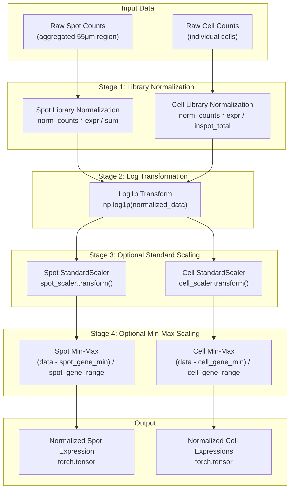
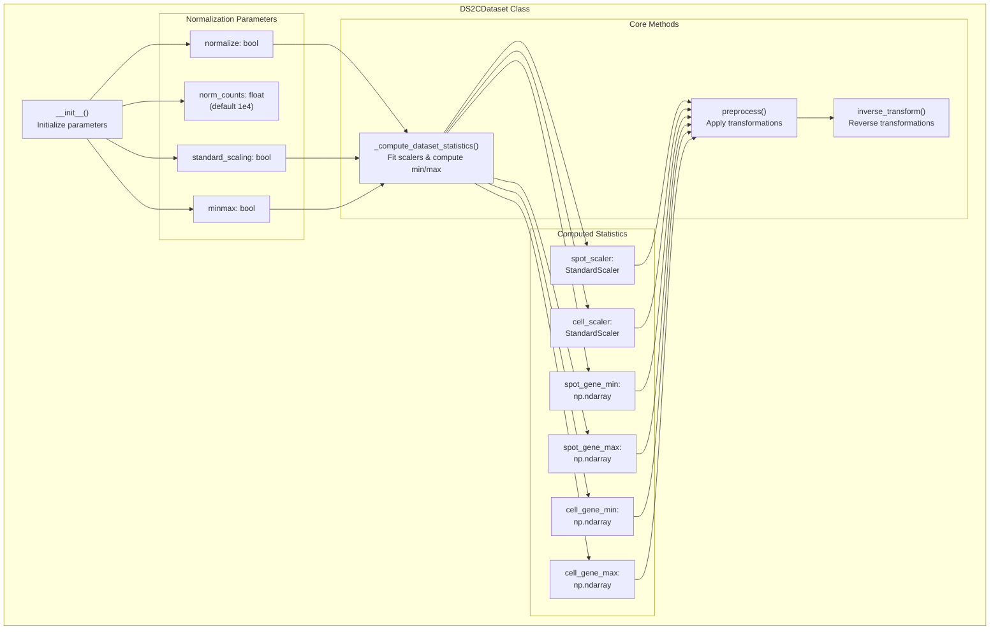
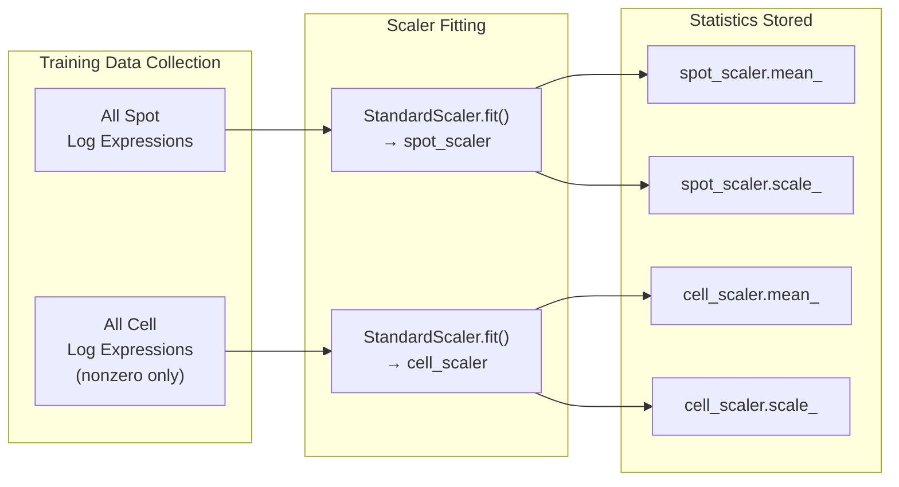
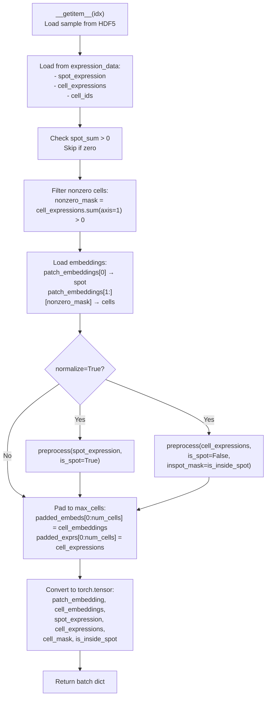
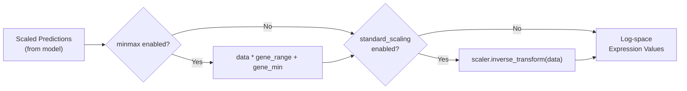

# Data Preprocessing and Normalization

<details>
<summary>Relevant source files</summary>

The following files were used as context for generating this wiki page:

- [deepspot2cell/dataloader.py](deepspot2cell/dataloader.py)
- [deepspot2cell/utils/utils_dataloader.py](deepspot2cell/utils/utils_dataloader.py)

</details>


This document describes the data preprocessing and normalization strategies implemented in DeepSpot2Cell. These transformations are applied to gene expression data before it is fed into the model during training and inference. For information about the overall dataset creation process, see [Dataset Creation](#5.1). For details about the data loading pipeline, see [DS2CDataset and Data Loading](#4.2).

## Purpose and Scope

DeepSpot2Cell implements a multi-stage normalization pipeline that standardizes gene expression data across different scales (spot-level and cell-level) to enable effective model training. The normalization process handles:

- **Library size normalization**: Accounting for varying sequencing depths across spots and cells
- **Log transformation**: Stabilizing variance in count data
- **Standard scaling (z-score normalization)**: Centering and scaling features to unit variance
- **Min-max scaling**: Normalizing features to a [0, 1] range
- **Separate normalization for spots vs. cells**: Different statistics for aggregated spot data versus individual cell data

All preprocessing is performed by the `DS2CDataset` class during data loading and can be configured via constructor parameters.

---

## Normalization Pipeline Overview

The following diagram illustrates the complete normalization pipeline from raw counts to model-ready tensors:



**Sources:** [deepspot2cell/dataloader.py:280-319]()

---

## DS2CDataset Preprocessing Components

The `DS2CDataset` class manages all preprocessing functionality. The following diagram shows the key components and their relationships:



**Sources:** [deepspot2cell/dataloader.py:9-36](), [deepspot2cell/dataloader.py:37-144]()

---

## Library Size Normalization

Library size normalization accounts for varying sequencing depths across different spots and cells. This is the first and most critical normalization step.

### Spot-Level Normalization

For spot-level expression data, each spot is normalized independently:

```python
norm_counts * spot_expression / sum(spot_expression)
```

This ensures that each spot's total counts sum to `norm_counts` (typically 10,000), making expression levels comparable across spots with different sequencing depths.

### Cell-Level Normalization

Cell-level normalization is more complex because cells are normalized relative to their parent spot's total:

```python
# Calculate total counts from cells inside the spot
inspot_total = sum(cell_sums[cells_inside_spot])

# Normalize all cells (inside and outside) by this total
norm_cells = norm_counts * cell_expressions / inspot_total
```

This approach has two important properties:
1. **Consistency**: The sum of normalized cell expressions within a spot approximately equals the normalized spot expression
2. **Handling outside cells**: Cells outside the spot boundary (marked with `_out` suffix) are normalized using the same `inspot_total`, maintaining relative scale

**Sources:** [deepspot2cell/dataloader.py:280-294]()

---

## Log Transformation

After library normalization, a log1p transformation is applied to stabilize variance:

```python
log_data = np.log1p(norm_data)
```

The `log1p` function computes `log(1 + x)`, which:
- Handles zero counts gracefully (log(1 + 0) = 0)
- Reduces the impact of highly expressed genes
- Makes the data distribution more approximately normal

This transformation is always applied when `normalize=True` and occurs before any subsequent scaling operations.

**Sources:** [deepspot2cell/dataloader.py:296]()

---

## Standard Scaling (Z-Score Normalization)

When `standard_scaling=True`, the dataset computes separate `StandardScaler` objects for spots and cells during initialization.

### Computing Scalers

The `_compute_dataset_statistics` method collects all log-normalized expressions and fits separate scalers:



The standard scaling transformation is:

```python
scaled_data = (log_data - mean) / std
```

This centers each gene at zero mean with unit variance, making genes with different expression ranges comparable.

**Sources:** [deepspot2cell/dataloader.py:55-124](), [deepspot2cell/dataloader.py:298-311]()

### Separate Spot and Cell Scalers

A critical design decision is maintaining separate scalers for spots versus cells:

| Aspect | Spot Scaler | Cell Scaler |
|--------|-------------|-------------|
| **Training Data** | All spot expressions from dataset | All non-zero cell expressions from dataset |
| **Mean Range** | Typically higher (aggregated signal) | Typically lower (single-cell signal) |
| **Application** | Applied to spot targets during training | Applied to cell features and predictions |
| **Purpose** | Normalize aggregated 55μm region data | Normalize individual cell data |

This separation is necessary because:
- Spots represent aggregated signals from ~10-30 cells
- Cells have sparser, lower-magnitude expression patterns
- Using the same scaler would distort the relative magnitudes

**Sources:** [deepspot2cell/dataloader.py:110-124](), [deepspot2cell/dataloader.py:304-311]()

---

## Min-Max Scaling

When `minmax=True`, an additional min-max normalization scales data to [0, 1]:

```python
scaled_data = (log_data - gene_min) / gene_range
```

where `gene_range = gene_max - gene_min`.

### Computing Min-Max Statistics

During `_compute_dataset_statistics`, the dataset tracks per-gene minimum and maximum values separately for spots and cells:

| Statistic | Spot Values | Cell Values |
|-----------|-------------|-------------|
| `spot_gene_min` | Minimum log-normalized value per gene across all spots | - |
| `spot_gene_max` | Maximum log-normalized value per gene across all spots | - |
| `cell_gene_min` | - | Minimum log-normalized value per gene across all nonzero cells |
| `cell_gene_max` | - | Maximum log-normalized value per gene across all nonzero cells |

The range is computed with a safeguard against zero division:

```python
gene_range = gene_max - gene_min
gene_range[gene_range < 1e-8] = 1.0  # Avoid division by zero
```

Min-max scaling is applied after standard scaling (if enabled) and provides bounded output values useful for certain model architectures.

**Sources:** [deepspot2cell/dataloader.py:45-144](), [deepspot2cell/dataloader.py:313-318]()

---

## Data Flow Through Preprocessing

The following diagram traces a single data sample through the complete preprocessing pipeline:



**Sources:** [deepspot2cell/dataloader.py:164-270]()

---

## Inverse Transformation

The `inverse_transform` method reverses the normalization pipeline, converting model predictions back to log-space:



The inverse transform is applied in reverse order:
1. **Undo min-max scaling** (if enabled): `data = data * gene_range + gene_min`
2. **Undo standard scaling** (if enabled): `data = scaler.inverse_transform(data)`

Note that the log transformation is **not reversed** by this method. To obtain raw counts, additional steps would be needed:
```python
# After inverse_transform, data is in log-space
raw_counts = np.expm1(log_data) * total_counts / norm_counts
```

**Sources:** [deepspot2cell/dataloader.py:321-348]()

---

## Configuration Parameters

The following table summarizes all normalization-related parameters accepted by `DS2CDataset.__init__`:

| Parameter | Type | Default | Description |
|-----------|------|---------|-------------|
| `normalize` | `bool` | `True` | Enable library normalization and log transformation |
| `norm_counts` | `float` | `1e4` | Target total counts for library normalization |
| `standard_scaling` | `bool` | `False` | Enable z-score normalization using `StandardScaler` |
| `minmax` | `bool` | `False` | Enable min-max scaling to [0, 1] range |

These parameters are typically set via the training configuration YAML file. See [Training Configuration](#6.2) for details on how to configure these values.

**Sources:** [deepspot2cell/dataloader.py:10]()

---

## Optional Spatial Smoothing and Augmentation

In addition to the core normalization pipeline, `utils_dataloader.py` provides functions for optional data augmentation:

### Spatial Smoothing

The `spatial_upsample_and_smooth` function can smooth expression values using k-nearest neighbors in latent space:

```python
if smooth_n > 0:
    neigh = NearestNeighbors(n_neighbors=smooth_n)
    neigh.fit(adata.obsm["latent"])
    neigh_idx = neigh.kneighbors(adata.obsm["latent"], return_distance=False)
    smooth_counts = adata.X[neigh_idx].mean(axis=1)
```

This averages expression values across `smooth_n` neighbors, reducing noise.

### Clustering-Based Balancing

The function also supports clustering-based balanced sampling:

| Method | Description | Function |
|--------|-------------|----------|
| `default` | PCA + Leiden clustering | `run_default(adata, resolution)` |
| `aestetik` | AESTETIK multi-modal clustering | `run_aestetik(adata, window_size, resolution)` |

After clustering, samples are balanced by oversampling underrepresented clusters:
```python
n_count = np.max(adata.obs.label.value_counts())
resampled_barcodes = get_balanced_index(sample_barcode, adata.obs.leiden, n_count)
```

**Note:** These augmentation functions are provided for advanced use cases but are not used in the default DeepSpot2Cell training pipeline.

**Sources:** [deepspot2cell/utils/utils_dataloader.py:20-98]()

---

## Normalization Statistics Logging

During dataset initialization, `_compute_dataset_statistics` prints detailed statistics about the normalization:

```python
print(f"Max cells per patch: {max_cells}")
print(f"Mean cells per patch: {avg_cells}")
print(f"Mean cells per spot: {np.mean(cells_per_spot):.2f}")

if standard_scaling:
    print(f"Fit Spot StandardScaler on {all_spot_log_expressions.shape[0]} spot expressions")
    print(f"Spot Mean: min={spot_scaler.mean_.min():.4f}, max={spot_scaler.mean_.max():.4f}")
    print(f"Spot Std: min={spot_scaler.scale_.min():.4f}, max={spot_scaler.scale_.max():.4f}")
```

These logs are useful for verifying that:
- The dataset loaded correctly
- Normalization statistics are reasonable
- Separate spot/cell scalers have different parameters (as expected)

**Sources:** [deepspot2cell/dataloader.py:126-144]()

---

## Summary

The DeepSpot2Cell preprocessing pipeline implements a sophisticated multi-stage normalization strategy:

1. **Library normalization** ensures comparable expression magnitudes across samples with different sequencing depths
2. **Log transformation** stabilizes variance and handles zero counts
3. **Standard scaling** (optional) centers and scales features to unit variance
4. **Min-max scaling** (optional) bounds features to [0, 1]
5. **Separate normalization** for spots vs. cells maintains appropriate relative scales
6. **Inverse transformation** allows converting model predictions back to log-space

All preprocessing is handled automatically by the `DS2CDataset` class during data loading, with behavior controlled by constructor parameters. The design ensures that spot-level supervision signals remain properly scaled relative to cell-level features during training, enabling the model to learn the resolution transfer from spot-supervised training to cell-level predictions.

---