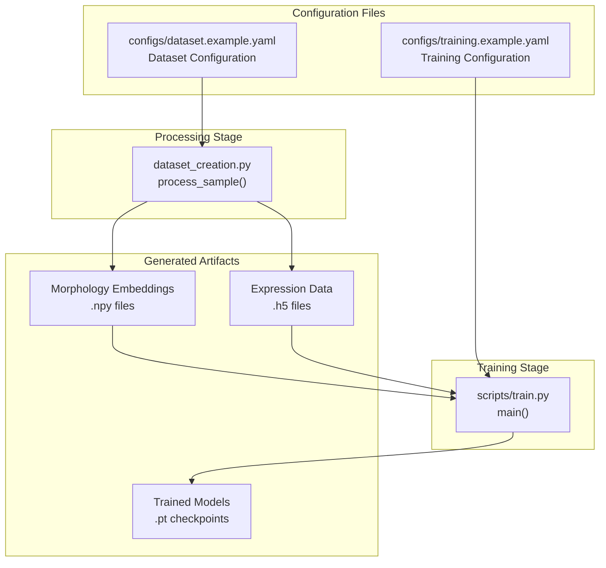
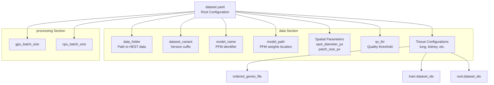
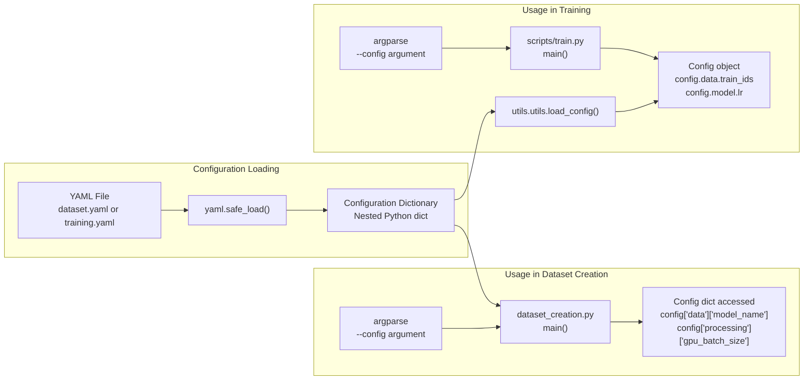
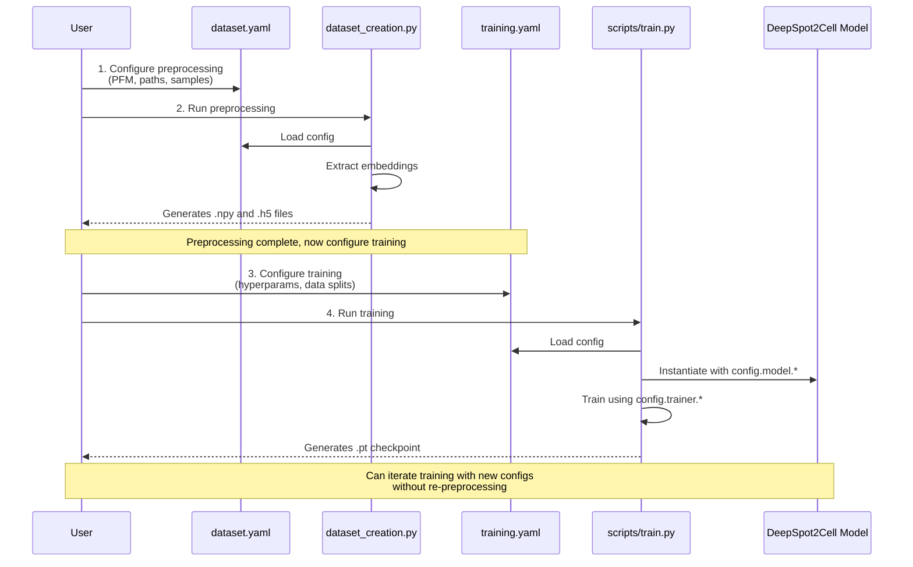
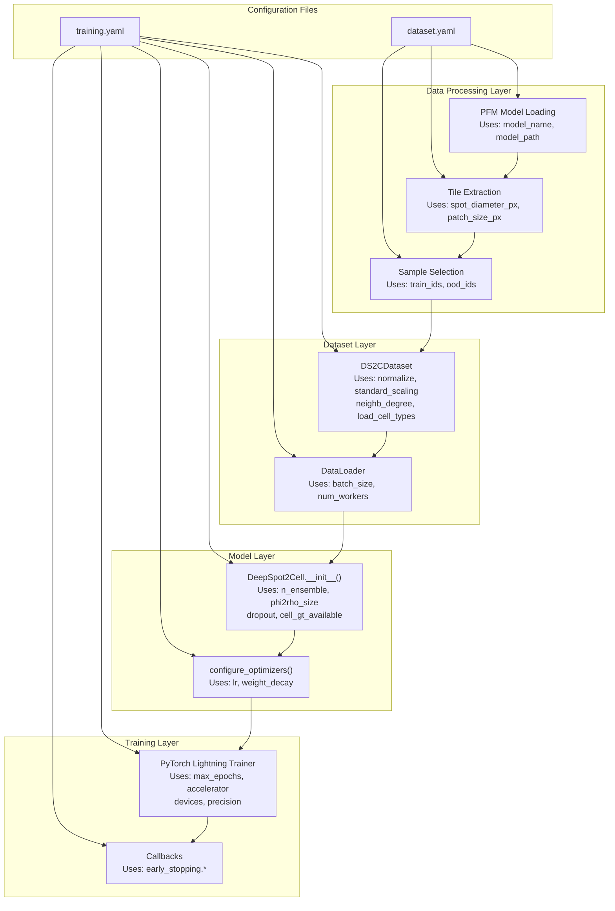

# Configuration

<details>
<summary>Relevant source files</summary>

The following files were used as context for generating this wiki page:

- [configs/dataset.example.yaml](configs/dataset.example.yaml)
- [configs/training.example.yaml](configs/training.example.yaml)

</details>


## Purpose and Scope

This page provides an overview of DeepSpot2Cell's configuration system, which uses YAML files to control all aspects of dataset processing and model training. The configuration system centralizes parameter management and enables reproducible experiments by explicitly defining all settings in version-controlled files.

For detailed documentation of specific configuration parameters:
- Dataset configuration parameters: see [Dataset Configuration](#6.1)
- Training configuration parameters: see [Training Configuration](#6.2)

For information about how configuration is used during execution:
- Dataset creation workflow: see [Dataset Creation](#5.1)
- Training workflow: see [Training Script](#8.1)

---

## Configuration System Architecture

DeepSpot2Cell uses a two-tier configuration system that separates concerns between data preparation and model training:



**Diagram: Configuration System Flow**

The system enforces a clean separation: dataset configuration controls the one-time preprocessing phase where morphological features are extracted and saved, while training configuration controls the iterative training process that can be repeated with different hyperparameters without re-preprocessing data.

**Sources:** [configs/dataset.example.yaml](), [configs/training.example.yaml]()

---

## Configuration File Types

DeepSpot2Cell provides two distinct configuration file types:

| Configuration Type | File Pattern | Purpose | Used By | Frequency |
|-------------------|--------------|---------|---------|-----------|
| Dataset | `dataset.*.yaml` | Controls data preprocessing, PFM selection, spatial parameters | `dataset_creation.py` | Once per dataset |
| Training | `training.*.yaml` | Controls model architecture, training hyperparameters, optimization | `scripts/train.py` | Multiple times during experimentation |

### File Locations

All configuration files reside in the `configs/` directory at the repository root:

```
configs/
├── dataset.example.yaml     # Example dataset configuration
└── training.example.yaml    # Example training configuration
```

Users create their own configuration files by copying these examples and modifying paths and parameters for their specific use case.

**Sources:** [configs/dataset.example.yaml](), [configs/training.example.yaml]()

---

## Configuration Structure Overview

### Dataset Configuration Hierarchy



**Diagram: Dataset Configuration Structure**

The dataset configuration has two main sections:
- **`data`**: Defines input paths, PFM selection, spatial dimensions, and sample organization by tissue type
- **`processing`**: Controls batch sizes for GPU and CPU operations during embedding computation

**Sources:** [configs/dataset.example.yaml:1-27]()

### Training Configuration Hierarchy

```mermaid
graph TB
    ROOT["training.yaml<br/>Root Configuration"]
    
    subgraph "experiment Section"
        EXP_NAME["name"]
        SEED["random_seed"]
    end
    
    subgraph "data Section"
        TR_DATA_FOLDER["data_folder"]
        TR_DATASET_VARIANT["dataset_variant"]
        TR_MODEL_NAME["model_name"]
        TRAIN_IDS["train_ids"]
        VAL_IDS["val_ids"]
        PREPROCESS["Preprocessing Flags<br/>normalize, standard_scaling<br/>minmax, norm_counts"]
        NEIGHB["neighb_degree"]
        CELLTYPES["load_cell_types"]
    end
    
    subgraph "dataloader Section"
        BATCH_SIZE["batch_size"]
        NUM_WORKERS["num_workers"]
    end
    
    subgraph "model Section"
        LEARNING["lr, weight_decay"]
        ARCH["dropout, n_ensemble<br/>phi2rho_size"]
        CELL_GT["cell_gt_available"]
    end
    
    subgraph "trainer Section"
        TR_PARAMS["max_epochs, accelerator<br/>devices, precision"]
        LOGGING["log_every_n_steps"]
        EARLY_STOP["early_stopping<br/>enabled, monitor, patience"]
    end
    
    ROOT --> EXP_NAME
    ROOT --> SEED
    ROOT --> TR_DATA_FOLDER
    ROOT --> TRAIN_IDS
    ROOT --> VAL_IDS
    ROOT --> PREPROCESS
    ROOT --> BATCH_SIZE
    ROOT --> NUM_WORKERS
    ROOT --> LEARNING
    ROOT --> ARCH
    ROOT --> TR_PARAMS
    ROOT --> EARLY_STOP
```



**Diagram: Training Configuration Structure**

The training configuration has five main sections:
- **`experiment`**: Identifies the experiment and sets reproducibility parameters
- **`data`**: Specifies data locations, train/val splits, and preprocessing options
- **`dataloader`**: Controls PyTorch DataLoader behavior
- **`model`**: Defines model architecture and optimization hyperparameters
- **`trainer`**: Configures PyTorch Lightning Trainer settings including early stopping

**Sources:** [configs/training.example.yaml:1-54]()

---

## Configuration Loading Mechanism



**Diagram: Configuration Loading Code Entities**

Configuration files are loaded through standard Python YAML parsing:

1. **Dataset creation** loads configuration directly as a dictionary and accesses values using bracket notation (e.g., `config['data']['model_name']`)

2. **Training script** uses a utility function `load_config()` from `deepspot2cell.utils.utils` that provides dot-notation access to configuration values (e.g., `config.model.lr`)

Both approaches read the same YAML format but provide different access patterns to suit their respective use cases.

**Sources:** [configs/dataset.example.yaml](), [configs/training.example.yaml]()

---

## Configuration Workflow

The two configuration types are used at different stages of the DeepSpot2Cell pipeline:



**Diagram: Configuration Usage Sequence**

The separation between dataset and training configuration enables efficient experimentation:
- Dataset configuration is used once to generate preprocessed artifacts
- Training configuration can be modified and reused multiple times without re-running expensive preprocessing
- Each configuration file is self-contained and version-controllable for reproducibility

**Sources:** [configs/dataset.example.yaml](), [configs/training.example.yaml]()

---

## Example Configuration Files

DeepSpot2Cell provides example configuration files that serve as templates:

### Dataset Configuration Example

The example dataset configuration (`configs/dataset.example.yaml`) demonstrates:
- Absolute path specifications for data and model locations
- Choice between pixel-based or micron-based spatial dimensions (lines 7-11)
- Tissue-specific settings with gene lists and sample IDs
- Processing batch sizes for GPU and CPU operations

Key sections:
- **data**: Paths, PFM selection, spatial parameters, quality threshold
- **tissue_type** (e.g., `lung`): Gene lists and train/ood sample splits
- **processing**: Batch sizes for parallel processing

### Training Configuration Example

The example training configuration (`configs/training.example.yaml`) demonstrates:
- Experiment identification and random seed for reproducibility
- Data paths matching the dataset configuration's output location
- Preprocessing toggles for normalization strategies
- Model hyperparameters including ensemble size and dropout
- PyTorch Lightning trainer settings with early stopping

Key sections:
- **experiment**: Name and seed
- **data**: Paths, sample IDs, preprocessing flags
- **dataloader**: Batch size and worker count
- **model**: Architecture and optimization parameters
- **trainer**: Training duration, hardware, and early stopping

**Sources:** [configs/dataset.example.yaml:1-27](), [configs/training.example.yaml:1-54]()

---

## Configuration Parameter Categories

The table below categorizes configuration parameters by their functional purpose:

| Category | Parameters | Configuration File | Purpose |
|----------|-----------|-------------------|---------|
| **Paths** | `data_folder`, `model_path` | Both | Locate input data and model weights |
| **Identifiers** | `dataset_variant`, `model_name`, `experiment.name` | Both | Version and identify artifacts |
| **Spatial Geometry** | `spot_diameter_px`, `patch_size_px`, `neighb_degree` | Dataset, Training | Define spatial scales and relationships |
| **Data Selection** | `train_ids`, `val_ids`, `ordered_genes_file`, `qv_thr` | Both | Select samples, genes, and quality thresholds |
| **Preprocessing** | `normalize`, `standard_scaling`, `minmax`, `norm_counts` | Training | Transform expression values |
| **Model Architecture** | `n_ensemble`, `phi2rho_size`, `dropout` | Training | Define network structure |
| **Optimization** | `lr`, `weight_decay`, `batch_size` | Training | Control learning process |
| **Training Control** | `max_epochs`, `early_stopping`, `gradient_clip_val` | Training | Manage training duration and stability |
| **Compute Resources** | `gpu_batch_size`, `cpu_batch_size`, `devices`, `num_workers` | Both | Allocate computational resources |
| **Reproducibility** | `random_seed` | Training | Ensure deterministic results |

**Sources:** [configs/dataset.example.yaml:1-27](), [configs/training.example.yaml:1-54]()

---

## Configuration Best Practices

When creating configuration files for your experiments:

1. **Copy from examples**: Start with `dataset.example.yaml` or `training.example.yaml` and modify for your needs

2. **Use absolute paths**: Always specify absolute paths for `data_folder` and `model_path` to avoid ambiguity

3. **Match configurations**: Ensure `data_folder`, `dataset_variant`, and `model_name` match between dataset and training configs so training can find preprocessed data

4. **Version your configs**: Include configurations in version control alongside code for full reproducibility

5. **Document experiments**: Use descriptive `experiment.name` values to identify different training runs

6. **Set seeds consistently**: Use the same `random_seed` value across related experiments for reproducibility

7. **Start conservative**: Use provided default values for hyperparameters, then tune systematically

8. **Enable early stopping**: Set `early_stopping.enabled: true` to prevent overfitting during initial experiments

**Sources:** [configs/dataset.example.yaml](), [configs/training.example.yaml]()

---

## Integration with Pipeline Components

Configuration parameters flow through the DeepSpot2Cell pipeline to control different components:



**Diagram: Configuration Parameter Flow to Code Components**

Configuration parameters are consumed by specific classes and functions throughout the pipeline:

- **Dataset creation** uses spatial parameters to extract appropriately sized image tiles
- **DS2CDataset** uses preprocessing flags to normalize expression data
- **DeepSpot2Cell** model initialization uses architecture parameters
- **PyTorch Lightning Trainer** uses training control parameters

This modular consumption pattern allows each component to access only the configuration values it needs.

**Sources:** [configs/dataset.example.yaml](), [configs/training.example.yaml]()

---

## Next Steps

For detailed parameter-by-parameter documentation:
- [Dataset Configuration](#6.1) - Complete reference for all dataset config parameters
- [Training Configuration](#6.2) - Complete reference for all training config parameters

For seeing configurations in action:
- [Tutorial 1: Data Preprocessing](#3.1) - Using dataset configuration
- [Tutorial 2: Model Training](#3.2) - Using training configuration

---