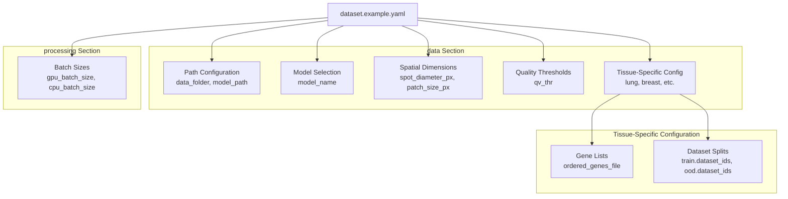
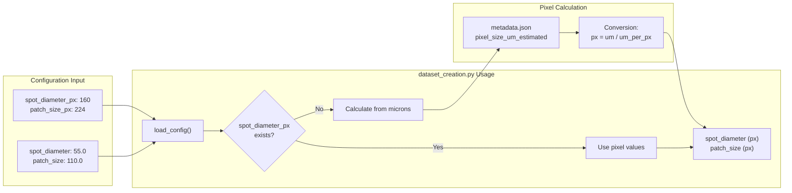
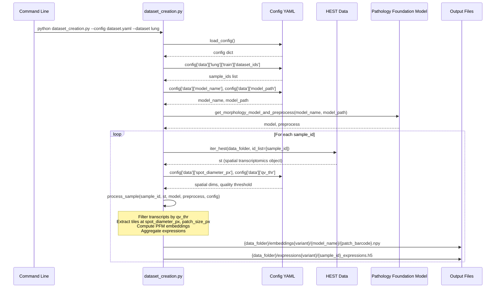

# Dataset Configuration

<details>
<summary>Relevant source files</summary>

The following files were used as context for generating this wiki page:

- [configs/dataset.example.yaml](configs/dataset.example.yaml)
- [deepspot2cell/dataset_creation.py](deepspot2cell/dataset_creation.py)

</details>


This page documents the configuration parameters used to control dataset creation and preprocessing in DeepSpot2Cell. The dataset configuration file defines how raw HEST-1k data is processed into training-ready embeddings and expression files.

For information about training configuration parameters, see [Training Configuration](#6.2). For details on the dataset creation process itself, see [Dataset Creation](#5.1).

## Overview

Dataset configuration is specified in YAML files (typically `configs/dataset.example.yaml`). These configurations control:

- **Data paths** and file locations for HEST-1k data
- **Pathology Foundation Model (PFM)** selection and loading
- **Spatial dimensions** for tile extraction (spots, patches, cells)
- **Quality filtering** thresholds for transcript selection
- **Dataset organization** including train/test splits per tissue type
- **Processing parameters** for batch sizes during embedding computation

The configuration is loaded by `dataset_creation.py` to preprocess samples, extract tiles, compute PFM embeddings, and generate the `.h5` expression files and `.npy` embedding files required for training.

**Sources:** [configs/dataset.example.yaml:1-27](), [deepspot2cell/dataset_creation.py:495-511]()

## Configuration File Structure



**Sources:** [configs/dataset.example.yaml:1-27]()

## Data Section Parameters

### Basic Paths and Identifiers

| Parameter | Type | Description | Example |
|-----------|------|-------------|---------|
| `data_folder` | string | Absolute path to HEST data directory containing subdirectories (`wsis/`, `metadata/`, `tissue_seg/`, etc.) | `/absolute/path/to/hest_data` |
| `dataset_variant` | string | Suffix appended to output directories (`embeddings{variant}/`, `expressions{variant}/`) to version datasets | `_v1` |

These parameters define the root data location and allow multiple dataset versions to coexist.

**Sources:** [configs/dataset.example.yaml:1-3](), [deepspot2cell/dataset_creation.py:166-167]()

### Model Selection

| Parameter | Type | Description | Example |
|-----------|------|-------------|---------|
| `model_name` | string | Name of the Pathology Foundation Model to use for feature extraction | `phikonv2`, `uni`, `hoptimus0` |
| `model_path` | string | Absolute path to the PFM checkpoint or model directory | `/absolute/path/to/phikonv2` |

The `model_name` determines which PFM architecture is loaded, while `model_path` specifies where to find the model weights. These are passed to `get_morphology_model_and_preprocess()` to instantiate the feature extractor.

**Sources:** [configs/dataset.example.yaml:4-5](), [deepspot2cell/dataset_creation.py:506-507, 526]()

### Spatial Dimensions

DeepSpot2Cell supports two methods for specifying spatial dimensions: **pixel-based** or **micron-based**.

**Pixel-Based Configuration (Recommended):**

| Parameter | Type | Description | Example |
|-----------|------|-------------|---------|
| `spot_diameter_px` | int | Diameter of each spot in pixels (typically 160px for 55μm spots at ~0.34μm/px) | `160` |
| `patch_size_px` | int | Size of square patches extracted from the WSI in pixels | `224` |

**Micron-Based Configuration (Alternative):**

| Parameter | Type | Description | Example |
|-----------|------|-------------|---------|
| `spot_diameter` | float | Diameter of each spot in microns | `55.0` |
| `patch_size` | float | Size of square patches in microns | `110.0` |

When using micron-based configuration, dimensions are converted to pixels using the `pixel_size_um_estimated` metadata field for each sample (default: 0.2125 μm/px).



**Sources:** [configs/dataset.example.yaml:7-12](), [deepspot2cell/dataset_creation.py:176-183]()

### Quality Thresholds

| Parameter | Type | Description | Default |
|-----------|------|-------------|---------|
| `qv_thr` | int | Quality value threshold for filtering Xenium transcripts. Transcripts with `qv <= qv_thr` are excluded. | `20` |

This parameter controls transcript quality filtering. In the HEST-1k dataset, each transcript has a quality value (`qv`) indicating detection confidence. Setting a higher threshold removes lower-quality transcripts but reduces transcript count.

**Sources:** [configs/dataset.example.yaml:14](), [deepspot2cell/dataset_creation.py:210-214]()

### Tissue-Specific Configuration

Each tissue type (e.g., `lung`, `breast`) has its own configuration block specifying gene ordering and dataset splits.

```yaml
lung:
  ordered_genes_file: lung_ordered_genes.json
  train:
    dataset_ids:
      - SAMPLE_ID_1
      - SAMPLE_ID_2
  ood:
    dataset_ids: []
```

| Parameter | Type | Description |
|-----------|------|-------------|
| `ordered_genes_file` | string | Filename (relative to `data_folder`) containing ordered list of gene names to use for this tissue type |
| `train.dataset_ids` | list[string] | List of HEST sample IDs to process for training |
| `ood.dataset_ids` | list[string] | List of HEST sample IDs to process for out-of-distribution evaluation |

The `ordered_genes_file` defines the fixed gene ordering used to create expression vectors. All samples in a tissue type must use the same gene order for consistency. If the file doesn't exist, it's generated automatically by ranking genes by variability across samples.

**Sources:** [configs/dataset.example.yaml:15-22](), [deepspot2cell/dataset_creation.py:61-84, 509]()

## Processing Section Parameters

| Parameter | Type | Description | Default |
|-----------|------|-------------|---------|
| `gpu_batch_size` | int | Number of image tiles to process in parallel when using GPU | `32` (auto-computed based on VRAM) |
| `cpu_batch_size` | int | Number of image tiles to process in parallel when using CPU | `8` |

These parameters control the batch size for PFM feature extraction. The GPU batch size is automatically calculated based on available VRAM if not specified (approximately `VRAM_GB * 32 / 14`). Larger batch sizes improve throughput but require more memory.

**Sources:** [configs/dataset.example.yaml:24-26](), [deepspot2cell/dataset_creation.py:514-524]()

## Configuration Parameter Reference

```mermaid
graph TB
    subgraph "config.yaml Parameters"
        DATA_FOLDER["data_folder"]
        VARIANT["dataset_variant"]
        MODEL_NAME["model_name"]
        MODEL_PATH["model_path"]
        SPOT_PX["spot_diameter_px"]
        PATCH_PX["patch_size_px"]
        QV_THR["qv_thr"]
        GENES_FILE["ordered_genes_file"]
        TRAIN_IDS["train.dataset_ids"]
        GPU_BATCH["gpu_batch_size"]
    end
    
    subgraph "dataset_creation.py Usage"
        LOAD_CFG["load_config(args.config)"]
        GET_SAMPLES["sample_ids = config['data'][dataset]['train']['dataset_ids']"]
        GET_MODEL["get_morphology_model_and_preprocess(model_name, device, model_path)"]
        GET_DIMS["if config['data'].get('spot_diameter_px'):<br/>    spot_diameter = config['data']['spot_diameter_px']<br/>else:<br/>    spot_diameter = int(config['data']['spot_diameter'] / um_per_px)"]
        FILTER_TX["filtered_df = filtered_df[filtered_df['qv'] > qv_thr]"]
        SORT_GENES["sort_genes_by_variability(adata, config)"]
        SET_BATCH["batch_size = processing_cfg.get('gpu_batch_size', auto_batch)"]
        SAVE_PATHS["f'{data_folder}/embeddings{dataset_variant}/{model_name}/{patch_barcode}.npy'<br/>f'{data_folder}/expressions{dataset_variant}/{sample_id}_expressions.h5'"]
    end
    
    DATA_FOLDER --> LOAD_CFG
    VARIANT --> SAVE_PATHS
    MODEL_NAME --> GET_MODEL
    MODEL_PATH --> GET_MODEL
    SPOT_PX --> GET_DIMS
    PATCH_PX --> GET_DIMS
    QV_THR --> FILTER_TX
    GENES_FILE --> SORT_GENES
    TRAIN_IDS --> GET_SAMPLES
    GPU_BATCH --> SET_BATCH
    
    LOAD_CFG --> GET_SAMPLES
    LOAD_CFG --> GET_MODEL
    LOAD_CFG --> GET_DIMS
    LOAD_CFG --> FILTER_TX
    LOAD_CFG --> SORT_GENES
    LOAD_CFG --> SET_BATCH
    LOAD_CFG --> SAVE_PATHS
```



**Sources:** [deepspot2cell/dataset_creation.py:503-535]()

## Usage in Dataset Creation Pipeline

The dataset configuration flows through the `dataset_creation.py` script as follows:

1. **Configuration Loading** [`dataset_creation.py:503`](): The script loads the YAML configuration file specified via `--config` argument
2. **Sample Selection** [`dataset_creation.py:509`](): Sample IDs are extracted from the tissue-specific configuration (combining `train.dataset_ids` and `ood.dataset_ids`)
3. **Model Initialization** [`dataset_creation.py:526-527`](): The PFM is loaded using `model_name` and `model_path`
4. **Batch Size Configuration** [`dataset_creation.py:514-524`](): Batch size is set based on available hardware and configuration
5. **Per-Sample Processing** [`dataset_creation.py:533-535`](): For each sample:
   - Spatial dimensions are computed [`dataset_creation.py:177-183`]()
   - Gene ordering is loaded/created [`dataset_creation.py:61-84`]()
   - Transcripts are filtered by quality [`dataset_creation.py:210-214`]()
   - Cell and spot embeddings are computed and saved to `embeddings{variant}/{model_name}/`
   - Expression data is saved to `expressions{variant}/{sample_id}_expressions.h5`



**Sources:** [deepspot2cell/dataset_creation.py:495-535]()

## Complete Parameter Mapping

The following table shows how each configuration parameter maps to code usage:

| Config Path | Code Reference | Purpose |
|-------------|----------------|---------|
| `data.data_folder` | [`dataset_creation.py:166`]() | Base directory for all HEST data and outputs |
| `data.dataset_variant` | [`dataset_creation.py:167`]() | Suffix for `embeddings{variant}/` and `expressions{variant}/` directories |
| `data.model_name` | [`dataset_creation.py:506, 526`]() | PFM architecture name passed to `get_morphology_model_and_preprocess()` |
| `data.model_path` | [`dataset_creation.py:507, 526`]() | Path to PFM checkpoint passed to `get_morphology_model_and_preprocess()` |
| `data.spot_diameter_px` | [`dataset_creation.py:178`]() | Pixel diameter of spots (used if specified) |
| `data.patch_size_px` | [`dataset_creation.py:179`]() | Pixel size of square patches (used if specified) |
| `data.spot_diameter` | [`dataset_creation.py:181`]() | Micron diameter of spots (converted to pixels) |
| `data.patch_size` | [`dataset_creation.py:182`]() | Micron size of patches (converted to pixels) |
| `data.qv_thr` | [`dataset_creation.py:210, 213`]() | Quality value threshold for filtering transcripts |
| `data.{tissue}.ordered_genes_file` | [`dataset_creation.py:62-72`]() | JSON file with ordered gene list for expression vectors |
| `data.{tissue}.train.dataset_ids` | [`dataset_creation.py:509`]() | HEST sample IDs to process for training |
| `data.{tissue}.ood.dataset_ids` | [`dataset_creation.py:509`]() | HEST sample IDs to process for OOD evaluation |
| `processing.gpu_batch_size` | [`dataset_creation.py:518`]() | Batch size for GPU feature extraction |
| `processing.cpu_batch_size` | [`dataset_creation.py:522`]() | Batch size for CPU feature extraction |

**Sources:** [configs/dataset.example.yaml:1-27](), [deepspot2cell/dataset_creation.py:1-536]()

## Example Configuration

A complete example configuration for processing lung tissue samples with Phikon v2:

```yaml
data:
  data_folder: /data/hest_data
  dataset_variant: _v1
  model_name: phikonv2
  model_path: /models/phikonv2
  
  # Pixel-based dimensions
  spot_diameter_px: 160
  patch_size_px: 224
  
  qv_thr: 20
  
  lung:
    ordered_genes_file: lung_ordered_genes.json
    train:
      dataset_ids:
        - TENX95_lung
        - TENX97_lung
        - ZEN38_lung
    ood:
      dataset_ids:
        - TENX101_lung

processing:
  gpu_batch_size: 32
  cpu_batch_size: 8
```

This configuration will:
- Process 3 training samples and 1 OOD sample from HEST-1k lung data
- Use Phikon v2 for feature extraction
- Extract 224×224 pixel patches centered on 160-pixel diameter spots
- Filter transcripts with quality value > 20
- Save outputs to `/data/hest_data/embeddings_v1/phikonv2/` and `/data/hest_data/expressions_v1/`
- Use batch size 32 on GPU for feature extraction

**Sources:** [configs/dataset.example.yaml:1-27]()

---