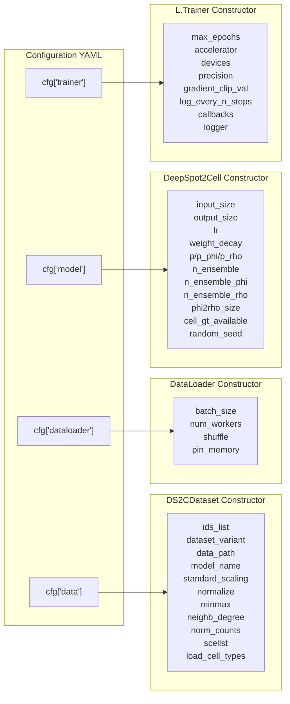
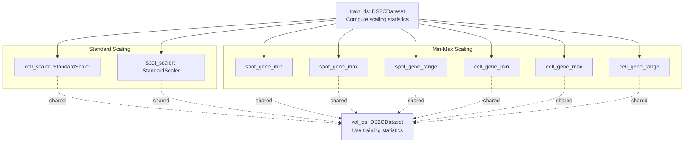

# Training Configuration

<details>
<summary>Relevant source files</summary>

The following files were used as context for generating this wiki page:

- [configs/training.example.yaml](configs/training.example.yaml)
- [scripts/train.py](scripts/train.py)

</details>


This page documents the training configuration system used to control DeepSpot2Cell model training. Training configuration is specified via YAML files that define experiment settings, data preprocessing options, dataloader parameters, model hyperparameters, and trainer settings including early stopping. 

For information about dataset creation configuration (preprocessing parameters for generating embeddings and expression files), see [Dataset Configuration](#6.1). For the actual training script implementation, see [Training Script](#8.1).

## Purpose and Scope

The training configuration system provides a declarative interface for controlling all aspects of model training without modifying code. Configuration files are YAML-formatted and organize parameters into five main sections: `experiment`, `data`, `dataloader`, `model`, and `trainer`. The configuration is loaded by the training script and used to instantiate datasets, dataloaders, models, and PyTorch Lightning trainers.

## Configuration File Structure

The training configuration file follows a hierarchical structure with five top-level sections:

```mermaid
graph TB
    CONFIG["training.yaml<br/>Configuration File"]
    
    EXPERIMENT["experiment:<br/>Experiment metadata"]
    DATA["data:<br/>Data loading & preprocessing"]
    DATALOADER["dataloader:<br/>DataLoader parameters"]
    MODEL["model:<br/>Model hyperparameters"]
    TRAINER["trainer:<br/>Training loop settings"]
    
    CONFIG --> EXPERIMENT
    CONFIG --> DATA
    CONFIG --> DATALOADER
    CONFIG --> MODEL
    CONFIG --> TRAINER
    
    EXPERIMENT --> EXP_NAME["name: Experiment identifier"]
    EXPERIMENT --> EXP_SEED["random_seed: Reproducibility"]
    
    DATA --> DATA_FOLDER["data_folder: Root path"]
    DATA --> DATA_IDS["train_ids, val_ids: Sample splits"]
    DATA --> DATA_NORM["normalize, standard_scaling, minmax"]
    DATA --> DATA_NEIGHB["neighb_degree: Context spots"]
    
    DATALOADER --> DL_BATCH["batch_size: Batch size"]
    DATALOADER --> DL_WORKERS["num_workers: Data loading threads"]
    
    MODEL --> MODEL_LR["lr: Learning rate"]
    MODEL --> MODEL_WD["weight_decay: L2 regularization"]
    MODEL --> MODEL_DROP["dropout: Dropout probability"]
    MODEL --> MODEL_ENS["n_ensemble: Ensemble size"]
    MODEL --> MODEL_PHI2RHO["phi2rho_size: Bottleneck dimension"]
    
    TRAINER --> TRAINER_EPOCHS["max_epochs: Training duration"]
    TRAINER --> TRAINER_ACC["accelerator, devices: Hardware"]
    TRAINER --> TRAINER_ES["early_stopping: Early stopping config"]
```



**Sources:** [configs/training.example.yaml:1-54]()

## Configuration Sections

### Experiment Settings

The `experiment` section defines metadata and reproducibility settings for the training run.

| Parameter | Type | Description | Default |
|-----------|------|-------------|---------|
| `name` | string | Experiment identifier used for output directory naming | Required |
| `random_seed` | integer | Random seed for reproducibility across PyTorch, NumPy, and Python | Required |

**Example:**
```yaml
experiment:
  name: ds2c_baseline
  random_seed: 2024
```

The `random_seed` is passed to `fix_seed()` to ensure deterministic behavior across all random number generators.

**Sources:** [configs/training.example.yaml:1-3](), [scripts/train.py:168]()

### Data Configuration

The `data` section specifies data paths, sample splits, and preprocessing options. This section overlaps with dataset configuration but focuses on training-time settings.

| Parameter | Type | Description | Default |
|-----------|------|-------------|---------|
| `data_folder` | string | Absolute path to data root directory | Required |
| `dataset_variant` | string | Dataset variant suffix (e.g., `_v1`) | Required |
| `model_name` | string | PFM identifier (e.g., `phikonv2`, `uni`, `hoptimus0`) | Required |
| `train_ids` | list[string] | Sample IDs for training set | Required |
| `val_ids` | list[string] | Sample IDs for validation set | `[]` |
| `normalize` | boolean | Apply library size normalization | `true` |
| `standard_scaling` | boolean | Apply standard scaling (z-score) | `false` |
| `minmax` | boolean | Apply min-max scaling to [0, 1] | `false` |
| `norm_counts` | integer | Target library size for normalization | `10000` |
| `neighb_degree` | integer | Number of neighboring spot rings to load | `1` |
| `load_cell_types` | boolean | Load cell type annotations if available | `false` |
| `scellst` | boolean | Use single-cell spatial transcriptomics mode | `false` |

**Example:**
```yaml
data:
  data_folder: /absolute/path/to/data_root
  dataset_variant: _v1
  model_name: phikonv2
  
  train_ids:
    - SAMPLE_ID_1
    - SAMPLE_ID_2
  val_ids:
    - SAMPLE_ID_VAL
  
  normalize: true
  standard_scaling: false
  minmax: false
  norm_counts: 10000
  neighb_degree: 1
  load_cell_types: false
  scellst: false
```

These parameters are passed directly to `DS2CDataset` constructors. Scaling statistics (means, standard deviations, min/max values) are computed on the training set and shared with the validation set to prevent data leakage.

**Sources:** [configs/training.example.yaml:5-22](), [scripts/train.py:20-60]()

### Dataloader Parameters

The `dataloader` section controls PyTorch DataLoader behavior.

| Parameter | Type | Description | Default |
|-----------|------|-------------|---------|
| `batch_size` | integer | Number of samples per batch | `4` |
| `num_workers` | integer | Number of worker processes for data loading | `4` |

**Example:**
```yaml
dataloader:
  batch_size: 4
  num_workers: 4
```

Additional DataLoader settings (shuffling, pin_memory) are hardcoded in the training script: training data is always shuffled, validation data is not shuffled, and `pin_memory` is enabled when CUDA is available.

**Sources:** [configs/training.example.yaml:24-26](), [scripts/train.py:63-87]()

### Model Hyperparameters

The `model` section defines hyperparameters for the DeepSpot2Cell architecture.

| Parameter | Type | Description | Default |
|-----------|------|-------------|---------|
| `lr` | float | Learning rate for Adam optimizer | `1e-4` |
| `weight_decay` | float | L2 regularization coefficient | `1e-6` |
| `dropout` | float | Dropout probability (used for both Phi and Rho if not separately specified) | `0.3` |
| `n_ensemble` | integer | Number of ensemble members (used for both Phi and Rho if not separately specified) | `8` |
| `phi2rho_size` | integer | Dimensionality of bottleneck layer between Phi and Rho ensembles | `512` |
| `cell_gt_available` | boolean | Whether cell-level ground truth is available (affects loss computation) | `true` |
| `p_phi` | float | Dropout probability for Phi ensemble (overrides `dropout`) | `null` |
| `p_rho` | float | Dropout probability for Rho ensemble (overrides `dropout`) | `null` |
| `n_ensemble_phi` | integer | Number of Phi ensemble members (overrides `n_ensemble`) | `null` |
| `n_ensemble_rho` | integer | Number of Rho ensemble members (overrides `n_ensemble`) | `null` |

**Example:**
```yaml
model:
  lr: 1.0e-4
  weight_decay: 1.0e-6
  dropout: 0.3
  n_ensemble: 8
  phi2rho_size: 512
  cell_gt_available: true
  # Optional: separate control for Phi and Rho
  # p_phi: 0.3
  # p_rho: 0.3
  # n_ensemble_phi: 8
  # n_ensemble_rho: 8
```

The `input_size` and `output_size` are automatically inferred from the dataset's embedding and expression dimensions, respectively. The model uses these hyperparameters to construct Phi and Rho ensemble modules.

**Sources:** [configs/training.example.yaml:28-38](), [scripts/train.py:90-110]()

### Trainer Settings

The `trainer` section configures the PyTorch Lightning Trainer and training loop behavior.

| Parameter | Type | Description | Default |
|-----------|------|-------------|---------|
| `max_epochs` | integer | Maximum number of training epochs | `50` |
| `accelerator` | string | Hardware accelerator (`auto`, `cpu`, `gpu`, `tpu`, `mps`) | `auto` |
| `devices` | integer/list | Number or list of devices to use | `1` |
| `precision` | integer/string | Floating point precision (`32`, `16`, `bf16`) | `32` |
| `gradient_clip_val` | float | Max gradient norm for clipping (`null` disables) | `null` |
| `log_every_n_steps` | integer | Logging frequency in steps | `50` |

**Example:**
```yaml
trainer:
  max_epochs: 50
  accelerator: auto
  devices: 1
  precision: 32
  gradient_clip_val: null
  log_every_n_steps: 50
```

#### Early Stopping Configuration

Early stopping is configured as a nested dictionary within the `trainer` section:

| Parameter | Type | Description | Default |
|-----------|------|-------------|---------|
| `enabled` | boolean | Whether to enable early stopping | `false` |
| `monitor` | string | Metric to monitor (`val_loss`, `val_pearson`, etc.) | `val_loss` |
| `patience` | integer | Number of epochs with no improvement before stopping | `5` |
| `mode` | string | Whether to minimize or maximize the metric (`min`, `max`) | `min` |
| `min_delta` | float | Minimum change to qualify as improvement | `0.001` |

**Example:**
```yaml
trainer:
  early_stopping:
    enabled: true
    monitor: val_loss
    patience: 5
    mode: min
    min_delta: 0.001
```

When enabled, an `EarlyStopping` callback is added to the trainer. The same `monitor` metric is used for model checkpointing to save the best model.

**Sources:** [configs/training.example.yaml:40-53](), [scripts/train.py:113-152]()

## Configuration Loading and Usage

The configuration file is loaded and processed by the training script through several functions that map YAML sections to code entities.

### Configuration Flow Diagram

```mermaid
graph TB
    YAML["training.yaml<br/>YAML Configuration"]
    
    LOAD["load_config()<br/>scripts/train.py:15-17"]
    DICT["cfg: dict<br/>In-memory configuration"]
    
    BUILD_DS["build_datasets()<br/>scripts/train.py:20-60"]
    BUILD_DL["build_dataloaders()<br/>scripts/train.py:63-87"]
    BUILD_MODEL["build_model()<br/>scripts/train.py:90-110"]
    BUILD_TRAINER["build_trainer()<br/>scripts/train.py:113-152"]
    
    TRAIN_DS["train_ds: DS2CDataset"]
    VAL_DS["val_ds: DS2CDataset"]
    
    TRAIN_DL["train_loader: DataLoader"]
    VAL_DL["val_loader: DataLoader"]
    
    MODEL["model: DeepSpot2Cell"]
    TRAINER["trainer: L.Trainer"]
    
    FIT["trainer.fit()<br/>scripts/train.py:175"]
    
    YAML --> LOAD
    LOAD --> DICT
    
    DICT --> BUILD_DS
    DICT --> BUILD_DL
    DICT --> BUILD_MODEL
    DICT --> BUILD_TRAINER
    
    BUILD_DS --> TRAIN_DS
    BUILD_DS --> VAL_DS
    
    TRAIN_DS --> BUILD_DL
    VAL_DS --> BUILD_DL
    BUILD_DL --> TRAIN_DL
    BUILD_DL --> VAL_DL
    
    TRAIN_DS --> BUILD_MODEL
    BUILD_MODEL --> MODEL
    
    BUILD_TRAINER --> TRAINER
    
    MODEL --> FIT
    TRAIN_DL --> FIT
    VAL_DL --> FIT
    TRAINER --> FIT
    
    DICT -.cfg["experiment"].-> BUILD_MODEL
    DICT -.cfg["data"].-> BUILD_DS
    DICT -.cfg["dataloader"].-> BUILD_DL
    DICT -.cfg["model"].-> BUILD_MODEL
    DICT -.cfg["trainer"].-> BUILD_TRAINER
```

**Sources:** [scripts/train.py:15-175]()

### Parameter Mapping to Code Entities

The following diagram shows how configuration parameters map to constructor arguments and method calls:



**Sources:** [scripts/train.py:20-152]()

### Configuration Loading Implementation

The `load_config()` function reads the YAML file and returns a dictionary:

```yaml
# Usage in train.py
cfg = load_config(cfg_path)
experiment_name = cfg["experiment"]["name"]
fix_seed(cfg["experiment"]["random_seed"])
```

Each build function extracts its relevant configuration section:

- `build_datasets()` extracts `cfg["data"]` and creates `DS2CDataset` instances for training and validation
- `build_dataloaders()` extracts `cfg["dataloader"]` and wraps datasets in PyTorch DataLoaders
- `build_model()` extracts `cfg["model"]` and instantiates `DeepSpot2Cell`
- `build_trainer()` extracts `cfg["trainer"]` and creates a PyTorch Lightning Trainer with callbacks

**Sources:** [scripts/train.py:15-17](), [scripts/train.py:162-175]()

## Scaling Statistics Sharing

When both training and validation datasets are configured, scaling statistics computed on the training set are shared with the validation set to ensure consistent preprocessing and prevent data leakage:



**Sources:** [scripts/train.py:46-58]()

## Callbacks and Logging

The training script automatically configures two types of callbacks:

### Early Stopping Callback

When `trainer.early_stopping.enabled` is `true`, an `EarlyStopping` callback is created:

```python
EarlyStopping(
    monitor=early_cfg.get("monitor", "val_loss"),
    patience=early_cfg.get("patience", 5),
    mode=early_cfg.get("mode", "min"),
    min_delta=early_cfg.get("min_delta", 0.0),
)
```

### Model Checkpoint Callback

A `ModelCheckpoint` callback is always created to save the best model:

```python
ModelCheckpoint(
    dirpath=ckpt_dir,
    save_top_k=1,
    monitor=early_cfg.get("monitor", "val_loss"),
    mode=early_cfg.get("mode", "min"),
    filename="best-{epoch}-{val_loss:.4f}",
    auto_insert_metric_name=False,
)
```

Checkpoints are saved to `{output_dir}/checkpoints/` with the filename format `best-{epoch}-{val_loss:.4f}.ckpt`.

### CSV Logger

Training and validation metrics are logged to CSV files using PyTorch Lightning's `CSVLogger`:

```python
CSVLogger(save_dir=output_dir, name="logs")
```

Logs are saved to `{output_dir}/logs/version_0/metrics.csv`.

**Sources:** [scripts/train.py:113-152]()

## Example Configuration

A complete example configuration demonstrating typical settings:

```yaml
experiment:
  name: ds2c_baseline
  random_seed: 2024

data:
  data_folder: /path/to/data
  dataset_variant: _v1
  model_name: phikonv2
  
  train_ids:
    - TENX52
    - TENX53
  val_ids:
    - TENX54
  
  normalize: true
  standard_scaling: false
  minmax: false
  norm_counts: 10000
  neighb_degree: 1
  load_cell_types: false
  scellst: false

dataloader:
  batch_size: 4
  num_workers: 4

model:
  lr: 1.0e-4
  weight_decay: 1.0e-6
  dropout: 0.3
  n_ensemble: 8
  phi2rho_size: 512
  cell_gt_available: true

trainer:
  max_epochs: 50
  accelerator: auto
  devices: 1
  precision: 32
  gradient_clip_val: null
  log_every_n_steps: 50
  
  early_stopping:
    enabled: true
    monitor: val_loss
    patience: 5
    mode: min
    min_delta: 0.001
```

This configuration trains a DeepSpot2Cell model with 8-member ensembles, using library size normalization on the expression data, with a batch size of 4 and early stopping based on validation loss.

**Sources:** [configs/training.example.yaml:1-54]()

---