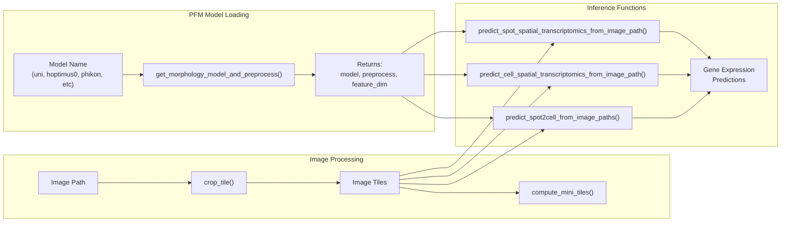
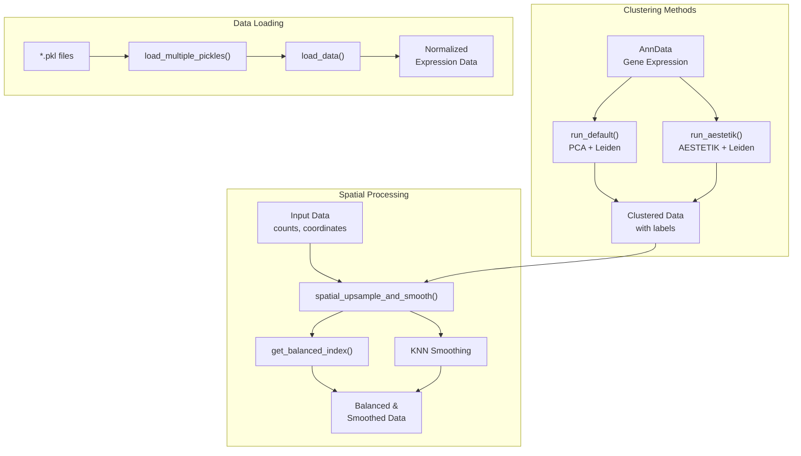
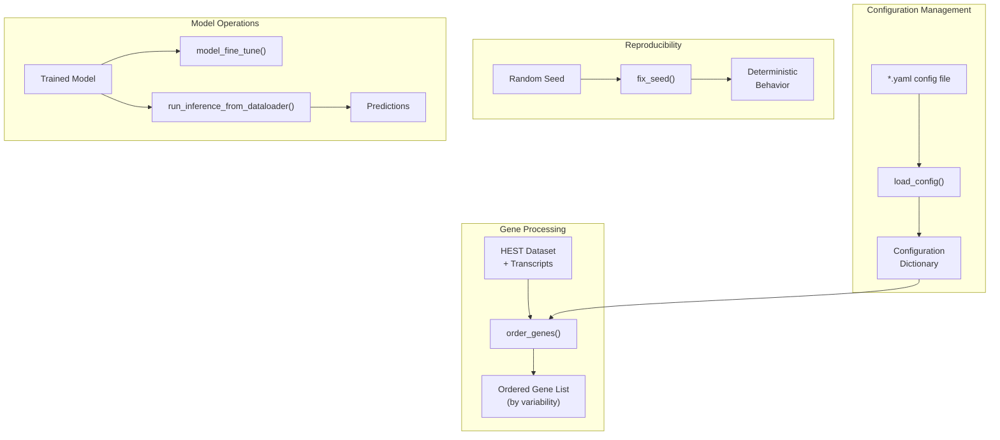

# Utility Modules

<details>
<summary>Relevant source files</summary>

The following files were used as context for generating this wiki page:

- [deepspot2cell/utils/__init__.py](deepspot2cell/utils/__init__.py)
- [deepspot2cell/utils/utils.py](deepspot2cell/utils/utils.py)
- [deepspot2cell/utils/utils_dataloader.py](deepspot2cell/utils/utils_dataloader.py)
- [deepspot2cell/utils/utils_image.py](deepspot2cell/utils/utils_image.py)

</details>


This document provides an overview of the utility modules in the `deepspot2cell.utils` package. These modules contain helper functions and supporting infrastructure that enable the core components of DeepSpot2Cell to function. The utilities are organized into three categories: image processing, data loading, and general utilities.

For detailed documentation of specific utility functions, see:
- Image processing utilities: [Image Processing Utilities](#7.1)
- Data loading utilities: [Data Loading Utilities](#7.2)
- General utilities: [General Utilities](#7.3)

For API reference documentation, see [deepspot2cell.utils Package](#9.2).

## Package Structure

The `deepspot2cell.utils` package consists of four files that together provide supporting functionality for data preprocessing, model training, and inference.


**Sources:** [deepspot2cell/utils/__init__.py:1-3]()

## Module Categories

The utility modules are organized by functionality:

| Module | Purpose | Key Functions | Primary Users |
|--------|---------|---------------|---------------|
| `utils.py` | Configuration management, reproducibility, gene ordering | `load_config()`, `fix_seed()`, `order_genes()`, `model_fine_tune()`, `run_inference_from_dataloader()` | Training scripts, dataset creation |
| `utils_image.py` | PFM loading, image processing, tile extraction, inference | `get_morphology_model_and_preprocess()`, `crop_tile()`, `predict_spot2cell_from_image_paths()` | Dataset creation, inference workflows |
| `utils_dataloader.py` | Data augmentation, spatial processing, clustering | `spatial_upsample_and_smooth()`, `run_default()`, `run_aestetik()`, `load_data()` | Data loading, preprocessing |

## Image Processing Utilities

The `utils_image.py` module provides functions for loading pathology foundation models, processing histology images, and running inference on image data. Key capabilities include:

- **PFM Model Loading**: Support for UNI, H-optimus-0, Phikon v1, Phikon v2, InceptionV3, ResNet50, and DenseNet121
- **Image Tile Extraction**: Functions to crop specific regions from whole slide images using PyVips
- **Inference Workflows**: Prediction functions for spot-level and cell-level transcriptomics



**Sources:** [deepspot2cell/utils/utils_image.py:36-183](), [deepspot2cell/utils/utils_image.py:246-361](), [deepspot2cell/utils/utils_image.py:364-458]()

### Supported Pathology Foundation Models

The following table shows the PFM models supported by `get_morphology_model_and_preprocess()`:

| Model Name | Architecture | Feature Dimension | Normalization | Use Case |
|------------|-------------|-------------------|---------------|----------|
| `uni` | ViT-Large/16 | 1024 | ImageNet stats | UNI foundation model |
| `hoptimus0` | ViT-giant/14 (DINOv2) | 1536 | Custom H&E stats | H-optimus-0 |
| `phikon` | ViT | 768 | HuggingFace processor | Phikon v1 |
| `phikonv2` | ViT | 1024 | HuggingFace processor | Phikon v2 |
| `inception` | InceptionV3 | 2048 | ImageNet weights | Baseline |
| `resnet50` | ResNet-50 | 2048 | ImageNet weights | Baseline |
| `densenet121` | DenseNet-121 | 1024 | ImageNet weights | Baseline |

**Sources:** [deepspot2cell/utils/utils_image.py:36-182]()

## Data Loading Utilities

The `utils_dataloader.py` module provides functions for data augmentation, spatial processing, and clustering. These utilities are primarily used during dataset creation and training to enhance data quality and balance.

Key functionalities:

- **Spatial Clustering**: `run_default()` and `run_aestetik()` for Leiden clustering with spatial context
- **Data Augmentation**: `spatial_upsample_and_smooth()` for balancing and smoothing spot-level data
- **Balanced Sampling**: `get_balanced_index()` for creating balanced datasets across clusters
- **Data Loading**: `load_data()` and `load_multiple_pickles()` for loading preprocessed data



**Sources:** [deepspot2cell/utils/utils_dataloader.py:20-99](), [deepspot2cell/utils/utils_dataloader.py:124-175]()

### Clustering Configurations

The `spatial_upsample_and_smooth()` function supports two clustering methods:

| Method | Implementation | Parameters | Description |
|--------|----------------|------------|-------------|
| `default` | `run_default()` | `resolution` | Standard PCA + Leiden clustering with neighborhood graph |
| `aestetik` | `run_aestetik()` | `resolution`, `window_size` | AESTETIK framework with spatial awareness and multimodal integration |

Both methods produce:
- `adata.obsm["latent"]`: Low-dimensional representation for downstream processing
- `adata.obs["label"]`: Cluster assignments for balanced sampling

**Sources:** [deepspot2cell/utils/utils_dataloader.py:29-63]()

## General Utilities

The `utils.py` module contains general-purpose functions for configuration management, reproducibility, gene ordering, model fine-tuning, and inference.

### Core Functions



**Sources:** [deepspot2cell/utils/utils.py:23-52](), [deepspot2cell/utils/utils.py:54-72](), [deepspot2cell/utils/utils.py:92-109](), [deepspot2cell/utils/utils.py:112-200]()

### Function Descriptions

| Function | Purpose | Inputs | Outputs |
|----------|---------|--------|---------|
| `load_config()` | Load YAML configuration files | `config_path` (str) | Configuration dictionary |
| `fix_seed()` | Set random seeds for reproducibility | `seed` (int) | None (sets global state) |
| `order_genes()` | Rank genes by variability across samples | `config` (dict) | Ordered gene list (JSON file) |
| `model_fine_tune()` | Fine-tune specific model layers | `model`, `dataloader`, flags | Trained model |
| `run_inference_from_dataloader()` | Batch inference with dataloader | `model`, `dataloader`, `device` | Predictions array |
| `plot_loss_values()` | Visualize training progress | `train_losses`, `val_losses` | Matplotlib plot |

**Sources:** [deepspot2cell/utils/utils.py:75-200]()

## Public API Design

The `__init__.py` file exposes a carefully curated public API that balances convenience with clarity:

```python
# Selective imports from utils.py
from .utils import fix_seed, load_config, order_genes

# Selective imports from utils_image.py
from .utils_image import get_morphology_model_and_preprocess, format_to_dtype, predict_spot2cell_from_image_paths

# Wildcard import from utils_dataloader.py
from .utils_dataloader import *
```

This design has three patterns:

1. **Explicit Core Functions**: `fix_seed`, `load_config`, `order_genes` are explicitly imported because they're frequently used and form the core workflow
2. **Key Image Functions**: Essential image processing functions are explicitly exposed for inference workflows
3. **All Data Loading Functions**: The entire data loading module is exported via `*` because these functions are often used together in data preprocessing pipelines

**Sources:** [deepspot2cell/utils/__init__.py:1-3]()

## Common Usage Patterns

### Pattern 1: Dataset Creation Setup

```python
from deepspot2cell.utils import load_config, fix_seed, get_morphology_model_and_preprocess

# Load configuration
config = load_config('configs/dataset.yaml')

# Set reproducibility
fix_seed(config['seed'])

# Load PFM model
model, preprocess, feature_dim = get_morphology_model_and_preprocess(
    model_name=config['model_name'],
    device='cuda',
    model_path=config['model_path']
)
```

**Sources:** [deepspot2cell/utils/utils.py:106-109](), [deepspot2cell/utils/utils.py:92-100](), [deepspot2cell/utils/utils_image.py:36-183]()

### Pattern 2: Training Configuration

```python
from deepspot2cell.utils import load_config, fix_seed

# Load training configuration
config = load_config('configs/training.yaml')

# Ensure reproducibility
fix_seed(42)
```

**Sources:** [deepspot2cell/utils/utils.py:92-109]()

### Pattern 3: Inference from Images

```python
from deepspot2cell.utils import get_morphology_model_and_preprocess, predict_spot2cell_from_image_paths

# Load models
morphology_model, preprocess, _ = get_morphology_model_and_preprocess('phikonv2', 'cuda', model_path)

# Predict from image paths
predictions = predict_spot2cell_from_image_paths(
    cell_image_path='cell.png',
    spot_image_path='spot.png',
    neighbor_image_paths=['neighbor1.png', 'neighbor2.png'],
    deepspot2cell_model=trained_model,
    morphology_model=morphology_model,
    preprocess=preprocess,
    device='cuda',
    gene_names=gene_list
)
```

**Sources:** [deepspot2cell/utils/utils_image.py:364-458]()

## Dependencies

The utility modules rely on several external libraries:

| Library | Used In | Purpose |
|---------|---------|---------|
| PyTorch | All modules | Tensor operations, model loading |
| PyVips | `utils_image.py` | Efficient whole slide image processing |
| Scanpy | `utils.py`, `utils_dataloader.py` | Single-cell analysis, clustering |
| scikit-learn | `utils_dataloader.py` | Nearest neighbors, scaling |
| timm | `utils_image.py` | Vision transformer models |
| transformers | `utils_image.py` | HuggingFace model loading |
| HEST | `utils.py` | HEST dataset iteration |
| Lightning | `utils.py` | Training utilities |
| AESTETIK | `utils_dataloader.py` | Spatial clustering (optional) |

**Sources:** [deepspot2cell/utils/utils.py:1-20](), [deepspot2cell/utils/utils_image.py:1-19](), [deepspot2cell/utils/utils_dataloader.py:1-17]()

---