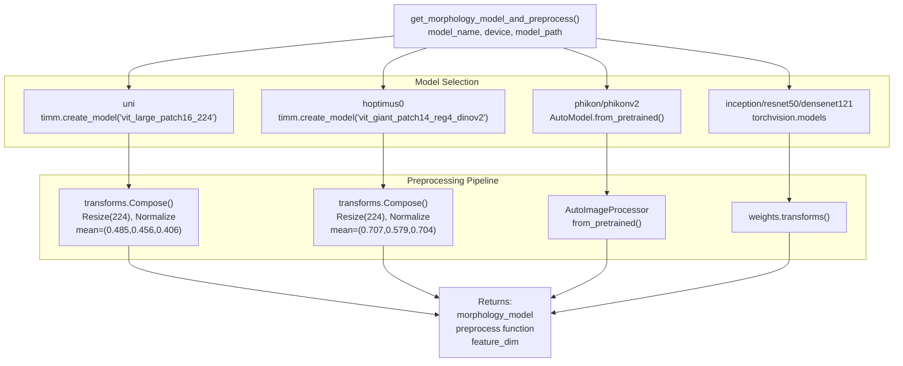
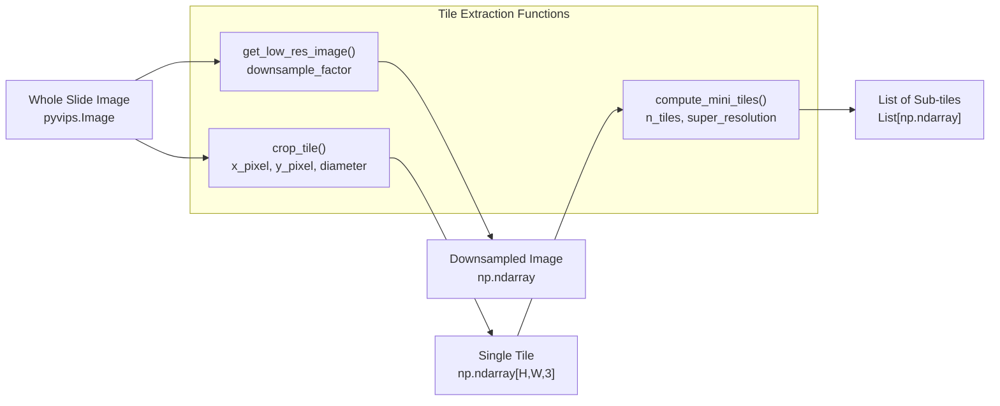
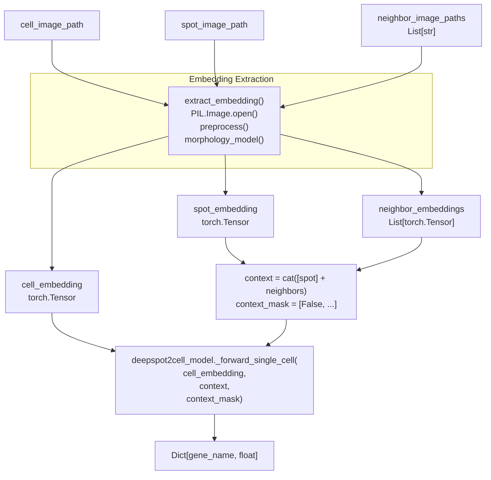
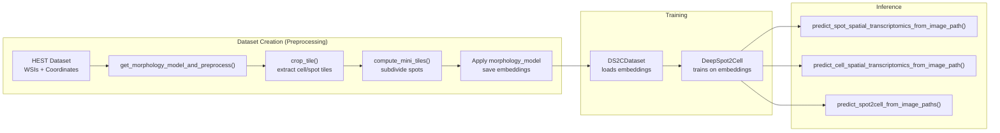

# Image Processing Utilities

<details>
<summary>Relevant source files</summary>

The following files were used as context for generating this wiki page:

- [README.md](README.md)
- [deepspot2cell/utils/utils_image.py](deepspot2cell/utils/utils_image.py)

</details>


## Purpose and Scope

This page documents the image processing utilities provided in `deepspot2cell/utils/utils_image.py`. These utilities handle three primary responsibilities:

1. **Pathology Foundation Model (PFM) Loading**: Loading and configuring different pre-trained vision models for feature extraction
2. **Image Tile Operations**: Extracting, cropping, and subdividing image patches from whole-slide images
3. **Inference Functions**: Applying trained models to predict gene expression from H&E image data

For data loading utilities (neighbor computation, augmentation, smoothing), see [Data Loading Utilities](#7.2). For general configuration and training utilities, see [General Utilities](#7.3).

Sources: [deepspot2cell/utils/utils_image.py:1-458]()

---

## Pathology Foundation Model Loading

The `get_morphology_model_and_preprocess()` function loads pre-trained pathology foundation models and their corresponding preprocessing pipelines. This function supports multiple PFM architectures used in computational pathology.

### Supported Models

| Model Name | Architecture | Feature Dimension | Key Characteristics |
|------------|--------------|-------------------|---------------------|
| `uni` | ViT-Large/16 | 1024 | Mahmood Lab's pathology foundation model |
| `hoptimus0` | ViT-Giant/14 | 1536 | Bioptimus H-optimus-0 model |
| `phikon` | ViT-Base | 768 | Owkin's Phikon v1 model |
| `phikonv2` | ViT-Large | 1024 | Owkin's Phikon v2 model |
| `inception` | Inception-v3 | 2048 | Pre-trained ImageNet model |
| `resnet50` | ResNet-50 | 2048 | Pre-trained ImageNet model |
| `densenet121` | DenseNet-121 | 1024 | Pre-trained ImageNet model |

Sources: [deepspot2cell/utils/utils_image.py:36-182]()

### Model Loading Workflow



**Figure: PFM Loading and Preprocessing Pipeline**

Sources: [deepspot2cell/utils/utils_image.py:36-182]()

### UNI Model Configuration

The UNI model uses a Vision Transformer architecture optimized for pathology images. It requires specific normalization parameters:

- **Architecture**: ViT-Large with 16x16 patches
- **Input Size**: 224x224 pixels
- **Normalization**: ImageNet statistics (mean=[0.485, 0.456, 0.406], std=[0.229, 0.224, 0.225])
- **Feature Dimension**: 1024
- **Model Loading**: Weights loaded from `model_path` using `torch.load()`

Sources: [deepspot2cell/utils/utils_image.py:38-58]()

### H-optimus-0 Model Configuration

The H-optimus-0 model uses a larger Vision Transformer trained specifically on histopathology data:

- **Architecture**: ViT-Giant with 14x14 patches and DINOv2 registration
- **Input Size**: 224x224 pixels  
- **Normalization**: Pathology-specific statistics (mean=[0.707, 0.579, 0.704], std=[0.212, 0.230, 0.178])
- **Feature Dimension**: 1536
- **Dynamic Image Size**: Supports variable input dimensions

Sources: [deepspot2cell/utils/utils_image.py:59-80]()

### Phikon v2 Model Configuration

Phikon v2 uses Hugging Face's transformers library with custom wrapper classes:

- **Architecture**: ViT-Large from transformers
- **Feature Dimension**: 1024
- **Preprocessing**: `AutoImageProcessor` from Hugging Face
- **Custom Wrapper**: `MyModel` class extracts the `[CLS]` token embedding
- **Forward Methods**: Supports both `forward()` and `forward_features()` for different use cases

Sources: [deepspot2cell/utils/utils_image.py:107-135]()

---

## Image Tile Operations

These functions handle the geometric operations required to extract and process image patches from whole-slide images.



**Figure: Image Tile Processing Operations**

Sources: [deepspot2cell/utils/utils_image.py:185-239]()

### get_low_res_image()

Downsamples a whole-slide image for visualization or quick processing:

**Parameters**:
- `image_path` (str): Path to the image file
- `downsample_factor` (int): Factor by which to downsample the image

**Returns**: `np.ndarray` - Downsampled image array

**Implementation**: Uses `pyvips.Image.resize()` for memory-efficient downsampling of large images. The function automatically handles format conversion using the `format_to_dtype` mapping dictionary.

Sources: [deepspot2cell/utils/utils_image.py:185-192](), [deepspot2cell/utils/utils_image.py:22-33]()

### crop_tile()

Extracts a square tile centered at specified pixel coordinates:

**Parameters**:
- `image` (pyvips.Image): Source image object
- `x_pixel` (int): X-coordinate of tile center
- `y_pixel` (int): Y-coordinate of tile center  
- `cell_diameter` (int): Width and height of the tile in pixels

**Returns**: `np.ndarray` - RGB tile array with shape `[cell_diameter, cell_diameter, 3]`

**Implementation**: Centers the crop by offsetting by `cell_diameter // 2`, uses pyvips' efficient `crop()` method, and extracts only the first 3 channels (RGB).

Sources: [deepspot2cell/utils/utils_image.py:195-203]()

### compute_mini_tiles()

Subdivides a tile into smaller sub-tiles for multi-resolution processing:

**Parameters**:
- `image` (np.ndarray): Input tile to subdivide
- `n_tiles` (int): Total number of sub-tiles (must be a perfect square, e.g., 4, 9, 16)
- `super_resolution_mode` (bool): If True, extracts only the center sub-tile

**Returns**: `List[np.ndarray]` - List of sub-tile arrays

**Algorithm**:
1. Compute grid dimensions: `n = sqrt(n_tiles)`
2. Calculate sub-tile size: `square_size = D // n`
3. Extract tiles in row-major order
4. In super-resolution mode, extract only the center tile with padding

**Use Case**: During training, spot tiles are subdivided into mini-tiles to provide finer-grained spatial information while maintaining computational efficiency.

Sources: [deepspot2cell/utils/utils_image.py:206-239]()

---

## Prediction Functions

The utility module provides three prediction functions for different inference scenarios. Each function follows a similar pattern but differs in the spatial scale and input structure.

```mermaid
graph TB
    subgraph "Spot-Level Prediction"
        SPOT_FUNC["predict_spot_spatial_transcriptomics_from_image_path()"]
        SPOT_INPUT["Inputs:<br/>image_path, adata<br/>spot_diameter, n_mini_tiles"]
        SPOT_TILE["Extracts:<br/>spot tile<br/>sub-tiles<br/>neighbor tiles"]
        SPOT_OUT["Output:<br/>spot-level expression<br/>np.ndarray[n_spots, n_genes]"]
    end
    
    subgraph "Cell-Level Prediction"
        CELL_FUNC["predict_cell_spatial_transcriptomics_from_image_path()"]
        CELL_INPUT["Inputs:<br/>image_path, adata<br/>cell_diameter, radius_neighbors"]
        CELL_TILE["Extracts:<br/>cell tile<br/>neighbor tiles"]
        CELL_OUT["Output:<br/>cell-level expression<br/>np.ndarray[n_cells, n_genes]"]
    end
    
    subgraph "DeepSpot2Cell Prediction"
        DS2C_FUNC["predict_spot2cell_from_image_paths()"]
        DS2C_INPUT["Inputs:<br/>cell_image_path<br/>spot_image_path<br/>neighbor_image_paths"]
        DS2C_EMB["Extracts embeddings<br/>from pre-cropped images"]
        DS2C_OUT["Output:<br/>gene expression dict<br/>Dict[gene_name, float]"]
    end
    
    SPOT_INPUT --> SPOT_FUNC
    SPOT_FUNC --> SPOT_TILE
    SPOT_TILE --> SPOT_OUT
    
    CELL_INPUT --> CELL_FUNC
    CELL_FUNC --> CELL_TILE
    CELL_TILE --> CELL_OUT
    
    DS2C_INPUT --> DS2C_FUNC
    DS2C_FUNC --> DS2C_EMB
    DS2C_EMB --> DS2C_OUT
```



**Figure: Prediction Function Hierarchy**

Sources: [deepspot2cell/utils/utils_image.py:246-457]()

### predict_spot_spatial_transcriptomics_from_image_path()

Predicts spot-level gene expression from H&E images using spatial context.

**Function Signature**:
```python
predict_spot_spatial_transcriptomics_from_image_path(
    image_path,
    adata,
    spot_diameter,
    n_mini_tiles,
    preprocess,
    morphology_model,
    model_expression,
    device,
    super_resolution=False,
    neighbor_radius=1
)
```

**Parameters**:
- `image_path` (str): Path to the H&E image
- `adata` (AnnData): AnnData object containing spot coordinates in `.obs`
- `spot_diameter` (int): Diameter of spot tiles in pixels
- `n_mini_tiles` (int): Number of sub-tiles to extract from each spot
- `preprocess` (callable): Preprocessing function for the PFM
- `morphology_model` (nn.Module): Pre-trained PFM for feature extraction
- `model_expression` (nn.Module): Trained expression prediction model
- `device` (str): Device for computation ('cuda' or 'cpu')
- `super_resolution` (bool): Whether to use super-resolution mode
- `neighbor_radius` (int): Radius for neighbor spot identification

**Processing Pipeline**:
1. For each spot in `adata.obs`, compute neighboring spots using `compute_neighbors()`
2. Extract spot tile using `crop_tile()` centered at `(x_pixel, y_pixel)`
3. Subdivide spot tile into mini-tiles using `compute_mini_tiles()`
4. Extract neighbor spot tiles
5. Apply preprocessing and morphology model to all tiles
6. Convert embeddings using `detach_and_convert()`
7. Pass embeddings to `model_expression` for prediction
8. Apply inverse transform to convert predictions back to expression space

**Returns**: `np.ndarray` with shape `[n_spots, n_genes]`

Sources: [deepspot2cell/utils/utils_image.py:246-297]()

### predict_cell_spatial_transcriptomics_from_image_path()

Predicts cell-level gene expression with spatial neighbor context.

**Function Signature**:
```python
predict_cell_spatial_transcriptomics_from_image_path(
    image_path,
    adata,
    cell_diameter,
    radius_neighbors,
    preprocess,
    morphology_model,
    model_expression,
    device
)
```

**Key Differences from Spot Prediction**:
- Uses `NearestNeighbors` from scikit-learn for radius-based neighbor finding
- Does not use mini-tiles (no sub-division of cell tiles)
- Simpler input structure: `[X_cell, X_neighbors]` vs `[X_spot, X_subspot, X_neighbors]`
- Designed for single-cell resolution data where each cell is individually identified

**Neighbor Computation**:
```python
neigh = NearestNeighbors(radius=radius_neighbors)
neigh.fit(adata.obs[["x_pixel", "y_pixel"]].values)
neighbors = neigh.radius_neighbors(..., return_distance=True, sort_results=True)[1]
neighbors = [n[1:] for n in neighbors]  # remove the cell itself
```

**Returns**: `np.ndarray` with shape `[n_cells, n_genes]`

Sources: [deepspot2cell/utils/utils_image.py:300-361]()

### predict_spot2cell_from_image_paths()

DeepSpot2Cell-specific inference function for pre-extracted image tiles.

**Function Signature**:
```python
predict_spot2cell_from_image_paths(
    cell_image_path,
    spot_image_path,
    neighbor_image_paths,
    deepspot2cell_model,
    morphology_model,
    preprocess,
    device,
    gene_names=None
)
```

**Design Rationale**: This function is specifically designed for DeepSpot2Cell's training/inference paradigm where:
- Cell tiles are pre-extracted based on segmentation masks
- Spot tiles provide broader spatial context (55μm)
- Neighbor tiles provide multi-spot spatial relationships

**Key Features**:
1. **Pre-extracted Images**: Accepts paths to already-cropped tiles rather than extracting from WSI
2. **Helper Function**: Includes `extract_embedding()` nested function for consistent embedding extraction
3. **Missing Neighbor Handling**: Creates zero embeddings for missing neighbors
4. **Context Masking**: Generates boolean masks to indicate valid vs. padded embeddings
5. **Model-Specific API**: Calls `deepspot2cell_model._forward_single_cell()` directly

**Processing Flow**:



**Figure: DeepSpot2Cell Prediction Workflow**

**Returns**: Dictionary mapping gene names to predicted expression values

Sources: [deepspot2cell/utils/utils_image.py:364-457]()

---

## Utility Functions

### detach_and_convert()

Helper function to convert tensors to a consistent format for model input:

```python
def detach_and_convert(data):
    return data[None, ].detach().float()
```

Adds a batch dimension, detaches from computational graph, and converts to float32.

Sources: [deepspot2cell/utils/utils_image.py:242-243]()

### format_to_dtype Dictionary

Mapping from pyvips image format strings to NumPy data types:

| Format | NumPy dtype |
|--------|-------------|
| `'uchar'` | `np.uint8` |
| `'ushort'` | `np.uint16` |
| `'float'` | `np.float32` |
| `'double'` | `np.float64` |

Used in `get_low_res_image()` and `crop_tile()` for format conversion.

Sources: [deepspot2cell/utils/utils_image.py:22-33]()

---

## Integration with Dataset Creation

The image processing utilities are primarily used during dataset creation and inference:



**Figure: Image Utilities in the Overall Pipeline**

**Dataset Creation Phase**: Functions like `get_morphology_model_and_preprocess()`, `crop_tile()`, and `compute_mini_tiles()` are used in [Dataset Creation](#5.1) to preprocess images and extract embeddings.

**Inference Phase**: Prediction functions are used in [Tutorial 3: Inference and Prediction](#3.3) to apply trained models to new images.

Sources: [deepspot2cell/utils/utils_image.py:1-458]()

---

## Common Usage Patterns

### Loading a PFM for Preprocessing

```python
from deepspot2cell.utils import get_morphology_model_and_preprocess

model, preprocess, feature_dim = get_morphology_model_and_preprocess(
    model_name="phikonv2",
    device="cuda",
    model_path="/path/to/phikon-v2"
)
```

### Extracting Tiles from WSI

```python
import pyvips

image = pyvips.Image.new_from_file("sample.tif")
cell_tile = crop_tile(image, x_pixel=1000, y_pixel=2000, cell_diameter=128)
mini_tiles = compute_mini_tiles(cell_tile, n_tiles=9)
```

### Running Spot-Level Prediction

```python
import scanpy as sc

adata = sc.read_h5ad("spatial_data.h5ad")
predictions = predict_spot_spatial_transcriptomics_from_image_path(
    image_path="tissue.tif",
    adata=adata,
    spot_diameter=256,
    n_mini_tiles=16,
    preprocess=preprocess,
    morphology_model=model,
    model_expression=trained_model,
    device="cuda",
    neighbor_radius=1
)
```

Sources: [deepspot2cell/utils/utils_image.py:36-297]()

---