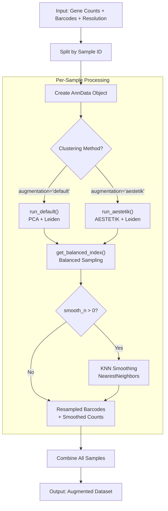
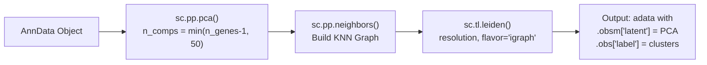
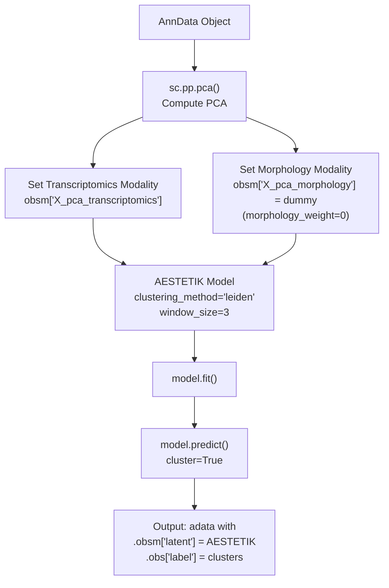
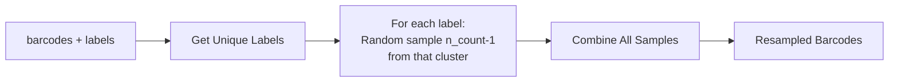
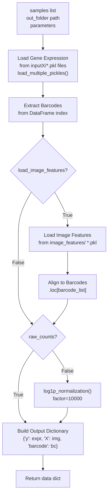

# Data Loading Utilities

<details>
<summary>Relevant source files</summary>

The following files were used as context for generating this wiki page:

- [deepspot2cell/dataloader.py](deepspot2cell/dataloader.py)
- [deepspot2cell/utils/utils_dataloader.py](deepspot2cell/utils/utils_dataloader.py)

</details>


## Purpose and Scope

This page documents the utility functions in the `deepspot2cell.utils.utils_dataloader` module that support data loading, preprocessing, and augmentation operations. These utilities provide helper functions for spatial upsampling, smoothing, clustering, normalization, and balanced sampling.

For the core dataset class and main data loading pipeline, see [DS2CDataset and Data Loading](#4.2). For image processing utilities, see [Image Processing Utilities](#7.1). For general utilities like configuration loading and seed fixing, see [General Utilities](#7.3).

**Sources:** [deepspot2cell/utils/utils_dataloader.py:1-175]()

---

## Overview of Utility Functions

The `utils_dataloader` module provides a collection of independent helper functions organized into four main categories:

| Category | Functions | Purpose |
|----------|-----------|---------|
| **Spatial Processing** | `spatial_upsample_and_smooth`, `run_default`, `run_aestetik`, `get_balanced_index` | Spatial upsampling, clustering, and balanced sampling |
| **Normalization** | `log1p_normalization` | Log-transform and normalize expression data |
| **Data Loading** | `load_data`, `load_multiple_pickles` | Load and combine data from multiple files |
| **Utilities** | `add_zero_padding`, `compute_neighbors` | Zero-padding and neighbor computation |

**Sources:** [deepspot2cell/utils/utils_dataloader.py:1-175]()

---

## Spatial Upsampling and Smoothing

### Workflow Overview

The spatial upsampling and smoothing pipeline performs clustering-based data augmentation and optional k-nearest neighbor smoothing to improve model training.



**Diagram: Spatial Upsampling and Smoothing Pipeline**

**Sources:** [deepspot2cell/utils/utils_dataloader.py:65-98]()

### Main Function: spatial_upsample_and_smooth

The `spatial_upsample_and_smooth` function is the entry point for spatial data augmentation.

**Function Signature:**
```python
spatial_upsample_and_smooth(counts, obs, barcode, resolution, smooth_n=0, augmentation="default")
```

**Parameters:**

| Parameter | Type | Description |
|-----------|------|-------------|
| `counts` | `np.ndarray` | Gene expression counts matrix (n_spots × n_genes) |
| `obs` | `pd.DataFrame` | Observation metadata |
| `barcode` | `np.ndarray` | Spot barcodes (must include sample ID) |
| `resolution` | `float` or `None` | Leiden clustering resolution; if `None`, no clustering |
| `smooth_n` | `int` | Number of neighbors for KNN smoothing (default: 0, no smoothing) |
| `augmentation` | `str` | Clustering method: `"default"` or `"aestetik"` |

**Returns:**
- `resampled_barcodes`: NumPy array of balanced barcode samples
- `transcriptomics_smooth`: Smoothed expression counts (zeros if `smooth_n=0`)

**Processing Steps:**

1. **Sample Splitting** [deepspot2cell/utils/utils_dataloader.py:66-73](): Extracts sample IDs from barcodes (assumes format `*_sampleID_*`) and processes each sample independently

2. **Clustering** [deepspot2cell/utils/utils_dataloader.py:75-82](): Runs clustering algorithm if `resolution` is specified:
   - `augmentation="default"`: PCA + Leiden clustering
   - `augmentation="aestetik"`: AESTETIK + Leiden clustering

3. **Balanced Sampling** [deepspot2cell/utils/utils_dataloader.py:86-87](): Uses `get_balanced_index` to oversample minority clusters

4. **KNN Smoothing** [deepspot2cell/utils/utils_dataloader.py:91-96](): If `smooth_n > 0`, smooths expression by averaging k-nearest neighbors in latent space

**Sources:** [deepspot2cell/utils/utils_dataloader.py:65-98]()

---

## Clustering Methods

### Default Clustering: run_default

The default clustering method uses standard scanpy preprocessing with PCA dimensionality reduction and Leiden community detection.



**Diagram: Default Clustering Pipeline**

**Function Signature:**
```python
run_default(adata, resolution=1.0)
```

**Implementation Details:**
- PCA components limited to `min(n_genes - 1, 50)` [deepspot2cell/utils/utils_dataloader.py:31]()
- Uses igraph implementation with 2 iterations [deepspot2cell/utils/utils_dataloader.py:34]()
- Stores PCA embeddings in `adata.obsm["latent"]`
- Stores cluster labels in `adata.obs["label"]`

**Sources:** [deepspot2cell/utils/utils_dataloader.py:29-37]()

### AESTETIK Clustering: run_aestetik

AESTETIK (Aesthetic Spatial Transcriptomics) is a multi-modal clustering method that can incorporate both transcriptomic and morphological features. In this implementation, morphology is set to dummy values (weight=0) to focus on transcriptomics.



**Diagram: AESTETIK Clustering Pipeline**

**Function Signature:**
```python
run_aestetik(adata, window_size=3, resolution=1.0)
```

**Implementation Details:**
- Requires the `aestetik` package to be installed [deepspot2cell/utils/utils_dataloader.py:41]()
- Morphology weight set to 0, focusing only on transcriptomics [deepspot2cell/utils/utils_dataloader.py:56]()
- Stores AESTETIK embeddings in `adata.obsm["latent"]`
- Stores cluster labels in `adata.obs["label"]`
- The `nCluster` parameter is set to the `resolution` value for Leiden clustering [deepspot2cell/utils/utils_dataloader.py:54]()

**Sources:** [deepspot2cell/utils/utils_dataloader.py:40-62]()

---

## Balanced Sampling

### get_balanced_index

This function performs balanced resampling to ensure equal representation of all cluster labels.

**Function Signature:**
```python
get_balanced_index(barcode, labels, n_count)
```

**Parameters:**
- `barcode`: Array of spot barcodes
- `labels`: Array of cluster labels (same length as `barcode`)
- `n_count`: Number of samples to draw from each cluster

**Returns:**
- List of resampled barcodes with balanced cluster representation

**Implementation Logic:**



**Diagram: Balanced Sampling Process**

The function iterates through each unique label and randomly samples `n_count - 1` barcodes from spots with that label [deepspot2cell/utils/utils_dataloader.py:24-25](). This ensures that minority clusters are oversampled to match the size of the majority cluster.

**Sources:** [deepspot2cell/utils/utils_dataloader.py:20-26]()

---

## Normalization and Preprocessing

### log1p_normalization

Performs library size normalization followed by log1p transformation, a standard preprocessing step in single-cell and spatial transcriptomics.

**Function Signature:**
```python
log1p_normalization(arr, factor=10000, eps=1e-12)
```

**Parameters:**
- `arr`: Expression count matrix (n_spots × n_genes)
- `factor`: Normalization factor (default: 10,000 counts per spot)
- `eps`: Small epsilon to prevent division by zero (default: 1e-12)

**Returns:**
- Normalized and log-transformed expression matrix

**Formula:**
```
normalized[i, j] = log(1 + (arr[i, j] / sum(arr[i, :]) + eps) × factor)
```

**Implementation:**
```python
np.log1p(((arr.T / (np.sum(arr, axis=1) + eps)).T) * factor)
```

The function transposes twice to enable proper broadcasting for per-spot normalization [deepspot2cell/utils/utils_dataloader.py:129]().

**Sources:** [deepspot2cell/utils/utils_dataloader.py:128-129]()

### add_zero_padding

Pads an array with zeros to reach a desired size.

**Function Signature:**
```python
add_zero_padding(original_array, desired_padding)
```

**Parameters:**
- `original_array`: NumPy array of shape (n, m)
- `desired_padding`: Target number of rows

**Returns:**
- Padded array of shape (desired_padding, m)

If `original_array.shape[0] == desired_padding`, returns the original array unchanged [deepspot2cell/utils/utils_dataloader.py:102-103](). Otherwise, pads with zeros at the bottom [deepspot2cell/utils/utils_dataloader.py:107]().

**Sources:** [deepspot2cell/utils/utils_dataloader.py:101-109]()

---

## Data Loading Helpers

### load_multiple_pickles

Utility function to load and concatenate multiple pickle files into a single pandas DataFrame.

**Function Signature:**
```python
load_multiple_pickles(files)
```

**Parameters:**
- `files`: List of file paths to pickle files

**Returns:**
- Concatenated pandas DataFrame

**Implementation:**
```python
pd.concat([pd.read_pickle(f) for f in files])
```

This is a simple wrapper around pandas concatenation [deepspot2cell/utils/utils_dataloader.py:125]().

**Sources:** [deepspot2cell/utils/utils_dataloader.py:124-125]()

### load_data

Comprehensive data loading function that loads gene expression and optionally image features from pickle files.



**Diagram: load_data Function Flow**

**Function Signature:**
```python
load_data(samples, out_folder, feature_model=None, cell_diameter=None, 
          load_image_features=True, factor=10000, raw_counts=False)
```

**Parameters:**

| Parameter | Type | Description |
|-----------|------|-------------|
| `samples` | `list` | List of sample IDs to load |
| `out_folder` | `str` | Root directory containing data subfolders |
| `feature_model` | `str` | Name of the feature extraction model (e.g., "UNI", "phikon") |
| `cell_diameter` | `int/None` | Cell diameter for diameter-specific features |
| `load_image_features` | `bool` | Whether to load image features (default: True) |
| `factor` | `int` | Normalization factor for log1p (default: 10,000) |
| `raw_counts` | `bool` | If True, skip normalization (default: False) |

**Expected Directory Structure:**
```
out_folder/
├── data/
│   ├── inputX/
│   │   └── {sample}.pkl          # Gene expression data
│   └── image_features/
│       ├── {feature_model}/
│       │   └── {sample}.pkl       # Image features (no diameter)
│       └── {feature_model}_{cell_diameter}/
│           └── {sample}.pkl       # Image features (with diameter)
```

**Returns:**

Dictionary with keys:
- `"y"`: Gene expression matrix (normalized unless `raw_counts=True`)
- `"X"`: Image feature embeddings (if `load_image_features=True`)
- `"barcode"`: Array of spot barcodes

**Processing Details:**

1. **Expression Loading** [deepspot2cell/utils/utils_dataloader.py:144-149](): Loads expression data from `inputX/{sample}.pkl` files and extracts barcodes from the DataFrame index

2. **Image Feature Loading** [deepspot2cell/utils/utils_dataloader.py:151-161](): Conditionally loads image features based on whether `cell_diameter` is specified:
   - With diameter: `image_features/{feature_model}_{cell_diameter}/{sample}.pkl`
   - Without diameter: `image_features/{feature_model}/{sample}.pkl`

3. **Alignment** [deepspot2cell/utils/utils_dataloader.py:155](), [deepspot2cell/utils/utils_dataloader.py:160](): Ensures image features align with expression barcodes using `.loc[barcode_list]`

4. **Normalization** [deepspot2cell/utils/utils_dataloader.py:165-166](): Applies log1p normalization unless `raw_counts=True`

**Sources:** [deepspot2cell/utils/utils_dataloader.py:132-174]()

---

## Spatial Neighbor Computation

### compute_neighbors

Computes neighboring spots within a specified radius for a given spot based on spatial coordinates.

**Function Signature:**
```python
compute_neighbors(row, coordinates, radius=1)
```

**Parameters:**
- `row`: pandas Series with fields `x_array`, `y_array`, `sampleID`, `barcode`
- `coordinates`: pandas DataFrame containing all spot coordinates with same fields
- `radius`: Integer radius in array units (default: 1)

**Returns:**
- String of neighbor barcodes joined by `"___"`

**Query Logic:**

The function builds a pandas query to find neighbors [deepspot2cell/utils/utils_dataloader.py:113-117]():
```python
((x_array - radius) <= row.x_array <= (x_array + radius)) and 
((y_array - radius) <= row.y_array <= (y_array + radius)) and 
(sampleID == row.sampleID and barcode != row.barcode)
```

This finds all spots within a square window of size `(2×radius + 1)` centered on the target spot, excluding the target spot itself and limiting to the same sample.

**Output Format:**

Neighbor barcodes are joined with `"___"` delimiter [deepspot2cell/utils/utils_dataloader.py:120](), e.g., `"spot1___spot2___spot3"`.

**Sources:** [deepspot2cell/utils/utils_dataloader.py:112-121]()

---

## Function Summary Table

| Function | Primary Use Case | Key Parameters | Output |
|----------|------------------|----------------|--------|
| `spatial_upsample_and_smooth` | Data augmentation and smoothing | `resolution`, `smooth_n`, `augmentation` | Resampled barcodes, smoothed counts |
| `run_default` | Default clustering (PCA + Leiden) | `resolution` | AnnData with clusters and latent embeddings |
| `run_aestetik` | AESTETIK clustering | `window_size`, `resolution` | AnnData with AESTETIK embeddings |
| `get_balanced_index` | Balanced cluster sampling | `n_count` | Resampled barcodes |
| `log1p_normalization` | Expression normalization | `factor` (10,000) | Normalized log-transformed array |
| `add_zero_padding` | Array padding | `desired_padding` | Zero-padded array |
| `load_multiple_pickles` | Combine pickle files | `files` | Concatenated DataFrame |
| `load_data` | Load expression and features | `samples`, `out_folder`, `feature_model` | Dictionary with expression, features, barcodes |
| `compute_neighbors` | Find spatial neighbors | `radius` | Neighbor barcode string |

**Sources:** [deepspot2cell/utils/utils_dataloader.py:1-175]()

---