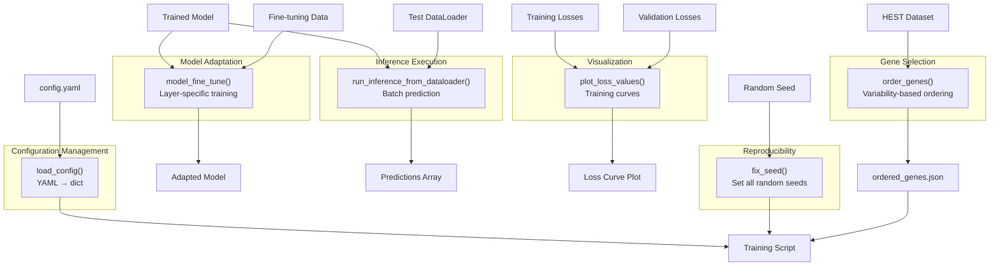
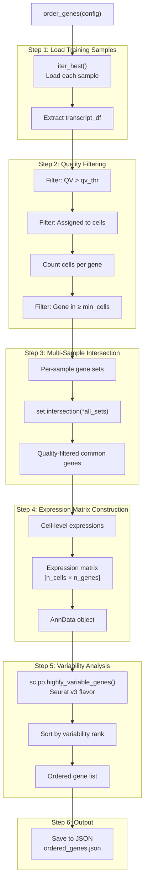
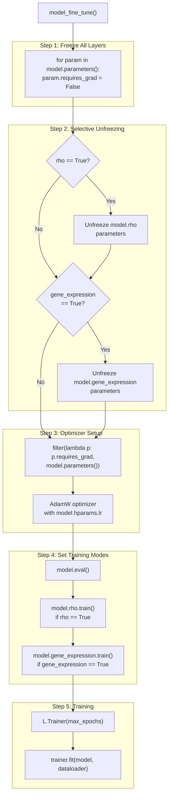
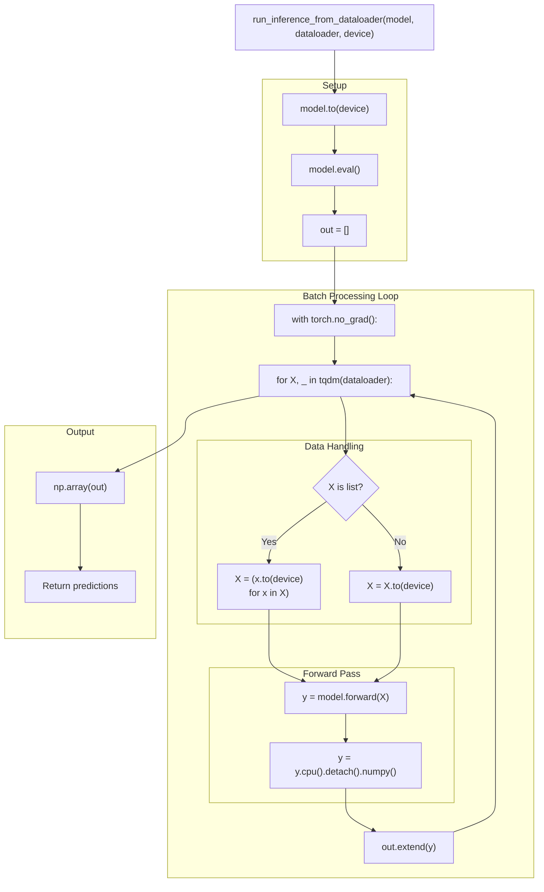
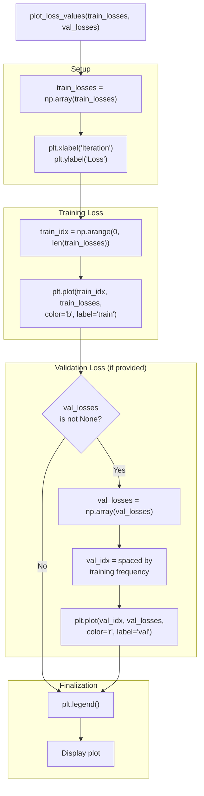

# General Utilities

<details>
<summary>Relevant source files</summary>

The following files were used as context for generating this wiki page:

- [deepspot2cell/utils/__init__.py](deepspot2cell/utils/__init__.py)
- [deepspot2cell/utils/utils.py](deepspot2cell/utils/utils.py)

</details>


## Purpose and Scope

This document covers general-purpose utility functions that support the DeepSpot2Cell pipeline but are not specific to image processing or data loading. These utilities handle configuration management, reproducibility, gene selection, model fine-tuning, inference execution, and result visualization.

For image-specific utilities (PFM loading, tile extraction, spatial prediction), see [Image Processing Utilities](#7.1). For data loading helpers (augmentation, smoothing, clustering), see [Data Loading Utilities](#7.2).

**Sources:** [deepspot2cell/utils/utils.py:1-200](), [deepspot2cell/utils/__init__.py:1-3]()

---

## Utility Function Overview

The general utilities module provides six main categories of functionality that support the DeepSpot2Cell workflow:



**Sources:** [deepspot2cell/utils/utils.py:1-200]()

---

## Configuration Management

### load_config()

The `load_config()` function loads YAML configuration files into Python dictionaries. It is used throughout the DeepSpot2Cell pipeline to load dataset configurations, training parameters, and experiment settings.

**Function Signature:**
```python
load_config(config_path: str) -> dict
```

**Parameters:**

| Parameter | Type | Description |
|-----------|------|-------------|
| `config_path` | `str` | Path to YAML configuration file |

**Returns:** Dictionary containing configuration parameters

**Usage:** Configuration files are typically loaded at the start of scripts and notebooks to define dataset paths, model hyperparameters, and processing options. The function uses `yaml.safe_load()` for secure parsing.

**Sources:** [deepspot2cell/utils/utils.py:106-109]()

---

## Reproducibility Utilities

### fix_seed()

The `fix_seed()` function ensures reproducibility by setting random seeds for all sources of randomness in the pipeline: Python's `random` module, NumPy, PyTorch (CPU and CUDA), and CuDNN backends.

**Function Signature:**
```python
fix_seed(seed: int) -> None
```

**Seed Configuration Process:**

```mermaid
graph TB
    fix_seed["fix_seed(seed)"]
    
    subgraph "Python Environment"
        PYTHONHASHSEED["PYTHONHASHSEED<br/>environment variable"]
        random_seed["random.seed()"]
    end
    
    subgraph "NumPy"
        np_seed["np.random.seed()"]
    end
    
    subgraph "PyTorch CPU"
        torch_seed["torch.manual_seed()"]
    end
    
    subgraph "PyTorch CUDA"
        cuda_seed["torch.cuda.manual_seed()"]
        cuda_seed_all["torch.cuda.manual_seed_all()"]
    end
    
    subgraph "CuDNN Backend"
        cudnn_det["cudnn.deterministic = True"]
        cudnn_bench["cudnn.benchmark = False"]
        cublas_config["CUBLAS_WORKSPACE_CONFIG<br/>:4096:8"]
    end
    
    fix_seed --> PYTHONHASHSEED
    fix_seed --> random_seed
    fix_seed --> np_seed
    fix_seed --> torch_seed
    fix_seed --> cuda_seed
    fix_seed --> cuda_seed_all
    fix_seed --> cudnn_det
    fix_seed --> cudnn_bench
    fix_seed --> cublas_config
```



**Implementation Details:**

The function sets seeds across multiple libraries to ensure deterministic behavior:

1. **Python**: Sets `PYTHONHASHSEED` and `random.seed()`
2. **NumPy**: Sets `np.random.seed()`
3. **PyTorch**: Sets CPU and CUDA seeds
4. **CuDNN**: Disables non-deterministic operations by setting `deterministic=True` and `benchmark=False`
5. **CUBLAS**: Configures workspace for deterministic operations

**Note:** Enabling full determinism may reduce performance, particularly for CuDNN operations. The trade-off is between reproducibility and speed.

**Sources:** [deepspot2cell/utils/utils.py:92-104]()

---

## Gene Selection and Ordering

### order_genes()

The `order_genes()` function performs quality filtering and variability-based ordering of genes across multiple samples. This ensures that the most informative genes are prioritized for model training and reduces the dimensionality of the gene expression space.

**Function Signature:**
```python
order_genes(config: dict) -> list
```

**Parameters:**

| Parameter | Type | Description |
|-----------|------|-------------|
| `config` | `dict` | Configuration dictionary containing data paths and filtering parameters |

**Configuration Parameters Used:**

| Config Key | Description | Default |
|------------|-------------|---------|
| `data.data_folder` | HEST dataset folder path | Required |
| `min_cells` | Minimum number of cells per gene | 20 |
| `qv_thr` | Minimum quality value threshold | 20 |
| `data.dataset.train.dataset_ids` | Sample IDs to process | Required |
| `data.dataset.ordered_genes_file` | Output filename for ordered genes | Required |

**Gene Ordering Pipeline:**



**Processing Steps:**

1. **Sample Loading**: Iterates through training samples using HEST iterator [deepspot2cell/utils/utils.py:125-126]()
2. **Quality Filtering**: Filters transcripts by quality value (QV) and cell assignment [deepspot2cell/utils/utils.py:138-150]()
3. **Cell Count Threshold**: Keeps only genes present in at least `min_cells` cells [deepspot2cell/utils/utils.py:152-157]()
4. **Multi-Sample Intersection**: Finds genes passing filters in ALL training samples [deepspot2cell/utils/utils.py:164-168]()
5. **Expression Matrix**: Builds cell-by-gene expression matrix from transcript counts [deepspot2cell/utils/utils.py:170-186]()
6. **Variability Ranking**: Uses Scanpy's `highly_variable_genes` with Seurat v3 method [deepspot2cell/utils/utils.py:190-194]()
7. **JSON Output**: Saves ordered gene list to JSON file [deepspot2cell/utils/utils.py:196-199]()

**Output:** The function returns an empty list but saves the ordered gene list to a JSON file specified in the configuration. This file is used during dataset creation to select and order genes consistently.

**Sources:** [deepspot2cell/utils/utils.py:112-200]()

---

## Model Fine-Tuning

### model_fine_tune()

The `model_fine_tune()` function selectively fine-tunes specific layers of a trained DeepSpot2Cell model while keeping other layers frozen. This is useful for domain adaptation or transfer learning scenarios.

**Function Signature:**
```python
model_fine_tune(
    model: L.LightningModule,
    dataloader: DataLoader,
    rho: bool = False,
    gene_expression: bool = True,
    max_epochs: int = 10
) -> None
```

**Parameters:**

| Parameter | Type | Default | Description |
|-----------|------|---------|-------------|
| `model` | `L.LightningModule` | Required | DeepSpot2Cell model to fine-tune |
| `dataloader` | `DataLoader` | Required | DataLoader for fine-tuning data |
| `rho` | `bool` | `False` | Whether to unfreeze Rho ensemble layers |
| `gene_expression` | `bool` | `True` | Whether to unfreeze gene expression head |
| `max_epochs` | `int` | `10` | Maximum training epochs |

**Fine-Tuning Strategy:**



**Implementation Details:**

1. **Layer Freezing**: All model parameters are frozen by default [deepspot2cell/utils/utils.py:24-26]()
2. **Selective Unfreezing**: Based on flags, unfreezes either Rho ensemble or gene expression head [deepspot2cell/utils/utils.py:28-35]()
3. **Optimizer Construction**: Creates AdamW optimizer with only trainable parameters [deepspot2cell/utils/utils.py:38-41]()
4. **Training Mode Management**: Sets unfrozen layers to training mode while keeping others in eval mode [deepspot2cell/utils/utils.py:42-48]()
5. **Lightning Training**: Uses PyTorch Lightning trainer for the fine-tuning loop [deepspot2cell/utils/utils.py:50-51]()

**Use Cases:**
- Adapting to new tissue types
- Transfer learning from one PFM to another
- Fine-tuning on tissue-specific gene panels

**Sources:** [deepspot2cell/utils/utils.py:23-52]()

---

## Inference Utilities

### run_inference_from_dataloader()

The `run_inference_from_dataloader()` function executes batch inference on a PyTorch DataLoader, collecting predictions into a NumPy array. This is a general-purpose inference helper used across different prediction scenarios.

**Function Signature:**
```python
run_inference_from_dataloader(
    model: L.LightningModule,
    dataloader: DataLoader,
    device: torch.device
) -> np.ndarray
```

**Parameters:**

| Parameter | Type | Description |
|-----------|------|-------------|
| `model` | `L.LightningModule` | Trained model to use for inference |
| `dataloader` | `DataLoader` | DataLoader providing input batches |
| `device` | `torch.device` | Device for inference (CPU or CUDA) |

**Returns:** NumPy array of shape `[n_samples, n_genes]` containing predictions

**Inference Execution Flow:**



**Key Features:**

1. **Device Management**: Moves model and data to specified device [deepspot2cell/utils/utils.py:55-56]()
2. **Evaluation Mode**: Sets model to eval mode to disable dropout and batch normalization [deepspot2cell/utils/utils.py:56]()
3. **Gradient Disabling**: Uses `torch.no_grad()` context for memory efficiency [deepspot2cell/utils/utils.py:60]()
4. **Flexible Input Handling**: Supports both single tensors and lists of tensors [deepspot2cell/utils/utils.py:62-65]()
5. **Progress Tracking**: Uses tqdm for batch progress visualization [deepspot2cell/utils/utils.py:61]()
6. **Memory Management**: Converts to NumPy and moves to CPU after each batch [deepspot2cell/utils/utils.py:68]()

**Sources:** [deepspot2cell/utils/utils.py:54-72]()

---

## Visualization Utilities

### plot_loss_values()

The `plot_loss_values()` function creates matplotlib plots of training and validation losses over iterations, providing visual feedback on model convergence.

**Function Signature:**
```python
plot_loss_values(
    train_losses: list,
    val_losses: list = None
) -> None
```

**Parameters:**

| Parameter | Type | Description |
|-----------|------|-------------|
| `train_losses` | `list` | Training loss values per iteration |
| `val_losses` | `list` (optional) | Validation loss values (can be less frequent than training) |

**Plotting Behavior:**



**Implementation Details:**

1. **Training Loss**: Plotted at every iteration in blue [deepspot2cell/utils/utils.py:81-82]()
2. **Validation Loss**: Plotted at appropriate intervals in red, accounting for less frequent evaluation [deepspot2cell/utils/utils.py:84-87]()
3. **Index Calculation**: Validation loss indices are computed based on the ratio of training to validation iterations [deepspot2cell/utils/utils.py:86]()
4. **Legend**: Automatically added to distinguish training and validation curves [deepspot2cell/utils/utils.py:89]()

**Usage:** Typically called after training to visualize learning curves and diagnose convergence issues or overfitting.

**Sources:** [deepspot2cell/utils/utils.py:75-90]()

---

## Exported Utilities Summary

The following table summarizes which utility functions are exported in the public API:

| Function | Module | Exported | Purpose |
|----------|--------|----------|---------|
| `fix_seed()` | `utils.py` | ✓ | Set random seeds for reproducibility |
| `load_config()` | `utils.py` | ✓ | Load YAML configuration files |
| `order_genes()` | `utils.py` | ✓ | Order genes by variability |
| `model_fine_tune()` | `utils.py` | ✗ | Fine-tune model layers |
| `run_inference_from_dataloader()` | `utils.py` | ✗ | Execute batch inference |
| `plot_loss_values()` | `utils.py` | ✗ | Visualize training curves |

Functions marked with ✓ are imported in [deepspot2cell/utils/__init__.py:1]() and available as `from deepspot2cell.utils import <function>`. Functions marked with ✗ must be imported directly from the module.

**Sources:** [deepspot2cell/utils/__init__.py:1-3](), [deepspot2cell/utils/utils.py:1-200]()

---

## Dependencies

The general utilities module relies on the following external libraries:

| Library | Purpose | Functions Using It |
|---------|---------|-------------------|
| `yaml` | Configuration file parsing | `load_config()` |
| `torch` | PyTorch tensor operations | `fix_seed()`, `run_inference_from_dataloader()` |
| `numpy` | Numerical operations | All functions |
| `scanpy` | Single-cell analysis | `order_genes()` |
| `anndata` | Annotated data structures | `order_genes()` |
| `pandas` | Data frame operations | `order_genes()` |
| `lightning` | PyTorch Lightning training | `model_fine_tune()` |
| `matplotlib` | Plotting | `plot_loss_values()` |
| `hest` | HEST dataset access | `order_genes()` |
| `sklearn` | Data preprocessing | `order_genes()` |

**Sources:** [deepspot2cell/utils/utils.py:1-20]()

---