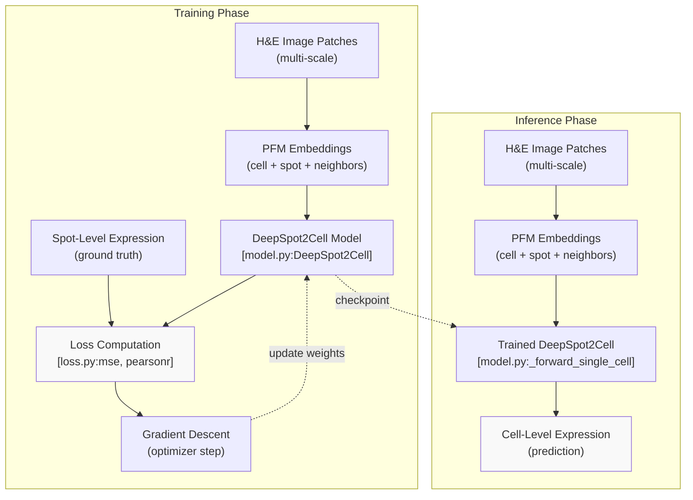
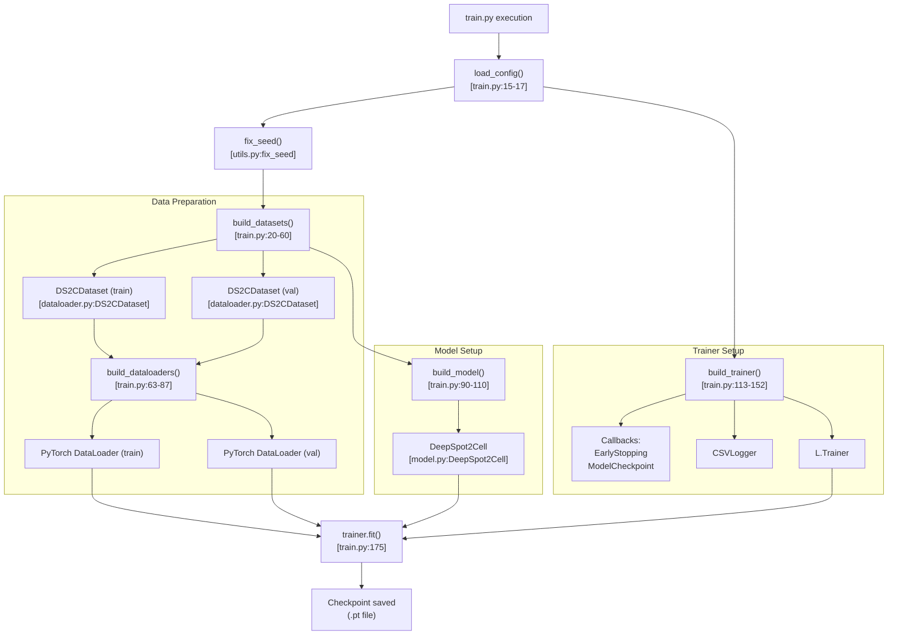
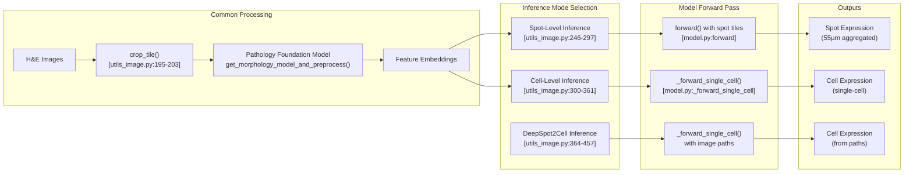
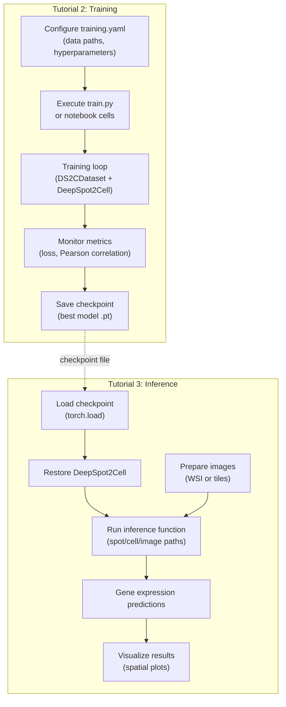

# Training and Inference

<details>
<summary>Relevant source files</summary>

The following files were used as context for generating this wiki page:

- [README.md](README.md)
- [deepspot2cell/utils/utils_image.py](deepspot2cell/utils/utils_image.py)
- [scripts/train.py](scripts/train.py)

</details>


This page provides an overview of the training and inference workflows in DeepSpot2Cell. It explains the conceptual differences between these two operational modes, their implementation in the codebase, and how they relate to the overall system architecture.

For detailed documentation of the training script implementation, see [Training Script](#8.1). For specific inference workflows and their usage, see [Inference Workflows](#8.2). For hands-on guidance, consult [Tutorial 2: Model Training](#3.2) and [Tutorial 3: Inference and Prediction](#3.3).

## Training vs Inference: Core Distinction

The fundamental innovation of DeepSpot2Cell lies in the asymmetry between training and inference. During **training**, the model learns from spot-level gene expression data (55μm regions containing multiple cells). During **inference**, the trained model predicts gene expression at the single-cell level. This resolution transfer is what enables the system to generate virtual single-cell spatial transcriptomics from more readily available spot-level training data.



**Sources:** [README.md:9](), [deepspot2cell/model.py](), [deepspot2cell/loss.py]()

| Aspect | Training | Inference |
|--------|----------|-----------|
| **Objective** | Learn spot-to-expression mapping | Predict cell-level expression |
| **Supervision** | Spot-level gene expression (55μm) | None (uses learned patterns) |
| **Input Structure** | Cell tile + Spot tile + Neighbors | Cell tile + Spot tile + Neighbors |
| **Output** | Spot-level prediction + loss | Cell-level prediction |
| **Forward Method** | `forward()` in training mode | `_forward_single_cell()` |
| **Data Source** | `DS2CDataset` with ground truth | Raw images or embeddings |

## Training Workflow

The training workflow is orchestrated by the `train.py` script, which integrates data loading, model instantiation, and PyTorch Lightning training loops.



**Sources:** [scripts/train.py:1-179]()

### Training Pipeline Components

The training script follows a modular design pattern with separate functions for each setup phase:

**Configuration Loading** [scripts/train.py:15-17]()
- Reads YAML configuration file
- Contains experiment settings, data paths, model hyperparameters, and trainer options

**Dataset Construction** [scripts/train.py:20-60]()
- Instantiates `DS2CDataset` objects for training and validation splits
- Configures data preprocessing: normalization, scaling, neighbor degree
- Shares scaling statistics between train and validation sets

**DataLoader Building** [scripts/train.py:63-87]()
- Creates PyTorch `DataLoader` instances
- Configures batch size, workers, and memory pinning
- Enables shuffling for training, disables for validation

**Model Instantiation** [scripts/train.py:90-110]()
- Infers input/output dimensions from dataset samples
- Initializes `DeepSpot2Cell` with ensemble configurations
- Sets dropout rates, learning rate, and weight decay

**Trainer Setup** [scripts/train.py:113-152]()
- Configures PyTorch Lightning `Trainer`
- Attaches callbacks: `EarlyStopping`, `ModelCheckpoint`
- Sets up logging with `CSVLogger`
- Specifies accelerator, precision, and gradient clipping

**Training Execution** [scripts/train.py:175]()
- Calls `trainer.fit()` to start training loop
- Automatically handles epoch iteration, validation, and checkpointing

**Sources:** [scripts/train.py:1-179]()

## Inference Workflows

DeepSpot2Cell supports three distinct inference modes, each designed for different use cases. All modes share the common pattern of processing multi-scale image features through pathology foundation models before prediction.



**Sources:** [deepspot2cell/utils/utils_image.py:246-457]()

### Inference Mode Comparison

| Function | Purpose | Input Requirements | Output Format | Typical Use Case |
|----------|---------|-------------------|---------------|------------------|
| `predict_spot_spatial_transcriptomics_from_image_path` | Predict at spot level | WSI path, spot coordinates, AnnData | Spot-level expression matrix | Validation against ground truth |
| `predict_cell_spatial_transcriptomics_from_image_path` | Predict at cell level | WSI path, cell coordinates, AnnData | Cell-level expression matrix | Virtual single-cell transcriptomics |
| `predict_spot2cell_from_image_paths` | Predict from individual images | Cell image path, spot path, neighbor paths | Gene expression dictionary | Fine-grained analysis of individual cells |

**Sources:** [deepspot2cell/utils/utils_image.py:246-457]()

### Spot-Level Inference

Function: `predict_spot_spatial_transcriptomics_from_image_path` [deepspot2cell/utils/utils_image.py:246-297]()

This mode predicts gene expression at the spot level (55μm diameter), matching the training supervision resolution. It is primarily used for:
- Validating model performance against ground truth spot-level data
- Predicting expression for spots in samples without transcriptomics data
- Benchmarking against standard spatial transcriptomics platforms

**Key Steps:**
1. Iterate over spot coordinates in `adata.obs`
2. For each spot, crop the spot tile and compute mini-tiles
3. Identify and crop neighboring spots within specified radius
4. Extract PFM embeddings for all tiles
5. Forward pass through DeepSpot2Cell model
6. Inverse transform predictions to original expression scale

**Sources:** [deepspot2cell/utils/utils_image.py:246-297]()

### Cell-Level Inference

Function: `predict_cell_spatial_transcriptomics_from_image_path` [deepspot2cell/utils/utils_image.py:300-361]()

This mode generates virtual single-cell spatial transcriptomics by predicting at the individual cell level. This is the primary application of DeepSpot2Cell's resolution transfer capability.

**Key Steps:**
1. Build spatial neighbor index using `NearestNeighbors` [deepspot2cell/utils/utils_image.py:309-320]()
2. For each cell, crop the cell tile at specified `cell_diameter`
3. Crop neighboring cell tiles within `radius_neighbors`
4. Extract PFM embeddings for cell and neighbors
5. Use `_forward_single_cell()` method for prediction
6. Inverse transform to expression values

**Sources:** [deepspot2cell/utils/utils_image.py:300-361]()

### DeepSpot2Cell-Specific Inference

Function: `predict_spot2cell_from_image_paths` [deepspot2cell/utils/utils_image.py:364-457]()

This specialized mode operates on pre-extracted image tiles rather than whole slide images, providing flexibility for custom workflows and fine-grained analysis.

**Input Structure:**
- `cell_image_path`: Path to target cell image tile
- `spot_image_path`: Path to spot tile containing the cell
- `neighbor_image_paths`: List of paths to neighboring image tiles

**Workflow:**
1. Load individual image tiles using PIL [deepspot2cell/utils/utils_image.py:398]()
2. Extract embeddings for cell, spot, and each neighbor
3. Construct context tensor by concatenating embeddings
4. Create context mask to handle missing neighbors [deepspot2cell/utils/utils_image.py:435-437]()
5. Call `_forward_single_cell()` with cell embedding and context
6. Return gene expression as dictionary mapping gene names to values

**Sources:** [deepspot2cell/utils/utils_image.py:364-457]()

## Training and Inference in Practice

The complete DeepSpot2Cell workflow integrates training and inference through the tutorial series:



**Sources:** [README.md:26-33]()

### Command-Line Training

The training script can be executed directly from the command line:

```bash
python scripts/train.py --config configs/training.example.yaml --output runs
```

**Parameters:**
- `--config`: Path to training configuration YAML file (default: `configs/training.example.yaml`)
- `--output`: Directory for checkpoints and logs (default: `runs`)

The script creates an experiment directory at `{output}/{experiment.name}/` containing:
- `checkpoints/`: Model checkpoint files (.pt)
- `logs/`: CSV training logs with metrics per epoch

**Sources:** [scripts/train.py:156-176]()

### Inference from Checkpoints

To use a trained model for inference, load the checkpoint and call the appropriate inference function:

```python
# Load model
checkpoint = torch.load('runs/experiment_name/checkpoints/best.pt')
model = DeepSpot2Cell(...)
model.load_state_dict(checkpoint['state_dict'])
model.eval()

# Run cell-level inference
predictions = predict_cell_spatial_transcriptomics_from_image_path(
    image_path='path/to/wsi.tif',
    adata=cell_annotations,
    cell_diameter=128,
    radius_neighbors=100,
    preprocess=preprocess,
    morphology_model=pfm,
    model_expression=model,
    device='cuda'
)
```

For detailed usage examples, see [Tutorial 3: Inference and Prediction](#3.3).

**Sources:** [deepspot2cell/utils/utils_image.py:300-361]()

## Key Implementation Details

### Mixed Precision Training

Both training and inference support mixed precision (FP16) for memory efficiency and speed:

**Training:** Configured via `trainer.precision` in YAML [scripts/train.py:146]()
```yaml
trainer:
  precision: 16  # or 32 for full precision
```

**Inference:** Automatic via `torch.autocast` [deepspot2cell/utils/utils_image.py:260]()
```python
with torch.autocast(device_type="cuda", dtype=torch.float16):
    with torch.inference_mode():
        # inference code
```

### Batch Processing vs Sequential Inference

**Training:** Processes batches for efficiency via `DataLoader` [scripts/train.py:69-85]()

**Inference:** Typically processes one sample at a time in a loop [deepspot2cell/utils/utils_image.py:262]()
- Enables progress tracking with `tqdm`
- Reduces memory requirements for large WSIs
- Allows early stopping if needed

### Gradient Management

**Training:** Gradients computed and accumulated during backward pass [scripts/train.py:147]()
- Optional gradient clipping via `gradient_clip_val`

**Inference:** Gradients disabled for performance [deepspot2cell/utils/utils_image.py:261]()
- Uses `torch.inference_mode()` (more efficient than `torch.no_grad()`)

**Sources:** [scripts/train.py:113-152](), [deepspot2cell/utils/utils_image.py:260-296]()

## Summary

The training and inference workflows in DeepSpot2Cell are designed to be modular and flexible:

- **Training** uses spot-level supervision through the `train.py` script and `DS2CDataset` class
- **Inference** provides three modes for different use cases: spot-level, cell-level, and image-path-based
- Both workflows share the same multi-scale feature extraction pipeline (cell + spot + neighbors → PFM → embeddings)
- The resolution transfer from spot-supervised training to cell-level inference is the core methodological innovation

For implementation details, see [Training Script](#8.1) and [Inference Workflows](#8.2).

**Sources:** [scripts/train.py](), [deepspot2cell/utils/utils_image.py](), [deepspot2cell/model.py](), [README.md]()

---