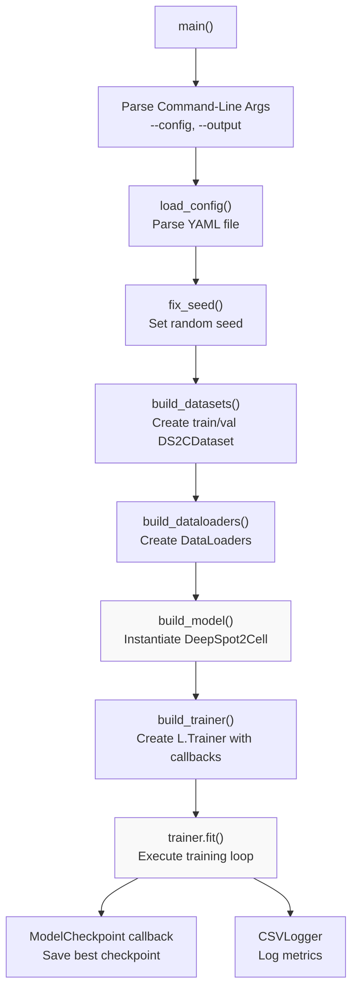
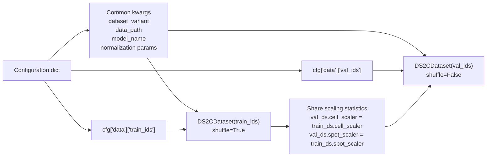
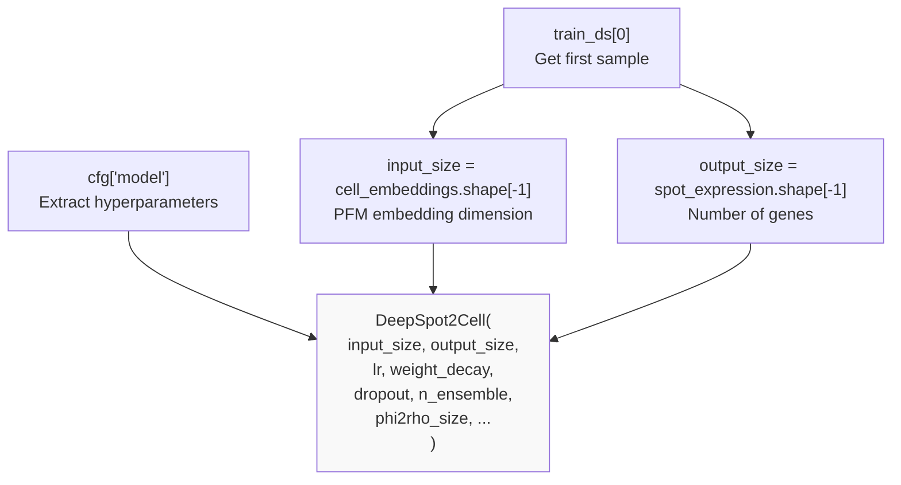
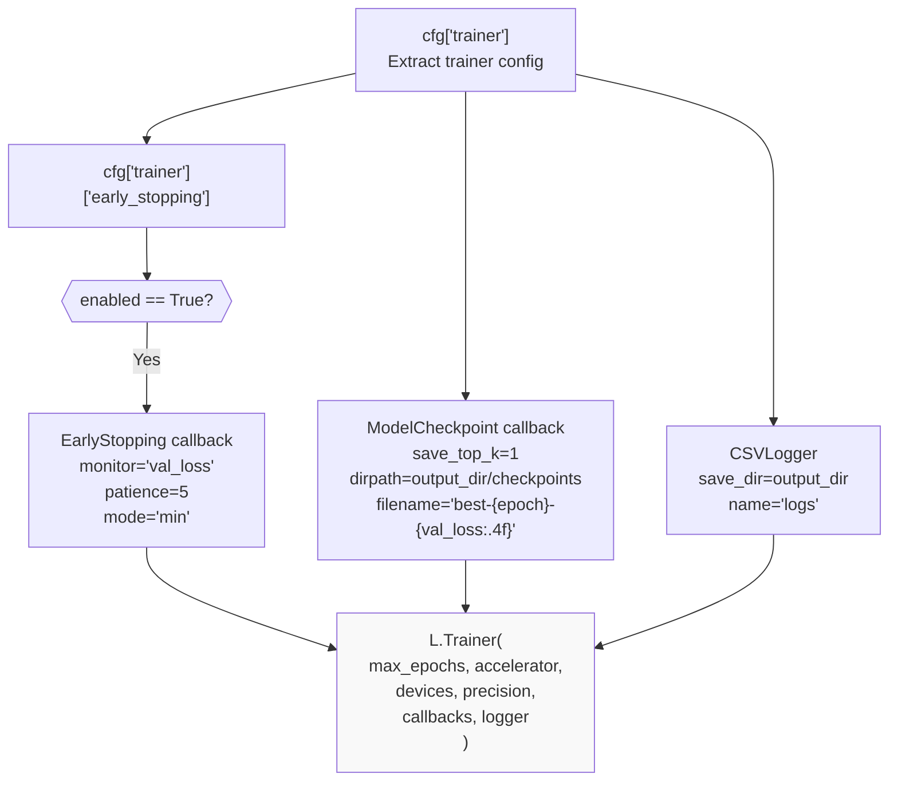
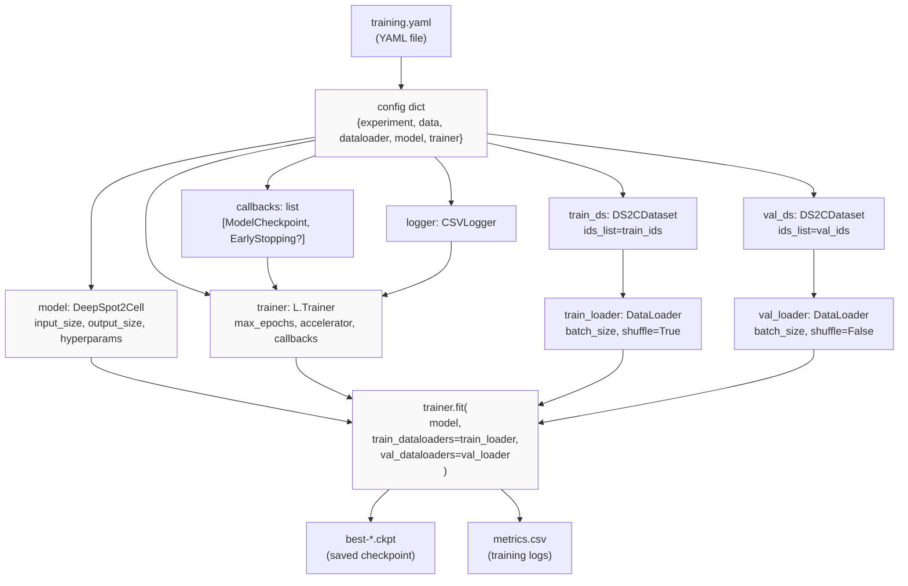

# Training Script

<details>
<summary>Relevant source files</summary>

The following files were used as context for generating this wiki page:

- [configs/training.example.yaml](configs/training.example.yaml)
- [deepspot2cell/model.py](deepspot2cell/model.py)
- [scripts/train.py](scripts/train.py)

</details>


This document describes the training script located at `scripts/train.py`, which provides a command-line interface for training DeepSpot2Cell models. The script orchestrates dataset loading, model instantiation, and training execution based on YAML configuration files.

For information about the training configuration parameters, see [Training Configuration](#6.2). For details about the model architecture being trained, see [DeepSpot2Cell Model Architecture](#4.1). For information about the dataset class used during training, see [DS2CDataset and Data Loading](#4.2).

## Purpose and Scope

The training script serves as the main entry point for model training. It:
- Loads configuration from YAML files
- Constructs training and validation datasets
- Instantiates the DeepSpot2Cell model
- Configures PyTorch Lightning Trainer with callbacks (checkpointing, early stopping)
- Executes the training loop
- Saves model checkpoints and training logs

The script is designed to be run from the command line and requires minimal user intervention once configuration files are properly set up.

## Command-Line Interface

The training script accepts two command-line arguments:

| Argument | Default | Description |
|----------|---------|-------------|
| `--config` | `configs/training.example.yaml` | Path to training configuration file |
| `--output` | `runs` | Directory to store checkpoints and logs |

**Example usage:**

```bash
python scripts/train.py --config configs/my_experiment.yaml --output experiments
```

This creates an output directory at `experiments/{experiment_name}/` containing:
- `checkpoints/` - Model checkpoint files
- `logs/` - CSV training logs

**Sources:** [scripts/train.py:155-159]()

## Training Script Workflow

The following diagram shows the complete execution flow of the training script, from configuration loading through model training:



**Sources:** [scripts/train.py:155-176]()

## Configuration Loading

The `load_config()` function reads and parses YAML configuration files:

```python
def load_config(path: Path) -> dict
```

This function uses `yaml.safe_load()` to parse the configuration file and returns a dictionary with the following top-level keys:
- `experiment` - Experiment name and random seed
- `data` - Dataset configuration
- `dataloader` - DataLoader parameters
- `model` - Model hyperparameters
- `trainer` - Training configuration including early stopping

**Sources:** [scripts/train.py:15-17]()

## Dataset Construction

The `build_datasets()` function creates training and validation `DS2CDataset` instances:



The function extracts common parameters from the configuration and passes them to both datasets:

| Parameter | Config Key | Default | Description |
|-----------|------------|---------|-------------|
| `dataset_variant` | `data.dataset_variant` | - | Dataset version suffix (e.g., `_v1`) |
| `data_path` | `data.data_folder` | - | Root directory containing embeddings and expressions |
| `model_name` | `data.model_name` | - | PFM model name (e.g., `phikonv2`) |
| `standard_scaling` | `data.standard_scaling` | `False` | Apply standard scaling |
| `normalize` | `data.normalize` | `True` | Normalize expression counts |
| `minmax` | `data.minmax` | `False` | Apply min-max scaling |
| `neighb_degree` | `data.neighb_degree` | `0` | Number of neighbor spot rings |
| `norm_counts` | `data.norm_counts` | `10000` | Target count for normalization |
| `scellst` | `data.scellst` | `False` | Use single-cell ST data |
| `load_cell_types` | `data.load_cell_types` | `False` | Load cell type annotations |

**Scaling statistics sharing:** If standard scaling or min-max scaling is enabled, the validation dataset shares the scaling parameters computed from the training data to prevent data leakage [scripts/train.py:46-58]().

**Sources:** [scripts/train.py:20-60](), [configs/training.example.yaml:5-22]()

## DataLoader Construction

The `build_dataloaders()` function wraps the datasets in PyTorch `DataLoader` objects:

```python
def build_dataloaders(train_ds, val_ds, cfg: dict)
```

Configuration parameters:

| Parameter | Config Key | Default | Description |
|-----------|------------|---------|-------------|
| `batch_size` | `dataloader.batch_size` | `4` | Number of spots per batch |
| `num_workers` | `dataloader.num_workers` | `0` | Number of worker processes |
| `pin_memory` | - | Auto-detected | Pin memory if CUDA available |

The training loader uses `shuffle=True`, while the validation loader uses `shuffle=False` to ensure reproducible validation metrics.

**Sources:** [scripts/train.py:63-87](), [configs/training.example.yaml:24-26]()

## Model Instantiation

The `build_model()` function creates a `DeepSpot2Cell` instance with parameters from the configuration:



The function automatically infers `input_size` and `output_size` from the dataset, then passes all model hyperparameters from the configuration:

| Parameter | Config Key | Default | Description |
|-----------|------------|---------|-------------|
| `lr` | `model.lr` | `1e-4` | Learning rate |
| `weight_decay` | `model.weight_decay` | `1e-6` | Weight decay for regularization |
| `dropout` | `model.dropout` | `0.3` | Dropout probability |
| `dropout_phi` | `model.dropout_phi` | Uses `dropout` | Phi-specific dropout |
| `dropout_rho` | `model.dropout_rho` | Uses `dropout` | Rho-specific dropout |
| `n_ensemble` | `model.n_ensemble` | `10` | Number of ensemble models |
| `n_ensemble_phi` | `model.n_ensemble_phi` | Uses `n_ensemble` | Phi ensemble size |
| `n_ensemble_rho` | `model.n_ensemble_rho` | Uses `n_ensemble` | Rho ensemble size |
| `phi2rho_size` | `model.phi2rho_size` | `512` | Intermediate feature dimension |
| `cell_gt_available` | `model.cell_gt_available` | `True` | Whether cell-level ground truth exists |

The `random_seed` is taken from `experiment.random_seed` to ensure reproducibility.

**Sources:** [scripts/train.py:90-110](), [configs/training.example.yaml:28-38]()

## Trainer Setup

The `build_trainer()` function creates a PyTorch Lightning `Trainer` with callbacks and logging:



### Callbacks

**ModelCheckpoint:** Saves the best model checkpoint based on validation loss [scripts/train.py:128-138]()
- `save_top_k=1` - Only keeps the best checkpoint
- `monitor` - Metric to track (typically `val_loss`)
- `mode` - Optimization direction (`min` or `max`)
- `filename` - Checkpoint naming pattern

**EarlyStopping (optional):** Stops training when validation loss stops improving [scripts/train.py:117-126]()

| Parameter | Config Key | Default | Description |
|-----------|------------|---------|-------------|
| `enabled` | `trainer.early_stopping.enabled` | `false` | Enable early stopping |
| `monitor` | `trainer.early_stopping.monitor` | `val_loss` | Metric to monitor |
| `patience` | `trainer.early_stopping.patience` | `5` | Epochs to wait before stopping |
| `mode` | `trainer.early_stopping.mode` | `min` | `min` or `max` optimization |
| `min_delta` | `trainer.early_stopping.min_delta` | `0.0` | Minimum change to qualify as improvement |

### Trainer Configuration

| Parameter | Config Key | Default | Description |
|-----------|------------|---------|-------------|
| `max_epochs` | `trainer.max_epochs` | `50` | Maximum number of epochs |
| `accelerator` | `trainer.accelerator` | `auto` | Hardware accelerator (`auto`, `gpu`, `cpu`) |
| `devices` | `trainer.devices` | `1` | Number of devices to use |
| `precision` | `trainer.precision` | `32` | Numerical precision (32, 16, or `bf16`) |
| `gradient_clip_val` | `trainer.gradient_clip_val` | `null` | Gradient clipping threshold |
| `log_every_n_steps` | `trainer.log_every_n_steps` | `50` | Logging frequency |

**Sources:** [scripts/train.py:113-152](), [configs/training.example.yaml:40-53]()

## Training Execution

After all components are constructed, the script executes training with a single call:

```python
trainer.fit(model, train_dataloaders=train_loader, val_dataloaders=val_loader)
```

This initiates the PyTorch Lightning training loop, which:
1. Iterates through epochs up to `max_epochs`
2. For each epoch:
   - Runs training batches through `model.training_step()`
   - Computes gradients and updates model weights
   - Runs validation batches through `model.validation_step()`
   - Logs metrics via `CSVLogger`
   - Invokes callbacks (checkpointing, early stopping)
3. Saves the best checkpoint based on validation loss
4. Optionally stops early if validation loss plateaus

The training loop is fully managed by PyTorch Lightning, with model-specific logic defined in `DeepSpot2Cell.training_step()` and `DeepSpot2Cell.validation_step()`.

**Sources:** [scripts/train.py:175]()

## Training Metrics

During training, the model logs the following metrics:

### Spot-Level Metrics

| Metric | Description | Logged In |
|--------|-------------|-----------|
| `train_loss` | MSE between predicted and true spot expressions | Every training step |
| `val_loss` | MSE between predicted and true spot expressions | Every validation step |

### Cell-Level Metrics (if `cell_gt_available=True`)

| Metric | Description | Logged In |
|--------|-------------|-----------|
| `train_cell_inside_pearson` | Mean Pearson correlation for cells inside spots | End of training epoch |
| `train_cell_outside_pearson` | Mean Pearson correlation for cells outside spots | End of training epoch |
| `val_cell_inside_pearson` | Mean Pearson correlation for cells inside spots | End of validation epoch |
| `val_cell_outside_pearson` | Mean Pearson correlation for cells outside spots | End of validation epoch |

The cell-level metrics provide insight into the model's ability to predict individual cell expressions, even though training supervision is at the spot level. The distinction between "inside" and "outside" cells refers to whether cells fall within or outside the spot boundary, which is useful for assessing generalization.

**Sources:** [deepspot2cell/model.py:148-192](), [deepspot2cell/model.py:195-234](), [deepspot2cell/model.py:236-276]()

## Output Structure

The training script produces the following output structure:

```
{output_dir}/{experiment_name}/
├── checkpoints/
│   └── best-epoch={N}-val_loss={X.XXXX}.ckpt
└── logs/
    └── version_0/
        └── metrics.csv
```

**Checkpoints directory:** Contains the best model checkpoint based on validation loss. The checkpoint includes:
- Model weights and optimizer state
- Hyperparameters
- Training metrics

**Logs directory:** Contains CSV files with training metrics for each epoch:
- `epoch` - Epoch number
- `train_loss` - Training loss
- `val_loss` - Validation loss
- `train_cell_inside_pearson` - Training inside-cell Pearson
- `val_cell_inside_pearson` - Validation inside-cell Pearson
- Additional metrics as logged by the model

**Sources:** [scripts/train.py:128-140]()

## Complete Data Flow

The following diagram shows how data and objects flow through the training script:



**Sources:** [scripts/train.py:15-176]()

## Integration with Other Components

The training script integrates with multiple system components:

- **DS2CDataset** ([#4.2](#4.2)): Loads preprocessed embeddings and expressions
- **DeepSpot2Cell model** ([#4.1](#4.1)): Defines the neural network architecture and training logic
- **Loss functions** ([#4.3](#4.3)): Used within model training/validation steps
- **Utility functions** ([#7.3](#7.3)): Configuration loading (`load_config`) and seed fixing (`fix_seed`)
- **Tutorial 2** ([#3.2](#3.2)): Provides user-facing documentation for training workflows

The script is designed to be both programmatically accessible (by importing its functions) and directly executable from the command line.

**Sources:** [scripts/train.py:1-180]()

---