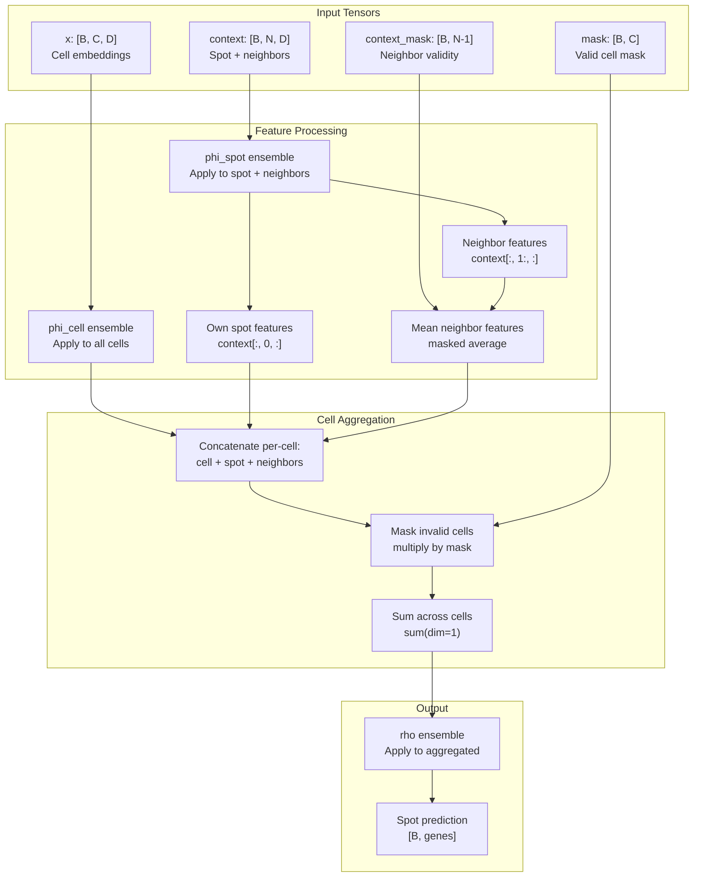
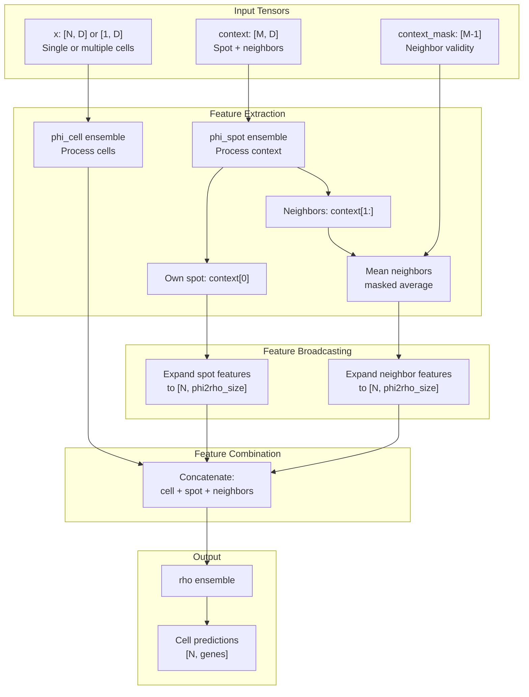
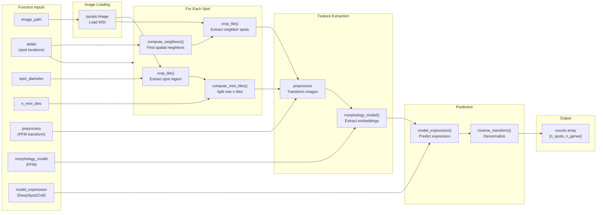
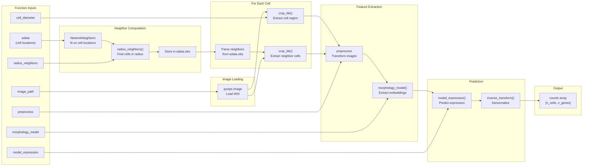
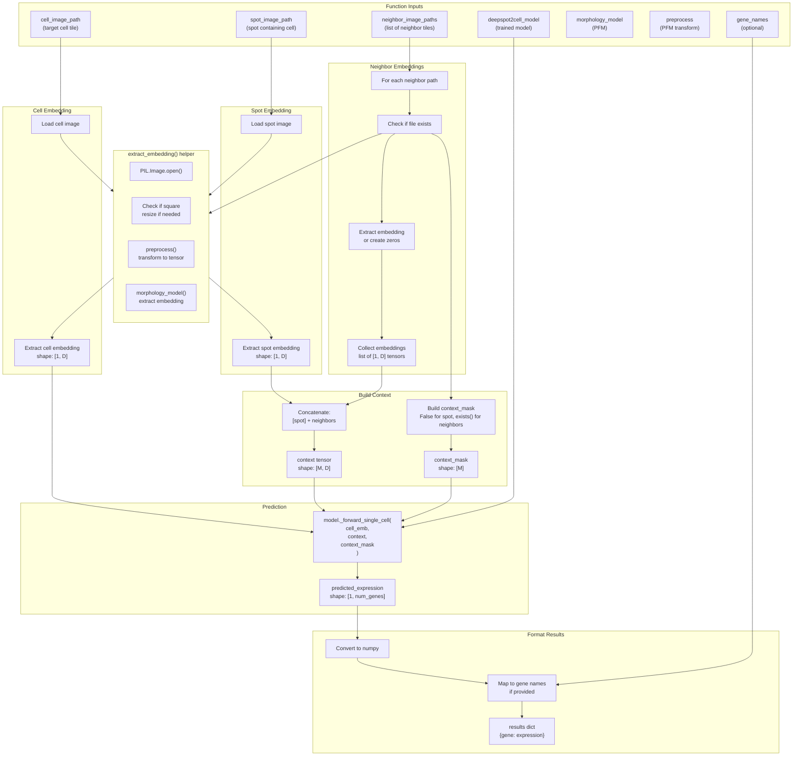

# Inference Workflows

<details>
<summary>Relevant source files</summary>

The following files were used as context for generating this wiki page:

- [deepspot2cell/model.py](deepspot2cell/model.py)
- [deepspot2cell/utils/utils_image.py](deepspot2cell/utils/utils_image.py)
- [tutorials/GettingStartedWithDeepSpot2Cell_3_inference.ipynb](tutorials/GettingStartedWithDeepSpot2Cell_3_inference.ipynb)

</details>


This page documents the different inference workflows available in DeepSpot2Cell for predicting gene expression from H&E images. DeepSpot2Cell provides three distinct inference approaches: spot-level prediction, cell-level prediction, and DeepSpot2Cell-specific inference from image paths. Each workflow is designed for different use cases and operates at different spatial resolutions.

For information about training the model, see [Training Script](#8.1). For information about preprocessing data before inference, see [Tutorial 1: Data Preprocessing](#3.1).

## Overview of Inference Modes

DeepSpot2Cell supports two fundamental prediction modes built into the model architecture, plus specialized functions for end-to-end inference directly from image files:

| Inference Mode | Method | Resolution | Use Case |
|---|---|---|---|
| **Superspot Mode** | `_forward_superspot()` | Spot-level (55μm) | Batch prediction during training/validation |
| **Single Cell Mode** | `_forward_single_cell()` | Cell-level | Individual cell predictions |
| **Spot from Image** | `predict_spot_spatial_transcriptomics_from_image_path()` | Spot-level | End-to-end spot inference from WSI |
| **Cell from Image** | `predict_cell_spatial_transcriptomics_from_image_path()` | Cell-level | End-to-end cell inference from WSI |
| **DeepSpot2Cell from Image** | `predict_spot2cell_from_image_paths()` | Cell-level | Inference from individual image tiles |

## Model-Level Inference Modes

The `DeepSpot2Cell` class implements two forward pass methods that operate at different spatial resolutions. These methods share the same underlying architecture (Phi and Rho ensembles) but differ in how they aggregate features.

### Superspot Mode (_forward_superspot)

The superspot mode is used during training and validation to predict spot-level gene expression. It aggregates embeddings from all cells within a spot to produce a single spot-level prediction.



**Sources:** [deepspot2cell/model.py:114-137]()

The superspot forward pass processes batches of spots:

1. **Cell Feature Extraction**: Cell embeddings `x` of shape `[batch, num_cells, embedding_dim]` are processed through the `phi_cell` ensemble to produce cell-specific features.

2. **Context Processing**: The context tensor contains the spot's own embedding at position `context[:, 0, :]` and neighboring spot embeddings at `context[:, 1:, :]`. These are processed through the `phi_spot` ensemble.

3. **Neighbor Aggregation**: Neighboring spot features are masked using `context_mask` and averaged to produce a mean neighbor representation. Invalid neighbors (masked as `True`) are excluded from the average.

4. **Per-Cell Concatenation**: For each cell, the system concatenates three feature vectors: the cell's own features, the spot's features, and the mean neighbor features. This produces a tensor of shape `[batch, num_cells, phi2rho_size * 3]`.

5. **Cell Masking and Aggregation**: The concatenated features are multiplied by the cell mask (expanded to match dimensions) to zero out invalid cells. The features are then summed across the cell dimension to produce a single feature vector per spot.

6. **Final Prediction**: The aggregated features pass through the `rho` ensemble to produce spot-level gene expression predictions of shape `[batch, num_genes]`.

### Single Cell Mode (_forward_single_cell)

The single cell mode predicts gene expression for individual cells. Unlike superspot mode, it does not aggregate across cells but instead produces a prediction for each cell independently.



**Sources:** [deepspot2cell/model.py:88-112]()

The single cell forward pass operates differently from superspot mode:

1. **Input Handling**: Accepts a tensor of cell embeddings with shape `[num_cells, embedding_dim]` or `[1, embedding_dim]`. If a 1D tensor is provided, it is unsqueezed to add a batch dimension.

2. **Cell Features**: Each cell embedding is processed through the `phi_cell` ensemble independently, producing cell-specific features.

3. **Context Processing**: The spot containing the cell is at `context[0]` and neighboring spots are at `context[1:]`. The spot is processed through `phi_spot`, while neighbors are processed and averaged (with masking).

4. **Feature Broadcasting**: Unlike superspot mode which aggregates, single cell mode broadcasts the spot and neighbor features to match the number of cells. Each cell receives the same spot and neighbor context.

5. **Per-Cell Prediction**: Features are concatenated for each cell: `[cell_features, spot_features, neighbor_features]`. Each concatenated vector passes through the `rho` ensemble to produce an independent gene expression prediction for that cell.

6. **Output Shape**: Returns a tensor of shape `[num_cells, num_genes]`, with one prediction per cell.

This mode is used during validation (when `cell_gt_available=True`) to compute cell-level metrics, and during inference to generate virtual single-cell transcriptomics.

**Sources:** [deepspot2cell/model.py:168-191](), [deepspot2cell/model.py:211-232]()

## Image-Based Inference Functions

DeepSpot2Cell provides three high-level functions for performing inference directly from H&E whole slide images. These functions handle image loading, tile extraction, feature computation, and prediction in a single call.

### Spot-Level Inference from Image Path

The `predict_spot_spatial_transcriptomics_from_image_path()` function performs end-to-end spot-level prediction from a whole slide image.



**Sources:** [deepspot2cell/utils/utils_image.py:246-297]()

#### Workflow Details

1. **Image Loading**: Opens the whole slide image using `pyvips.Image.new_from_file()` for memory-efficient access to large images.

2. **Spot Iteration**: Iterates over all spots in the provided AnnData object (`adata.obs`), processing each spot independently.

3. **Tile Extraction**: For each spot:
   - Uses `crop_tile()` to extract a square region centered on the spot coordinates (`x_pixel`, `y_pixel`) with size `spot_diameter`
   - Applies `compute_mini_tiles()` to split the spot into `n_mini_tiles` sub-regions (e.g., 4x4=16 tiles)
   - Uses `compute_neighbors()` to find neighboring spots within a specified radius

4. **Neighbor Processing**: Extracts image tiles for all neighboring spots identified in step 3. If no neighbors exist, creates a zero array as placeholder.

5. **Preprocessing and Embedding**: 
   - Applies the PFM preprocessing transformation to all image tiles
   - Passes preprocessed tiles through the morphology model to extract feature embeddings
   - Uses mixed precision (`torch.autocast`) and inference mode (`torch.inference_mode()`) for efficiency

6. **Prediction**: Combines spot, sub-spot, and neighbor embeddings into a list `[X_spot, X_subspot, X_neighbors]` and passes to the expression model for prediction.

7. **Post-processing**: Applies inverse transformation to denormalize predictions back to gene expression space.

#### Input Requirements

| Parameter | Type | Description |
|---|---|---|
| `image_path` | str | Path to whole slide image (H&E) |
| `adata` | AnnData | Spot locations with `x_pixel`, `y_pixel`, `barcode` in `.obs` |
| `spot_diameter` | int | Diameter in pixels for spot tile extraction |
| `n_mini_tiles` | int | Number of sub-tiles to split each spot into |
| `preprocess` | callable | PFM preprocessing function |
| `morphology_model` | torch.nn.Module | Pre-trained PFM for feature extraction |
| `model_expression` | Model | Trained DeepSpot2Cell model with `inverse_transform()` |
| `device` | str | 'cuda' or 'cpu' |
| `super_resolution` | bool | If True, extracts only center tile |
| `neighbor_radius` | int | Radius for neighbor identification (default=1) |

**Sources:** [deepspot2cell/utils/utils_image.py:246-297]()

### Cell-Level Inference from Image Path

The `predict_cell_spatial_transcriptomics_from_image_path()` function performs end-to-end cell-level prediction from a whole slide image.



**Sources:** [deepspot2cell/utils/utils_image.py:300-361]()

#### Workflow Details

1. **Neighbor Precomputation**: Uses `sklearn.neighbors.NearestNeighbors` to identify all cells within `radius_neighbors` of each cell. Stores results in `adata.obs["neighbors"]` as a triple-underscore-separated string of cell barcodes.

2. **Image Loading**: Opens the whole slide image using `pyvips` for efficient memory access.

3. **Cell Iteration**: Processes each cell in `adata.obs` sequentially.

4. **Tile Extraction**: For each cell:
   - Extracts a square tile centered on the cell using `crop_tile()` with `cell_diameter`
   - Parses the neighbor list and extracts tiles for all neighboring cells
   - Creates zero-filled placeholder if no neighbors exist

5. **Feature Extraction**: Preprocesses and embeds cell and neighbor tiles through the morphology model.

6. **Prediction**: Combines cell and neighbor embeddings into list `[X_cell, X_neighbors]` and passes to model.

7. **Post-processing**: Applies inverse transformation to convert predictions to gene expression values.

#### Key Differences from Spot-Level Inference

- **No sub-tiles**: Cells are not split into mini-tiles
- **No spot context**: Uses neighboring cells directly instead of spot-level context
- **Radius-based neighbors**: Uses distance-based neighbor finding instead of spot adjacency
- **Different model input**: Model receives `[cell, neighbors]` instead of `[spot, subspots, neighbor_spots]`

**Sources:** [deepspot2cell/utils/utils_image.py:300-361]()

### DeepSpot2Cell-Specific Inference from Image Paths

The `predict_spot2cell_from_image_paths()` function provides a specialized interface for DeepSpot2Cell that accepts individual image tile paths rather than extracting tiles from a whole slide image.



**Sources:** [deepspot2cell/utils/utils_image.py:364-457]()

#### Function Architecture

This function is designed for scenarios where image tiles have already been extracted and saved as individual files. It directly calls the model's `_forward_single_cell()` method.

#### Helper Function: extract_embedding()

Defined inline at [deepspot2cell/utils/utils_image.py:396-410](), this helper extracts embeddings from individual image files:

1. Opens image using PIL
2. Ensures square dimensions (resizes if necessary)
3. Applies preprocessing transformation
4. Passes through morphology model
5. Returns numpy array of embedding

#### Main Workflow

1. **Cell Embedding Extraction**: Loads the target cell image and extracts its embedding using the helper function.

2. **Spot Embedding Extraction**: Loads the spot image (the spot region containing the target cell) and extracts its embedding.

3. **Neighbor Embedding Extraction**: Iterates through neighbor image paths:
   - If file exists: extracts embedding
   - If file missing: creates zero-filled tensor matching embedding dimensions
   - Collects all neighbor embeddings in a list

4. **Context Construction**: 
   - Concatenates spot embedding and neighbor embeddings: `[spot_embedding] + neighbor_embeddings`
   - Creates context mask: `[False]` for the spot (always present), then `True/False` for each neighbor based on file existence

5. **Model Inference**: Calls `deepspot2cell_model._forward_single_cell()` with:
   - Cell embedding tensor
   - Context tensor (spot + neighbors)
   - Context mask (validity indicators)

6. **Result Formatting**: If `gene_names` provided, returns a dictionary mapping gene names to predicted expression values. Otherwise, uses generic names like "gene_0", "gene_1", etc.

#### Input Requirements

| Parameter | Type | Description |
|---|---|---|
| `cell_image_path` | str | Path to target cell image tile |
| `spot_image_path` | str | Path to spot image tile containing the cell |
| `neighbor_image_paths` | list[str] | List of paths to neighboring image tiles |
| `deepspot2cell_model` | DeepSpot2Cell | Trained model instance |
| `morphology_model` | torch.nn.Module | Pre-trained PFM |
| `preprocess` | callable | PFM preprocessing function |
| `device` | str | 'cuda' or 'cpu' |
| `gene_names` | list[str] (optional) | Gene names for result mapping |

#### Return Value

Returns a dictionary mapping gene names/indices to predicted expression values:

```python
{
    "gene1": 5.234,
    "gene2": 1.032,
    ...
}
```

#### Use Cases

This function is particularly useful for:
- **Interactive applications**: Where users select individual cells for prediction
- **Pre-extracted datasets**: Where tiles have been saved during preprocessing
- **Debugging**: Testing model predictions on specific tiles
- **Integration**: Embedding DeepSpot2Cell in larger pipelines that work with tile-based data

**Sources:** [deepspot2cell/utils/utils_image.py:364-457]()

## Inference Workflow Comparison

The three image-based inference functions serve different purposes and have different input/output characteristics:

| Aspect | Spot from Image | Cell from Image | DeepSpot2Cell from Paths |
|---|---|---|---|
| **Input** | WSI + spot coordinates | WSI + cell coordinates | Individual tile paths |
| **Resolution** | Spot-level (55μm) | Cell-level (~10μm) | Cell-level |
| **Tile Extraction** | Automatic from WSI | Automatic from WSI | Pre-extracted tiles |
| **Sub-tiles** | Yes (splits spots) | No | No |
| **Context** | Neighboring spots | Neighboring cells | Spot + neighbor spots |
| **Batch Processing** | Sequential per spot | Sequential per cell | Single prediction |
| **Model Method** | Custom forward | Custom forward | `_forward_single_cell()` |
| **Output** | Array [n_spots, n_genes] | Array [n_cells, n_genes] | Dict {gene: value} |
| **Use Case** | Spot-level ST prediction | Cell-level ST prediction | Interactive/debugging |

## Implementation Notes

### Memory and Performance Considerations

1. **Mixed Precision**: All image-based inference functions use `torch.autocast(device_type="cuda", dtype=torch.float16)` for efficient GPU memory usage and faster inference.

2. **Inference Mode**: Functions use `torch.inference_mode()` to disable gradient computation, reducing memory overhead.

3. **Sequential Processing**: Both `predict_spot_spatial_transcriptomics_from_image_path()` and `predict_cell_spatial_transcriptomics_from_image_path()` process locations sequentially with a progress bar (`tqdm`). For large datasets, this can be time-consuming.

4. **WSI Loading**: Uses `pyvips` for memory-efficient loading of large whole slide images, loading only required regions on demand.

**Sources:** [deepspot2cell/utils/utils_image.py:260-261](), [deepspot2cell/utils/utils_image.py:327-328]()

### Ensemble Predictions

The model uses ensemble methods for robust predictions:

- **Phi Ensembles**: Multiple Phi modules process features independently, and predictions are combined using median: `torch.median(torch.stack([p(x) for p in self.phi_spot], 1), 1).values`

- **Rho Ensemble**: Multiple Rho modules process aggregated features, and predictions are averaged: `torch.stack([r(x) for r in self.rho], 1).mean(1)`

This ensemble approach provides more stable predictions compared to single-model inference.

**Sources:** [deepspot2cell/model.py:139-146]()

### Missing Neighbors Handling

All inference functions handle missing neighbors gracefully:

- In `predict_spot_spatial_transcriptomics_from_image_path()`: Creates zero array if no neighbors found [deepspot2cell/utils/utils_image.py:274]()

- In `predict_cell_spatial_transcriptomics_from_image_path()`: Creates zero array if no neighbors found [deepspot2cell/utils/utils_image.py:340]()

- In `predict_spot2cell_from_image_paths()`: Creates zero tensor for non-existent neighbor paths [deepspot2cell/utils/utils_image.py:428]()

The context mask ensures that missing neighbors are properly excluded during feature aggregation in the model's forward pass.

---