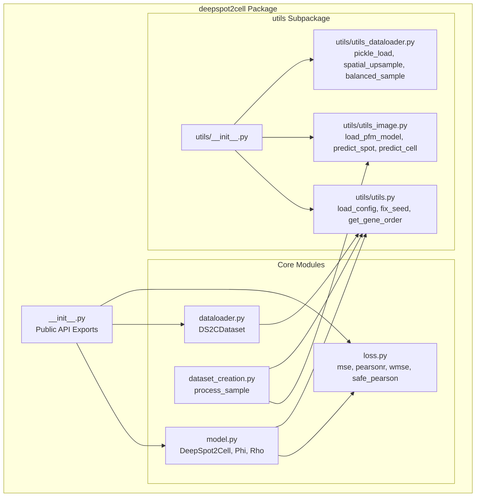
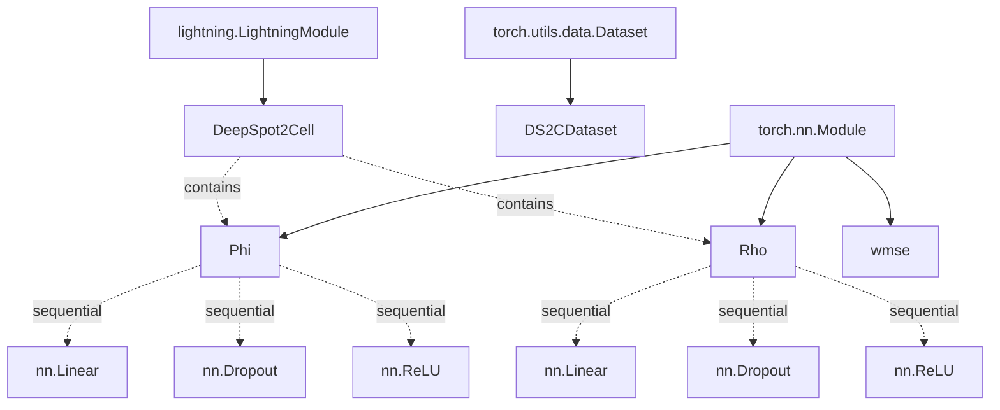
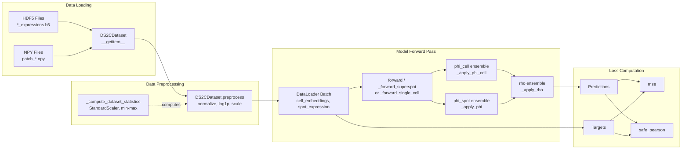
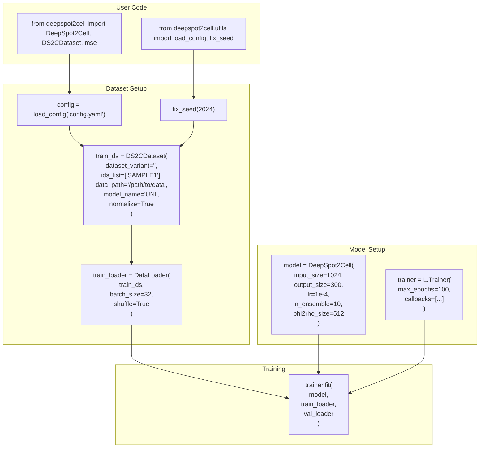

# API Reference

Relevant source files

The following files were used as context for generating this wiki page:

- [deepspot2cell/__init__.py](deepspot2cell/__init__.py)
- [deepspot2cell/dataloader.py](deepspot2cell/dataloader.py)
- [deepspot2cell/loss.py](deepspot2cell/loss.py)
- [deepspot2cell/model.py](deepspot2cell/model.py)

This document provides a complete reference for all public classes, functions, and modules in the DeepSpot2Cell codebase. It covers the main `deepspot2cell` package and its `utils` subpackage.

For detailed information about specific modules:
- Main package classes and functions: see [deepspot2cell Package](#9.1)
- Utility functions and helpers: see [deepspot2cell.utils Package](#9.2)

For higher-level conceptual information about these components, see:
- Model architecture details: [DeepSpot2Cell Model Architecture](#4.1)
- Dataset loading details: [DS2CDataset and Data Loading](#4.2)
- Loss functions and metrics: [Loss Functions](#4.3)

---

## Public API Overview

The `deepspot2cell` package exports the following core components through [deepspot2cell/\_\_init\_\_.py:1-4]():

### Core Classes

| Class | Module | Purpose |
|-------|--------|---------|
| `DeepSpot2Cell` | `model.py` | Main model class implementing Phi and Rho ensembles with training/validation logic |
| `Phi` | `model.py` | Feature transformation network for cell and spot embeddings |
| `Rho` | `model.py` | Aggregation network that produces gene expression predictions |
| `DS2CDataset` | `dataloader.py` | PyTorch Dataset class for loading preprocessed embeddings and expressions |

### Loss Functions

| Function | Module | Purpose |
|----------|--------|---------|
| `mse` | `loss.py` | Mean squared error loss |
| `pearsonr` | `loss.py` | Pearson correlation loss (1 - mean correlation) |
| `pearson_mse` | `loss.py` | Combined Pearson and MSE loss |
| `wmse` | `loss.py` | Weighted MSE loss with gene-specific weights |
| `safe_pearson` | `loss.py` | Pearson correlation metric with NaN handling |

**Sources:** [deepspot2cell/\_\_init\_\_.py:1-4]()

---

## Module Organization

The following diagram shows the structure of the `deepspot2cell` package and how modules depend on each other:

**Sources:** [deepspot2cell/\_\_init\_\_.py:1-4](), [deepspot2cell/model.py:1-281](), [deepspot2cell/dataloader.py:1-390](), [deepspot2cell/loss.py:1-48]()

---

## Class Hierarchy

The following diagram shows the inheritance structure and relationships between core classes:

**Sources:** [deepspot2cell/model.py:11-40](), [deepspot2cell/model.py:43-281](), [deepspot2cell/dataloader.py:9-390](), [deepspot2cell/loss.py:25-41]()

---

## Data Flow Through API Components

The following diagram illustrates how data flows through the main API components during training and inference:

**Sources:** [deepspot2cell/dataloader.py:164-278](), [deepspot2cell/dataloader.py:280-319](), [deepspot2cell/model.py:84-147](), [deepspot2cell/loss.py:5-48]()

---

## Core API Components

### DeepSpot2Cell Model

The `DeepSpot2Cell` class [deepspot2cell/model.py:43-281]() is a PyTorch Lightning module that implements the main model architecture.

**Key Methods:**

| Method | Purpose |
|--------|---------|
| `__init__` | Initialize model with Phi/Rho ensembles and hyperparameters |
| `forward` | Forward pass for spot-level prediction (calls `_forward_superspot`) |
| `_forward_single_cell` | Forward pass for single-cell prediction |
| `_forward_superspot` | Forward pass for superspot (batch) prediction |
| `_apply_phi` | Apply Phi ensemble to spot embeddings (median aggregation) |
| `_apply_phi_cell` | Apply Phi ensemble to cell embeddings (median aggregation) |
| `_apply_rho` | Apply Rho ensemble to concatenated features (mean aggregation) |
| `training_step` | Training logic with loss computation |
| `validation_step` | Validation logic with metrics |
| `configure_optimizers` | Configure AdamW optimizer |

**Sources:** [deepspot2cell/model.py:43-281]()

### DS2CDataset

The `DS2CDataset` class [deepspot2cell/dataloader.py:9-390]() handles data loading and preprocessing.

**Key Methods:**

| Method | Purpose |
|--------|---------|
| `__init__` | Initialize dataset with paths, normalization options |
| `load_data` | Load all sample data and collect patch barcodes |
| `load_spot_data` | Load expression data from HDF5 files |
| `__getitem__` | Retrieve preprocessed batch with embeddings and expressions |
| `preprocess` | Normalize, log-transform, and scale expression data |
| `inverse_transform` | Reverse preprocessing transformations |
| `_compute_dataset_statistics` | Compute dataset-wide statistics for scaling |

**Sources:** [deepspot2cell/dataloader.py:9-390]()

### Phi and Rho Networks

The `Phi` [deepspot2cell/model.py:11-24]() and `Rho` [deepspot2cell/model.py:27-40]() classes are simple feedforward networks:

**Phi Architecture:**
- Linear layer (input_size → input_size)
- Dropout
- ReLU activation
- Linear layer (input_size → output_size)
- Dropout
- ReLU activation

**Rho Architecture:**
- Dropout
- Linear layer (input_size → input_size)
- ReLU activation
- Linear layer (input_size → output_size)
- ReLU activation
- Dropout

**Sources:** [deepspot2cell/model.py:11-40]()

---

## Import Patterns and Usage

The following diagram shows typical import patterns and how to use the API:

**Sources:** [deepspot2cell/\_\_init\_\_.py:1-4](), [deepspot2cell/model.py:43-50](), [deepspot2cell/dataloader.py:9-36]()

---

## API Design Patterns

### Ensemble Aggregation

The model uses two distinct aggregation strategies for ensembles [deepspot2cell/model.py:139-146]():

- **Phi ensembles**: Median aggregation across ensemble members (more robust to outliers)
- **Rho ensembles**: Mean aggregation across ensemble members (smoother predictions)

### Preprocessing Pipeline

The dataset applies a consistent preprocessing pipeline [deepspot2cell/dataloader.py:280-319]():

1. **Normalization**: Scale to `norm_counts` (default 1e4)
2. **Log transformation**: Apply `log1p` to normalized counts
3. **Standard scaling** (optional): Z-score standardization using `StandardScaler`
4. **Min-max scaling** (optional): Scale to [0, 1] range

Separate scalers are maintained for spot-level and cell-level data.

### Masking Strategy

The codebase uses several masking mechanisms:

| Mask Type | Purpose | Code Reference |
|-----------|---------|----------------|
| `cell_mask` | Indicates valid (non-padded) cells | [deepspot2cell/dataloader.py:223-224]() |
| `is_inside_spot` | Indicates cells inside vs outside spot | [deepspot2cell/dataloader.py:190]() |
| `neighb_masks` | Indicates missing neighboring spots | [deepspot2cell/dataloader.py:245-254]() |

**Sources:** [deepspot2cell/model.py:139-146](), [deepspot2cell/dataloader.py:280-319](), [deepspot2cell/dataloader.py:223-254]()

---

## Batch Data Structure

The `DS2CDataset.__getitem__` method returns a dictionary with the following structure:

| Key | Type | Shape | Description |
|-----|------|-------|-------------|
| `patch_embedding` | `torch.Tensor` | `(embed_dim,)` | Spot-level embedding from PFM |
| `cell_embeddings` | `torch.Tensor` | `(max_cells, embed_dim)` | Cell-level embeddings (padded) |
| `spot_expression` | `torch.Tensor` | `(num_genes,)` | Ground truth spot expression |
| `cell_expressions` | `torch.Tensor` | `(max_cells, num_genes)` | Ground truth cell expressions (padded) |
| `cell_mask` | `torch.Tensor` | `(max_cells,)` | Binary mask for valid cells |
| `is_inside_spot` | `torch.Tensor` | `(max_cells,)` | Binary mask for cells inside spot |
| `num_cells` | `int` | scalar | Actual number of cells (before padding) |
| `cell_centroids` | `torch.Tensor` | `(max_cells, 2)` | Cell centroid coordinates (padded) |
| `patch_barcode` | `str` | - | Unique identifier for the patch |
| `neighb_embeddings` | `torch.Tensor` | `(num_neighbors+1, embed_dim)` | Spot and neighbor embeddings (optional) |
| `neighb_masks` | `torch.Tensor` | `(num_neighbors+1,)` | Binary mask for missing neighbors (optional) |
| `cell_classes` | `List[str]` | `(max_cells,)` | Cell type annotations (optional) |

**Sources:** [deepspot2cell/dataloader.py:226-265]()

---

## Detailed Subsections

For detailed API documentation of specific components:

- **[deepspot2cell Package](#9.1)**: Complete reference for `DeepSpot2Cell`, `Phi`, `Rho`, `DS2CDataset`, and loss functions
- **[deepspot2cell.utils Package](#9.2)**: Complete reference for utility functions including configuration, image processing, and data loading helpers

---