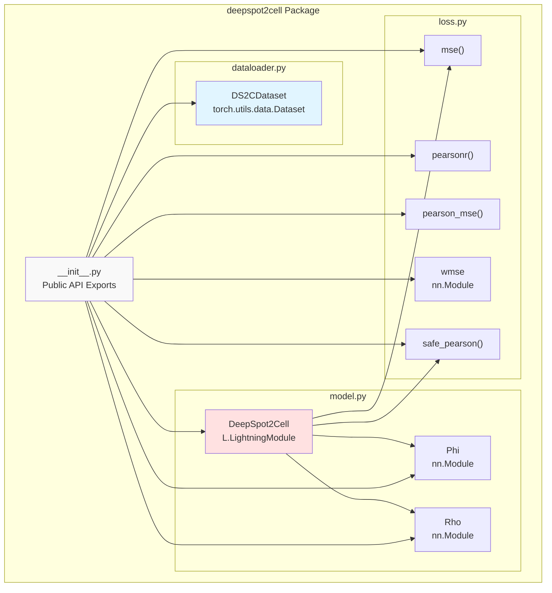
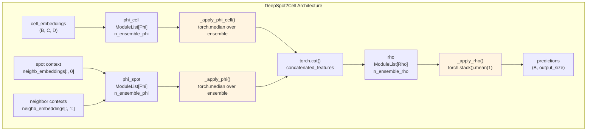
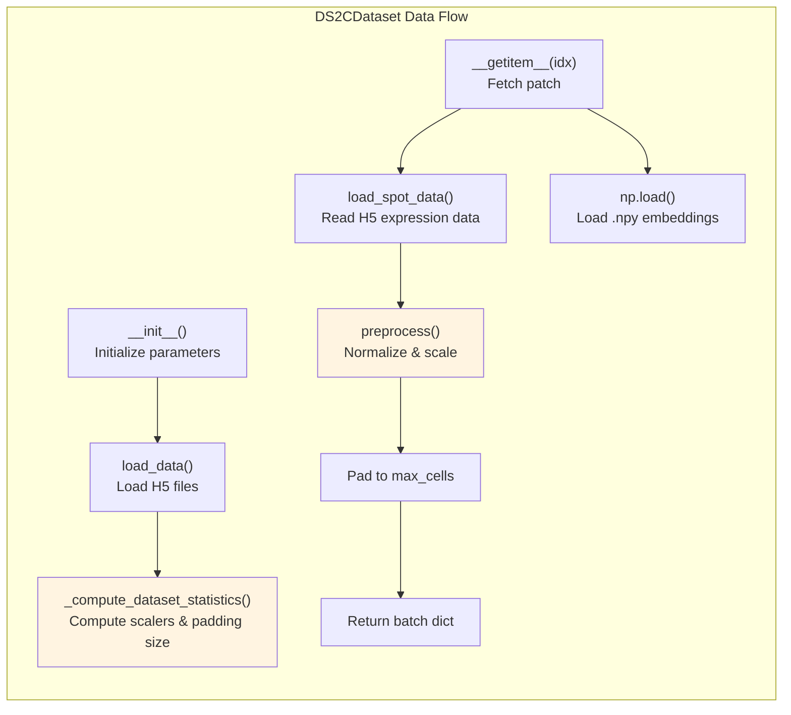
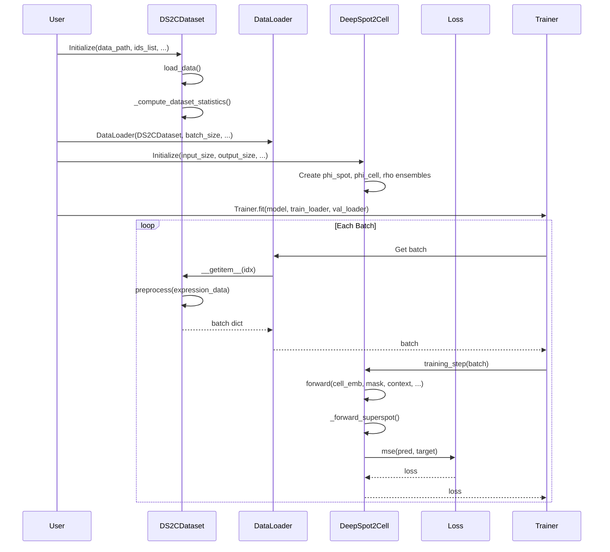
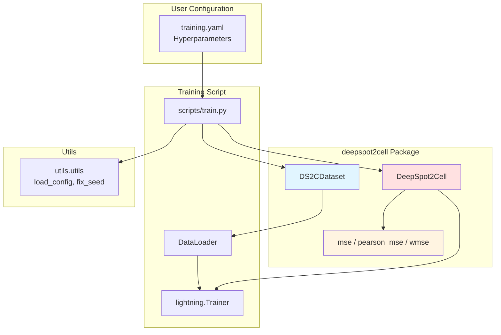

# deepspot2cell Package

<details>
<summary>Relevant source files</summary>

The following files were used as context for generating this wiki page:

- [deepspot2cell/__init__.py](deepspot2cell/__init__.py)
- [deepspot2cell/dataloader.py](deepspot2cell/dataloader.py)
- [deepspot2cell/loss.py](deepspot2cell/loss.py)
- [deepspot2cell/model.py](deepspot2cell/model.py)

</details>


## Purpose and Scope

This document provides the API reference for the core `deepspot2cell` package, which contains the primary classes and functions for building, training, and using DeepSpot2Cell models. This page documents:

- **Model architecture classes**: `DeepSpot2Cell`, `Phi`, and `Rho` for building the neural network ensemble
- **Dataset class**: `DS2CDataset` for loading and preprocessing training data
- **Loss functions**: `mse`, `pearsonr`, `pearson_mse`, `wmse`, and `safe_pearson` for training and evaluation

For utility functions that support the main pipeline (image processing, data augmentation, configuration management), see [deepspot2cell.utils Package](#9.2). For information about configuring and running training, see [Training Script](#8.1).

## Package Structure

The `deepspot2cell` package exposes its public API through the top-level `__init__.py` file:

```python
from .model import DeepSpot2Cell, Phi, Rho
from .dataloader import DS2CDataset
from .loss import mse, pearsonr, pearson_mse, wmse, safe_pearson
```

This structure allows users to import core components directly:

```python
from deepspot2cell import DeepSpot2Cell, DS2CDataset, mse
```

**Sources:** [deepspot2cell/__init__.py:1-4]()

## Core Components Overview

The package is organized around three main modules that work together to implement the DeepSpot2Cell system:



**Sources:** [deepspot2cell/__init__.py:1-4](), [deepspot2cell/model.py:11-281](), [deepspot2cell/dataloader.py:9-390](), [deepspot2cell/loss.py:1-48]()

## Model Architecture Classes

### DeepSpot2Cell

The `DeepSpot2Cell` class is the main model that inherits from PyTorch Lightning's `LightningModule`. It implements an ensemble architecture with two types of feature extractors (`Phi`) and an aggregation module (`Rho`).



#### Key Parameters

| Parameter | Type | Default | Description |
|-----------|------|---------|-------------|
| `input_size` | int | - | Dimension of input embeddings from PFM |
| `output_size` | int | - | Number of genes to predict |
| `lr` | float | 1e-4 | Learning rate for AdamW optimizer |
| `p` | float | 0.3 | Default dropout probability |
| `p_phi` | float | None | Dropout for Phi modules (defaults to `p`) |
| `p_rho` | float | None | Dropout for Rho modules (defaults to `p`) |
| `n_ensemble` | int | 10 | Default ensemble size |
| `n_ensemble_phi` | int | None | Number of Phi ensembles (defaults to `n_ensemble`) |
| `n_ensemble_rho` | int | None | Number of Rho ensembles (defaults to `n_ensemble`) |
| `phi2rho_size` | int | 512 | Intermediate feature dimension |
| `weight_decay` | float | 1e-6 | L2 regularization weight |
| `random_seed` | int | 2024 | Random seed for reproducibility |
| `cell_gt_available` | bool | True | Whether cell-level ground truth is available for metrics |

#### Key Methods

**`forward(x, mask, context, context_mask)`**
- Performs spot-level prediction by aggregating cell features
- Calls `_forward_superspot()` internally
- **Parameters:**
  - `x`: Cell embeddings tensor `(batch, num_cells, embedding_dim)`
  - `mask`: Cell validity mask `(batch, num_cells)`
  - `context`: Spot and neighbor embeddings `(batch, num_neighbors+1, embedding_dim)`
  - `context_mask`: Neighbor validity mask `(batch, num_neighbors)`
- **Returns:** Predicted spot-level expression `(batch, num_genes)`

**`_forward_single_cell(x, context, context_mask)`**
- Performs cell-level prediction for inference
- Processes individual cell(s) with spot/neighbor context
- **Parameters:**
  - `x`: Single or multiple cell embeddings `(num_cells, embedding_dim)`
  - `context`: Spot and neighbor embeddings `(num_neighbors+1, embedding_dim)`
  - `context_mask`: Neighbor validity mask `(num_neighbors,)`
- **Returns:** Predicted cell-level expression `(num_cells, num_genes)`

**`training_step(batch, batch_idx)`**
- Lightning training step, computes loss on spot-level predictions
- Optionally computes cell-level metrics if ground truth available
- Logs `train_loss` and `train_cell_inside_pearson`

**`validation_step(batch, batch_idx)`**
- Lightning validation step with similar logic to training
- Logs `val_loss` and `val_cell_inside_pearson`

**Sources:** [deepspot2cell/model.py:43-281]()

### Phi

The `Phi` class is a two-layer MLP feature extractor used in ensembles for both cell and spot embeddings.

```python
# Architecture
nn.Sequential(
    nn.Linear(input_size, input_size),
    nn.Dropout(p=p),
    nn.ReLU(inplace=True),
    nn.Linear(input_size, output_size),
    nn.Dropout(p=p),
    nn.ReLU(inplace=True),
)
```

#### Parameters

| Parameter | Type | Description |
|-----------|------|-------------|
| `input_size` | int | Input feature dimension (typically PFM embedding size) |
| `output_size` | int | Output feature dimension (typically `phi2rho_size`) |
| `p` | float | Dropout probability (default: 0.0) |

#### Methods

**`forward(x)`**
- Applies the two-layer transformation with dropout and ReLU
- **Parameters:** `x` - Input tensor `(*, input_size)`
- **Returns:** Transformed features `(*, output_size)`

**Sources:** [deepspot2cell/model.py:11-24]()

### Rho

The `Rho` class is a two-layer MLP that aggregates features from `Phi` modules to produce final gene expression predictions.

```python
# Architecture
nn.Sequential(
    nn.Dropout(p=p),
    nn.Linear(input_size, input_size),
    nn.ReLU(inplace=True),
    nn.Linear(input_size, output_size),
    nn.ReLU(inplace=True),
    nn.Dropout(p=0.1),
)
```

#### Parameters

| Parameter | Type | Description |
|-----------|------|-------------|
| `input_size` | int | Input feature dimension (3 × `phi2rho_size` for concatenated features) |
| `output_size` | int | Number of genes to predict |
| `p` | float | Dropout probability (default: 0.0) |

#### Methods

**`forward(x)`**
- Applies the two-layer transformation to produce gene predictions
- **Parameters:** `x` - Input tensor `(*, input_size)`
- **Returns:** Gene expression predictions `(*, output_size)`

**Sources:** [deepspot2cell/model.py:27-40]()

## Dataset Class

### DS2CDataset

The `DS2CDataset` class extends `torch.utils.data.Dataset` to load preprocessed spatial transcriptomics data. It handles loading embeddings and expressions, normalization, padding, and neighbor context loading.



#### Constructor Parameters

| Parameter | Type | Default | Description |
|-----------|------|---------|-------------|
| `dataset_variant` | str | - | Dataset suffix (e.g., "" or "_scellst") |
| `ids_list` | list | - | List of sample IDs to load |
| `data_path` | str | - | Path to data directory containing embeddings/ and expressions/ |
| `model_name` | str | - | PFM model name (e.g., "UNI", "hoptimus0") |
| `standard_scaling` | bool | False | Whether to apply StandardScaler normalization |
| `shuffle` | bool | True | Whether to shuffle patch order |
| `normalize` | bool | True | Whether to normalize expression counts |
| `norm_counts` | float | 1e4 | Target total counts for normalization |
| `minmax` | bool | False | Whether to apply min-max scaling |
| `plot_cell_dist` | bool | False | Whether to save cell distribution data |
| `neighb_degree` | int | 0 | Degree of neighborhood (0 = no neighbors, 1 = 8 neighbors, etc.) |
| `scellst` | bool | False | Whether to load scellst-variant embeddings |
| `load_cell_types` | bool | False | Whether to load cell type annotations |

#### Key Methods

**`__len__()`**
- Returns the total number of patches in the dataset

**`__getitem__(idx)`**
- Returns a dictionary containing preprocessed data for a single patch
- **Returns:** Dictionary with keys:
  - `patch_embedding`: Spot-level embedding `(embedding_dim,)`
  - `cell_embeddings`: Padded cell embeddings `(max_cells, embedding_dim)`
  - `spot_expression`: Spot-level gene expression `(num_genes,)`
  - `cell_expressions`: Padded cell expressions `(max_cells, num_genes)`
  - `cell_mask`: Binary mask for valid cells `(max_cells,)`
  - `is_inside_spot`: Binary indicator for cells inside spot `(max_cells,)`
  - `num_cells`: Integer count of valid cells
  - `cell_centroids`: Padded cell coordinates `(max_cells, 2)`
  - `patch_barcode`: String identifier
  - `neighb_embeddings`: (if `neighb_degree > 0`) Neighbor embeddings `(num_neighbors+1, embedding_dim)`
  - `neighb_masks`: (if `neighb_degree > 0`) Neighbor validity mask `(num_neighbors+1,)`

**`load_spot_data(sample_id, patch_barcode=None)`**
- Loads expression data from HDF5 files
- Can load a specific patch or all patches for a sample
- **Returns:** Dictionary or nested dictionary with expression and metadata arrays

**`preprocess(expression_data, is_spot=False, inspot_mask=None)`**
- Normalizes and scales expression data
- Applies log1p transformation after count normalization
- Optionally applies StandardScaler and/or min-max scaling
- **Parameters:**
  - `expression_data`: Raw expression counts
  - `is_spot`: Whether data is spot-level (vs cell-level)
  - `inspot_mask`: Binary mask indicating cells inside the spot
- **Returns:** Preprocessed expression data

**`inverse_transform(scaled_data, is_spot=False)`**
- Reverses preprocessing transformations back to log space
- Useful for interpreting predictions in original scale

**Sources:** [deepspot2cell/dataloader.py:9-390]()

### Data Normalization Strategy

The dataset implements a two-stage normalization approach that differs between spots and cells:

| Stage | Spot-Level | Cell-Level |
|-------|------------|------------|
| **Count Normalization** | Normalize to `norm_counts` by spot total | Normalize cells by total of in-spot cells |
| **Log Transformation** | `log1p(normalized)` | `log1p(normalized)` |
| **Standard Scaling** (optional) | Separate `spot_scaler` fit on log-normalized spots | Separate `cell_scaler` fit on log-normalized cells |
| **Min-Max Scaling** (optional) | Scale to [0,1] using spot min/max per gene | Scale to [0,1] using cell min/max per gene |

This separate scaling for spots and cells is critical because they have different dynamic ranges. The scaling parameters are computed in `_compute_dataset_statistics()` during initialization.

**Sources:** [deepspot2cell/dataloader.py:37-145](), [deepspot2cell/dataloader.py:280-319]()

## Loss Functions

### mse

Simple Mean Squared Error loss function.

```python
def mse(pred, target):
    return torch.nn.functional.mse_loss(pred, target)
```

**Parameters:**
- `pred`: Predicted values `(batch, num_genes)`
- `target`: Ground truth values `(batch, num_genes)`

**Returns:** Scalar MSE loss

**Sources:** [deepspot2cell/loss.py:5-6]()

### pearsonr

Computes Pearson correlation loss (1 - correlation) across the gene dimension.

```python
def pearsonr(pred, target, eps=1e-8):
    # Centers predictions and targets
    # Computes covariance / (std_pred * std_true)
    # Returns mean(1 - pearson_corr)
```

**Parameters:**
- `pred`: Predicted values `(batch, num_genes)`
- `target`: Ground truth values `(batch, num_genes)`
- `eps`: Small constant to prevent division by zero

**Returns:** Scalar loss (lower is better, 0 = perfect correlation)

**Sources:** [deepspot2cell/loss.py:9-18]()

### pearson_mse

Combined loss function that sums Pearson loss and MSE loss.

```python
def pearson_mse(pred, target):
    return (pearsonr(pred, target) + mse(pred, target))
```

**Sources:** [deepspot2cell/loss.py:21-22]()

### wmse

Weighted MSE loss that can upweight or downweight genes based on their rank (typically used to emphasize highly variable genes).

#### Parameters

| Parameter | Type | Default | Description |
|-----------|------|---------|-------------|
| `n_genes` | int | - | Number of genes |
| `upweight_hvg` | bool | True | If True, upweight genes with higher rank; if False, downweight |
| `power` | float | 0.1 | Exponent for weight computation: `weight = 1 / rank^power` |
| `device` | torch.device | None | Device for weight tensor |
| `dtype` | torch.dtype | torch.float32 | Data type for weight tensor |

#### Methods

**`forward(pred, target)`**
- Computes weighted squared error
- **Returns:** Scalar loss weighted by gene importance

The weighting scheme is:
- If `upweight_hvg=True`: weights = `1 / (n_genes ... 1)^power` (earlier genes weighted more)
- If `upweight_hvg=False`: weights = `1 / (1 ... n_genes)^power` (later genes weighted more)
- Weights are normalized to sum to `n_genes`

**Sources:** [deepspot2cell/loss.py:25-40]()

### safe_pearson

Evaluation metric that computes Pearson correlation along features, replacing NaN values with 0.

```python
def safe_pearson(pred, target, sample_wise=False):
    if sample_wise:
        pred, target = pred.T, target.T
    r = pearson_corrcoef(pred, target)
    return torch.nan_to_num(r, nan=0.0)
```

**Parameters:**
- `pred`: Predicted values
- `target`: Ground truth values
- `sample_wise`: If True, compute correlation per sample instead of per gene

**Returns:** Pearson correlation coefficient(s), with NaN replaced by 0.0

**Sources:** [deepspot2cell/loss.py:43-48]()

## Usage Example

Here's how the core components work together in a typical training workflow:



**Typical initialization pattern:**

```python
# Create dataset
dataset = DS2CDataset(
    dataset_variant="",
    ids_list=["TENX95", "TENX96"],
    data_path="/path/to/data",
    model_name="UNI",
    standard_scaling=True,
    normalize=True,
    neighb_degree=1
)

# Create model
model = DeepSpot2Cell(
    input_size=1024,      # PFM embedding dimension
    output_size=250,      # Number of genes
    lr=1e-4,
    n_ensemble=10,
    phi2rho_size=512
)

# Model will use mse loss by default
# model.loss_fn = mse
```

**Sources:** [deepspot2cell/__init__.py:1-4](), [deepspot2cell/model.py:43-60](), [deepspot2cell/dataloader.py:9-35]()

## Integration with Training Pipeline

The components from this package integrate with the broader training system:



For details on the training script that orchestrates these components, see [Training Script](#8.1). For preprocessing utilities that prepare the data consumed by `DS2CDataset`, see [Dataset Creation](#5.1).

**Sources:** [deepspot2cell/__init__.py:1-4](), [deepspot2cell/model.py:43-281](), [deepspot2cell/dataloader.py:9-390](), [deepspot2cell/loss.py:1-48]()

---