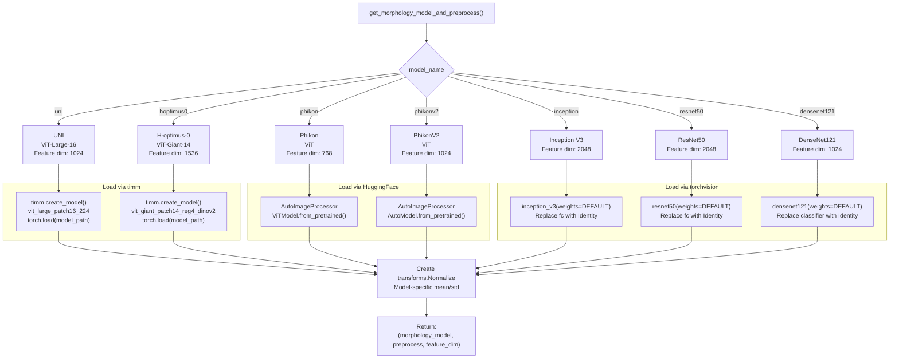
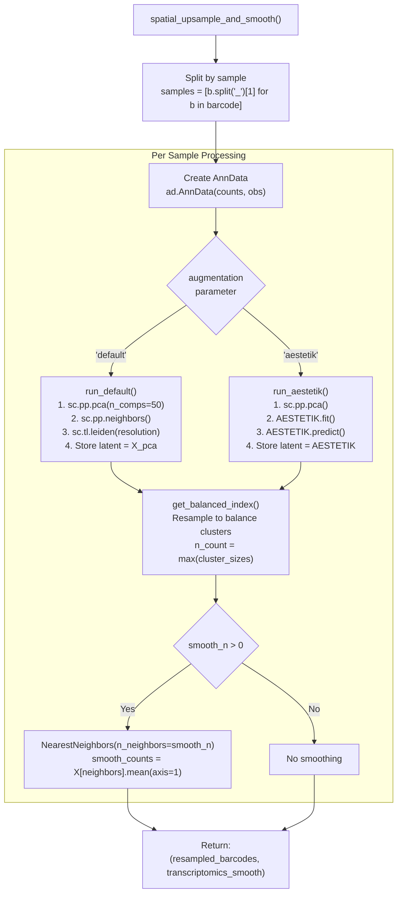

# deepspot2cell.utils Package

<details>
<summary>Relevant source files</summary>

The following files were used as context for generating this wiki page:

- [deepspot2cell/utils/__init__.py](deepspot2cell/utils/__init__.py)
- [deepspot2cell/utils/utils.py](deepspot2cell/utils/utils.py)
- [deepspot2cell/utils/utils_dataloader.py](deepspot2cell/utils/utils_dataloader.py)
- [deepspot2cell/utils/utils_image.py](deepspot2cell/utils/utils_image.py)

</details>


## Purpose and Scope

The `deepspot2cell.utils` package provides supporting utilities for the DeepSpot2Cell system across three main areas: general configuration and reproducibility (`utils.py`), image processing and morphology model integration (`utils_image.py`), and data loading with augmentation (`utils_dataloader.py`). These utilities support the core training and inference workflows documented in [Training Script](#8.1) and [Inference Workflows](#8.2).

For documentation of the main model architecture and dataset classes, see [deepspot2cell Package](#9.1).

**Sources:** [deepspot2cell/utils/__init__.py:1-3]()

---

## Module Organization

The utils package exposes its public API through three specialized modules:

| Module | Primary Functions | Purpose |
|--------|------------------|---------|
| `utils.py` | `fix_seed`, `load_config`, `order_genes` | Configuration loading, reproducibility, gene selection |
| `utils_image.py` | `get_morphology_model_and_preprocess`, `predict_spot2cell_from_image_paths` | PFM loading, image processing, inference from raw images |
| `utils_dataloader.py` | `spatial_upsample_and_smooth`, `load_data`, `compute_neighbors` | Data augmentation, clustering, spatial smoothing |

The package imports are structured to provide convenient access to commonly used functions:

```python
from deepspot2cell.utils import fix_seed, load_config, order_genes
from deepspot2cell.utils import get_morphology_model_and_preprocess
from deepspot2cell.utils import spatial_upsample_and_smooth
```

**Sources:** [deepspot2cell/utils/__init__.py:1-3]()

---

## Utils Package Architecture

```mermaid
graph TB
    subgraph "deepspot2cell.utils Package"
        INIT["__init__.py<br/>Public API Exports"]
        
        subgraph "utils.py"
            FIX_SEED["fix_seed()<br/>Set random seeds"]
            LOAD_CONFIG["load_config()<br/>Load YAML config"]
            ORDER_GENES["order_genes()<br/>Order by variability"]
            MODEL_FINETUNE["model_fine_tune()<br/>Fine-tune layers"]
            RUN_INFERENCE["run_inference_from_dataloader()<br/>Batch inference"]
        end
        
        subgraph "utils_image.py"
            GET_MORPH["get_morphology_model_and_preprocess()<br/>Load PFMs"]
            CROP_TILE["crop_tile()<br/>Extract image patches"]
            COMPUTE_MINI["compute_mini_tiles()<br/>Split into tiles"]
            PREDICT_SPOT["predict_spot_spatial_transcriptomics_from_image_path()"]
            PREDICT_CELL["predict_cell_spatial_transcriptomics_from_image_path()"]
            PREDICT_S2C["predict_spot2cell_from_image_paths()"]
        end
        
        subgraph "utils_dataloader.py"
            SPATIAL_UP["spatial_upsample_and_smooth()<br/>Augmentation"]
            RUN_DEFAULT["run_default()<br/>PCA + Leiden"]
            RUN_AESTETIK["run_aestetik()<br/>AESTETIK clustering"]
            GET_BALANCED["get_balanced_index()<br/>Balanced sampling"]
            LOAD_DATA["load_data()<br/>Load embeddings + expressions"]
            COMPUTE_NEIGH["compute_neighbors()<br/>Find spatial neighbors"]
        end
    end
    
    subgraph "External Dependencies"
        TORCH["PyTorch<br/>torch.manual_seed"]
        YAML["PyYAML<br/>yaml.safe_load"]
        TIMM["timm<br/>Vision models"]
        PYVIPS["pyvips<br/>Image loading"]
        SCANPY["scanpy<br/>sc.tl.leiden"]
        SKLEARN["scikit-learn<br/>NearestNeighbors"]
    end
    
    subgraph "Used By"
        TRAIN_SCRIPT["scripts/train.py"]
        DATASET_CREATE["dataset_creation.py"]
        MODEL["DeepSpot2Cell model"]
        DATALOADER["DS2CDataset"]
    end
    
    INIT --> FIX_SEED
    INIT --> LOAD_CONFIG
    INIT --> ORDER_GENES
    INIT --> GET_MORPH
    INIT --> PREDICT_S2C
    
    FIX_SEED --> TORCH
    LOAD_CONFIG --> YAML
    ORDER_GENES --> SCANPY
    
    GET_MORPH --> TIMM
    CROP_TILE --> PYVIPS
    PREDICT_SPOT --> GET_MORPH
    PREDICT_SPOT --> CROP_TILE
    PREDICT_CELL --> GET_MORPH
    PREDICT_CELL --> CROP_TILE
    PREDICT_S2C --> GET_MORPH
    
    SPATIAL_UP --> RUN_DEFAULT
    SPATIAL_UP --> RUN_AESTETIK
    RUN_DEFAULT --> SCANPY
    COMPUTE_NEIGH --> SKLEARN
    
    TRAIN_SCRIPT --> LOAD_CONFIG
    TRAIN_SCRIPT --> FIX_SEED
    DATASET_CREATE --> GET_MORPH
    DATASET_CREATE --> ORDER_GENES
    MODEL --> RUN_INFERENCE
    DATALOADER --> LOAD_DATA
    DATALOADER --> COMPUTE_NEIGH
```



**Diagram: Utils Package Structure and Dependencies**

This diagram maps the three utility modules to their key functions and external dependencies, showing how they integrate with the main DeepSpot2Cell components.

**Sources:** [deepspot2cell/utils/__init__.py:1-3](), [deepspot2cell/utils/utils.py:1-200](), [deepspot2cell/utils/utils_image.py:1-458](), [deepspot2cell/utils/utils_dataloader.py:1-175]()

---

## Configuration and Setup Utilities (utils.py)

### fix_seed(seed)

Ensures reproducibility by setting random seeds across all libraries and disabling non-deterministic operations.

**Parameters:**
- `seed` (int): Random seed value

**Implementation Details:**
- Sets seeds for: Python `random`, NumPy, PyTorch CPU and CUDA
- Disables cuDNN benchmarking (`cudnn.benchmark = False`)
- Enables cuDNN deterministic mode (`cudnn.deterministic = True`)
- Sets environment variables: `PYTHONHASHSEED`, `CUBLAS_WORKSPACE_CONFIG`

**Usage:**
```python
from deepspot2cell.utils import fix_seed
fix_seed(42)  # All random operations now deterministic
```

**Sources:** [deepspot2cell/utils/utils.py:92-104]()

---

### load_config(config_path)

Loads YAML configuration files used throughout the DeepSpot2Cell pipeline.

**Parameters:**
- `config_path` (str): Path to YAML configuration file

**Returns:**
- `dict`: Parsed configuration dictionary

**Usage:**
```python
from deepspot2cell.utils import load_config
config = load_config('configs/dataset.example.yaml')
data_folder = config['data']['data_folder']
```

**Sources:** [deepspot2cell/utils/utils.py:106-109]()

---

### order_genes(config)

Orders genes by variability across training samples. This function processes transcript-level data to identify high-quality genes that pass quality filters across all samples, then ranks them by variability using Scanpy's highly variable gene detection.

**Parameters:**
- `config` (dict): Configuration dictionary containing:
  - `data.data_folder`: Path to HEST data folder
  - `min_cells`: Minimum cells per gene (default: 20)
  - `qv_thr`: Quality value threshold (default: 20)
  - `data.dataset`: Dataset name
  - `data[dataset].train.dataset_ids`: List of sample IDs
  - `data[dataset].ordered_genes_file`: Output filename

**Process:**
1. Iterates through training samples using `iter_hest()`
2. Filters transcripts by quality value (`qv > qv_thr`)
3. Filters genes present in at least `min_cells` cells
4. Finds intersection of genes across all samples
5. Constructs cell-level expression matrix
6. Computes highly variable genes with `sc.pp.highly_variable_genes()`
7. Orders genes by variability rank
8. Saves ordered gene list as JSON

**Returns:**
- None (saves ordered genes to file specified in config)

**Output File Format:**
```json
["GENE1", "GENE2", "GENE3", ...]
```

**Sources:** [deepspot2cell/utils/utils.py:112-200]()

---

### model_fine_tune(model, dataloader, rho=False, gene_expression=True, max_epochs=10)

Fine-tunes specific layers of a trained DeepSpot2Cell model while freezing others.

**Parameters:**
- `model`: DeepSpot2Cell model instance
- `dataloader`: PyTorch DataLoader for fine-tuning data
- `rho` (bool): Whether to unfreeze Rho ensemble (default: False)
- `gene_expression` (bool): Whether to unfreeze gene expression head (default: True)
- `max_epochs` (int): Maximum training epochs (default: 10)

**Behavior:**
1. Freezes all model parameters
2. Selectively unfreezes specified layers (`model.rho`, `model.gene_expression`)
3. Creates AdamW optimizer for trainable parameters only
4. Sets model to eval mode except for fine-tuned layers
5. Trains using Lightning Trainer

**Sources:** [deepspot2cell/utils/utils.py:23-52]()

---

### run_inference_from_dataloader(model, dataloader, device)

Runs batch inference on a dataloader, collecting predictions.

**Parameters:**
- `model`: Trained DeepSpot2Cell model
- `dataloader`: PyTorch DataLoader containing input data
- `device` (str): Device for inference ('cuda' or 'cpu')

**Returns:**
- `np.ndarray`: Array of predictions with shape `(n_samples, n_genes)`

**Usage:**
```python
predictions = run_inference_from_dataloader(model, test_loader, 'cuda')
```

**Sources:** [deepspot2cell/utils/utils.py:54-72]()

---

## Image Processing Utilities (utils_image.py)

### Pathology Foundation Model Loading



**Diagram: PFM Loading Pipeline with Supported Models**

**Sources:** [deepspot2cell/utils/utils_image.py:36-182]()

---

### get_morphology_model_and_preprocess(model_name, device, model_path=None)

Loads a pathology foundation model and returns the model, preprocessing function, and feature dimension.

**Parameters:**
- `model_name` (str): Model identifier - one of:
  - `"uni"`: UNI (ViT-Large, 1024-dim)
  - `"hoptimus0"`: H-optimus-0 (ViT-Giant, 1536-dim)
  - `"phikon"`: Phikon (ViT, 768-dim)
  - `"phikonv2"`: Phikon v2 (ViT, 1024-dim)
  - `"inception"`: Inception V3 (2048-dim)
  - `"resnet50"`: ResNet50 (2048-dim)
  - `"densenet121"`: DenseNet121 (1024-dim)
- `device` (str): Device for model ('cuda' or 'cpu')
- `model_path` (str, optional): Path to model weights (required for UNI, H-optimus-0, Phikon)

**Returns:**
- `tuple`: `(morphology_model, preprocess, feature_dim)`
  - `morphology_model`: Loaded PyTorch model in eval mode
  - `preprocess`: Preprocessing function (transforms.Compose or custom)
  - `feature_dim` (int): Feature dimension of embeddings

**Model-Specific Details:**

| Model | Loading Method | Normalization | Feature Dim |
|-------|---------------|---------------|-------------|
| UNI | `timm.create_model()` | ImageNet (0.485, 0.456, 0.406) | 1024 |
| H-optimus-0 | `timm.create_model()` | Custom (0.707, 0.578, 0.704) | 1536 |
| Phikon | `AutoModel.from_pretrained()` | HF AutoImageProcessor | 768 |
| Phikon v2 | `AutoModel.from_pretrained()` | HF AutoImageProcessor | 1024 |
| Inception V3 | `torchvision.models.inception_v3()` | ImageNet | 2048 |
| ResNet50 | `torchvision.models.resnet50()` | ImageNet | 2048 |
| DenseNet121 | `torchvision.models.densenet121()` | ImageNet | 1024 |

**Usage:**
```python
model, preprocess, feat_dim = get_morphology_model_and_preprocess(
    model_name='phikonv2',
    device='cuda',
    model_path='/path/to/phikon_v2'
)
```

**Sources:** [deepspot2cell/utils/utils_image.py:36-182]()

---

### crop_tile(image, x_pixel, y_pixel, cell_diameter)

Crops a square tile from a pyvips image centered at specified coordinates.

**Parameters:**
- `image` (pyvips.Image): Source image
- `x_pixel` (int): Center x-coordinate in pixels
- `y_pixel` (int): Center y-coordinate in pixels
- `cell_diameter` (int): Size of tile to extract (width and height)

**Returns:**
- `np.ndarray`: RGB image array with shape `(cell_diameter, cell_diameter, 3)`

**Implementation:**
- Computes top-left corner: `(x - cell_diameter//2, y - cell_diameter//2)`
- Crops using `pyvips.Image.crop()`
- Converts to NumPy array
- Returns first 3 channels (RGB only)

**Sources:** [deepspot2cell/utils/utils_image.py:195-203]()

---

### compute_mini_tiles(image, n_tiles, super_resolution_mode=False)

Splits an image into smaller tiles for multi-scale processing.

**Parameters:**
- `image` (np.ndarray): Input image (assumed square)
- `n_tiles` (int): Number of tiles to create (must be perfect square, e.g., 4, 9, 16)
- `super_resolution_mode` (bool): If True, extracts single centered tile instead of grid

**Returns:**
- `list`: List of tile arrays, each with shape `(tile_size, tile_size, channels)`

**Behavior:**
- Normal mode: Divides image into `n x n` grid where `n = sqrt(n_tiles)`
- Super-resolution mode: Extracts single centered tile of size `(D/n) x (D/n)` where `D` is image dimension

**Sources:** [deepspot2cell/utils/utils_image.py:206-239]()

---

### Inference from Image Paths

```mermaid
graph TB
    subgraph "Spot-Level Inference"
        SPOT_START["predict_spot_spatial_transcriptomics_from_image_path()"]
        SPOT_LOAD["Load WSI with pyvips"]
        SPOT_ITER["Iterate over spots in adata.obs"]
        SPOT_CROP["For each spot:<br/>- crop_tile(spot_diameter)<br/>- compute_mini_tiles(n_tiles)<br/>- Find neighbors with compute_neighbors()"]
        SPOT_PREPROCESS["Preprocess all tiles<br/>preprocess() function"]
        SPOT_EMBED["Extract embeddings<br/>morphology_model()"]
        SPOT_PREDICT["Predict expression<br/>model_expression([X_spot, X_subspot, X_neighbors])"]
        SPOT_OUTPUT["Return counts array<br/>(n_spots, n_genes)"]
        
        SPOT_START --> SPOT_LOAD
        SPOT_LOAD --> SPOT_ITER
        SPOT_ITER --> SPOT_CROP
        SPOT_CROP --> SPOT_PREPROCESS
        SPOT_PREPROCESS --> SPOT_EMBED
        SPOT_EMBED --> SPOT_PREDICT
        SPOT_PREDICT --> SPOT_OUTPUT
    end
    
    subgraph "Cell-Level Inference"
        CELL_START["predict_cell_spatial_transcriptomics_from_image_path()"]
        CELL_LOAD["Load WSI with pyvips"]
        CELL_NEIGH["Find neighbors<br/>NearestNeighbors(radius=radius_neighbors)"]
        CELL_ITER["Iterate over cells in adata.obs"]
        CELL_CROP["For each cell:<br/>- crop_tile(cell_diameter)<br/>- Crop neighbor cells"]
        CELL_PREPROCESS["Preprocess all tiles"]
        CELL_EMBED["Extract embeddings"]
        CELL_PREDICT["Predict expression<br/>model_expression([X_cell, X_neighbors])"]
        CELL_OUTPUT["Return counts array<br/>(n_cells, n_genes)"]
        
        CELL_START --> CELL_LOAD
        CELL_LOAD --> CELL_NEIGH
        CELL_NEIGH --> CELL_ITER
        CELL_ITER --> CELL_CROP
        CELL_CROP --> CELL_PREPROCESS
        CELL_PREPROCESS --> CELL_EMBED
        CELL_EMBED --> CELL_PREDICT
        CELL_PREDICT --> CELL_OUTPUT
    end
    
    subgraph "DeepSpot2Cell Inference"
        DS2C_START["predict_spot2cell_from_image_paths()"]
        DS2C_CELL["Load cell image<br/>PIL.Image.open()"]
        DS2C_SPOT["Load spot image"]
        DS2C_NEIGHBORS["Load neighbor images<br/>Handle missing with zero embeddings"]
        DS2C_EMBED["Extract embeddings<br/>extract_embedding() helper"]
        DS2C_CONTEXT["Create context<br/>context = [spot_emb] + neighbor_embs"]
        DS2C_MASK["Create context_mask<br/>False for valid, True for missing"]
        DS2C_PREDICT["Predict with model<br/>model._forward_single_cell()"]
        DS2C_OUTPUT["Return dict<br/>{gene_name: expression_value}"]
        
        DS2C_START --> DS2C_CELL
        DS2C_START --> DS2C_SPOT
        DS2C_START --> DS2C_NEIGHBORS
        DS2C_CELL --> DS2C_EMBED
        DS2C_SPOT --> DS2C_EMBED
        DS2C_NEIGHBORS --> DS2C_EMBED
        DS2C_EMBED --> DS2C_CONTEXT
        DS2C_CONTEXT --> DS2C_MASK
        DS2C_MASK --> DS2C_PREDICT
        DS2C_PREDICT --> DS2C_OUTPUT
    end
```



**Diagram: Three Inference Workflows from Image Paths**

**Sources:** [deepspot2cell/utils/utils_image.py:246-458]()

---

### predict_spot_spatial_transcriptomics_from_image_path()

Predicts spot-level gene expression from whole slide images.

**Parameters:**
- `image_path` (str): Path to WSI file
- `adata` (AnnData): Spatial transcriptomics data with `.obs` containing:
  - `x_pixel`, `y_pixel`: Pixel coordinates
  - `barcode`: Spot identifiers
  - `x_array`, `y_array`: Array coordinates
  - `sampleID`: Sample identifier
- `spot_diameter` (int): Spot diameter in pixels
- `n_mini_tiles` (int): Number of sub-tiles per spot (e.g., 9)
- `preprocess` (callable): Preprocessing function from `get_morphology_model_and_preprocess()`
- `morphology_model` (torch.nn.Module): PFM model
- `model_expression` (torch.nn.Module): DeepSpot2Cell model
- `device` (str): Computation device
- `super_resolution` (bool, optional): Use super-resolution mode for tiles
- `neighbor_radius` (int, optional): Radius for finding neighbors (default: 1)

**Returns:**
- `np.ndarray`: Predicted expression counts with shape `(n_spots, n_genes)`

**Process:**
1. Loads WSI with pyvips
2. Iterates through spots in `adata.obs`
3. For each spot:
   - Finds neighbors using `compute_neighbors()`
   - Crops spot tile with `crop_tile()`
   - Splits into mini-tiles with `compute_mini_tiles()`
   - Crops neighbor tiles
4. Preprocesses all tiles
5. Extracts embeddings with morphology model
6. Predicts expression with `model_expression([X_spot, X_subspot, X_neighbors])`
7. Applies inverse transform

**Sources:** [deepspot2cell/utils/utils_image.py:246-297]()

---

### predict_cell_spatial_transcriptomics_from_image_path()

Predicts cell-level gene expression from whole slide images.

**Parameters:**
- `image_path` (str): Path to WSI file
- `adata` (AnnData): Cell-level data with `.obs` containing:
  - `x_pixel`, `y_pixel`: Cell center coordinates
  - `barcode`: Cell identifiers
- `cell_diameter` (int): Cell diameter in pixels
- `radius_neighbors` (float): Radius for neighbor search
- `preprocess` (callable): Preprocessing function
- `morphology_model` (torch.nn.Module): PFM model
- `model_expression` (torch.nn.Module): DeepSpot2Cell model
- `device` (str): Computation device

**Returns:**
- `np.ndarray`: Predicted expression counts with shape `(n_cells, n_genes)`

**Process:**
1. Finds neighbors for each cell using `NearestNeighbors(radius=radius_neighbors)`
2. For each cell:
   - Crops cell tile
   - Crops neighbor cell tiles (excluding the cell itself)
   - Handles missing neighbors with zero arrays
3. Extracts embeddings for cell and neighbors
4. Predicts with `model_expression([X_cell, X_neighbors])`

**Sources:** [deepspot2cell/utils/utils_image.py:300-361]()

---

### predict_spot2cell_from_image_paths()

Predicts single-cell gene expression from individual image paths using DeepSpot2Cell's native inference mode.

**Parameters:**
- `cell_image_path` (str): Path to target cell image
- `spot_image_path` (str): Path to spot image containing the cell
- `neighbor_image_paths` (list of str): Paths to neighboring images
- `deepspot2cell_model`: Trained DeepSpot2Cell model
- `morphology_model`: Morphology foundation model
- `preprocess` (callable): Preprocessing function
- `device` (str): Computation device ('cuda' or 'cpu')
- `gene_names` (list, optional): Gene names for result mapping

**Returns:**
- `dict`: Mapping of gene names to predicted expression values
  - If `gene_names` provided: `{gene_name: expression_value}`
  - Otherwise: `{f"gene_{i}": expression_value}`

**Helper Function: extract_embedding()**

Internal function that:
1. Opens image with PIL
2. Ensures square dimensions (resizes if needed)
3. Applies preprocessing
4. Extracts embedding with morphology model

**Inference Process:**
1. Extracts embeddings for cell, spot, and neighbors
2. Handles missing neighbors by checking file existence
3. Creates context tensor: `[spot_embedding] + neighbor_embeddings`
4. Creates context mask: `[False] + [is_missing for each neighbor]`
5. Calls `model._forward_single_cell(cell_embedding, context, context_mask)`
6. Returns results as dictionary

**Usage:**
```python
from deepspot2cell.utils import predict_spot2cell_from_image_paths

results = predict_spot2cell_from_image_paths(
    cell_image_path='path/to/cell.png',
    spot_image_path='path/to/spot.png',
    neighbor_image_paths=['path/to/neighbor1.png', 'path/to/neighbor2.png'],
    deepspot2cell_model=model,
    morphology_model=pfm_model,
    preprocess=preprocess_fn,
    device='cuda',
    gene_names=['GENE1', 'GENE2', ...]
)
# Returns: {'GENE1': 0.123, 'GENE2': 0.456, ...}
```

**Sources:** [deepspot2cell/utils/utils_image.py:364-458]()

---

## Data Loading Utilities (utils_dataloader.py)

### Data Augmentation Pipeline



**Diagram: Spatial Upsampling and Smoothing Pipeline**

**Sources:** [deepspot2cell/utils/utils_dataloader.py:65-98]()

---

### spatial_upsample_and_smooth(counts, obs, barcode, resolution, smooth_n=0, augmentation="default")

Performs spatial augmentation through clustering-based upsampling and optional smoothing.

**Parameters:**
- `counts` (np.ndarray): Expression matrix with shape `(n_spots, n_genes)`
- `obs` (pd.DataFrame): Observation metadata
- `barcode` (np.ndarray): Spot barcodes
- `resolution` (float or None): Leiden clustering resolution. If None, no upsampling
- `smooth_n` (int, optional): Number of neighbors for smoothing (default: 0, no smoothing)
- `augmentation` (str): Clustering method - `"default"` or `"aestetik"`

**Returns:**
- `tuple`: `(resampled_barcodes, transcriptomics_smooth)`
  - `resampled_barcodes` (np.ndarray): Balanced barcode samples
  - `transcriptomics_smooth` (np.ndarray): Smoothed expression matrix (zeros if `smooth_n=0`)

**Process:**

1. **Sample Separation**: Groups data by sample ID (extracted from barcode)

2. **Clustering** (if `resolution` is not None):
   - `augmentation="default"`: Uses PCA + Leiden clustering via `run_default()`
   - `augmentation="aestetik"`: Uses AESTETIK method via `run_aestetik()`
   
3. **Balanced Sampling**:
   - Finds largest cluster size
   - Resamples each cluster to match largest cluster size
   - Uses `get_balanced_index()` for sampling

4. **Smoothing** (if `smooth_n > 0`):
   - Fits k-NN in latent space
   - Averages expression across neighbors

**Sources:** [deepspot2cell/utils/utils_dataloader.py:65-98]()

---

### run_default(adata, resolution=1.0)

Default clustering pipeline using PCA and Leiden.

**Parameters:**
- `adata` (AnnData): Input data
- `resolution` (float): Leiden clustering resolution

**Returns:**
- `AnnData`: Modified AnnData with:
  - `.obsm["latent"]`: PCA embeddings
  - `.obsm["X_pca"]`: PCA embeddings
  - `.obs["label"]`: Cluster labels from Leiden
  - `.obs["leiden"]`: Leiden cluster assignments

**Pipeline:**
1. PCA with min(n_features-1, 50) components
2. Nearest neighbor graph construction
3. Leiden clustering with `flavor="igraph"`, `n_iterations=2`

**Sources:** [deepspot2cell/utils/utils_dataloader.py:29-37]()

---

### run_aestetik(adata, window_size=3, resolution=1.0)

AESTETIK-based clustering incorporating spatial context.

**Parameters:**
- `adata` (AnnData): Input data with spatial coordinates
- `window_size` (int): Spatial window size for AESTETIK (default: 3)
- `resolution` (float): Clustering resolution

**Returns:**
- `AnnData`: Modified AnnData with:
  - `.obsm["latent"]`: AESTETIK embeddings
  - `.obsm["AESTETIK"]`: AESTETIK embeddings
  - `.obs["label"]`: Cluster labels
  - `.obs["AESTETIK_cluster"]`: Cluster assignments

**Configuration:**
- Sets `adata.obsm["X_pca_transcriptomics"]` from PCA
- Sets `adata.obsm["X_pca_morphology"]` to dummy values (5-dim)
- Uses `morphology_weight=0` (transcriptomics only)

**Sources:** [deepspot2cell/utils/utils_dataloader.py:40-62]()

---

### get_balanced_index(barcode, labels, n_count)

Samples barcodes to balance cluster sizes.

**Parameters:**
- `barcode` (array-like): Spot/cell barcodes
- `labels` (array-like): Cluster assignments
- `n_count` (int): Target samples per cluster

**Returns:**
- `list`: Balanced barcode samples (size `n_count-1` per cluster)

**Note:** Samples `n_count-1` instead of `n_count` per cluster.

**Sources:** [deepspot2cell/utils/utils_dataloader.py:20-26]()

---

### compute_neighbors(row, coordinates, radius=1)

Finds spatial neighbors for a spot within a square radius.

**Parameters:**
- `row` (pd.Series): Row from coordinates DataFrame with:
  - `x_array`, `y_array`: Array coordinates
  - `sampleID`: Sample identifier
  - `barcode`: Spot barcode
- `coordinates` (pd.DataFrame): Full coordinates DataFrame
- `radius` (int): Search radius in array coordinates (default: 1)

**Returns:**
- `str`: Neighbor barcodes joined by `"___"` delimiter

**Query Logic:**
```python
((x_array - radius) <= target_x <= (x_array + radius)) and
((y_array - radius) <= target_y <= (y_array + radius)) and
(sampleID == target_sample and barcode != target_barcode)
```

**Sources:** [deepspot2cell/utils/utils_dataloader.py:112-121]()

---

### load_data(samples, out_folder, feature_model=None, cell_diameter=None, load_image_features=True, factor=10000, raw_counts=False)

Loads gene expression and image features from preprocessed files.

**Parameters:**
- `samples` (list): Sample IDs to load
- `out_folder` (str): Output folder containing preprocessed data
- `feature_model` (str, optional): Feature model name for loading embeddings
- `cell_diameter` (int, optional): Cell diameter for loading embeddings
- `load_image_features` (bool): Whether to load image embeddings (default: True)
- `factor` (int): Normalization factor for log1p (default: 10000)
- `raw_counts` (bool): If True, skip log1p normalization (default: False)

**Returns:**
- `dict`: Dictionary with keys:
  - `"y"`: Gene expression array, shape `(n_spots, n_genes)`
  - `"X"`: Image features (if `load_image_features=True`), shape `(n_spots, feature_dim)`
  - `"barcode"`: Barcode identifiers

**File Structure Expected:**
```
{out_folder}/
├── data/
│   ├── inputX/
│   │   └── {sample}.pkl  # Gene expression DataFrames
│   └── image_features/
│       ├── {feature_model}/
│       │   └── {sample}.pkl
│       └── {feature_model}_{cell_diameter}/
│           └── {sample}.pkl
```

**Processing:**
- Loads multiple pickles with `load_multiple_pickles()`
- Applies log1p normalization unless `raw_counts=True`:
  ```python
  log1p(((X.T / (X.sum(axis=1) + eps)).T) * factor)
  ```

**Sources:** [deepspot2cell/utils/utils_dataloader.py:132-174]()

---

### load_multiple_pickles(files)

Convenience function to load and concatenate multiple pickle files.

**Parameters:**
- `files` (list): List of pickle file paths

**Returns:**
- `pd.DataFrame`: Concatenated DataFrame

**Sources:** [deepspot2cell/utils/utils_dataloader.py:124-125]()

---

### add_zero_padding(original_array, desired_padding)

Pads an array with zeros to reach desired length.

**Parameters:**
- `original_array` (np.ndarray): Input array with shape `(n, d)`
- `desired_padding` (int): Target first dimension

**Returns:**
- `np.ndarray`: Padded array with shape `(desired_padding, d)`

**Behavior:**
- If `desired_padding == original_array.shape[0]`, returns original
- Otherwise, pads with zeros at the end of first dimension

**Sources:** [deepspot2cell/utils/utils_dataloader.py:101-109]()

---

## Utility Function Summary

| Category | Function | Primary Use Case |
|----------|----------|------------------|
| **Configuration** | `load_config()` | Load YAML configs |
| | `fix_seed()` | Ensure reproducibility |
| | `order_genes()` | Select high-quality genes |
| **Model Operations** | `model_fine_tune()` | Fine-tune model layers |
| | `run_inference_from_dataloader()` | Batch predictions |
| **PFM Loading** | `get_morphology_model_and_preprocess()` | Load foundation models |
| **Image Processing** | `crop_tile()` | Extract image patches |
| | `compute_mini_tiles()` | Split into sub-tiles |
| | `get_low_res_image()` | Downsample WSI |
| **Inference** | `predict_spot_spatial_transcriptomics_from_image_path()` | Spot-level prediction |
| | `predict_cell_spatial_transcriptomics_from_image_path()` | Cell-level prediction |
| | `predict_spot2cell_from_image_paths()` | DeepSpot2Cell inference |
| **Data Augmentation** | `spatial_upsample_and_smooth()` | Cluster + smooth |
| | `run_default()` | PCA + Leiden clustering |
| | `run_aestetik()` | AESTETIK clustering |
| | `get_balanced_index()` | Balance clusters |
| **Spatial Operations** | `compute_neighbors()` | Find spatial neighbors |
| **Data Loading** | `load_data()` | Load preprocessed data |
| | `load_multiple_pickles()` | Concatenate pickles |
| | `add_zero_padding()` | Pad arrays |

**Sources:** [deepspot2cell/utils/utils.py:1-200](), [deepspot2cell/utils/utils_image.py:1-458](), [deepspot2cell/utils/utils_dataloader.py:1-175]()

---

## Integration with Main Pipeline

The utilities integrate with DeepSpot2Cell's main components as follows:

**Dataset Creation ([Tutorial 1](#3.1), [Dataset Creation](#5.1)):**
- `order_genes()`: Select genes for training
- `get_morphology_model_and_preprocess()`: Load PFM for embedding extraction
- `crop_tile()`: Extract tiles from WSI
- `compute_mini_tiles()`: Create multi-scale tiles

**Training ([Tutorial 2](#3.2), [Training Script](#8.1)):**
- `load_config()`: Load training configuration
- `fix_seed()`: Ensure reproducible training
- `spatial_upsample_and_smooth()`: Augment training data
- `compute_neighbors()`: Build neighbor relationships
- `model_fine_tune()`: Fine-tune trained models

**Inference ([Tutorial 3](#3.3), [Inference Workflows](#8.2)):**
- `predict_spot2cell_from_image_paths()`: Direct inference from images
- `predict_cell_spatial_transcriptomics_from_image_path()`: Cell-level predictions
- `run_inference_from_dataloader()`: Batch inference

**Sources:** [deepspot2cell/utils/__init__.py:1-3]()

---