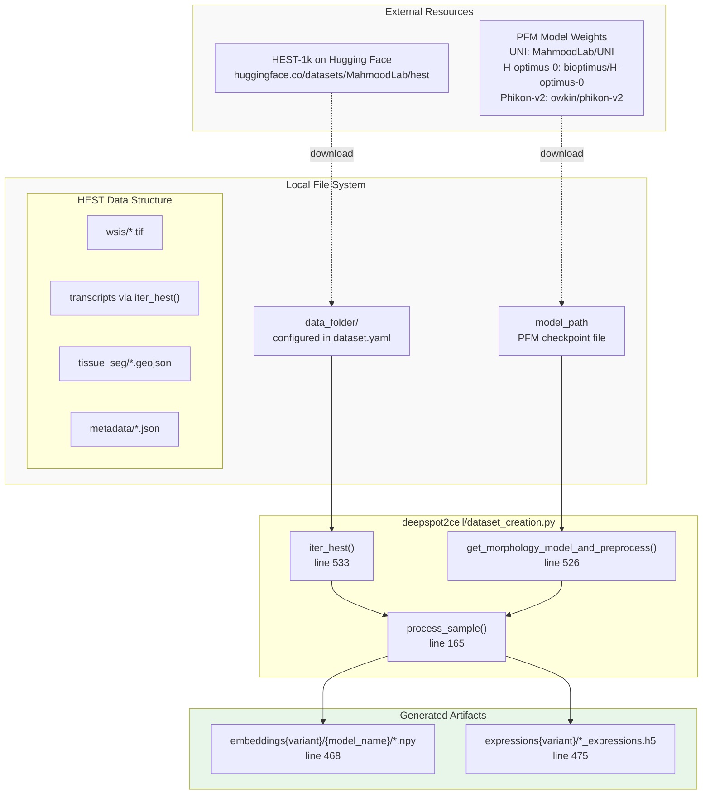
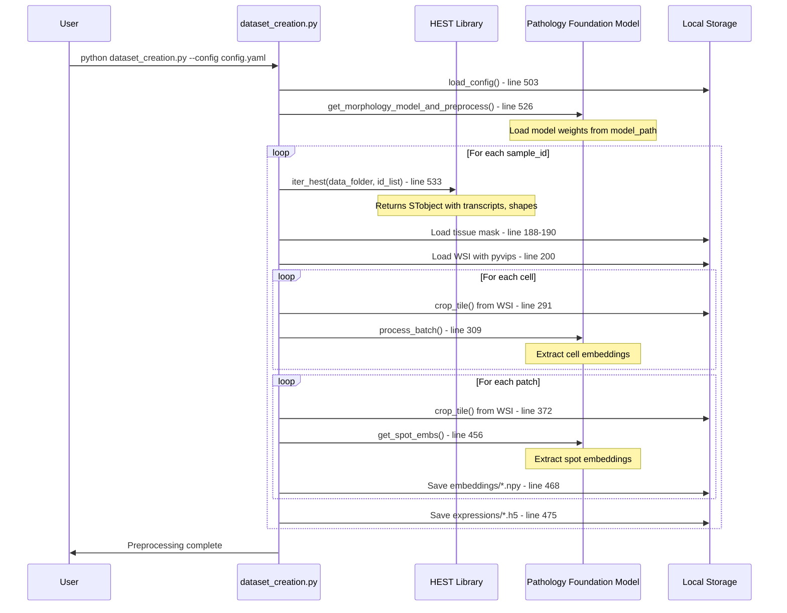

# External Integrations

<details>
<summary>Relevant source files</summary>

The following files were used as context for generating this wiki page:

- [README.md](README.md)
- [deepspot2cell/dataset_creation.py](deepspot2cell/dataset_creation.py)

</details>


This document describes how DeepSpot2Cell integrates with external systems and datasets. DeepSpot2Cell depends on two critical external resources: the **HEST-1k dataset** for spatial transcriptomics data and **Pathology Foundation Models (PFMs)** for morphological feature extraction. These integrations enable DeepSpot2Cell to train models that predict virtual single-cell spatial transcriptomics from H&E images.

For detailed information about specific integrations, see:
- HEST-1k dataset structure and access: [HEST-1k Dataset](#10.1)
- PFM models and configuration: [Pathology Foundation Models](#10.2)
- Data preprocessing workflow: [Tutorial 1: Data Preprocessing](#3.1)

## Overview of External Dependencies

DeepSpot2Cell requires two types of external resources that must be obtained and configured before use:

| External System | Purpose | Integration Point | Required Files |
|----------------|---------|------------------|----------------|
| **HEST-1k Dataset** | Provides spatial transcriptomics data (Xenium), H&E whole slide images, tissue segmentation masks, and cell segmentation data | Dataset creation and preprocessing | WSIs (.tif), transcript data, cell shapes, tissue masks (.geojson) |
| **Pathology Foundation Models** | Extract morphological features from H&E image tiles at multiple scales | Feature extraction during preprocessing | Model weights (.pth, .pt) and preprocessing transforms |

Both external systems are accessed during the **data preprocessing phase** ([deepspot2cell/dataset_creation.py]()), not during model training or inference. This separation allows preprocessing to be performed once, with the extracted features reused across multiple training runs.

**Sources:** [README.md:35-51](), [deepspot2cell/dataset_creation.py:1-20]()

## Integration Architecture

The following diagram illustrates how DeepSpot2Cell integrates with external systems throughout the data processing pipeline:



**Sources:** [README.md:16-51](), [deepspot2cell/dataset_creation.py:495-536]()

## Configuration Requirements

Both external integrations require configuration in the dataset configuration file (typically `configs/dataset.example.yaml`). The configuration specifies file paths and processing parameters:

### HEST Dataset Configuration

```yaml
data:
  data_folder: "/path/to/hest/data"  # Root directory containing HEST data
  dataset_variant: ""                 # Optional suffix for output folders
  
  lung:  # Dataset-specific configuration
    train:
      dataset_ids: ["TENX119", "TENX121", ...]  # Sample IDs to process
    ood:
      dataset_ids: ["TENX95", ...]
```

The `data_folder` must contain the HEST directory structure with subdirectories: `wsis/`, `tissue_seg/`, `metadata/`, and be accessible via the `hest` library's `iter_hest()` function.

**Sources:** [deepspot2cell/dataset_creation.py:166-168](), [deepspot2cell/utils/utils.py]()

### PFM Configuration

```yaml
data:
  model_name: "uni"                                    # Model identifier
  model_path: "/path/to/models/uni/pytorch_model.bin" # Path to weights
```

Supported `model_name` values are:
- `"uni"` - UNI model from Mahmood Lab
- `"hoptimus"` or `"h-optimus-0"` - H-optimus-0 from Bioptimus
- `"phikon"` or `"phikon-v2"` - Phikon v2 from Owkin

The `model_path` points to the downloaded model checkpoint file.

**Sources:** [README.md:35-45](), [deepspot2cell/dataset_creation.py:506-507]()

## Data Flow Through External Systems

The following diagram shows the sequence of operations during preprocessing, highlighting when and how external systems are accessed:



**Key Integration Points:**

1. **HEST Integration** ([deepspot2cell/dataset_creation.py:533]()):
   - `iter_hest(data_folder, id_list=sample_ids, load_transcripts=True)` loads spatial transcriptomics data
   - Returns `STobject` instances containing transcript dataframes, cell shapes, and metadata
   - Accessed once per sample during preprocessing

2. **PFM Integration** ([deepspot2cell/dataset_creation.py:526]()):
   - `get_morphology_model_and_preprocess(model_name, device.type, model_path=model_path)` loads the model
   - `process_batch()` ([deepspot2cell/dataset_creation.py:23-40]()) extracts cell-level features
   - `get_spot_embs()` ([deepspot2cell/dataset_creation.py:43-58]()) extracts spot-level features
   - Called thousands of times per sample for feature extraction

**Sources:** [deepspot2cell/dataset_creation.py:23-58](), [deepspot2cell/dataset_creation.py:165-492](), [deepspot2cell/dataset_creation.py:495-536]()

## Required Directory Structure

After downloading external resources and before running preprocessing, the local file system should have this structure:

```
/path/to/hest/data/          # data_folder in config
├── wsis/
│   ├── TENX119.tif
│   ├── TENX121.tif
│   └── ...
├── tissue_seg/
│   ├── TENX119_contours.geojson
│   ├── TENX121_contours.geojson
│   └── ...
├── metadata/
│   ├── TENX119.json
│   ├── TENX121.json
│   └── ...
└── [other HEST files accessed by iter_hest()]

/path/to/models/             # Separate directory for PFM weights
├── uni/
│   └── pytorch_model.bin
├── hoptimus/
│   └── pytorch_model.bin
└── phikon/
    └── pytorch_model.bin
```

The preprocessing script creates output directories automatically:

```
/path/to/hest/data/
├── embeddings{variant}/
│   └── {model_name}/
│       ├── patch_0_0_TENX119.npy
│       └── ...
└── expressions{variant}/
    ├── TENX119_expressions.h5
    └── ...
```

**Sources:** [deepspot2cell/dataset_creation.py:529-531](), [deepspot2cell/dataset_creation.py:468](), [deepspot2cell/dataset_creation.py:475]()

## Validation and Error Handling

The preprocessing script includes validation logic for external data:

**HEST Data Validation:**
- Checks for tissue mask validity ([deepspot2cell/dataset_creation.py:113-162]())
- Filters transcripts by quality score (`qv > qv_thr`) ([deepspot2cell/dataset_creation.py:210-214]())
- Validates cell geometry ([deepspot2cell/dataset_creation.py:263-267]())
- Ensures cells are within tissue boundaries ([deepspot2cell/dataset_creation.py:273-275]())

**PFM Integration Validation:**
- Automatic batch size selection based on available VRAM ([deepspot2cell/dataset_creation.py:514-524]())
- Graceful fallback to CPU if CUDA unavailable ([deepspot2cell/dataset_creation.py:522-524]())
- Automatic float16/float32 dtype selection ([deepspot2cell/dataset_creation.py:30](), [deepspot2cell/dataset_creation.py:44]())

**File System Validation:**
- Checks if sample already processed ([deepspot2cell/dataset_creation.py:169-171]())
- Creates output directories if they don't exist ([deepspot2cell/dataset_creation.py:529-531]())

**Sources:** [deepspot2cell/dataset_creation.py:96-162](), [deepspot2cell/dataset_creation.py:208-214](), [deepspot2cell/dataset_creation.py:514-531]()

## Integration Code Entities

The following table maps high-level integration concepts to specific code entities:

| Concept | Code Entity | Location | Description |
|---------|-------------|----------|-------------|
| **Load HEST data** | `iter_hest()` | [deepspot2cell/dataset_creation.py:533]() | Iterator that yields `STobject` instances for each sample |
| **Access transcripts** | `st.transcript_df` | [deepspot2cell/dataset_creation.py:208]() | Pandas DataFrame with transcript-level data |
| **Access cell shapes** | `st.get_shapes('xenium_cell', 'he')` | [deepspot2cell/dataset_creation.py:193]() | GeoDataFrame with cell segmentation polygons |
| **Load PFM** | `get_morphology_model_and_preprocess()` | [deepspot2cell/utils/utils_image.py]() | Returns model, preprocessing function, and feature dimension |
| **Extract cell features** | `process_batch()` | [deepspot2cell/dataset_creation.py:23-40]() | Batch processes cell tiles through PFM |
| **Extract spot features** | `get_spot_embs()` | [deepspot2cell/dataset_creation.py:43-58]() | Processes spot tiles through PFM |
| **Load tissue mask** | `create_tissue_mask()` | [deepspot2cell/dataset_creation.py:113-162]() | Parses GeoJSON tissue segmentation |
| **Crop image tiles** | `crop_tile()` | [deepspot2cell/dataset_creation.py:87-93]() | Extracts tiles from WSI using pyvips |

**Sources:** [deepspot2cell/dataset_creation.py:23-162](), [deepspot2cell/dataset_creation.py:533]()

## Performance Considerations

External integrations impact preprocessing performance significantly:

**HEST Data Access:**
- WSI loading uses `pyvips` for memory-efficient streaming ([deepspot2cell/dataset_creation.py:200]())
- Transcript filtering reduces memory footprint by ~50% ([deepspot2cell/dataset_creation.py:208-214]())
- Spatial filtering (tissue mask) reduces processing by ~30-40% ([deepspot2cell/dataset_creation.py:358-359]())

**PFM Inference:**
- Batch processing (default: 32 images on 16GB GPU) amortizes model overhead ([deepspot2cell/dataset_creation.py:518]())
- Mixed precision (float16) reduces memory by 50% and increases throughput ([deepspot2cell/dataset_creation.py:30](), [deepspot2cell/dataset_creation.py:34]())
- Embeddings saved as float16 to reduce disk usage ([deepspot2cell/dataset_creation.py:459](), [deepspot2cell/dataset_creation.py:464]())

Typical preprocessing time: 2-4 hours per sample on a system with 16GB GPU.

**Sources:** [deepspot2cell/dataset_creation.py:200](), [deepspot2cell/dataset_creation.py:208-214](), [deepspot2cell/dataset_creation.py:514-524](), [deepspot2cell/dataset_creation.py:459-468]()

---