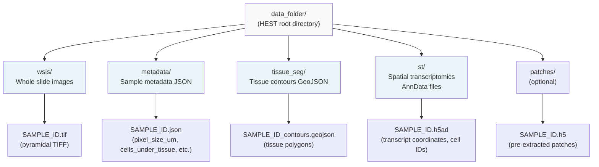
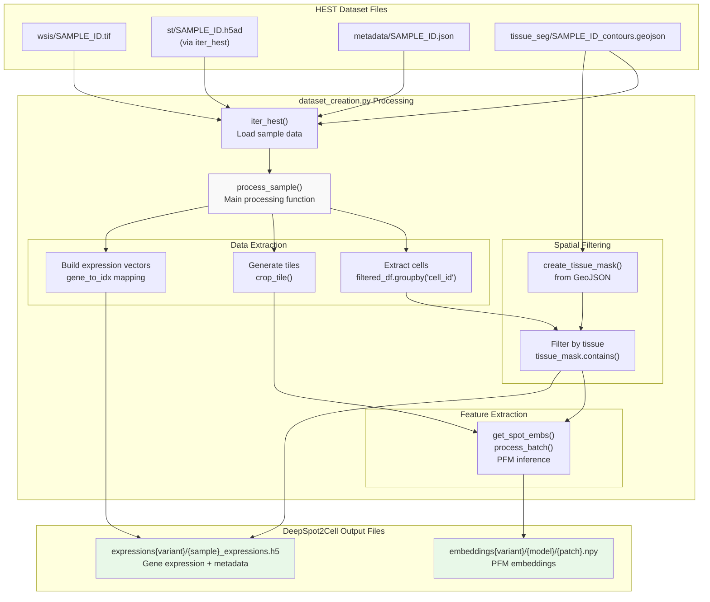
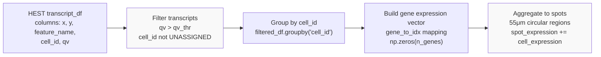
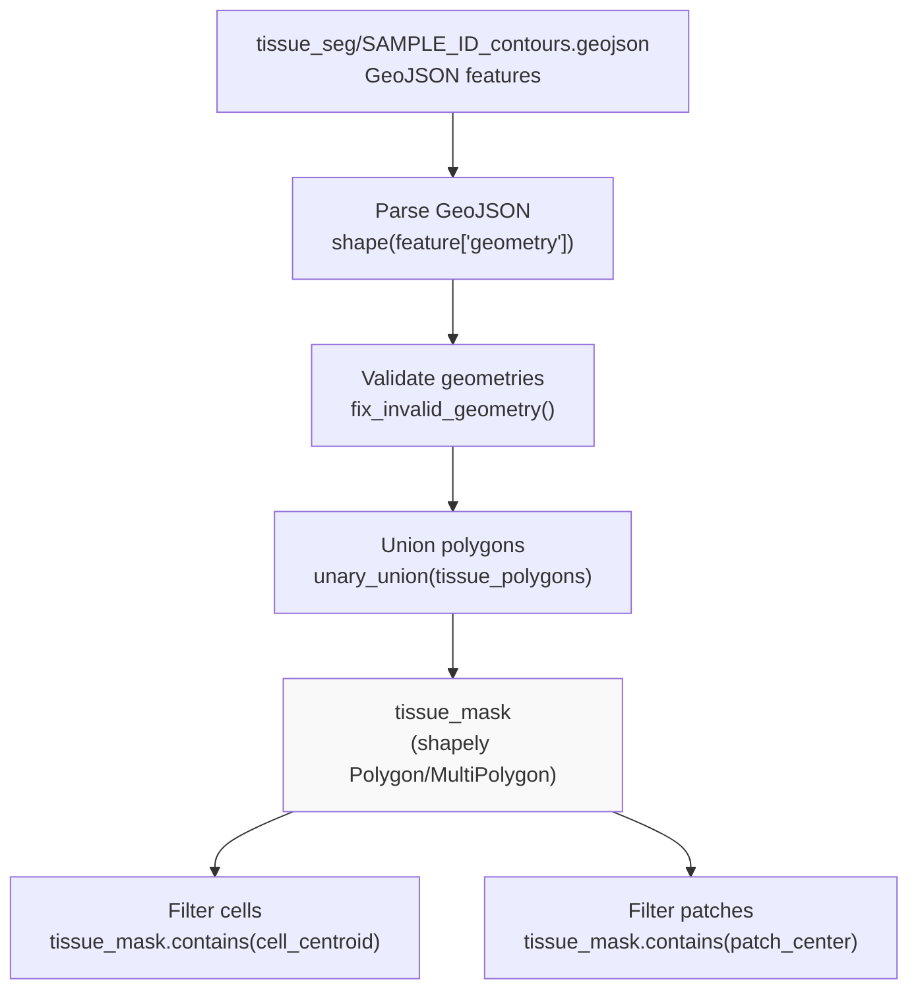
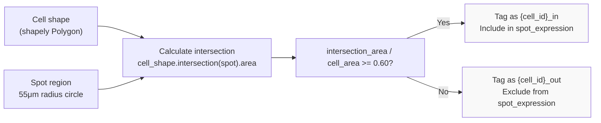
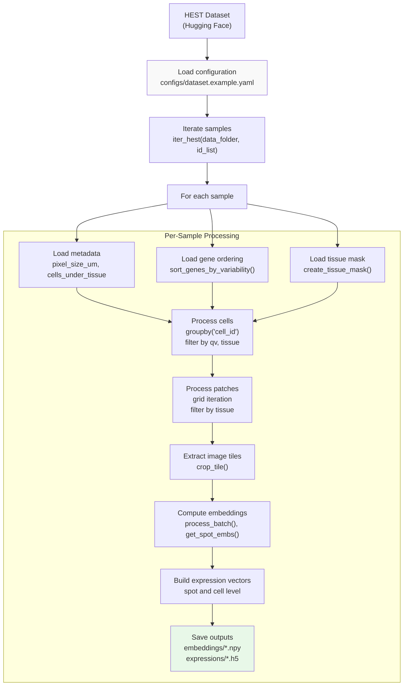

# HEST-1k Dataset

<details>
<summary>Relevant source files</summary>

The following files were used as context for generating this wiki page:

- [README.md](README.md)
- [configs/dataset.example.yaml](configs/dataset.example.yaml)
- [deepspot2cell/dataset_creation.py](deepspot2cell/dataset_creation.py)

</details>


This page documents the HEST-1k dataset, its structure, and how DeepSpot2Cell integrates with it to prepare training and inference data. For information about the preprocessing pipeline that processes HEST data, see [Tutorial 1: Data Preprocessing](#3.1). For configuration parameters related to HEST data, see [Dataset Configuration](#6.1).

## Overview

HEST-1k (Histology-based Expression of Spatial Transcriptomics) is a large-scale spatial transcriptomics dataset containing H&E whole slide images paired with Xenium spatial transcriptomics data. DeepSpot2Cell uses HEST-1k as its primary training and evaluation dataset. The dataset provides:

- **H&E Whole Slide Images (WSIs)**: High-resolution tissue histology images
- **Xenium Spatial Transcriptomics**: Transcript-level gene expression data with spatial coordinates
- **Cell Segmentation Masks**: Pre-computed cell boundaries from Xenium segmentation
- **Tissue Segmentation Masks**: Annotations defining tissue regions
- **Metadata**: Sample-specific information including pixel size, cell counts, and organ type

Sources: [README.md:47-49](), [deepspot2cell/dataset_creation.py:11]()

## HEST-1k Dataset Structure

The HEST-1k dataset is organized into a structured directory hierarchy that DeepSpot2Cell expects to find at the location specified by `data_folder` in the configuration files.

### Directory Organization



Sources: [deepspot2cell/dataset_creation.py:165-203]()

### File Types and Contents

| Directory | File Pattern | Content | Access Method |
|-----------|--------------|---------|---------------|
| `wsis/` | `{sample_id}.tif` | Multi-resolution pyramidal TIFF containing H&E image | `pyvips.Image.new_from_file()` |
| `metadata/` | `{sample_id}.json` | Sample metadata including `pixel_size_um_estimated`, `cells_under_tissue` | `json.load()` |
| `tissue_seg/` | `{sample_id}_contours.geojson` | GeoJSON with tissue boundary polygons | `json.load()` + `shapely.geometry.shape()` |
| `st/` | `{sample_id}.h5ad` | AnnData object with transcript_df (coordinates, gene names, cell IDs) and cell shapes | `iter_hest()` from HEST library |

Sources: [deepspot2cell/dataset_creation.py:173-203]()

## Accessing HEST-1k Data

### Download and Installation

The HEST-1k dataset is hosted on Hugging Face at [MahmoodLab/hest](https://huggingface.co/datasets/MahmoodLab/hest). DeepSpot2Cell accesses HEST data through the `hest` Python library, which is included in the project dependencies.

```bash
# The hest library is installed as part of the DeepSpot2Cell environment
conda activate deepspot2cell
```

### Loading HEST Data Programmatically

DeepSpot2Cell uses the `iter_hest()` function to iterate over HEST samples:

```python
from hest import iter_hest

# Load HEST samples with transcript data
for st in iter_hest(data_folder, id_list=sample_ids, load_transcripts=True):
    # st is a HEST object containing:
    # - st.adata: AnnData with spot-level expression
    # - st.transcript_df: DataFrame with transcript coordinates
    # - st.get_shapes(): Method to retrieve cell segmentation
```

The HEST object provides access to:
- **`st.adata`**: AnnData object with gene expression data
- **`st.transcript_df`**: Pandas DataFrame with columns `['x', 'y', 'feature_name', 'cell_id', 'qv']`
- **`st.get_shapes()`**: Method to retrieve cell segmentation polygons

Sources: [deepspot2cell/dataset_creation.py:533-535]()

## Integration with DeepSpot2Cell

### Data Flow from HEST to DeepSpot2Cell



Sources: [deepspot2cell/dataset_creation.py:165-535]()

### Key Integration Points

#### 1. Sample Iteration and Loading

The `process_sample()` function is the main entry point for processing HEST data:

```python
# Function signature from dataset_creation.py
def process_sample(sample_id, st, model, preprocess, device, batch_size, config):
    # st: HEST object loaded via iter_hest()
    # Returns: Creates embeddings and expression files
```

Sources: [deepspot2cell/dataset_creation.py:165]()

#### 2. Gene Expression Processing

DeepSpot2Cell processes transcript-level data from HEST into cell-level and spot-level expression vectors:



The quality filtering uses the `qv` (quality value) threshold from configuration:

- Transcripts with `qv > qv_thr` are retained [deepspot2cell/dataset_creation.py:210-214]()
- Transcripts assigned to cells (not `'UNASSIGNED'` or `-1`) are kept [deepspot2cell/dataset_creation.py:208]()

Sources: [deepspot2cell/dataset_creation.py:208-256]()

#### 3. Cell Segmentation Access

DeepSpot2Cell retrieves cell segmentation masks from HEST:

```python
# Get cell shapes from HEST
cell_shapes = st.get_shapes('xenium_cell', 'he').shapes

# cell_shapes is a GeoDataFrame with:
# - index: cell IDs
# - geometry: shapely Polygon objects
```

Cell shapes are used to:
- Extract cell bounding boxes for cropping cell tiles
- Compute cell centroids for spatial filtering
- Calculate intersection with spot regions to determine if cells are inside spots

Sources: [deepspot2cell/dataset_creation.py:193-197]()

#### 4. Spatial Filtering with Tissue Masks

The `create_tissue_mask()` function converts HEST tissue segmentation GeoJSON into shapely geometry:



This ensures that only cells and patches within annotated tissue regions are processed, improving data quality and reducing computational cost.

Sources: [deepspot2cell/dataset_creation.py:96-162](), [deepspot2cell/dataset_creation.py:272-276](), [deepspot2cell/dataset_creation.py:357-359]()

## Configuration for HEST Data

### Dataset Configuration Parameters

The `configs/dataset.example.yaml` file controls how HEST data is accessed and processed:

```yaml
data:
  data_folder: /absolute/path/to/hest_data  # HEST root directory
  dataset_variant: _v1                       # Output subdirectory suffix
  model_name: phikonv2                       # PFM to use
  model_path: /absolute/path/to/phikonv2    # PFM weights location
  
  # Spatial dimensions
  spot_diameter_px: 160      # Spot diameter in pixels (55μm)
  patch_size_px: 224         # Patch size in pixels
  
  # Quality filtering
  qv_thr: 20                 # Minimum transcript quality value
  
  # Dataset organization by organ type
  lung:
    ordered_genes_file: lung_ordered_genes.json
    train:
      dataset_ids:
        - SAMPLE_ID_1
        - SAMPLE_ID_2
    ood:
      dataset_ids: []
```

Sources: [configs/dataset.example.yaml:1-27]()

### Pixel Size and Spatial Dimensions

HEST metadata includes `pixel_size_um_estimated`, which DeepSpot2Cell uses to convert between physical and pixel dimensions:

```python
# Load pixel size from metadata
um_per_px = metadata.get('pixel_size_um_estimated', 0.2125)

# Convert micron-based to pixel-based dimensions
if config['data'].get('spot_diameter_px', None) is not None:
    spot_diameter = config['data']['spot_diameter_px']
    patch_size = config['data']['patch_size_px']
else:
    spot_diameter = int(config['data']['spot_diameter'] / um_per_px)
    patch_size = int(config['data']['patch_size'] / um_per_px)
```

This allows flexible configuration using either:
- **Pixel-based**: `spot_diameter_px`, `patch_size_px` (fixed pixel dimensions)
- **Micron-based**: `spot_diameter`, `patch_size` (physical dimensions converted based on pixel size)

Sources: [deepspot2cell/dataset_creation.py:173-183]()

## Output Files Generated from HEST

### Embeddings Directory Structure

```
embeddings{dataset_variant}/
└── {model_name}/
    └── patch_{h_idx}_{w_idx}_{sample_id}.npy
```

Each `.npy` file contains a stacked array of shape `(n_cells_in_patch + 1, feature_dim)`:
- **Row 0**: Spot-level embedding (full patch processed through PFM)
- **Rows 1+**: Cell-level embeddings (individual cell tiles processed through PFM)

Sources: [deepspot2cell/dataset_creation.py:456-468]()

### Expressions HDF5 Structure

```
expressions{dataset_variant}/
└── {sample_id}_expressions.h5
    └── patch_{h_idx}_{w_idx}_{sample_id}/  (HDF5 group)
        ├── spot_expression          (dataset: gene expression vector for spot)
        ├── cell_expressions         (dataset: n_cells × n_genes matrix)
        ├── cell_ids                 (dataset: cell IDs with "_in" or "_out" suffix)
        ├── cell_centroids          (dataset: normalized centroid coordinates)
        └── cell_bbxs               (dataset: normalized bounding box coordinates)
```

The HDF5 file stores all expression and spatial metadata for each patch (superspot):

```python
# Example access pattern
with h5py.File(f'{data_folder}/expressions{variant}/{sample_id}_expressions.h5', 'r') as f:
    patch_group = f['patch_0_0_SAMPLE_ID']
    spot_expr = patch_group['spot_expression'][:]        # Shape: (n_genes,)
    cell_exprs = patch_group['cell_expressions'][:]      # Shape: (n_cells, n_genes)
    cell_ids = patch_group['cell_ids'][:]                # List of cell IDs with tags
```

Sources: [deepspot2cell/dataset_creation.py:474-487]()

### Cell ID Tagging System

Cells are tagged with `"_in"` or `"_out"` suffixes based on their intersection with the spot region:



This tagging enables:
- **Training**: Only cells with `"_in"` tag contribute to spot-level expression labels
- **Context**: All cells in patch (both `"_in"` and `"_out"`) provide spatial context features

Sources: [deepspot2cell/dataset_creation.py:413-443]()

## Gene Ordering and Standardization

DeepSpot2Cell maintains consistent gene ordering across samples using the `sort_genes_by_variability()` function:

```python
def sort_genes_by_variability(adata, config):
    # Load or generate ordered gene list
    ordered_genes_path = f"{config['data']['data_folder']}/{config['data'][config['dataset']]['ordered_genes_file']}"
    
    if os.path.exists(ordered_genes_path):
        with open(ordered_genes_path, 'r') as f:
            ordered_gene_names = json.load(f)
    else:
        # Generate gene order based on variability
        order_genes(config)
    
    return ordered_gene_names
```

The ordered gene list ensures:
- Consistent gene indices across all samples in a dataset
- Expression vectors have the same dimensionality and gene ordering
- Efficient model training with standardized inputs

Sources: [deepspot2cell/dataset_creation.py:61-84]()

## Data Processing Pipeline Summary



Sources: [deepspot2cell/dataset_creation.py:495-536]()

## Command-Line Usage

The `dataset_creation.py` script can be run directly to process HEST data:

```bash
# Process all samples in a dataset
python deepspot2cell/dataset_creation.py --config configs/dataset.example.yaml --dataset lung

# Process specific samples by index
python deepspot2cell/dataset_creation.py --config configs/dataset.example.yaml --dataset lung --indices 0 1 2

# The script will:
# 1. Load HEST samples from data_folder
# 2. Extract cells and patches within tissue
# 3. Compute PFM embeddings
# 4. Save embeddings/*.npy and expressions/*.h5
```

Command-line arguments:
- `--config`: Path to configuration YAML file (default: `configs/dataset.example.yaml`)
- `--dataset`: Dataset name from config (e.g., `lung`, `breast`)
- `--indices`: Optional list of sample indices to process (processes all if not specified)

Sources: [deepspot2cell/dataset_creation.py:495-536]()

---