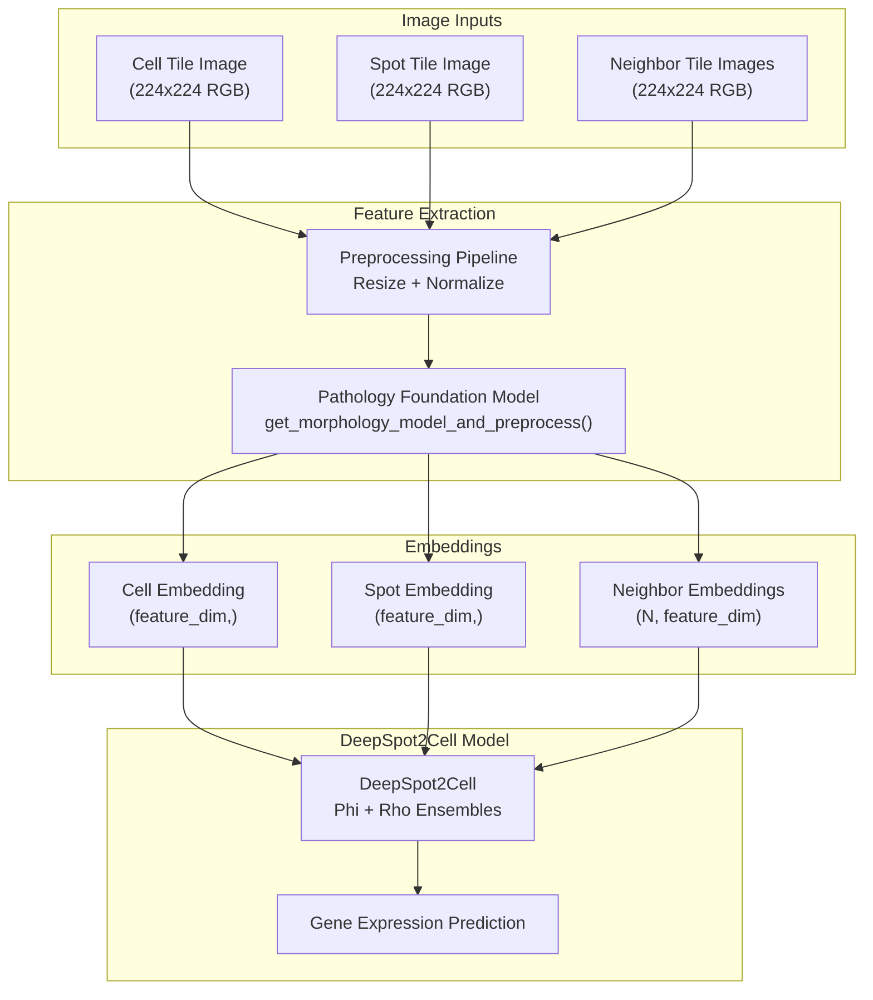
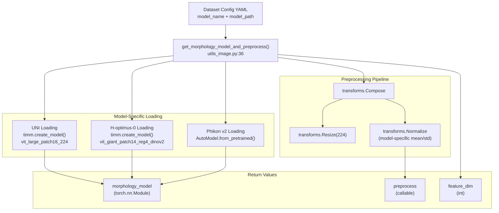
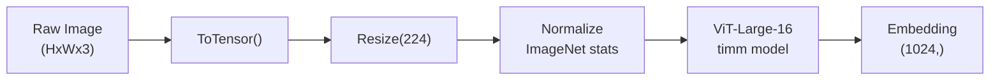
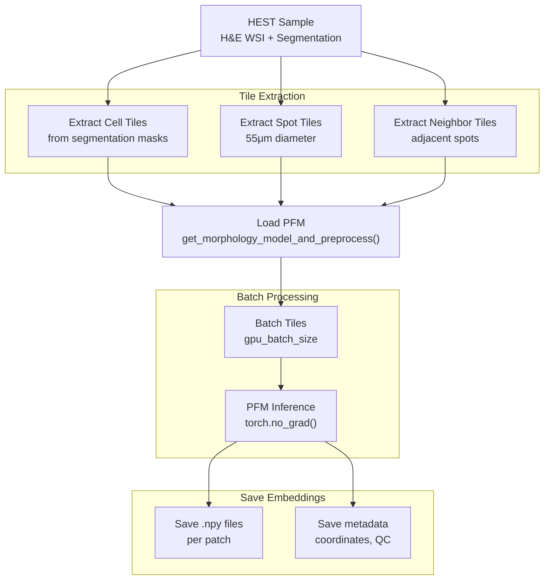
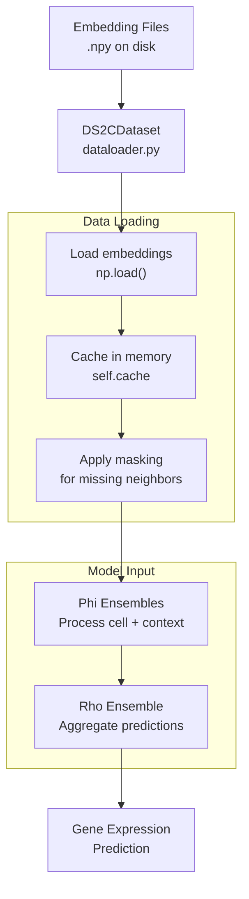

# Pathology Foundation Models

<details>
<summary>Relevant source files</summary>

The following files were used as context for generating this wiki page:

- [README.md](README.md)
- [configs/dataset.example.yaml](configs/dataset.example.yaml)
- [deepspot2cell/utils/utils_image.py](deepspot2cell/utils/utils_image.py)

</details>


## Purpose and Scope

This page documents the Pathology Foundation Models (PFMs) that DeepSpot2Cell uses to extract morphological features from H&E images. PFMs are pre-trained vision models that encode tissue morphology into high-dimensional embeddings. These embeddings serve as the input features for the DeepSpot2Cell model.

For information about how these embeddings are generated during data preprocessing, see [Dataset Creation](#5.1). For details on how embeddings are loaded and used during training, see [DS2CDataset and Data Loading](#4.2).

## Overview

Pathology Foundation Models are large-scale vision transformers pre-trained on millions of histopathology images. In DeepSpot2Cell's architecture, PFMs serve as frozen feature extractors that convert raw H&E image tiles into dense feature vectors. These embeddings capture morphological patterns at the cellular and tissue level, which the DeepSpot2Cell model then relates to gene expression.



**Sources**: [deepspot2cell/utils/utils_image.py:36-182](), [README.md:35-45]()

## Supported Models

DeepSpot2Cell supports multiple pathology foundation models, each with different architectures and characteristics.

### Officially Tested Models

The following models have been officially tested and validated with DeepSpot2Cell:

| Model | Identifier | Organization | Hugging Face Repository |
|-------|------------|--------------|------------------------|
| **UNI** | `uni` | MahmoodLab | `MahmoodLab/UNI` |
| **H-optimus-0** | `hoptimus0` | Bioptimus | `bioptimus/H-optimus-0` |
| **Phikon v2** | `phikonv2` | Owkin | `owkin/phikon-v2` |

These models must be downloaded from their respective Hugging Face repositories and the local path configured in the dataset configuration file.

**Sources**: [README.md:35-45]()

### Additional Supported Models

DeepSpot2Cell also supports additional models for research and comparison purposes:

| Model | Identifier | Notes |
|-------|------------|-------|
| **Phikon v1** | `phikon` | Earlier version of Phikon |
| **Inception v3** | `inception` | Baseline model from torchvision |
| **ResNet50** | `resnet50` | Baseline model from torchvision |
| **DenseNet121** | `densenet121` | Baseline model from torchvision |

**Sources**: [deepspot2cell/utils/utils_image.py:36-182]()

## Model Specifications

Each model has distinct architectural characteristics that affect feature dimensionality, preprocessing requirements, and computational cost.

| Model | Architecture | Feature Dim | Backbone Library | Patch Size | Special Preprocessing |
|-------|--------------|-------------|------------------|------------|----------------------|
| **UNI** | ViT-Large-16 | 1024 | `timm` | 16 | ImageNet normalization |
| **H-optimus-0** | ViT-Giant-14 (DINOv2) | 1536 | `timm` | 14 | Custom H&E normalization |
| **Phikon v2** | ViT | 1024 | `transformers` | 16 | AutoImageProcessor |
| **Phikon v1** | ViT | 768 | `transformers` | 16 | AutoImageProcessor |
| **Inception v3** | Inception v3 | 2048 | `torchvision` | N/A | ImageNet normalization |
| **ResNet50** | ResNet50 | 2048 | `torchvision` | N/A | ImageNet normalization |
| **DenseNet121** | DenseNet121 | 1024 | `torchvision` | N/A | ImageNet normalization |

### Normalization Parameters

Different models require different normalization statistics:

**UNI, Inception v3, ResNet50, DenseNet121** (ImageNet statistics):
- Mean: `(0.485, 0.456, 0.406)`
- Std: `(0.229, 0.224, 0.225)`

**H-optimus-0** (H&E-specific statistics):
- Mean: `(0.707223, 0.578729, 0.703617)`
- Std: `(0.211883, 0.230117, 0.177517)`

**Phikon v1/v2**:
- Uses `AutoImageProcessor` with model-specific normalization

**Sources**: [deepspot2cell/utils/utils_image.py:36-182]()

## Configuration

PFMs are configured in the dataset configuration file used during preprocessing.

### Dataset Configuration

```yaml
data:
  model_name: phikonv2
  model_path: /absolute/path/to/phikonv2
```

The `model_name` must match one of the supported identifiers listed in the table above. The `model_path` should point to the local directory containing the downloaded model weights.

**Example configurations**:

```yaml
# UNI configuration
data:
  model_name: uni
  model_path: /path/to/uni/pytorch_model.bin
```

```yaml
# H-optimus-0 configuration
data:
  model_name: hoptimus0
  model_path: /path/to/hoptimus0/pytorch_model.bin
```

```yaml
# Phikon v2 configuration
data:
  model_name: phikonv2
  model_path: /path/to/phikonv2/
```

**Sources**: [configs/dataset.example.yaml:4-5]()

## Implementation Details

### Model Loading Architecture



**Sources**: [deepspot2cell/utils/utils_image.py:36-182]()

### get_morphology_model_and_preprocess Function

The central function for loading PFMs is `get_morphology_model_and_preprocess()` located in [deepspot2cell/utils/utils_image.py:36-182](). This function handles model-specific loading logic and returns three components:

**Function Signature**:
```python
def get_morphology_model_and_preprocess(model_name, device, model_path=None):
    """
    Returns:
        morphology_model: torch.nn.Module - The loaded feature extractor
        preprocess: callable - Image preprocessing function
        feature_dim: int - Dimensionality of output embeddings
    """
```

**Implementation Logic**:

The function uses a conditional structure to handle each model type:

1. **Model name matching**: Tests `model_name` against supported identifiers
2. **Model instantiation**: Uses appropriate library (`timm`, `transformers`, or `torchvision`)
3. **Weight loading**: Loads pre-trained weights from `model_path`
4. **Preprocessing pipeline**: Creates model-specific `transforms.Compose` pipeline
5. **Feature dimension**: Returns the embedding dimensionality

**Sources**: [deepspot2cell/utils/utils_image.py:36-182]()

### UNI Implementation



**Code Reference**: [deepspot2cell/utils/utils_image.py:38-58]()

**Key Implementation Details**:
- Uses `timm.create_model("vit_large_patch16_224", ...)`
- Sets `num_classes=0` to remove classification head
- Enables `dynamic_img_size=True` for flexible input sizes
- Loads weights from `.bin` file using `torch.load()`
- Returns feature dimension of `1024`

### H-optimus-0 Implementation

**Code Reference**: [deepspot2cell/utils/utils_image.py:59-80]()

**Key Implementation Details**:
- Uses `timm.create_model("vit_giant_patch14_reg4_dinov2", ...)`
- Largest model with `1536` feature dimensions
- Custom H&E-specific normalization values
- Based on DINOv2 architecture with register tokens

### Phikon v2 Implementation

**Code Reference**: [deepspot2cell/utils/utils_image.py:107-135]()

**Key Implementation Details**:
- Uses Hugging Face `transformers` library
- Loads via `AutoModel.from_pretrained(model_path)`
- Wraps model in custom `MyModel` class to extract CLS token
- Implements both `forward()` and `forward_features()` methods
- Returns feature dimension of `1024`

**Custom Wrapper Implementation**:
```python
class MyModel(torch.nn.Module):
    def __init__(self, model):
        super().__init__()
        self.model = model

    def forward(self, x):
        with torch.no_grad():
            x = self.model(x)
            x = x.last_hidden_state[:, 0, :]  # Extract CLS token
            return x
```

The wrapper ensures that only the CLS token (first position in the sequence) is returned as the image embedding.

**Sources**: [deepspot2cell/utils/utils_image.py:107-135]()

### Baseline Models Implementation

The baseline models (Inception, ResNet50, DenseNet121) follow a simpler pattern:

**Code References**: 
- Inception v3: [deepspot2cell/utils/utils_image.py:137-150]()
- ResNet50: [deepspot2cell/utils/utils_image.py:152-165]()
- DenseNet121: [deepspot2cell/utils/utils_image.py:167-180]()

**Implementation Pattern**:
1. Load pre-trained weights via `torchvision.models`
2. Replace final classification layer with `torch.nn.Identity()`
3. Use default ImageNet preprocessing from model weights
4. Return feature dimensions (2048 for Inception/ResNet, 1024 for DenseNet)

## Integration with DeepSpot2Cell

### Data Preprocessing Integration

During dataset creation, PFMs are used to extract embeddings from image tiles:



**Process Flow**:
1. Load PFM once at the start of preprocessing
2. Extract all image tiles for a sample
3. Process tiles in batches for GPU efficiency
4. Save embeddings as `.npy` files organized by sample and patch
5. Embeddings are reused across multiple training runs

**Sources**: [deepspot2cell/utils/utils_image.py:36-182]()

### Training and Inference Integration

During training and inference, the system loads pre-computed embeddings rather than re-computing them:



This design separates the expensive PFM inference (done once during preprocessing) from the iterative training process.

**Sources**: [deepspot2cell/dataloader.py](), [deepspot2cell/model.py]()

### Inference-Time PFM Usage

For real-time inference on new images without pre-computed embeddings, PFMs are used directly via prediction functions:

**Spot-Level Prediction**: [deepspot2cell/utils/utils_image.py:246-297]()
- Function: `predict_spot_spatial_transcriptomics_from_image_path()`
- Extracts tiles from WSI on-the-fly
- Computes embeddings using PFM
- Passes embeddings to trained model

**Cell-Level Prediction**: [deepspot2cell/utils/utils_image.py:300-361]()
- Function: `predict_cell_spatial_transcriptomics_from_image_path()`
- Extracts cell and neighbor tiles
- Computes embeddings using PFM
- Predicts cell-level gene expression

**DeepSpot2Cell-Specific Inference**: [deepspot2cell/utils/utils_image.py:364-457]()
- Function: `predict_spot2cell_from_image_paths()`
- Takes individual image paths for cell, spot, and neighbors
- Extracts embeddings for each image
- Performs single-cell prediction

**Sources**: [deepspot2cell/utils/utils_image.py:246-457]()

## Model Selection Guidelines

### Computational Considerations

| Model | Feature Dim | Relative Speed | Memory Usage | Recommended For |
|-------|-------------|----------------|--------------|-----------------|
| UNI | 1024 | Fast | Moderate | General use, balanced performance |
| H-optimus-0 | 1536 | Slow | High | Maximum performance, research |
| Phikon v2 | 1024 | Fast | Moderate | General use, recommended default |
| Phikon v1 | 768 | Faster | Low | Quick experiments, resource-constrained |
| Baseline models | 1024-2048 | Very Fast | Low | Ablation studies, comparisons |

### Biological Domain Considerations

All three officially tested models (UNI, H-optimus-0, Phikon v2) are pre-trained on large-scale histopathology datasets and are suitable for diverse tissue types including:
- Lung tissue (primary use case in DeepSpot2Cell)
- Breast tissue
- Colorectal tissue
- Other solid tumor tissues

The choice between models primarily affects:
- **Feature quality**: Higher-dimensional models may capture more morphological nuance
- **Computational cost**: Larger models require more GPU memory and time
- **Downstream performance**: Model choice affects final gene expression prediction accuracy

**Sources**: [README.md:1-70]()

## Advanced Usage

### Custom Model Integration

To integrate a custom PFM not currently supported, modify [deepspot2cell/utils/utils_image.py:36-182]() by adding a new conditional branch:

**Required Components**:
1. Model loading logic (using appropriate library)
2. Preprocessing pipeline (transforms.Compose)
3. Feature dimension specification

**Template Pattern**:
```python
elif model_name == "custom_model":
    # Load model
    morphology_model = load_custom_model(model_path)
    morphology_model.eval()
    
    # Define preprocessing
    preprocess = transforms.Compose([
        transforms.ToTensor(),
        transforms.Resize(224),
        transforms.Normalize(mean=(...), std=(...))
    ])
    
    # Specify feature dimension
    feature_dim = 1024
```

### Mixed-Precision Inference

All inference functions support automatic mixed precision (AMP) via PyTorch's `torch.autocast`:

```python
with torch.autocast(device_type="cuda", dtype=torch.float16):
    with torch.inference_mode():
        embedding = morphology_model(image_tensor)
```

This reduces memory usage and increases throughput during embedding extraction.

**Sources**: [deepspot2cell/utils/utils_image.py:260-296](), [deepspot2cell/utils/utils_image.py:327-359]()

---