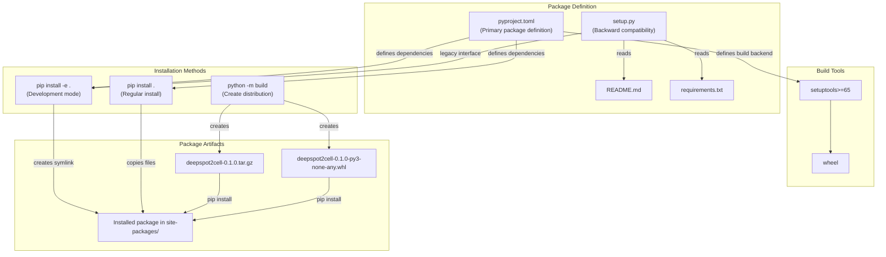
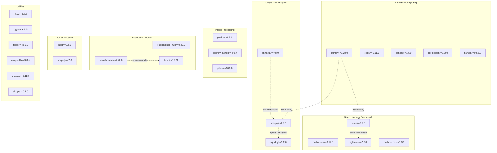
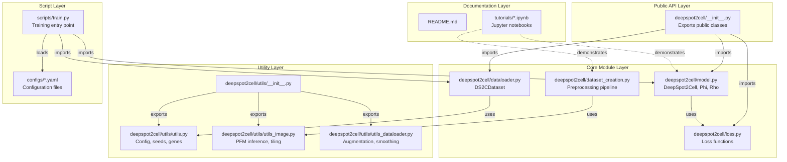
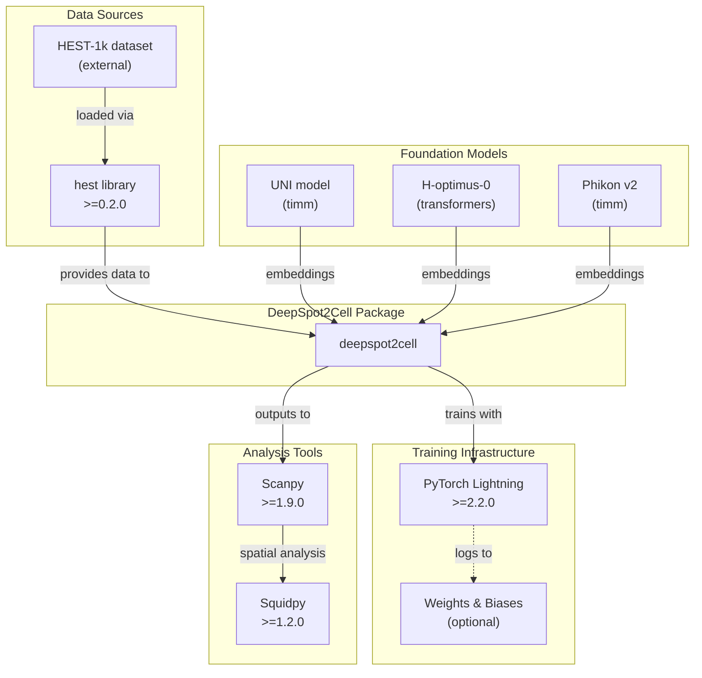

# Development Guide

<details>
<summary>Relevant source files</summary>

The following files were used as context for generating this wiki page:

- [.gitignore](.gitignore)
- [pyproject.toml](pyproject.toml)
- [setup.py](setup.py)

</details>


This guide is intended for developers who want to contribute to DeepSpot2Cell, extend its functionality, or understand its internal implementation. It covers the development workflow, environment setup, code organization principles, and packaging system.

For users who simply want to use DeepSpot2Cell for their research, see [Getting Started](#2) and [Tutorials](#3). For detailed information about the repository structure, see [Project Structure](#11.1). For dependency details, see [Dependencies and Environment](#11.2).

---

## Scope and Audience

This page covers:
- Setting up a development environment
- Package build and installation system
- Development workflow and best practices
- Code organization principles
- Making and testing changes

This guide assumes familiarity with Python package development, git version control, and conda/pip package managers.

---

## Development Environment Setup

DeepSpot2Cell uses a standard Python development workflow with conda for environment management and modern Python packaging tools.

### Initial Setup

**1. Clone the Repository**

```bash
git clone https://github.com/ratschlab/DeepSpot2Cell.git
cd DeepSpot2Cell
```

**2. Create Development Environment**

The repository uses conda for managing system-level dependencies and CUDA:

```bash
conda env create -f environment.yaml
conda activate deepspot2cell
```

**3. Install in Editable Mode**

For development, install the package in editable mode so changes to the source code are immediately reflected:

```bash
pip install -e .
```

For development with additional tools (code formatting, linting):

```bash
pip install -e ".[dev]"
```

This installs optional development dependencies defined in [pyproject.toml:43-44]().

**Sources:** [pyproject.toml:1-48](), [setup.py:1-21]()

---

## Package Build System

DeepSpot2Cell uses modern Python packaging standards with both `pyproject.toml` (PEP 517/518) and a traditional `setup.py` for backward compatibility.

### Build System Architecture



**Diagram: Package Build System**

**Sources:** [pyproject.toml:1-48](), [setup.py:1-21]()

### Package Metadata

The package is defined with the following metadata:

| Property | Value | Location |
|----------|-------|----------|
| Name | `deepspot2cell` | [pyproject.toml:6]() |
| Version | `0.1.0` | [pyproject.toml:7]() |
| Python Requirement | `>=3.9` | [pyproject.toml:11]() |
| Build Backend | `setuptools.build_meta` | [pyproject.toml:3]() |
| Package Finder | `setuptools.packages.find` | [pyproject.toml:46]() |

### Included Packages

The package finder is configured to include:
- `deepspot2cell` (main package)
- `deepspot2cell.*` (all subpackages)

This is defined in [pyproject.toml:46-47]() using setuptools' package discovery.

**Sources:** [pyproject.toml:5-11](), [pyproject.toml:46-47](), [setup.py:16]()

---

## Dependency Management

DeepSpot2Cell has a comprehensive set of dependencies organized by category:

### Core Dependencies



**Diagram: Dependency Graph by Category**

For detailed dependency information and rationale, see [Dependencies and Environment](#11.2).

**Sources:** [pyproject.toml:12-41]()

---

## Development Workflow

### Making Changes

**1. Create a Feature Branch**

```bash
git checkout -b feature/my-new-feature
```

**2. Make Code Changes**

Edit source files in the `deepspot2cell/` directory. Since the package is installed in editable mode (`pip install -e .`), changes are immediately available without reinstalling.

**3. Format Code (Optional)**

If you installed the `dev` extras, use the formatting tools:

```bash
# Format with black
black deepspot2cell/

# Sort imports with isort  
isort deepspot2cell/
```

These tools are defined in [pyproject.toml:44]() as optional dependencies.

**4. Test Changes**

Run your changes with example data or notebooks to verify functionality. Currently, the repository does not include a formal test suite.

**5. Commit and Push**

```bash
git add .
git commit -m "Add new feature"
git push origin feature/my-new-feature
```

### File Exclusions

The `.gitignore` file excludes common development artifacts:

| Pattern | Purpose |
|---------|---------|
| `__pycache__/`, `*.pyc`, `*.pyo` | Python bytecode |
| `*.so` | Compiled extensions |
| `env/`, `.venv/` | Virtual environments |
| `runs/`, `outputs/` | Training outputs |
| `.DS_Store` | macOS metadata |
| `*.zip` | Compressed archives |

**Sources:** [.gitignore:1-10](), [pyproject.toml:43-44]()

---

## Code Organization Principles

DeepSpot2Cell follows a modular architecture with clear separation of concerns:



**Diagram: Code Organization and Import Structure**

### Design Principles

1. **Modular Components**: Each core module (`model.py`, `dataloader.py`, `loss.py`) is self-contained
2. **Public API**: The `__init__.py` files define the public interface, hiding implementation details
3. **Utilities Separation**: Helper functions are organized by purpose (image processing, data loading, general)
4. **Configuration-Driven**: YAML files control behavior without code changes
5. **Script Separation**: Training/inference scripts are separate from library code

For detailed file structure, see [Project Structure](#11.1).

**Sources:** [pyproject.toml:46-47](), [setup.py:16]()

---

## Making Contributions

### Contribution Workflow


**Diagram: Contribution Process**

### Adding New Features

When extending DeepSpot2Cell:

1. **Core Model Changes**: Modify `deepspot2cell/model.py` for architecture changes
2. **New Loss Functions**: Add to `deepspot2cell/loss.py` and update imports
3. **Data Processing**: Extend `deepspot2cell/dataloader.py` or `dataset_creation.py`
4. **New Utilities**: Add to appropriate `utils/*.py` file and export via `utils/__init__.py`
5. **Documentation**: Update relevant wiki pages and docstrings

### Best Practices

- **Maintain Backward Compatibility**: Avoid breaking changes to public APIs
- **Add Docstrings**: Document new functions and classes
- **Update Configuration**: Add new parameters to YAML schemas if needed
- **Test with Example Data**: Verify changes work with HEST-1k samples
- **Follow Existing Style**: Match the coding style of existing modules

---

## Package Installation Modes

DeepSpot2Cell supports multiple installation modes for different use cases:

### Installation Mode Comparison

| Mode | Command | Use Case | Code Changes |
|------|---------|----------|--------------|
| **Editable** | `pip install -e .` | Development, testing | Immediately reflected |
| **Editable + Dev** | `pip install -e ".[dev]"` | Development with formatting tools | Immediately reflected |
| **Regular** | `pip install .` | Production use | Requires reinstall |
| **From Source** | `pip install git+https://github.com/...` | Installing from repository | N/A |
| **From Wheel** | `pip install deepspot2cell-0.1.0-*.whl` | Distributing package | N/A |

### Building Distribution Packages

To create distribution packages for sharing:

```bash
# Install build tools
pip install build

# Create source distribution and wheel
python -m build

# Outputs created in dist/:
# - deepspot2cell-0.1.0.tar.gz (source)
# - deepspot2cell-0.1.0-py3-none-any.whl (wheel)
```

**Sources:** [pyproject.toml:1-4](), [setup.py:9-20]()

---

## Environment Management

### Python Version Compatibility

DeepSpot2Cell requires Python 3.9 or later, as specified in [pyproject.toml:11]() and [setup.py:18]().

### Managing Dependencies

**Adding New Dependencies:**

1. Add to `dependencies` list in [pyproject.toml:12-41]()
2. Add to `requirements.txt` if maintaining backward compatibility
3. Update `environment.yaml` if conda-specific packages are needed

**Updating Dependencies:**

```bash
# Update all packages to latest compatible versions
pip install --upgrade -e .

# Or update specific package
pip install --upgrade torch
```

### Isolated Development

For testing with different dependency versions:

```bash
# Create isolated environment
conda create -n ds2c-test python=3.9
conda activate ds2c-test

# Install with specific versions
pip install -e .
```

**Sources:** [pyproject.toml:11-41](), [setup.py:7-18]()

---

## Integration Points

### External System Integration

DeepSpot2Cell integrates with several external systems:



**Diagram: External Integration Architecture**

For details on HEST integration, see [HEST-1k Dataset](#10.1). For PFM integration, see [Pathology Foundation Models](#10.2).

**Sources:** [pyproject.toml:12-41]()

---

## Build System Details

### setuptools Configuration

The package uses setuptools with automatic package discovery:

```python
# From pyproject.toml
[tool.setuptools.packages.find]
include = ["deepspot2cell", "deepspot2cell.*"]
```

This configuration:
- Includes the main `deepspot2cell` package
- Includes all subpackages (`deepspot2cell.utils`, etc.)
- Excludes test directories and other non-package files

### Package Data

The `setup.py` includes `include_package_data=True` ([setup.py:19]()), which includes non-Python files specified in `MANIFEST.in` or tracked by version control.

### Version Management

The version is currently hardcoded as `0.1.0` in both [pyproject.toml:7]() and [setup.py:11](). For production releases, consider using dynamic versioning tools like `setuptools_scm`.

**Sources:** [pyproject.toml:46-47](), [setup.py:9-20]()

---

## Development Tools

### Optional Development Dependencies

The package defines optional development dependencies in [pyproject.toml:43-44]():

| Tool | Purpose |
|------|---------|
| `black` | Code formatting |
| `isort` | Import sorting |
| `nbstripout` | Strip Jupyter notebook outputs |

Install these with:
```bash
pip install -e ".[dev]"
```

### Recommended Workflow Tools

While not included in the package, developers may find these tools useful:

- **Version Control**: Git with feature branches
- **Debugging**: PyCharm, VSCode, or pdb
- **Profiling**: cProfile, line_profiler for performance analysis
- **Documentation**: Jupyter notebooks for examples

**Sources:** [pyproject.toml:43-44]()

---

## License and Legal

DeepSpot2Cell is released under the MIT License. For full license terms, see [License](#11.3).

Key points:
- **Open Source**: Free to use, modify, and distribute
- **Commercial Use**: Allowed
- **Attribution**: Required
- **No Warranty**: Software provided "as is"

When contributing, ensure:
- Your contributions are your own work or properly licensed
- You agree to license contributions under the MIT License
- Third-party dependencies are compatible with MIT License

**Sources:** License information is detailed in page [11.3](#11.3)

---

## Next Steps

For more detailed information about development topics:

- **File Organization**: See [Project Structure](#11.1) for detailed repository layout
- **Dependency Details**: See [Dependencies and Environment](#11.2) for comprehensive dependency information
- **Usage Guides**: See [Getting Started](#2) and [Tutorials](#3) for using the package
- **API Documentation**: See [API Reference](#9) for function and class documentation

To start contributing, begin with the [Installation and Setup](#2.1) guide, then explore the codebase using the [Project Structure](#11.1) documentation.

---