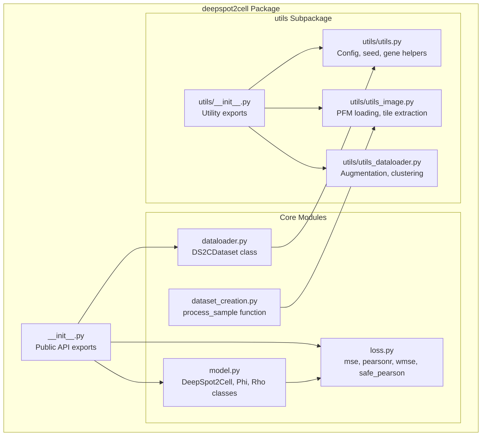
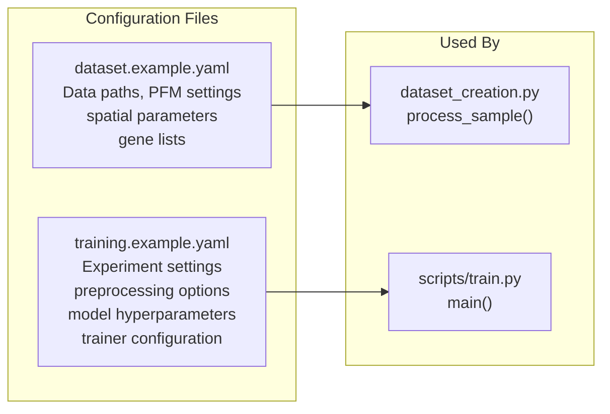
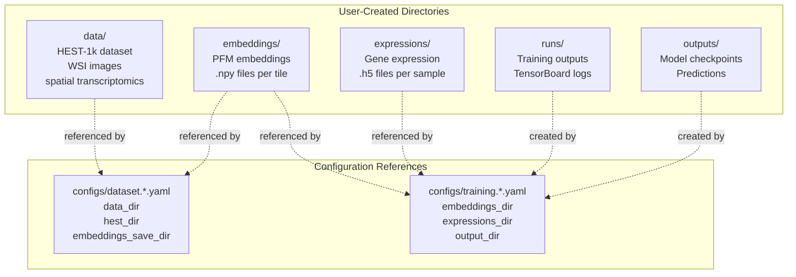
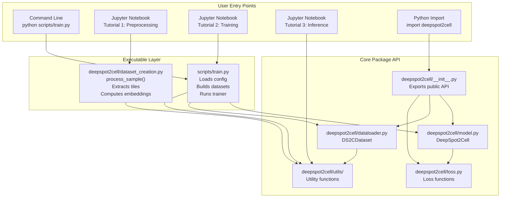

# Project Structure

<details>
<summary>Relevant source files</summary>

The following files were used as context for generating this wiki page:

- [.gitignore](.gitignore)
- [README.md](README.md)
- [pyproject.toml](pyproject.toml)
- [setup.py](setup.py)

</details>


This document explains the organization of the DeepSpot2Cell repository, detailing the purpose of each directory and key files. This information is intended for developers who want to understand the codebase layout, contribute to the project, or extend its functionality.

For information about the dependencies and how to set up the development environment, see [Dependencies and Environment](#11.2). For details about the actual code modules and their APIs, see [API Reference](#9).

---

## Repository Overview

The DeepSpot2Cell repository follows a standard Python package structure with clear separation between the installable package, executables, configuration, and documentation.

```mermaid
graph TB
    ROOT["Repository Root"]
    
    subgraph "Core Package"
        PKG["deepspot2cell/"]
        PKG_INIT["deepspot2cell/__init__.py"]
        PKG_MODEL["deepspot2cell/model.py"]
        PKG_LOSS["deepspot2cell/loss.py"]
        PKG_LOADER["deepspot2cell/dataloader.py"]
        PKG_DATASET["deepspot2cell/dataset_creation.py"]
        PKG_UTILS["deepspot2cell/utils/"]
    end
    
    subgraph "Executables"
        SCRIPTS["scripts/"]
        TRAIN["scripts/train.py"]
    end
    
    subgraph "Configuration"
        CONFIGS["configs/"]
        CONFIG_DS["configs/dataset.example.yaml"]
        CONFIG_TR["configs/training.example.yaml"]
    end
    
    subgraph "Documentation"
        README["README.md"]
        TUTORIALS["tutorials/"]
        TUT1["tutorials/...1_preprocessing.ipynb"]
        TUT2["tutorials/...2_training.ipynb"]
        TUT3["tutorials/...3_inference.ipynb"]
        FIGURES["figures/"]
    end
    
    subgraph "Build and Environment"
        SETUP["setup.py"]
        PYPROJECT["pyproject.toml"]
        ENV["environment.yaml"]
        REQUIREMENTS["requirements.txt"]
    end
    
    subgraph "Development"
        GITIGNORE[".gitignore"]
        LICENSE["LICENSE"]
    end
    
    ROOT --> PKG
    ROOT --> SCRIPTS
    ROOT --> CONFIGS
    ROOT --> README
    ROOT --> TUTORIALS
    ROOT --> SETUP
    ROOT --> GITIGNORE
    
    PKG --> PKG_INIT
    PKG --> PKG_MODEL
    PKG --> PKG_LOSS
    PKG --> PKG_LOADER
    PKG --> PKG_DATASET
    PKG --> PKG_UTILS
    
    SCRIPTS --> TRAIN
    
    CONFIGS --> CONFIG_DS
    CONFIGS --> CONFIG_TR
    
    TUTORIALS --> TUT1
    TUTORIALS --> TUT2
    TUTORIALS --> TUT3
    
    README --> FIGURES
```



**Sources**: [README.md:1-70](), [pyproject.toml:1-48](), [setup.py:1-21](), [.gitignore:1-10]()

---

## Root Directory Structure

The following table summarizes the top-level directories and files in the repository:

| Path | Type | Purpose |
|------|------|---------|
| `deepspot2cell/` | Directory | Core Python package containing all model, data, and utility code |
| `scripts/` | Directory | Command-line scripts for training and other operations |
| `configs/` | Directory | YAML configuration files for dataset processing and training |
| `tutorials/` | Directory | Jupyter notebooks demonstrating the complete workflow |
| `figures/` | Directory | Images and diagrams used in documentation |
| `setup.py` | File | Legacy setuptools installation script |
| `pyproject.toml` | File | Modern Python project configuration (PEP 518) |
| `environment.yaml` | File | Conda environment specification |
| `requirements.txt` | File | Python package dependencies |
| `README.md` | File | Main project documentation and quick-start guide |
| `LICENSE` | File | MIT license text |
| `.gitignore` | File | Git exclusion patterns |

**Sources**: [README.md:1-70](), [pyproject.toml:1-48](), [setup.py:1-21]()

---

## Core Package: `deepspot2cell/`

The `deepspot2cell` package is the installable Python library that contains all core functionality. It is organized into modules by responsibility.



**Sources**: [pyproject.toml:46-47](), [setup.py:16]()

### Module Responsibilities

#### `__init__.py`
The package initialization file exports the main public API. This provides a clean interface for users to import key classes and functions without needing to know the internal module structure.

**Key exports**:
- `DeepSpot2Cell`, `Phi`, `Rho` from `model.py`
- `DS2CDataset` from `dataloader.py`
- Loss functions from `loss.py`

#### `model.py`
Contains the neural network architecture classes:
- `DeepSpot2Cell`: Main PyTorch Lightning module implementing the complete training/inference pipeline
- `Phi`: Ensemble module for processing individual scale features (cell, spot, neighbor)
- `Rho`: Ensemble module for aggregating multi-scale features

For detailed architecture information, see [DeepSpot2Cell Model Architecture](#4.1).

#### `loss.py`
Implements loss functions and evaluation metrics:
- `mse()`: Mean squared error loss
- `pearsonr()`: Pearson correlation coefficient
- `wmse()`: Weighted mean squared error
- `safe_pearson()`: Pearson correlation with numerical stability

For detailed loss function documentation, see [Loss Functions](#4.3).

#### `dataloader.py`
Defines the `DS2CDataset` class, which handles:
- Loading morphological embeddings (`.npy` files)
- Loading gene expression data (`.h5` files)
- Batch processing with padding and masking
- Neighbor spot loading and spatial context

For detailed dataset documentation, see [DS2CDataset and Data Loading](#4.2).

#### `dataset_creation.py`
Provides the `process_sample()` function for preprocessing:
- Extracting tiles from whole-slide images
- Computing embeddings using pathology foundation models
- Generating expression matrices
- Spatial quality filtering

For detailed preprocessing documentation, see [Dataset Creation](#5.1).

#### `utils/` Subpackage
Contains utility modules organized by functionality:

| Module | Purpose | Key Functions/Classes |
|--------|---------|----------------------|
| `utils.py` | General utilities | `load_config()`, `fix_seed()`, `get_ordered_genes()` |
| `utils_image.py` | Image processing | `load_model()`, `compute_tiles()`, `predict_spot()`, `predict_cell()` |
| `utils_dataloader.py` | Data loading helpers | `pickle_load()`, `cluster_method()`, `cluster_aestetik()`, `get_balanced_sample()` |

For detailed utility documentation, see [Utility Modules](#7).

**Sources**: [pyproject.toml:46-47](), [setup.py:16]()

---

## Scripts Directory: `scripts/`

The `scripts/` directory contains executable Python scripts for command-line usage.

### `train.py`
The main training script that orchestrates the complete training workflow:
1. Parses command-line arguments
2. Loads configuration from YAML files
3. Builds `DS2CDataset` instances for train/validation/test splits
4. Instantiates the `DeepSpot2Cell` model
5. Configures PyTorch Lightning `Trainer` with callbacks
6. Executes training loop
7. Saves trained model checkpoints

**Usage**:
```bash
python scripts/train.py --config configs/training.example.yaml
```

For detailed training script documentation, see [Training Script](#8.1).

**Sources**: [README.md:24-33]()

---

## Configuration Directory: `configs/`

The `configs/` directory contains YAML configuration files that control dataset processing and model training.



### Configuration File Types

| File Pattern | Purpose | Key Sections |
|--------------|---------|--------------|
| `dataset.*.yaml` | Dataset creation configuration | `data_dir`, `model_name`, `pixel_size`, `num_genes`, `train_ids`, `val_ids`, `test_ids` |
| `training.*.yaml` | Training configuration | `experiment_name`, `dataset_config`, `preprocessing`, `dataloader`, `model`, `trainer` |

Users should copy the example files and modify paths and parameters for their specific use case:
```bash
cp configs/dataset.example.yaml configs/dataset.my_experiment.yaml
cp configs/training.example.yaml configs/training.my_experiment.yaml
```

For detailed configuration documentation, see [Dataset Configuration](#6.1) and [Training Configuration](#6.2).

**Sources**: [README.md:45-51]()

---

## Documentation and Tutorials

### `README.md`
The main project documentation file located at the repository root. It provides:
- Project overview and citation information
- Installation instructions
- Links to tutorials
- Information about external dependencies (HEST-1k, PFMs)

**Sources**: [README.md:1-70]()

### `tutorials/` Directory
Contains three Jupyter notebooks that guide users through the complete workflow:

| Notebook | Tutorial | Purpose |
|----------|----------|---------|
| `GettingStartedWithDeepSpot2Cell_1_preprocessing.ipynb` | Tutorial 1 | Data preprocessing and embedding generation |
| `GettingStartedWithDeepSpot2Cell_2_training.ipynb` | Tutorial 2 | Model training with configuration |
| `GettingStartedWithDeepSpot2Cell_3_inference.ipynb` | Tutorial 3 | Cell-level prediction and visualization |

These notebooks provide interactive, executable documentation with example outputs. For detailed tutorial documentation, see [Tutorials](#3).

**Sources**: [README.md:24-33]()

### `figures/` Directory
Contains images and diagrams used in documentation, including the architecture diagram shown in the README.

**Sources**: [README.md:7]()

---

## Build and Installation Files

### Package Definition Files

The repository uses both modern (`pyproject.toml`) and legacy (`setup.py`) Python packaging standards for maximum compatibility.

#### `pyproject.toml`
The modern Python project configuration file (PEP 518, PEP 621) that defines:
- Package metadata: name, version, description, authors
- Dependencies with version constraints
- Build system requirements
- Package discovery rules

**Key configuration sections**:
```toml
[project]
name = "deepspot2cell"
version = "0.1.0"
requires-python = ">=3.9"
dependencies = [...]

[project.optional-dependencies]
dev = [...]

[tool.setuptools.packages.find]
include = ["deepspot2cell", "deepspot2cell.*"]
```

**Sources**: [pyproject.toml:1-48]()

#### `setup.py`
The legacy setuptools configuration that reads from `pyproject.toml` and `requirements.txt` for backward compatibility. It dynamically loads the README for long description and requirements from the text file.

**Key operations**:
- Reads `README.md` for package description
- Reads `requirements.txt` for dependencies
- Configures package discovery to include `deepspot2cell` and subpackages

**Sources**: [setup.py:1-21]()

### Environment Files

#### `environment.yaml`
Conda environment specification file referenced in the installation instructions. Users create the environment with:
```bash
conda env create -f environment.yaml
conda activate deepspot2cell
```

#### `requirements.txt`
Python package dependencies in pip format. These are installed after the conda environment with:
```bash
pip install -e .
```

The `pyproject.toml` file contains the canonical list of dependencies, which includes:
- **Deep Learning**: `torch`, `torchvision`, `lightning`, `torchmetrics`
- **Scientific Computing**: `numpy`, `scipy`, `pandas`, `scikit-learn`
- **Bioinformatics**: `anndata`, `scanpy`, `squidpy`, `hest`
- **Vision Models**: `timm`, `transformers`, `huggingface_hub`
- **Image Processing**: `pyvips`, `opencv-python`, `pillow`
- **Utilities**: `h5py`, `pyyaml`, `tqdm`, `einops`

For detailed dependency documentation, see [Dependencies and Environment](#11.2).

**Sources**: [README.md:18-22](), [pyproject.toml:12-41](), [setup.py:7]()

---

## Development Files

### `.gitignore`
Specifies intentionally untracked files that Git should ignore. The file excludes:

| Pattern | Purpose |
|---------|---------|
| `__pycache__/`, `*.py[cod]`, `*.so` | Python bytecode and compiled extensions |
| `*.zip` | Compressed archives (likely data files) |
| `.DS_Store` | macOS system files |
| `runs/`, `outputs/` | Training outputs and experiment results |
| `env/`, `.venv/` | Virtual environment directories |

**Note**: The `runs/` and `outputs/` directories are where training artifacts and model checkpoints are typically saved but are not committed to version control due to their size and user-specific nature.

**Sources**: [.gitignore:1-10]()

### `LICENSE`
Contains the MIT License text, granting broad permissions for use, modification, and distribution of the codebase.

For license details, see [License](#11.3).

---

## Data and Output Directories (Not in Repository)

While not present in the repository, the following directories are created and used during operation:



These directories are excluded from version control via `.gitignore` patterns and must be configured by users in their YAML configuration files. Typical locations are specified in the example configuration files.

**Sources**: [.gitignore:6-7](), [README.md:48-51]()

---

## Entry Points and Module Flow

The following diagram shows how different entry points in the repository connect to the core package:



This structure allows users to:
1. **Run pre-built workflows** via command-line scripts
2. **Interact with examples** via tutorial notebooks
3. **Import and extend** the core package in custom code

The clean separation between executable scripts, tutorial notebooks, and the core package enables both ease of use for beginners and flexibility for advanced users.

**Sources**: [README.md:18-33](), [pyproject.toml:46-47]()

---

## Summary

The DeepSpot2Cell repository is organized with clear separation of concerns:

- **`deepspot2cell/`**: Installable Python package with core functionality
- **`scripts/`**: Command-line executables for training
- **`configs/`**: YAML configuration files
- **`tutorials/`**: Interactive Jupyter notebook guides
- **Root files**: Package metadata, installation configuration, and documentation

This structure supports multiple usage patterns: quick start via tutorials, production training via command-line scripts, and custom integration via Python imports. All configuration is externalized to YAML files, and computationally expensive preprocessing outputs are separated from the repository for efficient version control.

---