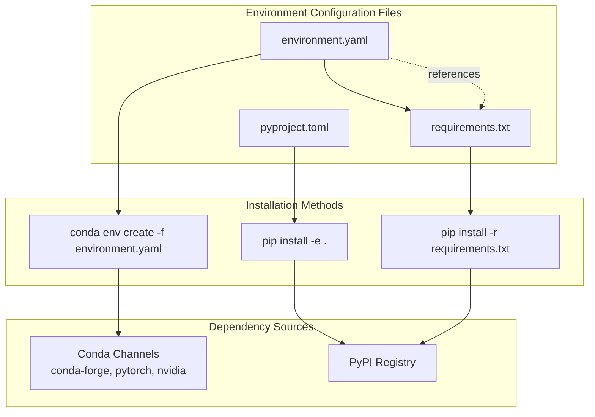
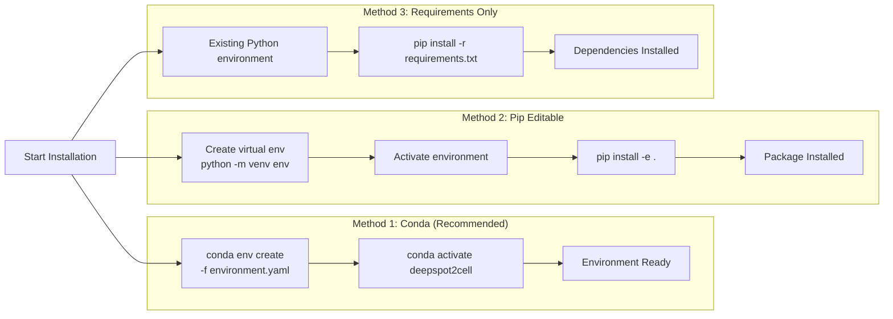
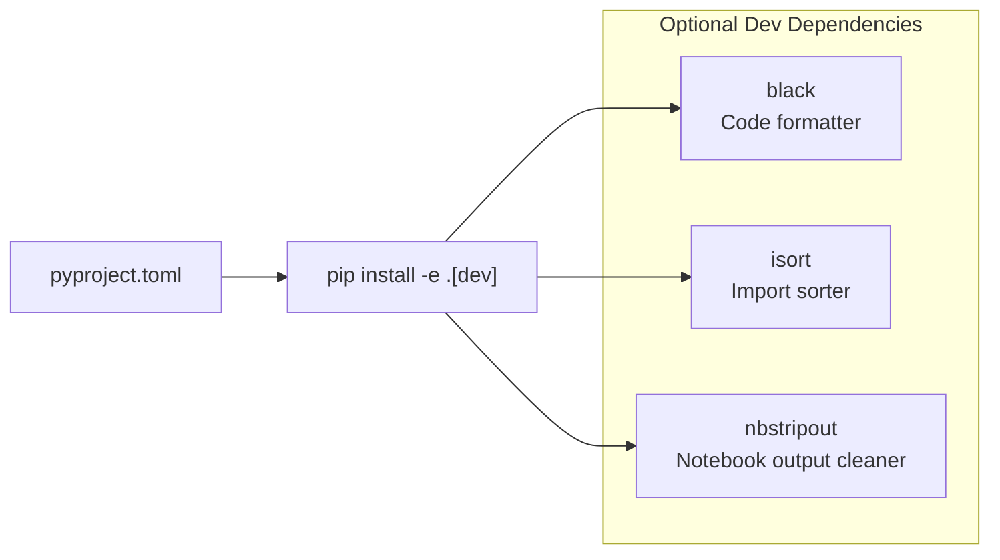
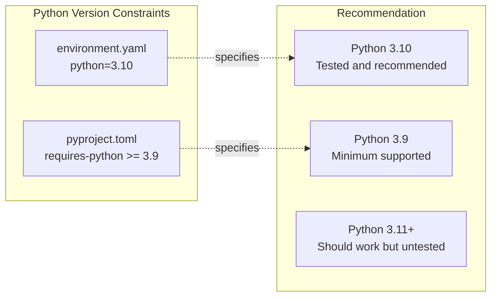
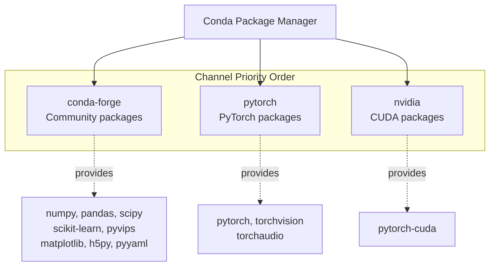
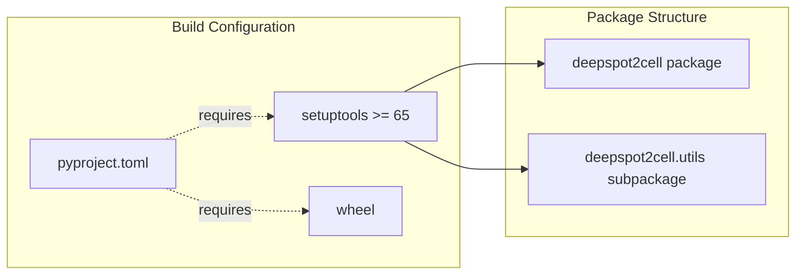
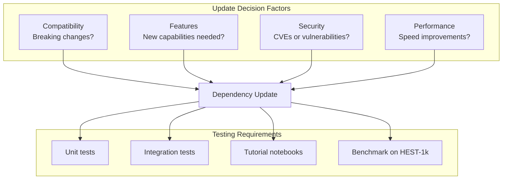

# Dependencies and Environment

<details>
<summary>Relevant source files</summary>

The following files were used as context for generating this wiki page:

- [environment.yaml](environment.yaml)
- [pyproject.toml](pyproject.toml)
- [requirements.txt](requirements.txt)

</details>


This document provides detailed information about all dependencies required by DeepSpot2Cell and explains how to manage the development environment. It covers installation methods, dependency categories, version constraints, and platform-specific considerations.

For installation instructions and quick setup, see [Installation and Setup](#2.1). For the overall project structure, see [Project Structure](#11.1).

## Purpose and Scope

This page documents:
- All required and optional dependencies with version constraints
- The purpose and role of each dependency category in the system
- Environment configuration files (`environment.yaml`, `pyproject.toml`, `requirements.txt`)
- Installation workflows for different use cases
- Platform-specific considerations (CPU vs GPU, operating systems)
- Development-specific dependencies

## Environment Configuration Files

DeepSpot2Cell provides multiple configuration files for different installation methods and use cases.

### Configuration File Overview



**Sources:** [environment.yaml:1-32](), [pyproject.toml:1-48](), [requirements.txt:1-29]()

| File | Purpose | Primary Use Case |
|------|---------|------------------|
| `environment.yaml` | Conda environment specification | Full environment setup with conda packages and CUDA support |
| `pyproject.toml` | Python package metadata and dependencies | Editable installation for development (`pip install -e .`) |
| `requirements.txt` | Pip-installable dependencies | Installation in existing Python environments or CI/CD |

### Installation Workflow



**Sources:** [environment.yaml:1-32](), [pyproject.toml:1-48]()

## Core Dependencies

DeepSpot2Cell's dependencies are organized into functional categories based on their role in the system.

### Dependency Categories and System Components

```mermaid
graph TB
    subgraph "Deep Learning Framework"
        TORCH["torch >= 2.2.0"]
        TORCHVISION["torchvision >= 0.17.0"]
        TORCHAUDIO["torchaudio >= 2.2.0"]
        LIGHTNING["lightning >= 2.2.0"]
        TORCHMETRICS["torchmetrics >= 1.3.0"]
        CUDA["pytorch-cuda = 12.4"]
    end
    
    subgraph "Scientific Computing"
        NUMPY["numpy >= 1.23.0"]
        PANDAS["pandas >= 1.5.0"]
        SCIPY["scipy >= 1.11.0"]
        SKLEARN["scikit-learn >= 1.2.0"]
        NUMBA["numba >= 0.56.0"]
        LLVM["llvmlite >= 0.39.0"]
    end
    
    subgraph "Single-Cell Analysis"
        ANNDATA["anndata >= 0.8.0"]
        SCANPY["scanpy >= 1.9.0"]
        SQUIDPY["squidpy >= 1.2.0"]
    end
    
    subgraph "Image Processing"
        PYVIPS["pyvips >= 2.2.1"]
        OPENCV["opencv-python >= 4.9.0"]
        PILLOW["pillow >= 10.0.0"]
        SHAPELY["shapely >= 2.0"]
    end
    
    subgraph "Foundation Models"
        HF_HUB["huggingface_hub >= 0.23.0"]
        TRANSFORMERS["transformers >= 4.42.0"]
        TIMM["timm >= 0.9.12"]
        EINOPS["einops >= 0.7.0"]
    end
    
    subgraph "Spatial Transcriptomics"
        HEST["hest >= 0.2.0"]
    end
    
    subgraph "Utilities"
        H5PY["h5py >= 3.8.0"]
        YAML["pyyaml >= 6.0"]
        TQDM["tqdm >= 4.65.0"]
        MATPLOTLIB["matplotlib >= 3.8.0"]
        PLOTNINE["plotnine >= 0.12.0"]
    end
    
    subgraph "DeepSpot2Cell Components"
        MODEL["deepspot2cell/model.py<br/>DeepSpot2Cell, Phi, Rho"]
        DATASET["deepspot2cell/dataset_creation.py<br/>process_sample"]
        DATALOADER["deepspot2cell/dataloader.py<br/>DS2CDataset"]
        UTILS_IMG["deepspot2cell/utils/utils_image.py<br/>PFM loading, inference"]
        UTILS_DATA["deepspot2cell/utils/utils_dataloader.py<br/>augmentation, clustering"]
    end
    
    TORCH --> MODEL
    LIGHTNING --> MODEL
    TORCHMETRICS --> MODEL
    
    NUMPY --> DATALOADER
    PANDAS --> DATASET
    SCIPY --> UTILS_DATA
    SKLEARN --> UTILS_DATA
    NUMBA --> UTILS_DATA
    
    ANNDATA --> DATALOADER
    SCANPY --> UTILS_DATA
    SQUIDPY --> UTILS_DATA
    
    PYVIPS --> DATASET
    OPENCV --> UTILS_IMG
    PILLOW --> UTILS_IMG
    SHAPELY --> DATASET
    
    HF_HUB --> UTILS_IMG
    TRANSFORMERS --> UTILS_IMG
    TIMM --> UTILS_IMG
    EINOPS --> MODEL
    
    HEST --> DATASET
    
    H5PY --> DATALOADER
    YAML --> MODEL
    TQDM --> DATASET
    MATPLOTLIB --> UTILS_DATA
```



**Sources:** [requirements.txt:1-29](), [pyproject.toml:12-41]()

### Deep Learning Framework

The deep learning framework forms the foundation of the model training and inference pipeline.

| Package | Version | Purpose in DeepSpot2Cell |
|---------|---------|--------------------------|
| `torch` | ≥2.2.0 | Core tensor operations, neural network modules, autograd |
| `torchvision` | ≥0.17.0 | Image transformations and utilities |
| `torchaudio` | ≥2.2.0 | Required PyTorch dependency (not directly used) |
| `lightning` | ≥2.2.0 | Training orchestration via `LightningModule` in `DeepSpot2Cell` class |
| `torchmetrics` | ≥1.3.0 | Metric computation (Pearson correlation, MSE) |
| `pytorch-cuda` | 12.4 | CUDA support for GPU acceleration (optional, conda only) |

**Key Usage:**
- `DeepSpot2Cell` inherits from `lightning.LightningModule` ([model.py:27]())
- All model components (`Phi`, `Rho`) use `torch.nn.Module`
- Loss functions in [loss.py]() use torch operations
- Training loop in [scripts/train.py]() uses `lightning.Trainer`

**Sources:** [requirements.txt:1-5](), [environment.yaml:11-14](), [pyproject.toml:13-17]()

### Scientific Computing

Scientific computing libraries provide numerical operations and data structures.

| Package | Version | Purpose in DeepSpot2Cell |
|---------|---------|--------------------------|
| `numpy` | ≥1.23.0 | Array operations, embedding storage (.npy files) |
| `pandas` | ≥1.5.0 | Data frame operations, metadata handling |
| `scipy` | ≥1.11.0 | Statistical functions, spatial operations |
| `scikit-learn` | ≥1.2.0 | Preprocessing (StandardScaler, MinMaxScaler), clustering |
| `numba` | ≥0.56.0 | JIT compilation for performance-critical operations |
| `llvmlite` | ≥0.39.0 | Required by numba for compilation |

**Key Usage:**
- Embeddings saved as `.npy` files in [dataset_creation.py]()
- `StandardScaler` and `MinMaxScaler` used in [dataloader.py]() for normalization
- Spatial upsampling and smoothing in [utils/utils_dataloader.py]() use scipy
- Clustering methods use scikit-learn's KMeans

**Sources:** [requirements.txt:6-11](), [environment.yaml:15-20](), [pyproject.toml:18-23]()

### Single-Cell Analysis

Single-cell analysis libraries handle spatial transcriptomics data structures and operations.

| Package | Version | Purpose in DeepSpot2Cell |
|---------|---------|--------------------------|
| `anndata` | ≥0.8.0 | AnnData objects for gene expression storage |
| `scanpy` | ≥1.9.0 | Single-cell analysis workflows, normalization |
| `squidpy` | ≥1.2.0 | Spatial transcriptomics analysis tools |

**Key Usage:**
- Expression data stored in AnnData format (.h5ad files)
- `DS2CDataset` loads `.h5` files containing expression matrices
- Clustering and preprocessing utilities in [utils/utils_dataloader.py]() use scanpy
- Spatial smoothing operations use squidpy functions

**Sources:** [requirements.txt:12-14](), [environment.yaml:21-23](), [pyproject.toml:24-26]()

### Image Processing

Image processing libraries handle whole slide image operations and tile extraction.

| Package | Version | Purpose in DeepSpot2Cell |
|---------|---------|--------------------------|
| `pyvips` | ≥2.2.1 | Fast whole slide image (WSI) reading and manipulation |
| `opencv-python` | ≥4.9.0 | Image operations, color space conversions |
| `pillow` | ≥10.0.0 | Image I/O and basic transformations |
| `shapely` | ≥2.0 | Geometric operations for spatial filtering |

**Key Usage:**
- `pyvips` used in [dataset_creation.py]() for efficient WSI tile extraction
- `compute_tile_at_spot()` function in [utils/utils_image.py]() uses pyvips
- Shapely used for spatial containment checks during tile generation
- OpenCV for image preprocessing and augmentation

**Sources:** [requirements.txt:19-22](), [environment.yaml:25-27](), [pyproject.toml:31-34]()

### Foundation Models

Foundation model libraries enable integration with pathology foundation models (PFMs).

| Package | Version | Purpose in DeepSpot2Cell |
|---------|---------|--------------------------|
| `huggingface_hub` | ≥0.23.0 | Download and cache pretrained models from HuggingFace |
| `transformers` | ≥4.42.0 | Vision transformer models (H-optimus-0) |
| `timm` | ≥0.9.12 | Image models library (UNI, Phikon v2) |
| `einops` | ≥0.7.0 | Tensor operations for model architectures |

**Key Usage:**
- `load_pfm_model()` in [utils/utils_image.py]() loads UNI, H-optimus-0, or Phikon v2
- `predict_patch_pfm()` computes morphological embeddings
- Model architectures from timm and transformers
- Einops used in `Phi` module for tensor reshaping

**Sources:** [requirements.txt:23-27](), [pyproject.toml:35-39]()

### Spatial Transcriptomics

The HEST library provides access to the HEST-1k dataset and spatial transcriptomics utilities.

| Package | Version | Purpose in DeepSpot2Cell |
|---------|---------|--------------------------|
| `hest` | ≥0.2.0 | HEST-1k dataset access, spatial transcriptomics utilities |

**Key Usage:**
- Dataset loading and processing in [dataset_creation.py]()
- Integration with HEST-1k benchmarking data
- Spatial transcriptomics data structures and alignment

**Sources:** [requirements.txt:28](), [pyproject.toml:40]()

### Utilities

Utility libraries provide supporting functionality for configuration, data storage, and visualization.

| Package | Version | Purpose in DeepSpot2Cell |
|---------|---------|--------------------------|
| `h5py` | ≥3.8.0 | HDF5 file I/O for expression data storage |
| `pyyaml` | ≥6.0 | YAML configuration file parsing |
| `tqdm` | ≥4.65.0 | Progress bars for long-running operations |
| `matplotlib` | ≥3.8.0 | Visualization and plotting |
| `plotnine` | ≥0.12.0 | Grammar of graphics plotting (ggplot2 style) |

**Key Usage:**
- Expression data saved as HDF5 in [dataset_creation.py]()
- Config files loaded in [utils/utils.py]() using `yaml.safe_load()`
- Progress tracking throughout preprocessing and training
- Visualization utilities in tutorials

**Sources:** [requirements.txt:16-18,28](), [environment.yaml:27-28](), [pyproject.toml:27-30,38]()

## Development Dependencies

Optional dependencies for development workflows are specified in `pyproject.toml`.



**Sources:** [pyproject.toml:43-44]()

| Package | Purpose |
|---------|---------|
| `black` | Code formatting for consistent style |
| `isort` | Import statement sorting and organization |
| `nbstripout` | Strip output from Jupyter notebooks before committing |

Install with: `pip install -e .[dev]`

## Platform-Specific Considerations

### GPU Support

GPU acceleration is configured through the PyTorch CUDA package.

| Platform | Configuration | Notes |
|----------|--------------|-------|
| **Conda with GPU** | `pytorch-cuda=12.4` in [environment.yaml:14]() | Requires NVIDIA GPU with CUDA 12.4+ |
| **Conda CPU-only** | Remove line 14 from environment.yaml | Comment notes removal for CPU-only |
| **Pip with GPU** | PyTorch auto-detects CUDA | Follow PyTorch installation guide for CUDA version |
| **Pip CPU-only** | Install CPU version explicitly | `pip install torch --index-url https://download.pytorch.org/whl/cpu` |

**Sources:** [environment.yaml:14]()

### Python Version Requirements



**Sources:** [environment.yaml:9](), [pyproject.toml:11]()

- **Recommended:** Python 3.10 (as specified in environment.yaml)
- **Minimum:** Python 3.9 (as specified in pyproject.toml)
- **Note:** Some dependencies may have stricter requirements

### Conda Channels

The conda environment uses three channels in priority order:



**Sources:** [environment.yaml:3-6]()

## Dependency Resolution and Compatibility

### Version Constraints Strategy

DeepSpot2Cell uses minimum version constraints (`>=`) for flexibility while ensuring compatibility.

| Constraint Type | Example | Rationale |
|----------------|---------|-----------|
| Minimum version | `torch>=2.2.0` | Ensures required features available |
| Exact version (conda only) | `pytorch-cuda=12.4` | CUDA version compatibility |
| No upper bound | Most packages | Allow patch and minor updates |

**Trade-offs:**
- **Flexibility:** Users can install newer versions with bug fixes
- **Risk:** Future versions may introduce breaking changes
- **Mitigation:** Conda environment.yaml pins specific versions when created

**Sources:** [requirements.txt:1-29](), [pyproject.toml:12-41]()

### Package Build System



**Sources:** [pyproject.toml:1-3,46-47]()

- **Build backend:** `setuptools.build_meta`
- **Package discovery:** Automatically finds `deepspot2cell` and `deepspot2cell.*` packages
- **Build requirements:** setuptools ≥65 and wheel

## Environment Management Best Practices

### Recommended Setup Workflow

1. **Create isolated environment:**
   ```bash
   conda env create -f environment.yaml
   conda activate deepspot2cell
   ```

2. **Verify installation:**
   ```bash
   python -c "import deepspot2cell; import torch; print(torch.cuda.is_available())"
   ```

3. **Install as editable package (for development):**
   ```bash
   pip install -e .
   ```

4. **Install development tools (optional):**
   ```bash
   pip install -e .[dev]
   ```

### Common Issues and Solutions

| Issue | Cause | Solution |
|-------|-------|----------|
| CUDA not available | Wrong PyTorch version or missing CUDA | Install CUDA-enabled PyTorch matching system CUDA version |
| PyVips errors | Missing system libraries | Install libvips: `conda install -c conda-forge libvips` |
| Version conflicts | Incompatible package versions | Use conda environment.yaml for consistent versions |
| Import errors | Package not installed in editable mode | Run `pip install -e .` from repository root |

## Dependency Update Considerations

When updating dependencies, consider the following constraints:



**Critical dependencies requiring careful testing:**
- PyTorch/Lightning: Model behavior may change
- Timm/Transformers: Foundation model loading compatibility
- HEST: Dataset API changes
- Scanpy/Squidpy: Expression processing behavior

**Sources:** All dependency files

---