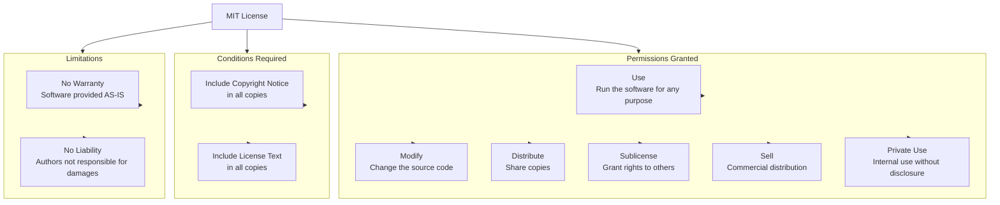
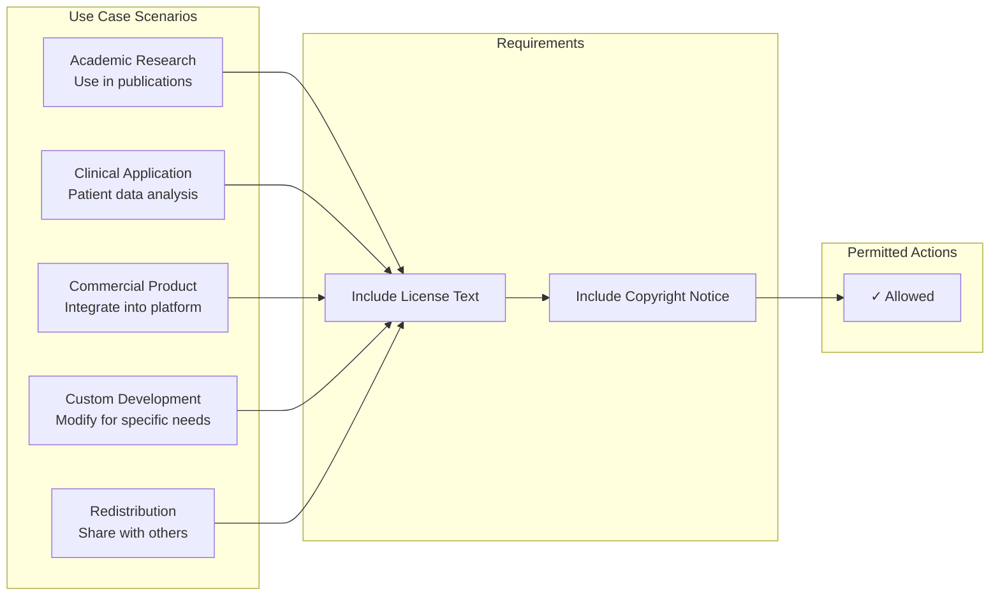
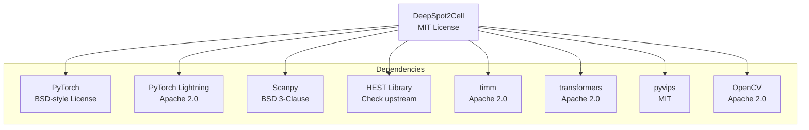

# License

<details>
<summary>Relevant source files</summary>

The following files were used as context for generating this wiki page:

- [LICENSE](LICENSE)

</details>


This document provides information about the software license governing the use, modification, and distribution of DeepSpot2Cell. This page covers the license type, copyright information, permissions granted, conditions of use, and practical implications for different use cases.

For information about dependencies and their respective licenses, see [Dependencies and Environment](#11.2).

---

## License Overview

DeepSpot2Cell is released under the **MIT License**, one of the most permissive open-source software licenses. The software is copyrighted by **Biomedical Informatics at ETH Zurich** as of **2025**.

**Sources:** [LICENSE:1-3]()

---

## License Structure

The MIT License has three main components that define how the software can be used:



**Sources:** [LICENSE:5-21]()

---

## Permissions Granted

The MIT License grants extensive permissions without restriction. Users may:

| Permission | Description | Practical Example |
|------------|-------------|-------------------|
| **Use** | Execute the software for any purpose | Run DeepSpot2Cell for research, clinical analysis, or commercial applications |
| **Copy** | Create copies of the software | Download and install on multiple machines |
| **Modify** | Alter the source code | Adapt the model architecture or add new features |
| **Merge** | Combine with other software | Integrate DeepSpot2Cell into a larger analysis pipeline |
| **Publish** | Make the software publicly available | Share modified versions on GitHub or other platforms |
| **Distribute** | Share copies with others | Provide to collaborators or clients |
| **Sublicense** | Grant licenses to downstream users | Include in a larger product with different licensing |
| **Sell** | Commercialize the software | Incorporate into a commercial product or service |

**Sources:** [LICENSE:5-10]()

---

## Conditions of Use

The MIT License requires only minimal compliance:

### Required Attribution

All copies or substantial portions of the software must include:

1. **Copyright Notice**: The original copyright statement identifying Biomedical Informatics at ETH Zurich as the copyright holder (2025).
2. **License Text**: The full MIT License text.

These requirements apply to:
- Binary distributions (compiled software packages)
- Source code distributions
- Modified versions
- Derivative works
- Documentation or other materials that incorporate the software

**Sources:** [LICENSE:11-13]()

---

## Limitations and Disclaimers

### No Warranty

The software is provided **"AS IS"** without any warranty of any kind, either express or implied. This includes, but is not limited to:

- **Merchantability**: No guarantee the software is fit for sale or use
- **Fitness for a Particular Purpose**: No guarantee it will meet specific requirements
- **Non-infringement**: No guarantee it doesn't violate third-party rights

### No Liability

The copyright holders and authors are not liable for:

- Claims arising from the software
- Damages of any kind (direct, indirect, incidental, special, or consequential)
- Issues arising from the use, modification, or distribution of the software
- Problems in connection with the software or its dealings

This applies whether liability is based on contract, tort, or other legal theories.

**Sources:** [LICENSE:15-21]()

---

## Practical Implications



**Sources:** [LICENSE:1-21]()

### For Academic Researchers

- **Permitted**: Use DeepSpot2Cell for research, publish results, modify the code for experiments
- **Required**: Include the MIT License and copyright notice if distributing modified code or incorporating it into other tools
- **Note**: Citation of the original work in publications is encouraged but not legally required by the license

### For Commercial Users

- **Permitted**: Use DeepSpot2Cell in commercial products, modify for proprietary applications, charge for services based on the software
- **Required**: Include the license and copyright notice in any distribution
- **Note**: You may apply additional terms to your modifications, but the original code remains under MIT License

### For Developers Creating Derivative Works

- **Permitted**: Fork the repository, create modified versions, combine with other software
- **Required**: Maintain the copyright notice and license text in all copies
- **Recommendation**: Clearly document changes made to help users understand differences from the original

### For Internal/Private Use

- **Permitted**: Use and modify the software internally without distributing it
- **Required**: No specific requirements if the software is not distributed outside your organization
- **Note**: Even for private use, maintaining the license file is good practice

---

## Integration with External Dependencies

DeepSpot2Cell depends on various third-party libraries, each with their own licenses:



**Note**: When distributing DeepSpot2Cell or derivative works, you must comply with the licenses of all included dependencies. Most dependencies use permissive licenses (MIT, BSD, Apache 2.0) compatible with MIT License.

For detailed information about dependencies, see [Dependencies and Environment](#11.2).

**Sources:** [LICENSE:1-21]() (for DeepSpot2Cell license); dependency licenses are documented in their respective packages

---

## Full License Text

The complete MIT License text as included in the repository:

```
MIT License

Copyright (c) 2025 Biomedical Informatics at ETH Zurich

Permission is hereby granted, free of charge, to any person obtaining a copy
of this software and associated documentation files (the "Software"), to deal
in the Software without restriction, including without limitation the rights
to use, copy, modify, merge, publish, distribute, sublicense, and/or sell
copies of the Software, and to permit persons to whom the Software is
furnished to do so, subject to the following conditions:

The above copyright notice and this permission notice shall be included in all
copies or substantial portions of the Software.

THE SOFTWARE IS PROVIDED "AS IS", WITHOUT WARRANTY OF ANY KIND, EXPRESS OR
IMPLIED, INCLUDING BUT NOT LIMITED TO THE WARRANTIES OF MERCHANTABILITY,
FITNESS FOR A PARTICULAR PURPOSE AND NONINFRINGEMENT. IN NO EVENT SHALL THE
AUTHORS OR COPYRIGHT HOLDERS BE LIABLE FOR ANY CLAIM, DAMAGES OR OTHER
LIABILITY, WHETHER IN AN ACTION OF CONTRACT, TORT OR OTHERWISE, ARISING FROM,
OUT OF OR IN CONNECTION WITH THE SOFTWARE OR THE USE OR OTHER DEALINGS IN THE
SOFTWARE.
```

**Sources:** [LICENSE:1-21]()

---

## License File Location

The license text is stored in the repository root:

| File | Description |
|------|-------------|
| `LICENSE` | Full MIT License text with copyright information |

When forking or redistributing DeepSpot2Cell, this file must be included in the distribution.

**Sources:** [LICENSE:1-21]()

---

## Compliance Checklist

To comply with the MIT License when using or distributing DeepSpot2Cell:

- [ ] Include the `LICENSE` file in any distribution
- [ ] Include the copyright notice (Copyright (c) 2025 Biomedical Informatics at ETH Zurich)
- [ ] Include the full MIT License text
- [ ] Apply these requirements to all copies or substantial portions of the software
- [ ] Document any modifications made (recommended but not required)
- [ ] Ensure compliance with dependency licenses if redistributing

**Sources:** [LICENSE:11-13]()

---

## Frequently Asked Questions

### Can I use DeepSpot2Cell for commercial purposes?
Yes, the MIT License explicitly permits commercial use, including selling copies or incorporating the software into commercial products.

### Do I need to open-source my modifications?
No, the MIT License does not require you to release your modifications under the same license or make them public. However, you must include the original license and copyright notice.

### Can I change the license of my fork?
You can apply additional terms to your modifications, but the original DeepSpot2Cell code must retain the MIT License. Typically, derivative works remain under MIT License for simplicity.

### Do I need permission to use DeepSpot2Cell?
No explicit permission is required. The MIT License grants permission to everyone. You should, however, comply with the attribution requirements.

### What about the licenses of Pathology Foundation Models?
The PFMs (UNI, H-optimus-0, Phikon v2) are separate from DeepSpot2Cell and have their own licenses. Check the respective model repositories for their licensing terms. See [Pathology Foundation Models](#10.2) for details.

**Sources:** [LICENSE:1-21]()