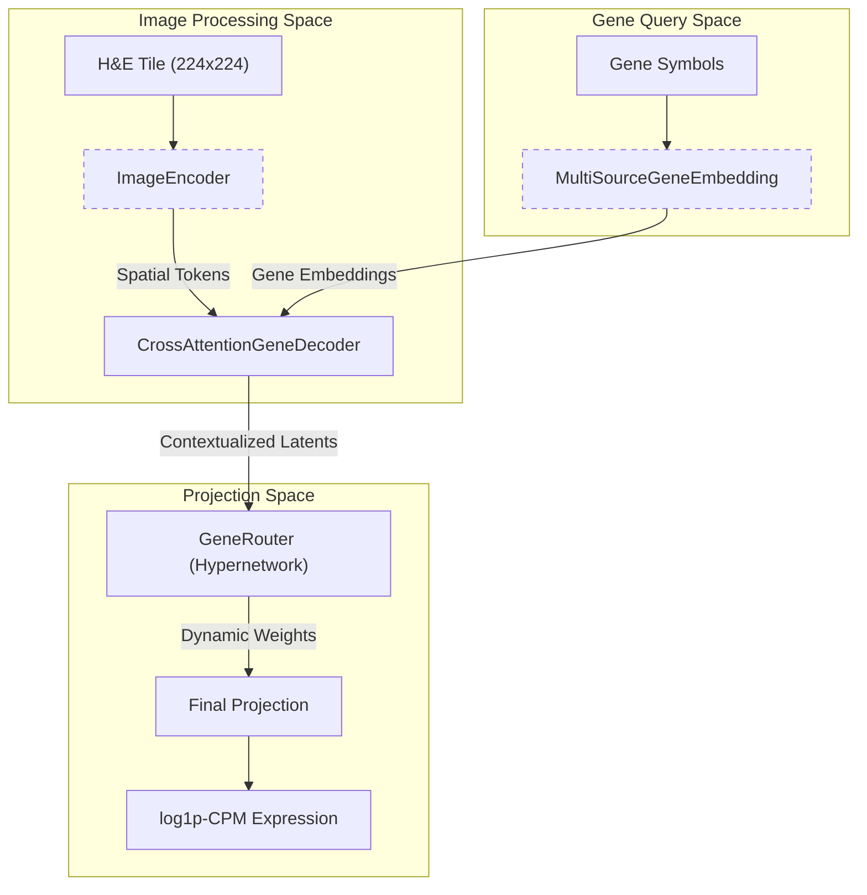
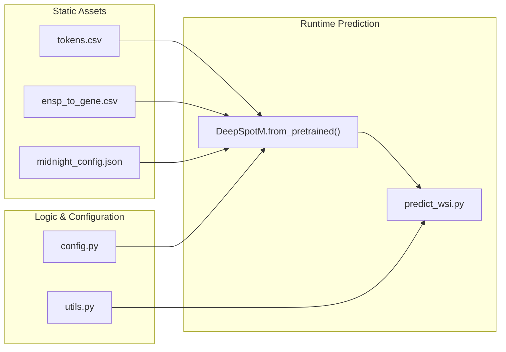

# Overview

Relevant source files

The following files were used as context for generating this wiki page:

- [CITATION.cff](CITATION.cff)
- [README.md](README.md)
- [assets/model_overview.png](assets/model_overview.png)

DeepSpot-M is a multimodal foundation model designed for **transcriptome-wide virtual spatial transcriptomics** from H&E-stained histology images. By reformulating gene expression prediction as a query-based task rather than a fixed-output classification or regression, DeepSpot-M can predict the expression of thousands of genes—including those not seen during training—across entire whole-slide images (WSIs).

The system bridges the gap between high-resolution tissue morphology and molecular states, enabling researchers to generate virtual spatial transcriptomics data at scale from routine pathology slides.

## Key Capabilities

*   **Transcriptome-Wide Prediction:** Predicts expression for a panel of ~19k protein-coding genes [src/deepspotm/assets/tokens.csv:1-19339]().
*   **Zero-Shot Inference:** Leverages frozen biological embeddings (DNA, RNA, protein, single-cell, and text) to predict genes unseen during model training [README.md:24-32]().
*   **Multimodal Integration:** Combines a pathology-specific image backbone with diverse gene embedding sources such as `scgpt`, `evo2`, `orthrus`, `prott5`, and `apertus` [README.md:73-76]().
*   **Spatial Interpretability:** Uses cross-attention mechanisms to map specific gene expressions back to spatial patch tokens within a histology tile [README.md:37-42]().
*   **Scalable Pipeline:** Provides optimized entry points for both individual 224x224 tiles and gigapixel whole-slide images [examples/predict_wsi.py:1-10]().

For a deeper dive into these terms, see [Key Concepts and Terminology](#1.2).

## System Architecture

DeepSpot-M follows a three-stage pipeline: spatial tokenization, gene querying, and dynamic projection.

### Architecture Workflow
The following diagram illustrates the flow from a raw histology image to gene expression values, mapping natural language components to their implementation classes.

**Sources:** [src/deepspotm/model.py:15-80](), [src/deepspotm/modules.py:284-350](), [src/deepspotm/image_encoder.py:17-45]()

### Core Components

| Component | Code Entity | Responsibility |
| :--- | :--- | :--- |
| **Model Wrapper** | `DeepSpotM` | High-level API for loading weights, switching gene sources, and running predictions [src/deepspotm/model.py:38](). |
| **Image Encoder** | `ImageEncoder` | Tokenizes 224x224 tiles into spatial patch embeddings using backbones like `Midnight` [src/deepspotm/image_encoder.py:17](). |
| **Gene Embedding** | `MultiSourceGeneEmbedding` | Manages biological embeddings from different foundation models (e.g., scGPT) [src/deepspotm/modules.py:284](). |
| **Gene Decoder** | `CrossAttentionGeneDecoder` | Performs cross-attention between gene queries and spatial image tokens [src/deepspotm/modules.py:440](). |
| **Hypernetwork** | `GeneRouter` | Generates gene-specific linear projection weights from gene embeddings [src/deepspotm/modules.py:408](). |

For implementation details, see [Core Architecture](#2).

## Data Flow: From Files to Predictions

This diagram bridges the static assets and configuration to the runtime execution of the model.

**Sources:** [src/deepspotm/config.py:1-19](), [src/deepspotm/checkpoint.py:80-120](), [src/deepspotm/assets/tokens.csv:1-10]()

## Child Pages

*   **[Getting Started](#1.1)**: Installation guide, dependency management (including `wsi` extras), and your first prediction using `from_pretrained`.
*   **[Key Concepts and Terminology](#1.2)**: A glossary and conceptual guide to the domain-specific logic used in the codebase, such as LoRA adaptation and log1p-CPM normalization.

## Quick Links
*   **Pretrained Models**: [HuggingFace Hub](https://huggingface.co/ratschlab/DeepSpotM)
*   **Atlas Data**: [TCGA Virtual Spatial Transcriptomics Atlas](https://huggingface.co/datasets/ratschlab/TCGA_virtual_spatial_transcriptomics_atlas)
*   **Research Paper**: [medRxiv Preprint](https://doi.org/10.64898/2026.06.19.26356060)

**Sources:** [README.md:1-15](), [CITATION.cff:1-25]()

---