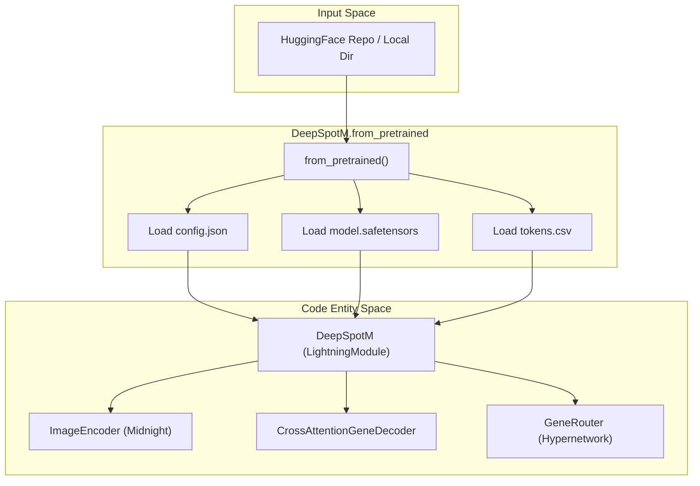
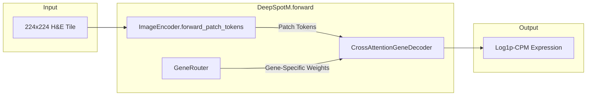

# Getting Started

<details>
<summary>Relevant source files</summary>

The following files were used as context for generating this wiki page:

- [README.md](README.md)
- [pyproject.toml](pyproject.toml)
- [src/deepspotm/__init__.py](src/deepspotm/__init__.py)

</details>


DeepSpot-M is a multimodal foundation model designed to predict transcriptome-wide spatial gene expression from H&E histology images. It utilizes a LoRA-adapted pathology backbone and a cross-attention gene decoder to map 224x224 image tiles to expression values across approximately 19,000 genes.

This page covers the installation process, dependency management, and the primary workflows for loading models and performing inference.

## Installation

The package is available on PyPI and requires Python 3.10 or newer due to dependency constraints from `torch`, `transformers`, and `peft` [pyproject.toml:26-28]().

### Basic Installation
To install the core package for tile-level predictions:
```bash
pip install deepspotm
```

### Whole-Slide Image (WSI) Support
For processing whole-slide images (e.g., `.svs`, `.ndpi`) and generating `AnnData` objects, install the `wsi` extra. This installs `pyvips` for efficient tiling and `anndata` for spatial data storage [pyproject.toml:59-62]().
```bash
pip install "deepspotm[wsi]"
```

### Development Version
To track the latest changes from the repository:
```bash
pip install git+https://github.com/ratschlab/DeepSpotM.git
```

### Core Dependencies
| Package | Version | Purpose |
| :--- | :--- | :--- |
| `torch` | >=2.0 | Tensor computations and neural network backend [pyproject.toml:45]() |
| `lightning` | >=2.0 | Model training and inference framework [pyproject.toml:46]() |
| `timm` | >=0.9 | Vision backbone implementations [pyproject.toml:47]() |
| `peft` | >=0.6 | LoRA (Low-Rank Adaptation) management [pyproject.toml:48]() |
| `transformers`| >=4.43 | HuggingFace integration and image processing [pyproject.toml:49]() |
| `safetensors` | >=0.3 | Secure model weight loading [pyproject.toml:50]() |

**Sources:** [pyproject.toml:26-71](), [README.md:46-63]()

---

## Loading a Pretrained Model

The `DeepSpotM` class provides a high-level `from_pretrained` method that handles the retrieval of model weights, configuration, and gene vocabulary assets.

### The `from_pretrained` Workflow
When calling `DeepSpotM.from_pretrained()`, the system performs the following:
1.  **Asset Retrieval**: Downloads or locates `config.json`, `model.safetensors`, and `tokens.csv` [README.md:70-73]().
2.  **Backbone Initialization**: Builds the pathology foundation model (defaulting to "Midnight") using an internal configuration to avoid external network calls to the original backbone provider [README.md:71-72]().
3.  **Source Selection**: Configures the gene router hypernetwork to use a specific biological embedding source (e.g., `scgpt`, `evo2`) [README.md:73-76]().

### Initialization Diagram
The following diagram illustrates the flow from a HuggingFace repository or local path to a functional `DeepSpotM` instance.

**Model Initialization Flow**

**Sources:** [src/deepspotm/model.py:1-10](), [README.md:67-76](), [src/deepspotm/__init__.py:1-15]()

---

## Running Predictions

DeepSpot-M supports three levels of prediction: full transcriptome, specific gene subsets, and whole-slide inference.

### 1. Tile-Level Prediction (Full Panel)
By default, the model predicts expression for the entire panel defined in `tokens.csv` (~19k genes) [README.md:87-88]().

```python
from deepspotm import DeepSpotM
import torch

# 1. Load model
model, image_processor = DeepSpotM.from_pretrained("ratschlab/DeepSpotM", source="scgpt")

# 2. Prepare tile (224x224 PIL Image)
tile_tensor = image_processor(my_pil_tile).unsqueeze(0)

# 3. Inference
with torch.no_grad():
    expression, _, _ = model(tile_tensor) # (batch, n_genes)

# 4. Map to gene symbols
results = dict(zip(model.gene_names, expression.squeeze(0).tolist()))
```
**Sources:** [README.md:67-85]()

### 2. Specific Gene Prediction
For faster inference, use `predict_genes`. This avoids computing projections for the entire 19k-gene vocabulary by only processing the requested queries [README.md:91-92]().

```python
# Returns tensor of shape (1, 3)
vals = model.predict_genes(tile_tensor, ["EPCAM", "CD3D", "PTPRC"])
```
**Sources:** [README.md:94-97]()

### 3. Whole-Slide Inference (CLI)
For production use-cases, the `predict_wsi.py` script automates tiling, background filtering, and result aggregation into a spatial `AnnData` (`.h5ad`) file [README.md:104-108]().

```bash
# Process a single slide
python examples/predict_wsi.py slide.svs -o slide.h5ad --source scgpt
```

### Prediction Data Flow
The diagram below traces a histology image through the model components to produce gene expression values.

**Inference Data Pipeline**

**Sources:** [README.md:24-42](), [src/deepspotm/model.py:1-10]()

---

## Available Embedding Sources
The model uses frozen biological embeddings to represent genes. When loading the model, you must specify a `source` which determines the "modality" of the gene representation [README.md:75]():

| Source | Foundation Model | Modality |
| :--- | :--- | :--- |
| `scgpt` | scGPT | Single-cell RNA-seq |
| `evo2` | Evo 2 | DNA/Genomic |
| `orthrus` | Orthrus | RNA/Transcriptomic |
| `prott5` | ProtT5 | Protein Sequence |
| `apertus` | Apertus | Text/Literature |

**Sources:** [README.md:27-32](), [README.md:75](), [src/deepspotm/modules.py:1-8]()

---