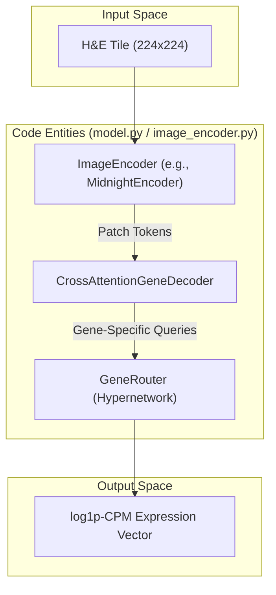
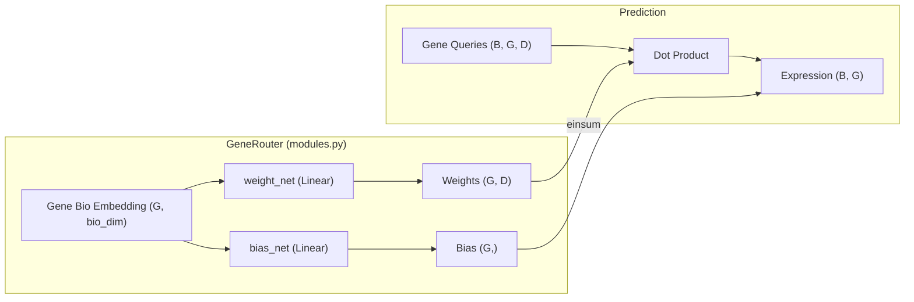

# Key Concepts and Terminology

Relevant source files

The following files were used as context for generating this wiki page:

- [CITATION.cff](CITATION.cff)
- [README.md](README.md)
- [src/deepspotm/assets/tokens.csv](src/deepspotm/assets/tokens.csv)
- [src/deepspotm/modules.py](src/deepspotm/modules.py)

This page defines the domain-specific terms and technical concepts fundamental to the DeepSpotM codebase. It serves as a reference for new contributors to understand the relationship between biological transcriptomics, pathology foundation models, and the hypernetwork-based architecture implemented in the library.

## Virtual Spatial Transcriptomics

**Virtual Spatial Transcriptomics (VST)** refers to the computational task of predicting gene expression levels directly from histology images (typically H&E stained slides) without performing physical sequencing.

In DeepSpotM, this is implemented as a mapping from a $224 \times 224$ pixel image tile to a vector of predicted expression values for approximately 19,000 genes [README.md:24-32](). The model treats each tile as a "spot" (analogous to spots in Visium or cells in Xenium) and predicts the molecular state based on morphological features captured by a pathology backbone.

### Data Flow: Image to Expression
The following diagram illustrates the transformation from a raw histology tile to a gene expression vector.

**DeepSpotM High-Level Data Flow**

Sources: [src/deepspotm/model.py:12-25](), [src/deepspotm/image_encoder.py:11-20](), [src/deepspotm/modules.py:110-117]()

---

## Gene Embedding Sources & Modality Vocabulary

DeepSpotM does not use a fixed output layer for genes. Instead, it represents genes as queryable embeddings derived from biological foundation models.

### Gene Embedding Sources
A **Source** refers to the specific foundation model used to generate the initial biological priors for genes. DeepSpotM supports several sources:
*   **evo2**: DNA-based foundation model.
*   **orthrus**: RNA-based foundation model.
*   **prott5 / esm2**: Protein-based foundation models.
*   **scgpt / geneformer**: Single-cell RNA-seq foundation models.
*   **apertus / genept**: Text/LLM-based gene descriptions.

These are managed by the `MultiSourceGeneEmbedding` class [src/deepspotm/modules.py:148-157](), which handles the loading and adaptation of these priors.

### Modality Vocabulary
The **Modality Vocabulary** is a canonical ordering of biological data types: `("dna", "rna", "protein", "single_cell", "text")` [src/deepspotm/modules.py:71-71](). 
*   **Modality Encoding**: A frozen one-hot encoding added to gene queries before cross-attention. This signals to the model which *type* of biological information is being used, allowing the shared decoder to leverage modality-level invariances [src/deepspotm/modules.py:164-171]().
*   **MODALITY_BY_SOURCE**: A mapping that links specific source names (e.g., `evo2`) to their canonical modality (e.g., `dna`) [src/deepspotm/modules.py:79-92]().

Sources: [src/deepspotm/modules.py:66-92](), [src/deepspotm/modules.py:148-175]()

---

## LoRA Adaptation

**LoRA (Low-Rank Adaptation)** is used to fine-tune the frozen pathology backbones (like Midnight or UNI) for the specific task of transcriptomic prediction without updating all parameters.

In `image_encoder.py`, the `ImageEncoder` uses `peft.LoraConfig` to target specific modules within the backbone [src/deepspotm/image_encoder.py:53-65]().
*   **Target Modules**: Typically `qkv` or `query`, `value` projections in the Transformer blocks.
*   **Rank (r)**: Usually set to 8 or 16 to minimize parameter overhead.

Sources: [src/deepspotm/image_encoder.py:44-70](), [src/deepspotm/model.py:120-130]()

---

## Zero-Shot Prediction

Unlike standard models that have a fixed number of output neurons (e.g., a final layer of size 1000 for 1000 genes), DeepSpotM uses a **Gene Router (Hypernetwork)** [src/deepspotm/modules.py:110-117]().

The `GeneRouter` generates the projection weights for a gene *on-the-fly* from its biological embedding [src/deepspotm/modules.py:143-145](). This architecture allows the model to predict expression for genes it never saw during training, provided a biological embedding for that gene is available. This capability is referred to as **Zero-Shot Prediction** [README.md:37-42]().

**Hypernetwork Projection Logic**

Sources: [src/deepspotm/modules.py:110-146]()

---

## AnnData and log1p-CPM

DeepSpotM adheres to standard bioinformatics data structures and normalization conventions for its outputs.

### log1p-CPM
The model is trained to predict, and outputs values in, **log1p-CPM** (Counts Per Million) space.
*   **CPM**: Normalizes for sequencing depth (or total signal per spot).
*   **log1p**: The transformation $f(x) = \ln(1 + x)$, which stabilizes variance and handles the sparsity typical of transcriptomic data.
*   The `StructureExpression` class assumes input values are already in this space or similar normalized formats [src/deepspotm/modules.py:12-18]().

### AnnData
The `predict_wsi.py` pipeline saves results in the `.h5ad` format, which is the `AnnData` (Annotated Data) standard used by the `scanpy` and `squidpy` ecosystems [README.md:104-108]().
*   **X**: The predicted expression matrix (Spots $\times$ Genes).
*   **obs**: Metadata for each spot, including spatial coordinates (`array_row`, `array_col`) and pixel coordinates (`px_x`, `px_y`).
*   **var**: Gene metadata, including gene symbols and Ensembl IDs.

Sources: [README.md:104-116](), [src/deepspotm/modules.py:12-18]()

---

## Modality and Gene Vocabulary Mapping

DeepSpotM maintains a strict internal vocabulary to ensure consistency across different biological priors.

| Term | Definition | Code Entity |
| :--- | :--- | :--- |
| **Gene Names Ordered** | The fixed list of 19,338 genes the model is capable of predicting. | `StructureExpression.gene_names_ordered` [src/deepspotm/modules.py:22]() |
| **Tokens** | The CSV asset containing the gene vocabulary and token types. | `src/deepspotm/assets/tokens.csv` |
| **ENSP Mapping** | Mapping from Ensembl Protein IDs to Gene Symbols, used for protein-based sources like ProtT5. | `src/deepspotm/assets/ensp_to_gene.csv` |
| **Expression Mask** | A boolean tensor indicating which genes in the vocabulary were actually measured in a ground-truth sample. | `StructureExpression.structure_expression` [src/deepspotm/modules.py:25-32]() |

Sources: [src/deepspotm/modules.py:11-33](), [src/deepspotm/assets/tokens.csv:1-20]()

---