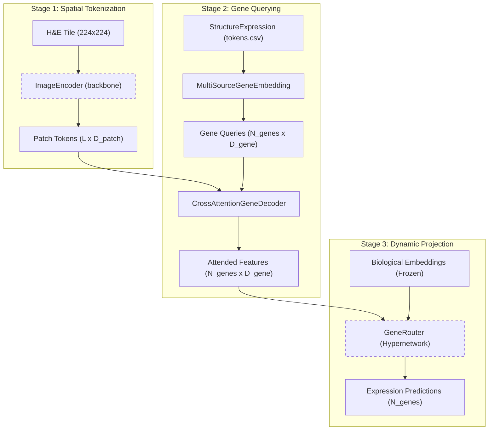
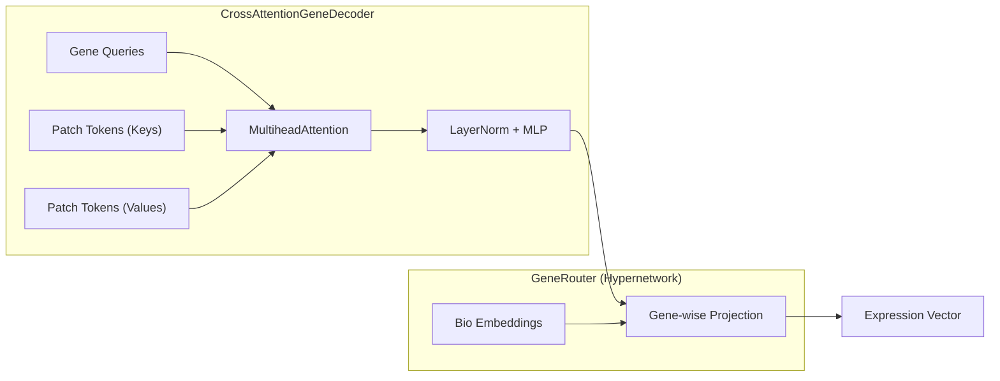

# Core Architecture

Relevant source files

The following files were used as context for generating this wiki page:

- [README.md](README.md)
- [src/deepspotm/model.py](src/deepspotm/model.py)

DeepSpot-M implements a three-stage pipeline that transforms histology images into transcriptome-wide spatial gene expression maps. The architecture bridges pathology foundation models with biological foundation models (DNA, RNA, protein, single-cell, and text) through a cross-attention mechanism and a dynamic projection layer.

### The DeepSpotM Pipeline

The system processes a 224x224 H&E image tile through the following stages:
1.  **Spatial Tokenization**: The image is encoded into a sequence of patch embeddings.
2.  **Gene Querying**: A decoder allows individual gene embeddings to attend to specific spatial tokens.
3.  **Dynamic Projection**: A hypernetwork (Gene Router) projects the attended features into expression values using frozen biological embeddings.

For details on the primary interface and model lifecycle, see [DeepSpotM Model (model.py)](#2.1).

### Architectural Overview

The following diagram illustrates the data flow from the raw image to the predicted gene expression vector, highlighting the key code entities involved in the transformation.

**DeepSpotM Data Flow**

Sources: [src/deepspotm/model.py:24-42](), [src/deepspotm/model.py:85-117](), [README.md:24-32]()

---

### 1. Image Encoding and Spatial Tokenization
The `backbone` of the model is a pathology foundation model (typically `MidnightEncoder`) wrapped in a LoRA (Low-Rank Adaptation) adapter. The encoder converts the input tile into a grid of spatial patch tokens. This stage is modular; the `build_encoder` factory allows swapping the backbone for other models like UNI or H1.

*   **Key Class**: `ImageEncoder` in `image_encoder.py`
*   **Mechanism**: `forward_patch_tokens` produces the sequence used for cross-attention.
*   **Adaptation**: `LoraConfig` is applied to `target_modules` specific to each backbone.

For details on supported backbones and LoRA integration, see [Image Encoder (image_encoder.py)](#2.2).

Sources: [src/deepspotm/model.py:85-95](), [src/deepspotm/image_encoder.py:1-20]()

---

### 2. Gene Embedding and Vocabulary
The model maintains a fixed vocabulary of ~19,000 genes defined in `tokens.csv`. Each gene is represented by a query embedding. When the model is configured for "multi-source" mode, it can dispatch queries across different biological modalities (e.g., `scgpt`, `prott5`, `evo2`).

*   **Key Class**: `StructureExpression` and `MultiSourceGeneEmbedding` in `modules.py`
*   **Asset**: `src/deepspotm/assets/tokens.csv`
*   **Zero-Shot Capability**: Because genes are embeddings rather than fixed output indices, the model can be retargeted to new vocabularies via `swap_gene_vocabulary`.

For details on how gene names are mapped to indices and embeddings, see [Gene Vocabulary and StructureExpression (modules.py + assets)](#2.4).

Sources: [src/deepspotm/model.py:73-80](), [src/deepspotm/model.py:126-157](), [src/deepspotm/modules.py:1-50]()

---

### 3. Cross-Attention Decoder and Gene Router
The `CrossAttentionGeneDecoder` acts as the bridge between histology and biology. It uses standard `MultiheadAttention` where gene embeddings serve as **queries** and image patch tokens serve as **keys/values**. 

The final layer is a `GeneRouter` hypernetwork. Instead of a single static linear layer for all genes, the router generates gene-specific weights based on biological embeddings (e.g., DNA sequence from Evo2 or protein sequence from ProtT5).

**Decoder and Router Detail**

*   **Key Class**: `CrossAttentionGeneDecoder` and `GeneRouter` in `modules.py`
*   **Modality Encoding**: When multiple sources are used, `use_modality_encoding` adds a learnable bias to differentiate between embedding origins.

For details on the hypernetwork and attention layers, see [Gene Decoder and Hypernetwork (modules.py)](#2.3).

Sources: [src/deepspotm/model.py:98-111](), [src/deepspotm/modules.py:480-550](), [README.md:37-42]()

---