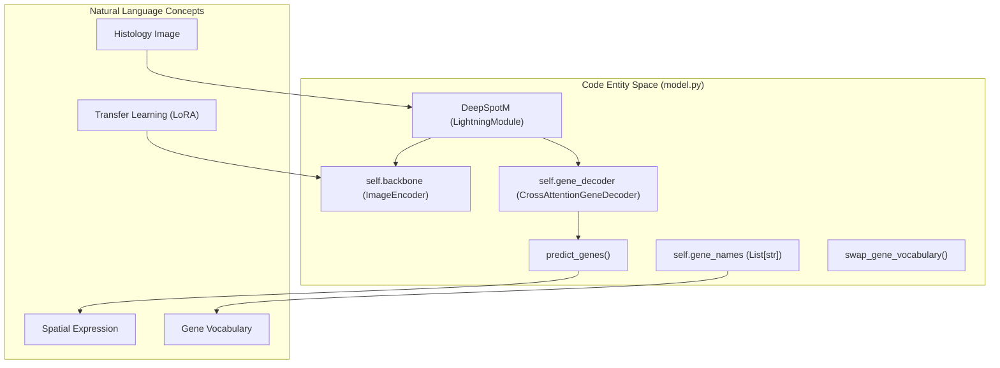
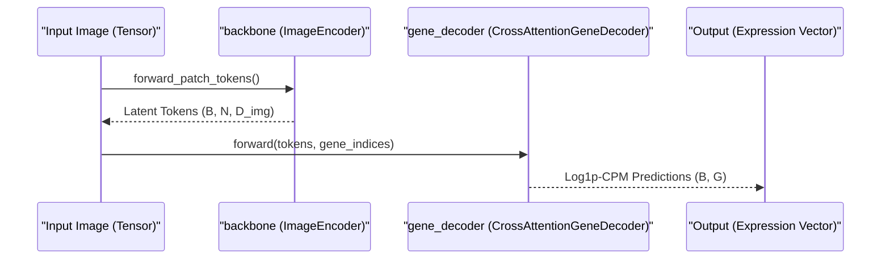

# 2.1 DeepSpotM Model (model.py)

Relevant source files

The following files were used as context for generating this wiki page:

- [src/deepspotm/__init__.py](src/deepspotm/__init__.py)
- [src/deepspotm/model.py](src/deepspotm/model.py)

The `DeepSpotM` class, defined in `src/deepspotm/model.py`, is the central `LightningModule` that orchestrates the spatial transcriptomics prediction pipeline. It integrates a vision backbone (image encoder) with a gene-specific decoder to predict gene expression from histology image patches.

## Overview and Architecture

DeepSpotM is designed for modularity, allowing every architectural component to be toggled via hyperparameters for ablation studies. The model supports Parameter-Efficient Fine-Tuning (PEFT) via LoRA and zero-shot gene prediction through a hypernetwork-based "Gene Router".

### Key Components
*   **Vision Backbone**: Encodes image patches into latent tokens using a variety of supported encoders (e.g., Midnight, UNI, H-Transformer).
*   **Gene Decoder**: A cross-attention mechanism that queries image tokens using gene embeddings to produce spatial expression values.
*   **Gene Router**: A hypernetwork that dynamically generates projection weights for genes based on their biological embeddings, enabling prediction for genes not seen during training.

### DeepSpotM System Mapping
The following diagram bridges the conceptual "Natural Language Space" to the specific "Code Entity Space" within `model.py`.

**Diagram: DeepSpotM Code Entity Map**

**Sources:** [src/deepspotm/model.py:15-117](), [src/deepspotm/model.py:171-205](), [src/deepspotm/model.py:231-267]()

---

## Constructor Hyperparameters

The `DeepSpotM` constructor [src/deepspotm/model.py:38-68]() initializes the architecture based on several key categories of hyperparameters:

| Category | Parameter | Description |
| :--- | :--- | :--- |
| **Vision** | `encoder_model` | String identifier for the backbone (e.g., `"MidnightEncoder"`) [src/deepspotm/model.py:40](). |
| | `use_lora` | Whether to wrap the backbone with LoRA adapters [src/deepspotm/model.py:54](). |
| **Decoder** | `use_cross_attention` | Toggles between the `CrossAttentionGeneDecoder` and a simple MLP head [src/deepspotm/model.py:42](). |
| | `gene_embed_dim` | The latent dimension for gene queries [src/deepspotm/model.py:43](). |
| | `init_gene_embeddings` | Strategy for gene embeddings: `"xavier"`, a specific source key, or a list for multi-source [src/deepspotm/model.py:47](). |
| **Zero-Shot** | `use_router` | Enables the `GeneRouter` hypernetwork for dynamic weight projection [src/deepspotm/model.py:49](). |
| **Vocab** | `token_path` | Path to the `tokens.csv` defining the gene set [src/deepspotm/model.py:57](). |

**Sources:** [src/deepspotm/model.py:38-68](), [src/deepspotm/model.py:85-117]()

---

## Data Flow and Forward Pass

The `forward` pass transforms raw image tensors into predicted gene expression vectors.

**Diagram: DeepSpotM Data Flow**

**Sources:** [src/deepspotm/model.py:171-180](), [src/deepspotm/model.py:231-267]()

### Key Methods

#### `predict_genes(x, gene_indices=None)`
A wrapper around `forward` specifically for inference. It allows subsetting the output to specific genes by their indices in `self.gene_names` [src/deepspotm/model.py:231-267]().

#### `get_gene_attention_maps(x, gene_indices=None)`
Extracts the attention weights from the `CrossAttentionGeneDecoder`. This is used for interpretability, visualizing which image patches the model focuses on for specific genes [src/deepspotm/model.py:269-305]().

---

## Gene Vocabulary Management

DeepSpotM allows dynamic modification of the gene vocabulary and embedding sources after initialization.

### Multi-Source Management
When using multi-source embeddings (e.g., protein sequences + gene ontologies), the model manages a `MultiSourceGeneEmbedding` module.
*   **`sources`**: Property returning the list of available embedding sources [src/deepspotm/model.py:214-216]().
*   **`current_source`**: Property returning the currently active source (or "multi" if not collapsed) [src/deepspotm/model.py:218-220]().
*   **`set_source(source_name)`**: Collapses a multi-source model to a single specific source to reduce memory/computation during inference [src/deepspotm/model.py:222-229]().

### `swap_gene_vocabulary`
This method [src/deepspotm/model.py:126-160]() retargets the decoder to a custom vocabulary in-place. It:
1.  Loads new embeddings from a `.pt` file.
2.  Validates the new `tokens.csv`.
3.  Rebuilds the vocabulary-specific layers (`gene_embeddings`, `gene_query_proj`, and the router/head) [src/deepspotm/model.py:134-156]().

**Sources:** [src/deepspotm/model.py:126-160](), [src/deepspotm/model.py:214-229]()

---

## Factory Methods and Loading

DeepSpotM provides specialized methods for loading models from Hugging Face or local checkpoints.

### `from_pretrained(model_id, ...)`
Downloads a checkpoint from the Hugging Face Hub. It handles the mapping of `bio_dims` (embedding dimensions) and sets `backbone_pretrained=False` to ensure vision weights are loaded from the checkpoint rather than re-downloaded from upstream vision providers [src/deepspotm/model.py:307-353]().

### `load_for_inference(checkpoint_path, ...)`
A utility to load a local `.ckpt` file. It ensures the LoRA wrappers are correctly initialized before loading state dicts, maintaining the "LoRA save/load contract" [src/deepspotm/model.py:355-392]().

### LoRA Save/Load Contract
When `use_lora=True`, the backbone is wrapped by PEFT. The model requires that LoRA remains **wrapped** during prediction. Calling `model.backbone.merge_and_unload()` is prohibited in the inference path because it breaks the state-dict key structure (`backbone.base_model.model...`) expected by the `LightningModule` [src/deepspotm/model.py:22-36]().

**Sources:** [src/deepspotm/model.py:22-36](), [src/deepspotm/model.py:307-392]()

---