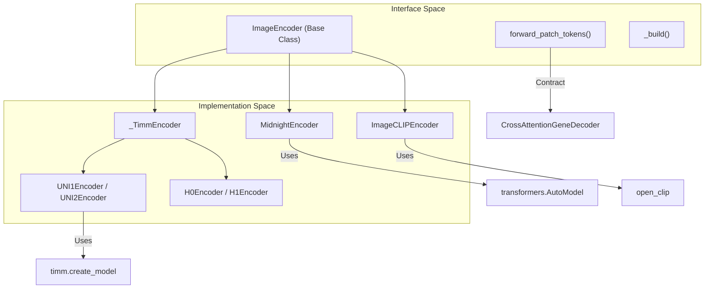
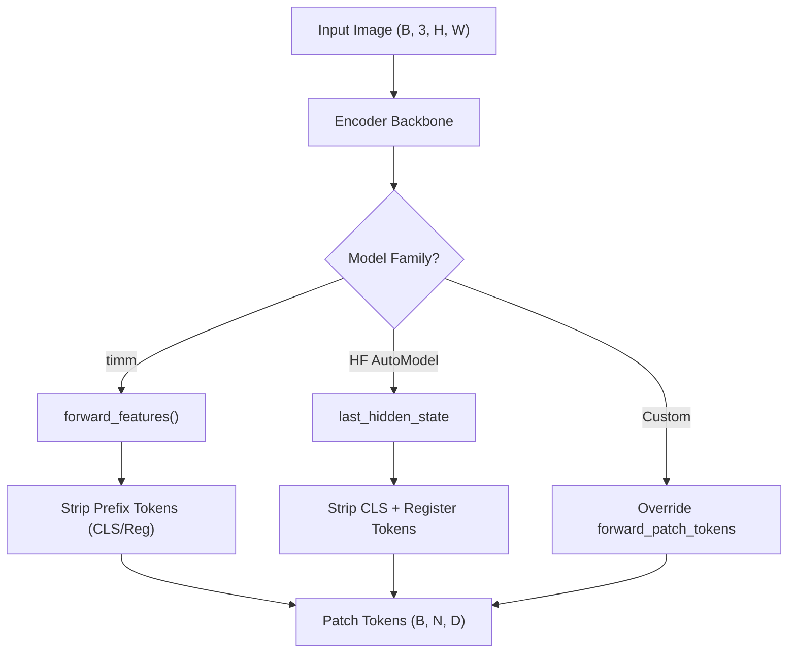

# Image Encoder (image_encoder.py)

<details>
<summary>Relevant source files</summary>

The following files were used as context for generating this wiki page:

- [src/deepspotm/image_encoder.py](src/deepspotm/image_encoder.py)
- [src/deepspotm/utils.py](src/deepspotm/utils.py)

</details>


The `image_encoder.py` module defines the vision backbone architecture for DeepSpotM. It provides a unified interface for pathology foundation models (e.g., UNI, H-Transformer) and general-purpose vision models (e.g., CLIP, Midnight). The module handles weight resolution from the Hugging Face Hub, automated image transformation pipelines, and extraction of spatial patch tokens required by the gene decoder.

## Encoder Architecture

DeepSpotM uses a hierarchical class structure to manage different vision backbones. The base `ImageEncoder` defines the contract for all encoders, while specialized mixins like `_TimmEncoder` handle the boilerplate for models integrated via the `timm` library.

### Class Hierarchy and Data Flow

The following diagram illustrates how the `ImageEncoder` interface abstracts different model families into a consistent API for the `DeepSpotM` model.

**Vision Backbone Abstraction**

**Sources:** [src/deepspotm/image_encoder.py:34-153](), [src/deepspotm/image_encoder.py:162-284]()

### The ImageEncoder Base Class
The `ImageEncoder` class [src/deepspotm/image_encoder.py:34-106]() is a `torch.nn.Module` that standardizes:
*   **Normalization Constants**: `NORM_MEAN` and `NORM_STD` must be defined by subclasses to ensure consistent preprocessing [src/deepspotm/image_encoder.py:40-41]().
*   **LoRA Targets**: `LORA_TARGET_MODULES` defines which layers are targeted during Parameter-Efficient Fine-Tuning (defaulting to `["qkv"]` for standard ViTs) [src/deepspotm/image_encoder.py:37]().
*   **Build Lifecycle**: The `__init__` method triggers `_build()`, which returns the model, its specific `transforms`, and the `hidden_dim` [src/deepspotm/image_encoder.py:52]().

## Concrete Encoder Implementations

DeepSpotM supports several state-of-the-art pathology and general vision encoders. These are registered in the `ENCODER_REGISTRY` [src/deepspotm/image_encoder.py:334-342]().

| Class Name | Backbone Family | Hidden Dim | Source / Architecture |
| :--- | :--- | :--- | :--- |
| `UNI1Encoder` | timm (ViT-L/16) | 1024 | Mahmood Lab (UNI) |
| `UNI2Encoder` | timm (ViT-G/14) | 1536 | Mahmood Lab (UNI2-h) |
| `H0Encoder` | timm (ViT-S/16) | 384 | Bioptimus (H-Transformer) |
| `H1Encoder` | timm (ViT-L/14) | 1024 | Bioptimus (H-Transformer) |
| `MidnightEncoder` | HF Transformers | 1152 | Bioptimus (Midnight) |
| `ImageCLIPEncoder` | open_clip | 768 | ViT-L/14 (OpenAI/DataComp) |

**Sources:** [src/deepspotm/image_encoder.py:162-332]()

### Weight Resolution and Loading
Weights are resolved via `_resolve_weights` [src/deepspotm/image_encoder.py:6-21](), which prioritizes local paths before attempting to download from the Hugging Face Hub using `hf_hub_download`. The `_load_state_dict` utility [src/deepspotm/image_encoder.py:24-32]() automatically detects and handles both standard PyTorch `.bin`/`.pt` files and `.safetensors` formats.

## Spatial Token Contract: `forward_patch_tokens`

The primary interface between the Image Encoder and the Gene Decoder is the `forward_patch_tokens` method. DeepSpotM relies on the spatial context of an image rather than just a global summary (CLS) token.

**Token Extraction Logic**


The method [src/deepspotm/image_encoder.py:70-96]() handles the removal of non-spatial tokens (like CLS tokens or DINOv2 register tokens) to ensure the `CrossAttentionGeneDecoder` only receives tokens corresponding to physical image patches.

**Sources:** [src/deepspotm/image_encoder.py:70-96](), [src/deepspotm/image_encoder.py:142-151]()

## Factory and Registry

The `build_encoder` function serves as the central factory for instantiating vision backbones.

```python
def build_encoder(name, weights_path=None, pretrained=True, **kwargs):
    """
    Instantiates an encoder from the ENCODER_REGISTRY.
    'name' corresponds to the keys in ENCODER_REGISTRY (e.g., 'uni', 'h1').
    """
```

### Registry Mapping
The `ENCODER_REGISTRY` maps short strings to encoder classes:
*   `"uni"`: `UNI1Encoder`
*   `"uni2"`: `UNI2Encoder`
*   `"h0"`, `"h0mini"`, `"h1"`: Respective Bioptimus models.
*   `"midnight"`: `MidnightEncoder`
*   `"clip"`: `ImageCLIPEncoder`

**Sources:** [src/deepspotm/image_encoder.py:334-351]()

## Image Preprocessing

Encoders use the `get_eval_transforms` utility from `utils.py` [src/deepspotm/utils.py:26-74]() to construct their pipeline. This pipeline is designed for robustness during inference, handling multiple input types:
1.  **NumPy Arrays**: Converts `uint8` or `float` arrays to PIL Images [src/deepspotm/utils.py:34-37]().
2.  **Tensors**: Handles `CHW` tensors, converting them back to `HWC` for PIL processing [src/deepspotm/utils.py:39-46]().
3.  **PIL Images**: Passed through directly [src/deepspotm/utils.py:47-48]().

The pipeline follows a strict sequence: `Ensure PIL` → `Resize (Bicubic)` → `CenterCrop (Optional)` → `ToTensor` → `Normalize`.

**Sources:** [src/deepspotm/utils.py:26-74](), [src/deepspotm/image_encoder.py:62-69]()

---