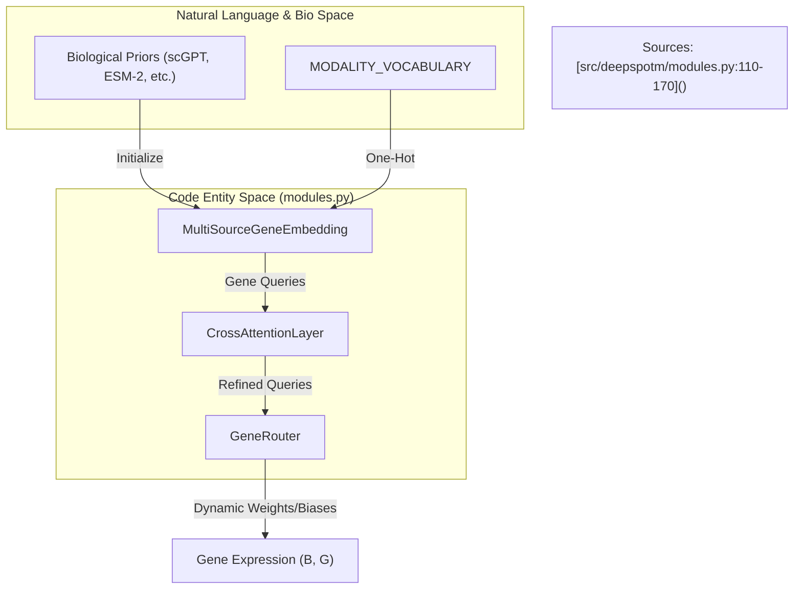

# Gene Decoder and Hypernetwork (modules.py)

<details>
<summary>Relevant source files</summary>

The following files were used as context for generating this wiki page:

- [src/deepspotm/modules.py](src/deepspotm/modules.py)
- [tests/test_decoder.py](tests/test_decoder.py)

</details>


The `modules.py` file contains the core architectural components responsible for translating high-dimensional image patch tokens into gene expression values. The architecture follows a query-based design where biological gene embeddings act as queries that attend to image features via cross-attention, followed by a dynamic projection through a hypernetwork.

## Architecture Overview

The decoding process consists of three main stages:
1.  **Multi-Source Embedding**: Biological priors (e.g., scGPT, ESM-2) are projected into a shared query space.
2.  **Cross-Attention**: Gene queries interact with image patch tokens to extract spatial context.
3.  **Gene Router (Hypernetwork)**: A dynamic projection layer generates gene-specific weights and biases to produce the final expression scalar.

### Data Flow Diagram

The following diagram illustrates the flow from raw biological embeddings to the final expression output.



## Multi-Source Gene Embedding

The `MultiSourceGeneEmbedding` class handles the dispatching and adaptation of biological embeddings from different sources (e.g., DNA, RNA, Protein).

### Modality Vocabulary and Registry
The system uses a canonical ordering for modalities to ensure checkpoint compatibility. Sources are mapped to modalities via `MODALITY_BY_SOURCE`.

| Modality | Index | Description |
| :--- | :--- | :--- |
| `dna` | 0 | DNA-based priors (e.g., `evo2`) |
| `rna` | 1 | RNA-based priors (e.g., `orthrus`) |
| `protein` | 2 | Protein-based priors (e.g., `esm2`, `prott5`) |
| `single_cell` | 3 | Single-cell foundation models (e.g., `scgpt`, `geneformer`) |
| `text` | 4 | Text-based embeddings (e.g., `apertus`, `genept`) |

*   **Implementation**: `MODALITY_VOCABULARY` is a tuple defining the frozen index order [src/deepspotm/modules.py:71]().
*   **Mapping**: `MODALITY_BY_SOURCE` maps specific model names to these modalities [src/deepspotm/modules.py:79-92]().

### Key Functions
*   **`collapse_to_source(source_name)`**: Switches the active embedding source by updating internal buffers and projection layers [src/deepspotm/modules.py:255-276]().
*   **Modality Encoding**: An optional frozen one-hot encoding is added to gene queries to signal the modality (DNA vs Protein) to the cross-attention layers [src/deepspotm/modules.py:164-169]().

Sources: [src/deepspotm/modules.py:66-92](), [src/deepspotm/modules.py:148-170]()

## Cross-Attention Gene Decoder

The `CrossAttentionGeneDecoder` is the top-level container for the query-based expression prediction.

### Component Breakdown
1.  **`CrossAttentionLayer`**: Implements standard Multi-Head Attention where `gene_queries` are the `query` and `patch_tokens` are the `key` and `value` [src/deepspotm/modules.py:38-62]().
2.  **Gene Subsetting**: The `forward` method accepts a `gene_indices` tensor, allowing the model to compute expression for only a specific subset of genes, which significantly reduces computation during inference [src/deepspotm/modules.py:326-335]().
3.  **Interpretability**: If `need_weights=True`, the decoder returns the attention maps for each layer, enabling visualization of which image patches contributed to the prediction of specific genes [src/deepspotm/modules.py:348-350]().

### Output Contract
The `forward` method returns a three-tuple:
1.  **Expression**: `(Batch, N_Genes)` tensor of predicted log1p-CPM values.
2.  **Gene Features**: `(Batch, Gene_Embed_Dim)` aggregated features.
3.  **Attention Weights**: List of attention tensors or `None`.

Sources: [src/deepspotm/modules.py:302-353](), [tests/test_decoder.py:46-55]()

## Gene Router (Hypernetwork)

The `GeneRouter` enables **zero-shot prediction** for genes not seen during training. Instead of learning a fixed weight matrix for every gene, it uses a hypernetwork to generate projection parameters on-the-fly.

### Dynamic Projection Logic
The router takes the raw biological embedding ($E_{bio}$) and the cross-attention refined query ($Q_{refined}$) to produce the expression value $y$:

$$y = Q_{refined} \cdot \text{WeightNet}(E_{bio}) + \text{BiasNet}(E_{bio})$$

*   **`weight_net`**: A 2-layer MLP that generates the projection vector for the query dimension [src/deepspotm/modules.py:123-127]().
*   **`bias_net`**: A 2-layer MLP that generates a per-gene bias scalar [src/deepspotm/modules.py:129-133]().
*   **Einsum implementation**: The final projection uses `torch.einsum('bgd,gd->bg', gene_queries, proj)` for efficient batch computation [src/deepspotm/modules.py:145]().

### Code Entity Interaction

```mermaid
classDiagram
    class CrossAttentionGeneDecoder {
        +forward(patch_tokens, gene_indices)
    }
    class MultiSourceGeneEmbedding {
        +collapse_to_source(source_name)
        +forward(gene_indices)
    }
    class CrossAttentionLayer {
        +forward(gene_queries, patch_kv)
    }
    class GeneRouter {
        +weight_net: nn.Sequential
        +bias_net: nn.Sequential
        +forward(bio_emb, queries)
    }

    CrossAttentionGeneDecoder *-- MultiSourceGeneEmbedding
    CrossAttentionGeneDecoder *-- CrossAttentionLayer
    CrossAttentionGeneDecoder *-- GeneRouter
    
    Sources2["Sources: [src/deepspotm/modules.py:110-146](), [src/deepspotm/modules.py:302-315]()"]
```

## Expression Structuring

The `StructureExpression` class serves as a utility for handling the 19,338-gene vocabulary defined in `tokens.csv`.

*   **Gene Lookup**: It filters the vocabulary for entries where `token_type == 'gene'` [src/deepspotm/modules.py:22]().
*   **Missing Data**: In the `structure_expression` method, missing genes are filled with `0.0`, and a boolean `gene_mask` is generated to track which genes were actually measured in a given sample [src/deepspotm/modules.py:24-32]().
*   **Clamping**: It ensures all expression values are non-negative via `clamp_(min=0)` [src/deepspotm/modules.py:31]().

Sources: [src/deepspotm/modules.py:11-32]()

---