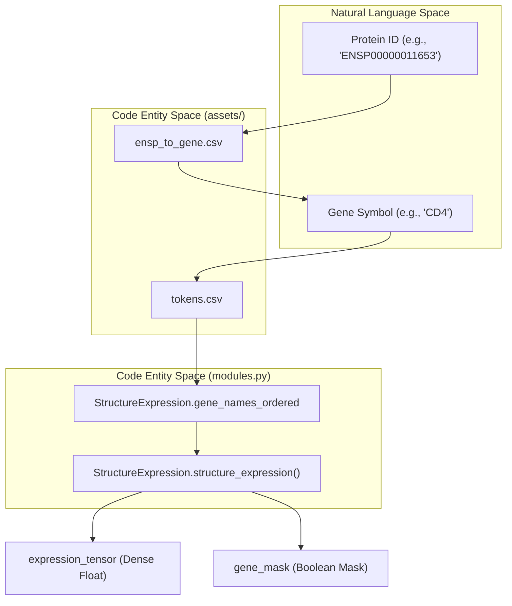
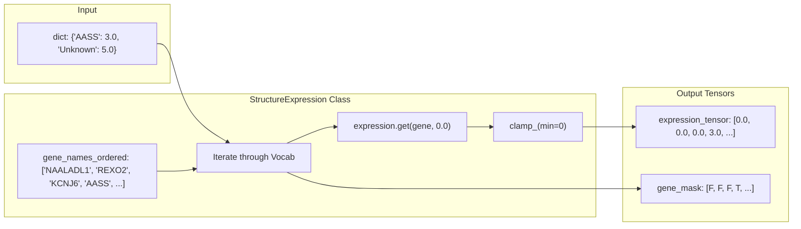

# Gene Vocabulary and StructureExpression (modules.py + assets)

Relevant source files

The following files were used as context for generating this wiki page:

- [src/deepspotm/assets/__init__.py](src/deepspotm/assets/__init__.py)
- [src/deepspotm/assets/ensp_to_gene.csv](src/deepspotm/assets/ensp_to_gene.csv)
- [src/deepspotm/assets/tokens.csv](src/deepspotm/assets/tokens.csv)
- [src/deepspotm/modules.py](src/deepspotm/modules.py)
- [tests/test_structure_expression.py](tests/test_structure_expression.py)

The DeepSpotM framework utilizes a fixed, high-dimensional gene vocabulary to ensure consistency across different biological sources and spatial transcriptomics datasets. This page details the implementation of `StructureExpression`, the handling of packaged gene assets, and the logic for mapping sparse gene expression data into dense tensors suitable for model input.

## Vocabulary Assets

DeepSpotM relies on two primary static assets to manage gene identity and mapping. These files are bundled within the package and resolved at runtime via the `Config` module.

### Gene Tokens (`tokens.csv`)
This file defines the canonical vocabulary of 19,338 genes [tests/test_structure_expression.py:15-15](). It contains three columns:
*   `token`: The gene symbol (e.g., `NAALADL1`, `REXO2`) [src/deepspotm/assets/tokens.csv:2-3]().
*   `token_type`: Categorizes the token. `StructureExpression` specifically filters for rows where `token_type == 'gene'` [src/deepspotm/modules.py:22-22]().
*   `token_id`: An integer index for internal tracking.

### ID Mapping (`ensp_to_gene.csv`)
This asset provides a mapping between Ensembl Protein IDs (ENSP) and gene symbols (e.g., `ENSP00000000233` to `ARF5`) [src/deepspotm/assets/ensp_to_gene.csv:1-1](). This is used primarily when dealing with protein-centric biological priors like ESM-2 or ProtT5.

## StructureExpression Implementation

The `StructureExpression` class in `modules.py` acts as the bridge between raw, per-sample expression dictionaries and the fixed-length tensors required by the `GeneRouter` and `CrossAttentionGeneDecoder`.

### Initialization and Loading
Upon instantiation, the class loads the vocabulary from the path defined in `config.ALPHABET_PATH` [src/deepspotm/modules.py:21-21](). It extracts only the symbols designated as "gene" to populate `self.gene_names_ordered` [src/deepspotm/modules.py:22-22]().

### The `structure_expression` Method
This method transforms a dictionary of `{gene_symbol: value}` into two synchronized tensors:
1.  **Expression Tensor**: A `float32` tensor where the value at index `i` corresponds to the expression of the gene at `self.gene_names_ordered[i]` [src/deepspotm/modules.py:28-30]().
2.  **Gene Mask**: A `bool` tensor indicating whether a gene was actually present in the input dictionary [src/deepspotm/modules.py:25-27]().

### Logic Flow: Natural Language to Code Entity

The following diagram illustrates how biological gene symbols are resolved through the system entities.

**Gene Resolution Flow**

Sources: [src/deepspotm/modules.py:11-32](), [src/deepspotm/assets/tokens.csv:1-20](), [src/deepspotm/assets/ensp_to_gene.csv:1-45]()

## Expression Semantics and Constraints

The `StructureExpression` logic enforces several constraints to maintain data integrity during the transformation process:

| Feature | Implementation Detail | Source |
| :--- | :--- | :--- |
| **Normalization** | None. Input is expected to be pre-normalized (e.g., log1p-CPM). | [src/deepspotm/modules.py:14-17]() |
| **Clamping** | All values are clamped to a minimum of `0.0` to prevent negative expression. | [src/deepspotm/modules.py:31-31]() |
| **OOV Handling** | Out-of-Vocabulary (OOV) genes are ignored; they do not shift indices. | [tests/test_structure_expression.py:47-54]() |
| **Padding** | Special tokens like `<pad>` are excluded from the ordered gene list. | [tests/test_structure_expression.py:16-17]() |
| **Default Value** | Genes missing from the input dictionary are assigned a value of `0.0`. | [src/deepspotm/modules.py:29-29]() |

## Data Flow: Sparse Dict to Dense Tensor

The transformation process involves a lookup against the ordered vocabulary to ensure that every sample, regardless of which genes were measured, results in a tensor of the same dimensionality.

**Tensor Construction Process**

Sources: [src/deepspotm/modules.py:24-32](), [tests/test_structure_expression.py:20-35]()

## OOV and Masking Behavior

The `gene_mask` is critical for downstream loss calculation and evaluation. It allows the model to distinguish between a gene having "zero expression" (measured but not detected) and a gene being "missing" (not part of the assay). 

*   **Measured Gene (Value 0)**: `expression_tensor[i] = 0.0`, `gene_mask[i] = True`.
*   **Unmeasured/OOV Gene**: `expression_tensor[i] = 0.0`, `gene_mask[i] = False` [tests/test_structure_expression.py:51-54]().

Sources:
*   [src/deepspotm/modules.py:11-32]()
*   [src/deepspotm/assets/tokens.csv:1-376]()
*   [src/deepspotm/assets/ensp_to_gene.csv:1-294]()
*   [tests/test_structure_expression.py:1-54]()

---