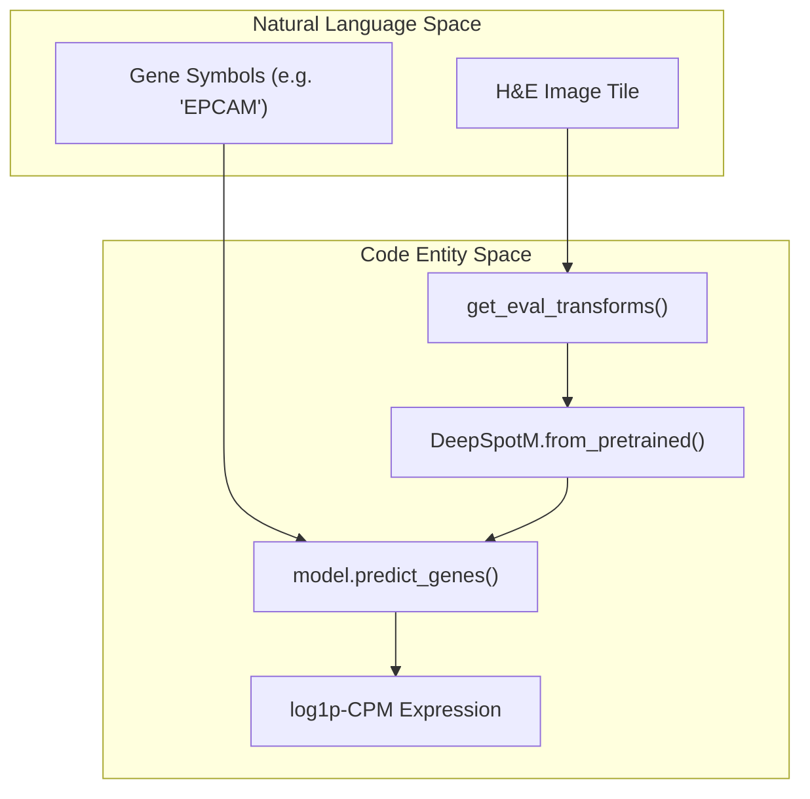

# Inference Pipelines

Relevant source files

The following files were used as context for generating this wiki page:

- [README.md](README.md)
- [examples/predict.py](examples/predict.py)
- [examples/predict_wsi.py](examples/predict_wsi.py)

DeepSpotM provides three primary entry points for inference, ranging from individual image tiles to whole-slide images (WSI) and evaluation notebooks. These pipelines leverage the `DeepSpotM.from_pretrained` method to load models and perform zero-shot or panel-wide gene expression prediction.

## Pipeline Entry Points

The following table summarizes the available inference workflows:

| Entry Point | Target Data | Output Format | Dependencies |
| :--- | :--- | :--- | :--- |
| `predict.py` | Individual 224x224 tiles | CSV or Console | Core package |
| `predict_wsi.py` | Whole-Slide Images (.svs, .tif, etc.) | AnnData (`.h5ad`) | `pyvips`, `anndata` |
| `predict_tcga_skcm.ipynb` | TCGA WSI + Ground Truth | Visual Plots / Metrics | `scanpy`, `matplotlib` |

### Core Inference Logic
All pipelines share a common execution flow using the `DeepSpotM` class. They utilize `model.predict_genes` for targeted gene queries or the standard `forward` pass for the full ~19k gene panel.

#### Data Flow Diagram: Tile to Prediction
This diagram illustrates how the CLI scripts interact with the core model entities to produce expression values.

**Sources:** [examples/predict.py:121-125](), [examples/predict_wsi.py:97-100]()

---

## 3.1 Tile-Level Prediction (predict.py)
The `predict.py` script is designed for processing pre-extracted H&E tiles. It is the most lightweight entry point and supports both single-gene and transcriptome-wide scoring.

- **Background Filtering**: Uses a `--white-mean` threshold to skip tiles that are likely empty (e.g., slide background) [examples/predict.py:88-91]().
- **Batching**: Tiles are processed in configurable batches to optimize GPU utilization [examples/predict.py:103-141]().
- **Output**: Can print the top $N$ expressed genes to the console or save all results to a structured CSV [examples/predict.py:76-78]().

For detailed CLI arguments and usage examples, see [Tile-Level Prediction (predict.py)](#3.1).

**Sources:** [examples/predict.py:31-141]()

---

## 3.2 Whole-Slide Image Prediction (predict_wsi.py)
The `predict_wsi.py` script provides a high-performance pipeline for clinical-scale slides. It uses `pyvips` for efficient random-access reading of multi-gigabyte files without loading the entire slide into memory.

- **Two-Stage Filtering**: A low-resolution thumbnail is first used to identify candidate tissue regions, followed by a high-resolution check on individual tiles [examples/predict_wsi.py:47-76]().
- **Spatial Metadata**: Generates an `AnnData` object where `obsm["spatial"]` contains the center coordinates of each tile, enabling immediate downstream analysis in `scanpy` or `squidpy` [examples/predict_wsi.py:116-136]().
- **Native Resolution**: Automatically tiles the slide at its native resolution (typically ~20x) to match the model's training distribution [examples/predict_wsi.py:10-11]().

For details on the AnnData construction and WSI tiling, see [Whole-Slide Image Prediction (predict_wsi.py)](#3.2).

#### System Architecture: WSI Pipeline

**Sources:** [examples/predict_wsi.py:47-136]()

---

## 3.3 TCGA SKCM Evaluation Notebook
The `predict_tcga_skcm.ipynb` notebook serves as a validation tutorial. It demonstrates how to use DeepSpotM in a "zero-shot" capacity to predict spatial expression on The Cancer Genome Atlas (TCGA) slides.

- **Preprocessing**: Shows how to download open-access slides and prepare them for inference.
- **Evaluation**: Compares model predictions against bulk or spatial ground truth using ROC-AUC and PR-AUC metrics.
- **Visualization**: Provides code to overlay predicted gene expression heatmaps (e.g., *BRAF*, *CD37*) directly onto the H&E tissue image.

For a walkthrough of the SKCM reproduction, see [TCGA SKCM Evaluation Notebook](#3.3).

**Sources:** [README.md:129-138]()

---