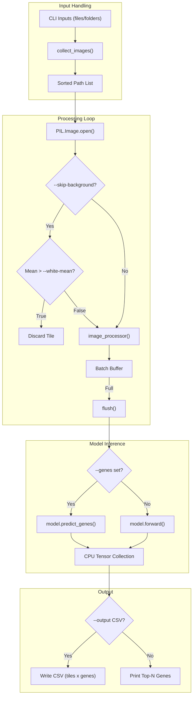
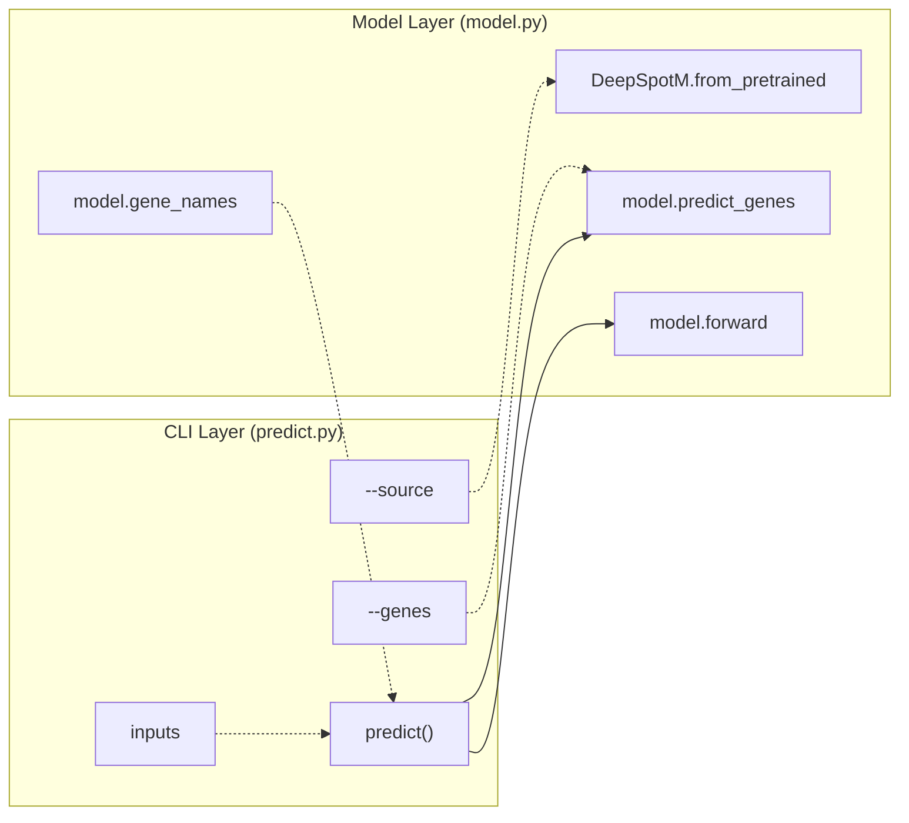

# Tile-Level Prediction (predict.py)

<details>
<summary>Relevant source files</summary>

The following files were used as context for generating this wiki page:

- [README.md](README.md)
- [examples/predict.py](examples/predict.py)

</details>


The `predict.py` script provides a command-line interface (CLI) for performing spatial gene expression prediction on individual histology image tiles. It is designed for processing pre-cut 224x224 RGB patches, offering features for background filtering, gene subsetting, and batched inference.

### Implementation Overview

The script follows a standard data flow: path expansion, model initialization, batched prediction with optional background filtering, and result reporting.

#### Image Collection and Filtering
The script uses `collect_images` to resolve input paths into a sorted list of absolute `Path` objects [examples/predict.py:31-43](). It filters files based on a predefined set of image extensions (`.png`, `.jpg`, `.jpeg`, `.tif`, `.tiff`, `.bmp`, `.webp`) [examples/predict.py:15-15]().

Background filtering is implemented in the `predict` function loop. If `--skip-background` is enabled, the script calculates the mean pixel value of each tile using `np.asarray(image).mean()`. Tiles with a mean exceeding the `--white-mean` threshold (default 220.0) are discarded before being passed to the model [examples/predict.py:130-138]().

#### Prediction Batch Loop
The `predict` function manages the inference lifecycle:
1.  **Batching**: It accumulates PIL images into `batch_tiles` until the `--batch-size` is reached [examples/predict.py:134-136]().
2.  **Forward Pass**: Inside the `flush()` closure, tiles are stacked into a tensor and moved to the target device [examples/predict.py:120-120]().
3.  **Gene Subsetting**: If specific genes are requested via `--genes`, it calls `model.predict_genes()` to compute only the relevant queries [examples/predict.py:122-123](). Otherwise, it executes a full forward pass [examples/predict.py:125-125]().
4.  **Collection**: Predictions are moved back to CPU and concatenated into a single result tensor [examples/predict.py:126-140]().

**Sources:** [examples/predict.py:31-43](), [examples/predict.py:103-141](), [examples/predict.py:15-15]().

---

### System Data Flow

The following diagram illustrates the flow from raw image files to the final CSV or terminal output, highlighting the interaction between CLI arguments and core model functions.

**Tile Prediction Data Flow**

**Sources:** [examples/predict.py:31-43](), [examples/predict.py:103-141](), [examples/predict.py:184-192]().

---

### CLI Arguments and Configuration

The script exposes several parameters to control the behavior of the `DeepSpotM` model and the inference environment.

| Argument | Type | Default | Description |
| :--- | :--- | :--- | :--- |
| `inputs` | Positional | N/A | One or more H&E tiles or folders of tiles. |
| `--repo` | String | `ratschlab/DeepSpotM` | Hugging Face repo ID or local directory containing model files. |
| `--source` | String | `scgpt` | Gene-embedding source (evo2, orthrus, prott5, scgpt, apertus). |
| `--genes` | List | None | List of gene symbols to score (e.g., `EPCAM CD3D`). |
| `--top` | Integer | 10 | Number of highest-expression genes to print if `--genes` is not set. |
| `--output` | String | None | Path to write a CSV of all predictions. |
| `--batch-size` | Integer | 16 | Number of tiles per forward pass. |
| `--skip-background`| Flag | False | Filter out near-white tiles. |
| `--white-mean` | Float | 220.0 | Pixel mean threshold for background filtering. |
| `--device` | String | Auto | Compute device (`cuda` or `cpu`). |

**Sources:** [examples/predict.py:53-100](), [examples/predict.py:16-16]().

---

### Code Entity Mapping

This diagram maps CLI concepts to specific implementation entities within `predict.py` and `DeepSpotM`.

**CLI to Code Entity Mapping**

**Sources:** [examples/predict.py:113-113](), [examples/predict.py:123-125](), [examples/predict.py:161-161]().

---

### Usage Examples

#### Single Tile Analysis
To identify the most expressed genes in a specific patch:
```bash
python examples/predict.py tile.png --top 5
```
**Sources:** [examples/predict.py:20-21]().

#### Targeted Marker Scoring
To score specific markers across a dataset and save the results for downstream analysis:
```bash
python examples/predict.py tiles/ --genes BRAF CD37 COL1A1 --output markers.csv
```
**Sources:** [examples/predict.py:23-24]().

#### Background-Aware Batch Processing
To process a large folder of tiles while skipping empty space, using a specific biological embedding source:
```bash
python examples/predict.py tiles/ --source prott5 --skip-background --white-mean 230 --batch-size 32
```
**Sources:** [examples/predict.py:84-91](), [examples/predict.py:62-65]().

---