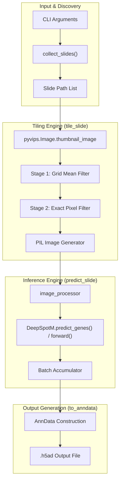
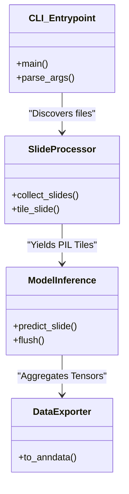

# Whole-Slide Image Prediction (predict_wsi.py)

<details>
<summary>Relevant source files</summary>

The following files were used as context for generating this wiki page:

- [README.md](README.md)
- [examples/predict_wsi.py](examples/predict_wsi.py)
- [pyproject.toml](pyproject.toml)

</details>


The `predict_wsi.py` script provides a high-performance command-line interface for generating virtual spatial transcriptomics from Whole-Slide Images (WSIs). Unlike the basic `predict.py` script which handles individual image tiles, `predict_wsi.py` implements a complete pipeline for large-scale slide processing, including efficient background filtering using `pyvips`, batched model inference, and structured output in the `AnnData` format.

### Data Flow and Architecture

The script follows a linear pipeline: it discovers slide files, iterates through them to extract tissue-containing tiles, performs inference using a loaded `DeepSpotM` model, and aggregates results into a spatial `AnnData` object.

#### WSI Prediction Pipeline

**Sources:** `[examples/predict_wsi.py:32-44]()`, `[examples/predict_wsi.py:47-77]()`, `[examples/predict_wsi.py:79-114]()`, `[examples/predict_wsi.py:116-136]()`

---

### Implementation Details

#### 1. Efficient Tiling with `tile_slide()`
The `tile_slide()` function implements a two-stage background filter to avoid processing empty regions (e.g., white space around the tissue) `[examples/predict_wsi.py:47-77]()`:

*   **Stage 1 (Coarse):** It generates a thumbnail where one pixel represents one tile (e.g., 224x224 pixels) using `pyvips.Image.thumbnail_image` `[examples/predict_wsi.py:63-66]()`. Tiles whose corresponding thumbnail pixel is above a threshold (default `white_mean + 10`) are discarded immediately.
*   **Stage 2 (Fine):** Candidate tiles are read at full resolution. If the mean pixel value of the actual 224x224 tile exceeds `--white-mean`, it is skipped `[examples/predict_wsi.py:74-75]()`.

#### 2. Batched Inference with `predict_slide()`
This function manages the interaction with the `DeepSpotM` model `[examples/predict_wsi.py:79-114]()`:
*   **Gene Subsetting:** If specific genes are requested via `--genes`, it uses `model.predict_genes()` for optimized computation `[examples/predict_wsi.py:97-98]()`. Otherwise, it performs a full transcriptome forward pass `[examples/predict_wsi.py:99-100]()`.
*   **Memory Management:** Tiles are accumulated into batches defined by `--batch-size` (default 64) before being moved to the GPU/device `[examples/predict_wsi.py:107-109]()`.

#### 3. AnnData Construction
The `to_anndata()` function formats the predictions for downstream analysis with `scanpy` or `squidpy` `[examples/predict_wsi.py:116-136]()`:
*   **Spatial Coordinates:** Stores tile-center coordinates in `adata.obsm["spatial"]` `[examples/predict_wsi.py:131]()`.
*   **Metadata:** The `adata.uns["deepspotm"]` dictionary tracks the slide name, tile size, gene embedding source, and expression units (log1p-CPM) `[examples/predict_wsi.py:132-135]()`.

---

### CLI Reference and Usage

The script supports various WSI formats including `.svs`, `.ndpi`, and `.mrxs` `[examples/predict_wsi.py:29]()`.

| Argument | Description | Default |
| :--- | :--- | :--- |
| `inputs` | One or more slide paths or directories. | (Required) |
| `--output`, `-o` | Output `.h5ad` file or directory. | `.` |
| `--source` | Gene-embedding source (`scgpt`, `evo2`, etc.). | `scgpt` |
| `--genes` | List of gene symbols to predict (space-separated). | Full Panel |
| `--white-mean` | Pixel threshold for background filtering. | `220.0` |
| `--batch-size` | Number of tiles per forward pass. | `64` |

#### Code Entity Mapping

**Sources:** `[examples/predict_wsi.py:171-213]()`, `[examples/predict_wsi.py:32-44]()`, `[examples/predict_wsi.py:79-114]()`, `[examples/predict_wsi.py:116-136]()`

#### Examples
**Predict a specific marker panel for a single slide:**
```bash
python examples/predict_wsi.py sample.svs -o sample.h5ad --genes EPCAM CD3D PTPRC
```

**Process an entire directory of slides using the `evo2` source:**
```bash
python examples/predict_wsi.py ./slides_dir/ -o ./results/ --source evo2
```

**Sources:** `[examples/predict_wsi.py:17-21]()`, `[examples/predict_wsi.py:140-168]()`

---