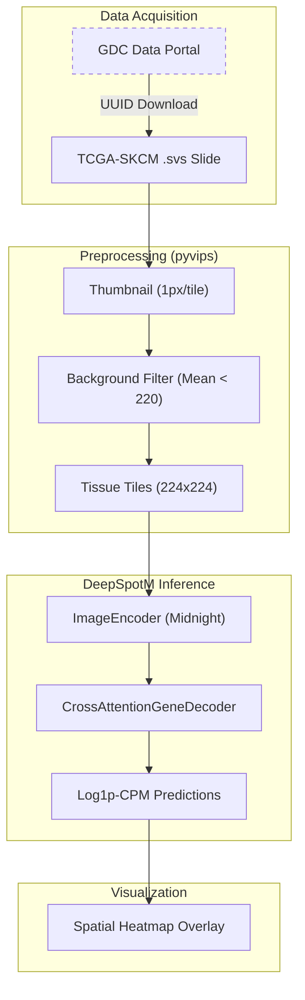
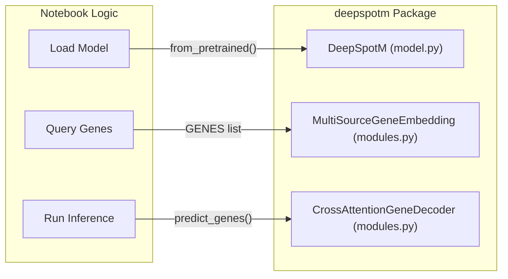

# TCGA SKCM Evaluation Notebook

Relevant source files

The following files were used as context for generating this wiki page:

- [examples/predict_tcga_skcm.ipynb](examples/predict_tcga_skcm.ipynb)

This page documents the `predict_tcga_skcm.ipynb` workflow, which demonstrates the end-to-end application of DeepSpotM on a whole-slide image (WSI) from the TCGA Skin Cutaneous Melanoma (SKCM) cohort. The notebook serves as a technical template for performing virtual spatial transcriptomics on large-scale pathology datasets.

## Overview

The evaluation notebook implements a pipeline that downloads a high-resolution `.svs` slide, performs background-aware tiling, and executes model inference to predict transcriptome-wide expression for specific marker genes. It reproduces the methodology used to generate the [TCGA virtual spatial transcriptomics atlas](https://huggingface.co/datasets/ratschlab/TCGA_virtual_spatial_transcriptomics_atlas).

### Data Flow Architecture

The diagram below illustrates the flow from raw WSI data to spatial gene expression maps.

**WSI Inference Data Flow**

**Sources:** `examples/predict_tcga_skcm.ipynb:8-46`()

---

## Implementation Details

### 1. Data Loading and Preprocessing
The notebook uses `pyvips` for lazy loading of pyramidal slides, which is critical for handling TCGA images that often exceed 90,000 pixels in width `[examples/predict_tcga_skcm.ipynb:156-159]()`. 

*   **Background Filtering**: To optimize inference, a two-stage filter is applied. First, a low-resolution thumbnail is generated where one pixel corresponds to one 224x224 tile `[examples/predict_tcga_skcm.ipynb:162-167]()`. Second, an exact mean pixel filter (`WHITE_MEAN = 220`) is applied to individual tiles during the batch read process `[examples/predict_tcga_skcm.ipynb:74-74]()`.
*   **Tiling**: The slide is divided into a non-overlapping grid of 224x224 patches, matching the expected input size of the `ImageEncoder` `[examples/predict_tcga_skcm.ipynb:73-73]()`.

### 2. Model Inference
The core of the prediction logic utilizes the `DeepSpotM.predict_genes` method. This allows for efficient querying of specific gene embeddings without computing the full 19,338-gene vocabulary.

*   **Gene Selection**: In the SKCM example, three specific markers are targeted: `BRAF` (Melanoma driver), `CD37` (Lymphocytes), and `COL1A1` (Stroma) `[examples/predict_tcga_skcm.ipynb:72-72]()`.
*   **Batch Processing**: Tiles are processed in batches (default `BATCH = 128`) to maximize GPU utilization `[examples/predict_tcga_skcm.ipynb:75-75]()`.

### 3. Entity Mapping: Code to Logic
The following diagram maps the logical steps in the notebook to the specific classes and methods within the `deepspotm` package.

**Code Entity Mapping**

**Sources:** `src/deepspotm/model.py:22-30`(), `src/deepspotm/modules.py:448-460`()

---

## Adapting to Other TCGA Cohorts

The notebook is designed to be modular. To adapt this workflow to other cancer types (e.g., LUAD, BRCA), users should modify the following parameters:

| Parameter | Description |
| :--- | :--- |
| `SLIDE_UUID` | The GDC File UUID for the target slide. |
| `SLIDE_MD5` | The MD5 checksum for data integrity verification. |
| `GENES` | A list of gene symbols relevant to the specific cancer type's pathology. |
| `WHITE_MEAN` | May need adjustment if the slide has significant artifacts or different staining intensity. |

### Evaluation Metrics
While the notebook focuses on visualization, it sets the stage for quantitative evaluation:
*   **ROC-AUC / PR-AUC**: If bulk RNA-seq data is available for the same patient, the spatial predictions can be aggregated (mean expression across all tissue tiles) and compared against bulk ground truth across a cohort.
*   **Spatial Correlation**: If paired Visium data is available, the `AnnData` output can be used to calculate Spearman correlation between predicted and observed counts per spot.

**Sources:** `examples/predict_tcga_skcm.ipynb:106-124`(), `src/deepspotm/model.py:202-215`()

---