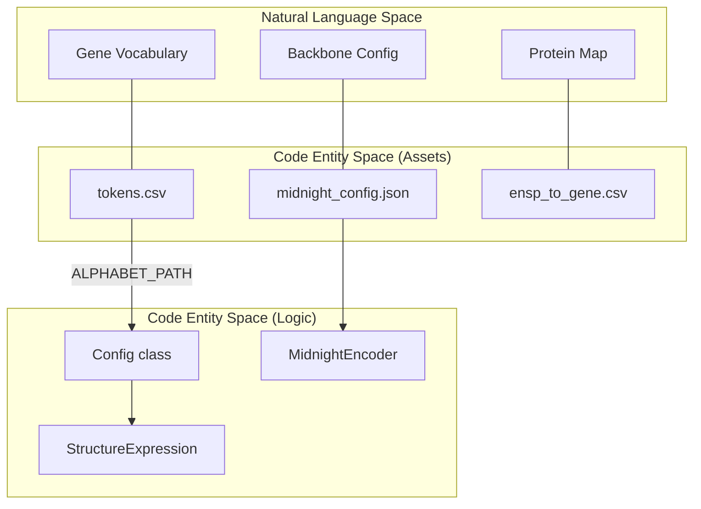
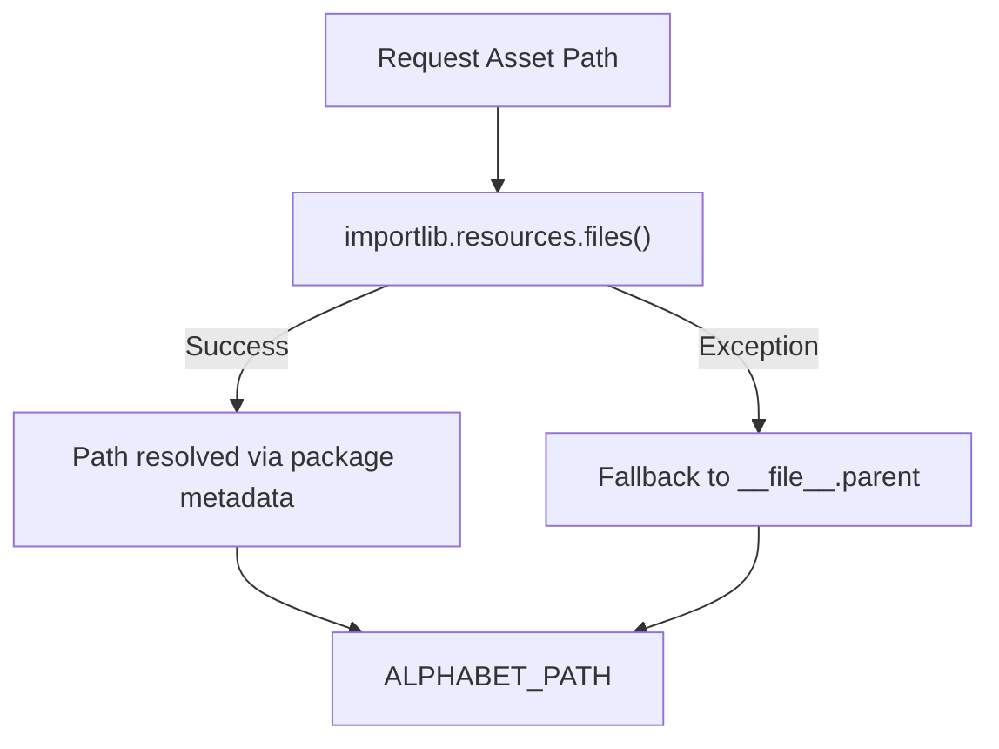

# Configuration and Assets

Relevant source files

The following files were used as context for generating this wiki page:

- [src/deepspotm/assets/midnight_config.json](src/deepspotm/assets/midnight_config.json)
- [src/deepspotm/assets/tokens.csv](src/deepspotm/assets/tokens.csv)
- [src/deepspotm/config.py](src/deepspotm/config.py)

DeepSpotM utilizes a centralized configuration layer and a suite of packaged static assets to ensure consistency across its inference pipelines and model architectures. This infrastructure manages the gene vocabulary, cross-modality mappings, and offline model configurations required for spatial transcriptomics prediction.

### Configuration Layer

The package uses a singleton `Config` object to resolve system-level paths and environment settings. Its primary responsibility is locating the gene vocabulary "alphabet" file, which is critical for the `StructureExpression` module and the `DeepSpotM` LightningModule.

The configuration logic implements a robust resolution strategy using `importlib.resources` to support various deployment environments, including standard pip installations and development clones.

For details, see [Config Module (config.py)](#4.1).

### Packaged Assets

DeepSpotM bundles several essential data files within the `src/deepspotm/assets/` directory. These assets provide the biological and structural context necessary for the model to map visual features to gene expression levels:

*   **Gene Vocabulary**: A comprehensive list of 19,338 gene entries used to define the output space of the decoder.
*   **Protein Mappings**: Cross-reference tables for Ensembl protein IDs to gene symbols.
*   **Backbone Configurations**: JSON definitions for offline image encoders, such as the Midnight backbone.

For details, see [Packaged Assets](#4.2).

### System Relationship Diagram

The following diagram illustrates how the `Config` module bridges the physical asset files to the functional code entities within the model.

**Configuration and Asset Flow**

**Sources:** [src/deepspotm/config.py:5-19](), [src/deepspotm/assets/tokens.csv:1-376](), [src/deepspotm/assets/midnight_config.json:1-47]()

### Asset Resolution Logic

The package prioritizes modern Python resource handling but maintains fallbacks for legacy environments. This ensures that the `ALPHABET_PATH` is always valid, whether the package is running from a `.whl` file or a local source tree.

**Asset Resolution Hierarchy**

**Sources:** [src/deepspotm/config.py:11-16]()

### Summary Table of Assets

| Asset File | Purpose | Primary Consumer |
| :--- | :--- | :--- |
| `tokens.csv` | Defines the 19,338 gene vocabulary and token IDs. | `StructureExpression` [src/deepspotm/config.py:12-16]() |
| `midnight_config.json` | Configuration for the `Dinov2Model` backbone. | `MidnightEncoder` [src/deepspotm/assets/midnight_config.json:1-5]() |
| `ensp_to_gene.csv` | Maps Ensembl Protein IDs to Gene Symbols. | Gene Decoder utilities |

**Sources:** [src/deepspotm/config.py:11-16](), [src/deepspotm/assets/tokens.csv:1-20](), [src/deepspotm/assets/midnight_config.json:1-16]()

---