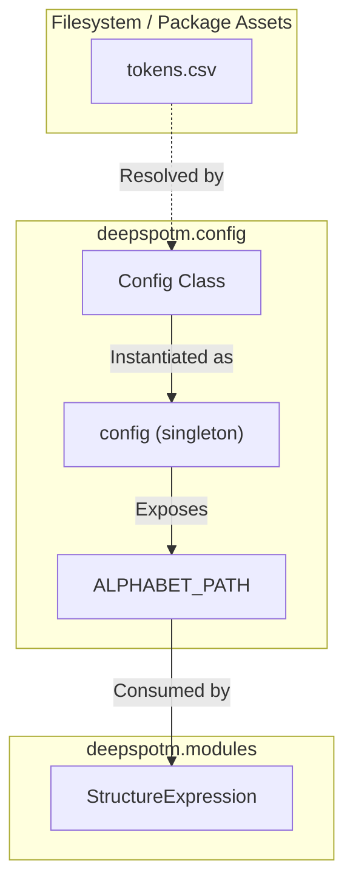
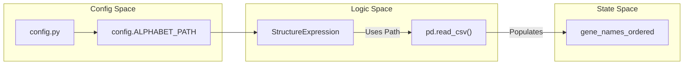

# Config Module (config.py)

Relevant source files

The following files were used as context for generating this wiki page:

- [.github/workflows/ci.yml](.github/workflows/ci.yml)
- [src/deepspotm/config.py](src/deepspotm/config.py)

The `config.py` module serves as the centralized configuration layer for the DeepSpotM package. Its primary responsibility is the resolution and management of paths to static assets required by the model, specifically the gene vocabulary. It provides a singleton `config` object that is consumed by other modules to ensure consistent access to packaged data regardless of the installation environment (e.g., source tree, installed wheel, or editable install).

### The Config Class

The `Config` class encapsulates global settings and asset paths. In the current implementation, it focuses on the robust resolution of the gene vocabulary file (`tokens.csv`).

#### ALPHABET_PATH Resolution Logic

The module employs a two-tier resolution strategy for `ALPHABET_PATH` to ensure compatibility across different Python versions and deployment scenarios:

1.  **Primary Path (`importlib.resources.files`)**: The implementation uses `importlib.resources.files` to locate assets within the `deepspotm.assets` namespace [src/deepspotm/config.py:8-14](). This is the modern, non-deprecated method for accessing package data, replacing the context-managed `path()` function which could lead to invalid references if the path outlived the context manager [src/deepspotm/config.py:8-10]().
2.  **Fallback Path (`__file__`)**: If the resource-based lookup fails (e.g., in environments where the package structure is not standard or during certain development setups), the class falls back to a relative path resolution using `Path(__file__).resolve().parent` to navigate to the `assets` directory [src/deepspotm/config.py:15-16]().

| Attribute | Type | Description |
| :--- | :--- | :--- |
| `ALPHABET_PATH` | `pathlib.Path` | Resolved absolute path to the `tokens.csv` file containing the 19,338 gene vocabulary entries. |

**Sources:**
- [src/deepspotm/config.py:5-17]()

---

### Config Consumption and Lifecycle

The module exports a singleton instance named `config` [src/deepspotm/config.py:19](). This instance is initialized at import time, performing the path resolution immediately.

#### Entity Relationship Diagram

The following diagram illustrates how the `config` singleton bridges the filesystem assets to the high-level model components.

"Config and Asset Resolution"

**Sources:**
- [src/deepspotm/config.py:5-19]()
- [.github/workflows/ci.yml:79-82]()

---

### Integration with Core Modules

The `ALPHABET_PATH` provided by the `config` object is critical for the initialization of the `StructureExpression` class in `modules.py`. This class uses the path to load the gene vocabulary, which defines the indices and names for the spatial transcriptomics prediction tasks.

The integrity of this configuration is validated during the Continuous Integration (CI) process. Specifically, the `import-check` job verifies that:
1.  The `config.ALPHABET_PATH` points to a valid file within a built wheel [ .github/workflows/ci.yml:81]().
2.  The `StructureExpression` class can successfully load exactly 19,338 gene names using this path [ .github/workflows/ci.yml:82]().

#### Data Flow: Config to Model

"Config to Model Data Flow"

**Sources:**
- [src/deepspotm/config.py:11-16]()
- [.github/workflows/ci.yml:79-82]()

---