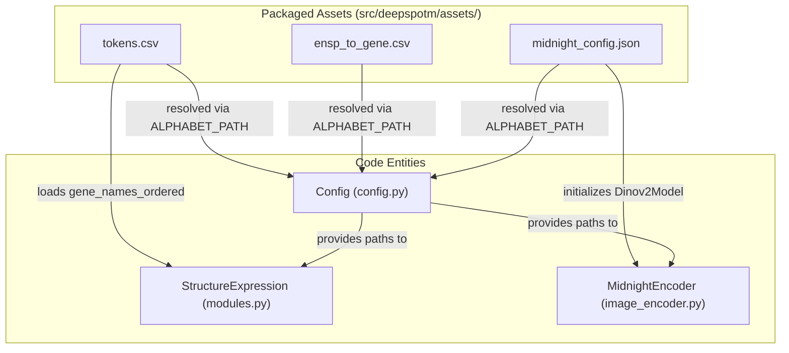
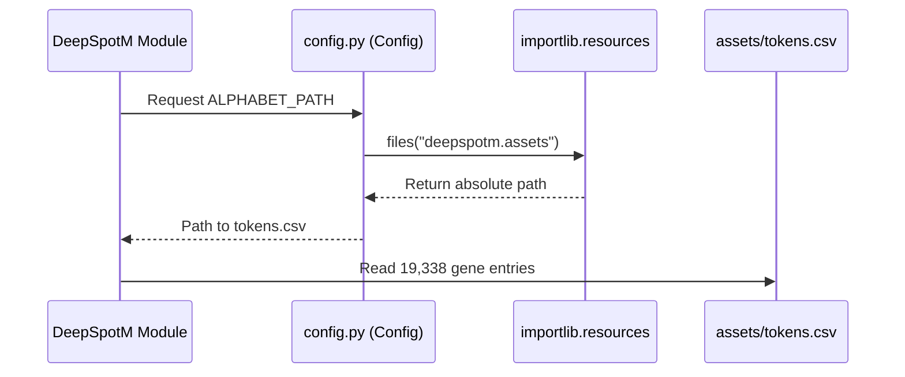

# Packaged Assets

Relevant source files

The following files were used as context for generating this wiki page:

- [pyproject.toml](pyproject.toml)
- [src/deepspotm/assets/__init__.py](src/deepspotm/assets/__init__.py)
- [src/deepspotm/assets/ensp_to_gene.csv](src/deepspotm/assets/ensp_to_gene.csv)
- [src/deepspotm/assets/midnight_config.json](src/deepspotm/assets/midnight_config.json)
- [src/deepspotm/assets/tokens.csv](src/deepspotm/assets/tokens.csv)

This page documents the static data files bundled within the `deepspotm` package. These assets provide the necessary metadata for gene vocabulary management, protein-to-gene mapping, and offline model configuration. These files are located in `src/deepspotm/assets/` and are essential for the `StructureExpression` module and various image encoders.

## Packaging and Distribution

The assets are bundled into the Python package using `setuptools`. The `pyproject.toml` file explicitly includes all `.csv` and `.json` files within the `assets` directory to ensure they are available in the installed site-packages.

| Asset File | Format | Purpose |
|:---|:---|:---|
| `tokens.csv` | CSV | Master vocabulary of 19,338 genes and tokens. |
| `ensp_to_gene.csv` | CSV | Mapping from Ensembl Protein IDs to Gene Symbols. |
| `midnight_config.json` | JSON | Offline configuration for the Midnight (DINOv2-based) backbone. |

**Sources:**
* `pyproject.toml` [82-83]()

## Gene Vocabulary (`tokens.csv`)

The `tokens.csv` file defines the canonical ordering and indexing for the DeepSpotM model's output space. It contains 19,338 entries.

### Structure
The file contains three columns:
1.  `token`: The string identifier (e.g., "KRT19").
2.  `token_type`: Categorization of the token, primarily `gene`.
3.  `token_id`: The integer index used for tensor operations.

### Implementation Flow
The `StructureExpression` class in `modules.py` loads this file to initialize the `gene_names_ordered` list. This list determines the mapping between the model's output logits and specific gene symbols.

**Sources:**
* `src/deepspotm/assets/tokens.csv` [1-376]()

## Protein Mapping (`ensp_to_gene.csv`)

This asset provides a lookup table to translate Ensembl Protein IDs (ENSP) to standard Gene Symbols. This is particularly useful when interfacing with external datasets or foundation models that utilize protein-level identifiers.

### Data Example
| ENSP ID | Gene Symbol |
|:---|:---|
| `ENSP00000000233` | `ARF5` |
| `ENSP00000000412` | `M6PR` |
| `ENSP00000011653` | `CD4` |

**Sources:**
* `src/deepspotm/assets/ensp_to_gene.csv` [1-294]()

## Midnight Configuration (`midnight_config.json`)

This file contains the architectural parameters for the `MidnightEncoder`. It allows the model to initialize the `Dinov2Model` backbone without requiring an active internet connection to fetch configurations from the Hugging Face Hub.

### Key Parameters
*   **Architecture**: `Dinov2Model` [src/deepspotm/assets/midnight_config.json:4]()
*   **Hidden Size**: 1536 [src/deepspotm/assets/midnight_config.json:10]()
*   **Patch Size**: 14 [src/deepspotm/assets/midnight_config.json:26]()
*   **Target Layers**: Configured to extract features from `stage12` (index 12) [src/deepspotm/assets/midnight_config.json:20-25]()

**Sources:**
* `src/deepspotm/assets/midnight_config.json` [1-47]()

## Data Flow: Assets to Model Entities

The following diagram illustrates how these packaged assets are consumed by the core classes of the DeepSpotM library.

### Asset Consumption Diagram

**Sources:**
* `pyproject.toml` [82-83]()
* `src/deepspotm/assets/tokens.csv` [1-1]()
* `src/deepspotm/assets/midnight_config.json` [1-16]()

## Vocabulary Resolution Logic

The system uses a centralized `Config` entity to resolve the location of these assets, ensuring that whether the package is installed as a site-package or used in a development environment, the files are correctly located.

### Path Resolution Sequence

**Sources:**
* `pyproject.toml` [79-83]()
* `src/deepspotm/assets/tokens.csv` [1-376]()

---