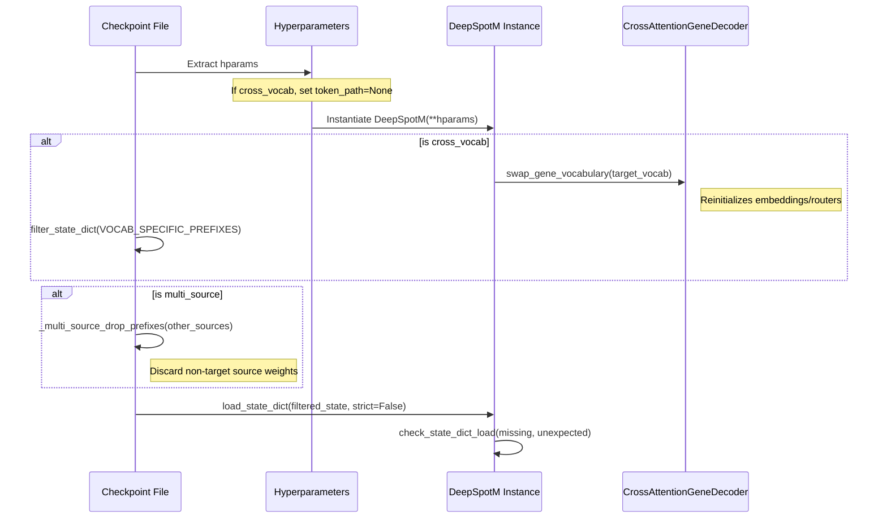
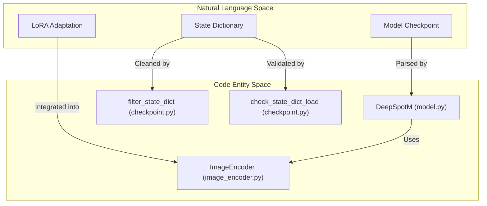

# Checkpoint Loading and State-Dict Utilities

Relevant source files

The following files were used as context for generating this wiki page:

- [src/deepspotm/checkpoint.py](src/deepspotm/checkpoint.py)
- [tests/test_checkpoint.py](tests/test_checkpoint.py)

The `checkpoint.py` module provides robust utilities for loading model weights into the `DeepSpotM` architecture. It serves as a safety layer to prevent "silent failures" where a model might load partially mismatched weights (e.g., due to vocabulary changes or hyperparameter drift) and produce garbage predictions without raising an error.

### State-Dict Filtering and Drift Detection

DeepSpotM employs a strict loading policy. Because the model's gene vocabulary and embedding sources can be dynamically swapped, standard PyTorch `load_state_dict` calls are wrapped in guards that distinguish between expected architectural differences and unexpected weight drift.

#### Key Prefixes
The `VOCAB_SPECIFIC_PREFIXES` constant identifies keys that are tied to the specific gene vocabulary used during training. These keys must be handled carefully during cross-vocabulary loading [src/deepspotm/checkpoint.py:20-23]().

| Prefix | Description |
| :--- | :--- |
| `gene_decoder.gene_embeddings` | The weight matrix for gene tokens. |
| `gene_decoder._router_bio_emb` | The biological embeddings used by the `GeneRouter` hypernetwork. |

#### Implementation Logic
The loading process uses `filter_state_dict` to remove specific keys from a checkpoint before injection [src/deepspotm/checkpoint.py:50-54](). Following the load, `check_state_dict_load` compares the missing and unexpected keys against allow-lists. If any keys are missing or unexpected that were not explicitly permitted, a `RuntimeError` is raised to prevent execution with uninitialized weights [src/deepspotm/checkpoint.py:57-87]().

**Sources:** [src/deepspotm/checkpoint.py:20-23](), [src/deepspotm/checkpoint.py:50-54](), [src/deepspotm/checkpoint.py:57-87](), [tests/test_checkpoint.py:24-32]().

---

### Loading for Prediction

The `load_for_prediction` function is the primary entry point for inference. It handles three distinct scenarios: standard loads, cross-vocabulary loads, and multi-source collapse [src/deepspotm/checkpoint.py:89-95]().

#### Data Flow: Checkpoint to Model
The following diagram illustrates how `load_for_prediction` orchestrates the construction of a `DeepSpotM` instance from a `.ckpt` file.

**Checkpoint Loading Sequence**

**Sources:** [src/deepspotm/checkpoint.py:89-159](), [src/deepspotm/checkpoint.py:26-47]().

---

### Cross-Vocabulary and Multi-Source Support

DeepSpotM supports models trained on one set of genes (e.g., a specific panel) being applied to another (e.g., Whole Transcriptome) via the `CrossAttentionGeneDecoder.swap_vocabulary` mechanism.

#### Multi-Source Collapse
When a checkpoint contains multiple embedding sources (e.g., `["protbert", "esm2"]`), the loader can "collapse" the model to a single source at load time. This is managed by `_multi_source_drop_prefixes`, which identifies and removes weights belonging to the unused sources [src/deepspotm/checkpoint.py:26-47]().

*   **Logic**: It drops `bio_{other}`, `adapters.{other}.*`, and `routers.{other}.*` for every source except the one specified by the `source` argument [src/deepspotm/checkpoint.py:39-46]().

#### Function Mapping
| Feature | Code Entity | Purpose |
| :--- | :--- | :--- |
| **Cross-Vocab** | `load_for_prediction` | Detects `token_path` and `gene_embeddings_path` to trigger `swap_gene_vocabulary` [src/deepspotm/checkpoint.py:119-148](). |
| **Filtering** | `filter_state_dict` | Prevents shape-mismatched weights from overwriting freshly swapped layers [src/deepspotm/checkpoint.py:50-54](). |
| **Validation** | `check_state_dict_load` | Ensures that the `RuntimeError` is only suppressed for keys that were intentionally dropped [src/deepspotm/checkpoint.py:75-87](). |

**Sources:** [src/deepspotm/checkpoint.py:26-47](), [src/deepspotm/checkpoint.py:89-159]().

---

### LoRA Save/Load Contract

While `checkpoint.py` handles the state-dict level, the `DeepSpotM` model (defined in `model.py`) manages the structural integration of LoRA (Low-Rank Adaptation) weights within the `ImageEncoder`.

**System Name to Code Entity Mapping**

#### Implementation Details
*   **Initialization**: When `DeepSpotM` is initialized, it builds the encoder via `build_encoder`. If `lora_rank` is specified in hyperparameters, the encoder wraps specific layers (e.g., `qkv` projections) with LoRA weights.
*   **Loading**: Because LoRA weights are new parameters not present in the base backbone, `load_for_prediction` must account for these keys during `check_state_dict_load`. If the checkpoint was trained with LoRA, the runtime model must also be instantiated with the same `lora_rank` to ensure the `state_dict` keys match.

**Sources:** [src/deepspotm/checkpoint.py:89-163](), [src/deepspotm/model.py:21-45]().

---