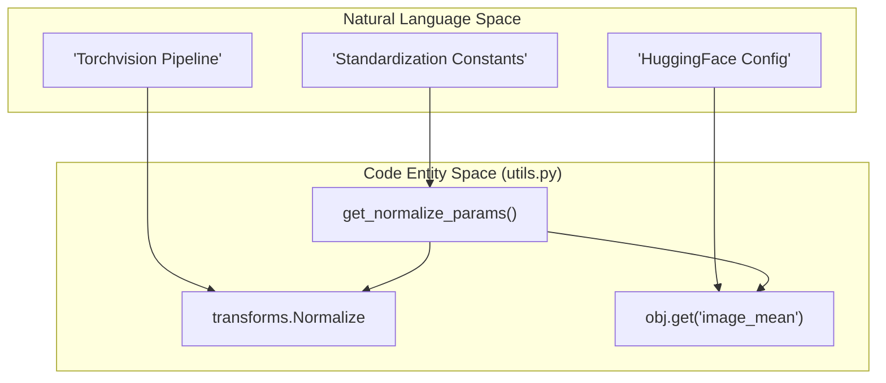
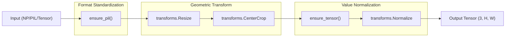

# Image Preprocessing Utilities (utils.py)

Relevant source files

The following files were used as context for generating this wiki page:

- [src/deepspotm/utils.py](src/deepspotm/utils.py)
- [tests/test_utils.py](tests/test_utils.py)

The `utils.py` module provides robust image transformation pipelines designed to standardize heterogeneous input formats into the specific tensor formats required by DeepSpotM's image encoders. It ensures that data originating from diverse sources—such as TIAToolbox (numpy-uint8), PIL-based WSI loaders, or pre-loaded PyTorch tensors—undergo identical normalization and geometric processing.

### Multi-Format Input Handling

The primary utility, `get_eval_transforms`, constructs a `torchvision.transforms.Compose` pipeline that dynamically handles four distinct input types:
1.  **NumPy uint8**: Standard HWC arrays (0-255).
2.  **NumPy float**: HWC arrays (0.0-1.0).
3.  **PIL Image**: Standard Python Imaging Library objects.
4.  **PyTorch Tensor**: CHW tensors, which are converted back to HWC for consistent geometric transformation via PIL.

#### Transform Pipeline Logic
The pipeline follows a strict sequence to ensure consistency:
1.  **Format Canonicalization**: All inputs are converted to a PIL Image via the internal `ensure_pil` lambda [src/deepspotm/utils.py:33-52](). This handles the `CHW -> HWC` permutation and `float -> uint8` scaling for tensors [src/deepspotm/utils.py:41-45]().
2.  **Geometric Scaling**: If `target_img_size` is specified, the image is resized using `BICUBIC` interpolation [src/deepspotm/utils.py:55-56]().
3.  **Spatial Alignment**: If `center_crop` is enabled, a square crop is taken from the center of the resized image [src/deepspotm/utils.py:58-61]().
4.  **Tensor Conversion**: The PIL Image is converted to a `torch.Tensor` (scaling values to `[0.0, 1.0]`) [src/deepspotm/utils.py:63-68]().
5.  **Standardization**: If mean and standard deviation are provided, the tensor is normalized [src/deepspotm/utils.py:71-72]().

**Entity Mapping: Input Types to Processing Logic**

| Input Entity | Code Implementation | Target State |
| :--- | :--- | :--- |
| `np.ndarray` (uint8) | `Image.fromarray(x)` | PIL Image |
| `np.ndarray` (float) | `(x * 255).clip(0, 255).astype(np.uint8)` | PIL Image |
| `torch.Tensor` | `x.permute(1, 2, 0).numpy()` | PIL Image |
| `PIL.Image` | Pass-through | PIL Image |

Sources: [src/deepspotm/utils.py:26-74](), [tests/test_utils.py:26-48]()

### Normalization Parameter Extraction

DeepSpotM supports various backbone architectures (e.g., Midnight, CLIP, TIMM-based models), each requiring specific normalization constants. The `get_normalize_params` function provides an introspection layer to extract these parameters from different configuration objects.

#### Supported Sources
*   **torchvision.transforms.Compose**: Iterates through the transform list to find a `transforms.Normalize` instance [src/deepspotm/utils.py:14-18]().
*   **HuggingFace Processors/Dicts**: Retrieves `image_mean` and `image_std` keys, commonly used in `CLIPImageProcessor` [src/deepspotm/utils.py:20-23]().

**Natural Language to Code Entity: Parameter Extraction**

Sources: [src/deepspotm/utils.py:7-23](), [tests/test_utils.py:74-95]()

### Data Flow Diagram

The following diagram illustrates the flow of a raw input (e.g., a tile from a Whole Slide Image) through the `get_eval_transforms` pipeline to the final tensor used by the `ImageEncoder`.

**Image Preprocessing Pipeline**

Sources: [src/deepspotm/utils.py:26-74](), [tests/test_utils.py:3-6]()

### Summary of Implementation Details

| Feature | implementation | Requirement/Constraint |
| :--- | :--- | :--- |
| **Resize Interpolation** | `InterpolationMode.BICUBIC` | [src/deepspotm/utils.py:56]() |
| **Center Crop Guard** | `assert target_img_size > 0` | Requires target size if cropping [src/deepspotm/utils.py:59]() |
| **Tensor Conversion** | `transforms.ToTensor()` | Converts HWC [0, 255] to CHW [0.0, 1.0] [src/deepspotm/utils.py:67]() |
| **Unsupported Types** | `TypeError` | Fails loudly on non-image inputs [src/deepspotm/utils.py:51-52]() |

Sources: [src/deepspotm/utils.py:1-74](), [tests/test_utils.py:50-72]()

---