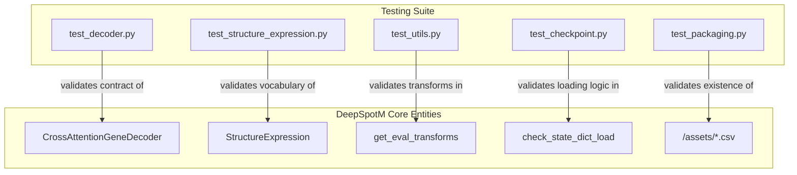
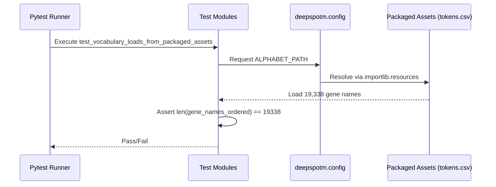

# Testing

Relevant source files

The following files were used as context for generating this wiki page:

- [tests/test_checkpoint.py](tests/test_checkpoint.py)
- [tests/test_decoder.py](tests/test_decoder.py)
- [tests/test_packaging.py](tests/test_packaging.py)
- [tests/test_structure_expression.py](tests/test_structure_expression.py)
- [tests/test_utils.py](tests/test_utils.py)

The DeepSpotM test suite is designed to ensure the integrity of the spatial transcriptomics pipeline, from image preprocessing to gene expression decoding. Because the model weights are gated, the test suite emphasizes **contract testing** and **asset integrity** to ensure that the package functions correctly across different environments without requiring a GPU or large model downloads.

The testing philosophy focuses on preventing silent regressions in the output format (e.g., gene ordering) and verifying that the packaged assets (vocabulary files) are correctly bundled in the distribution wheel.

### Test Architecture Overview

The following diagram maps the testing modules to the core system components they validate.

**System Validation Map**

**Sources:** [tests/test_decoder.py:1-8](), [tests/test_packaging.py:1-7](), [tests/test_checkpoint.py:1-6]()

---

### Unit Tests: Decoder, StructureExpression, and Utils

These tests verify the mathematical and logical correctness of the core modules. They use small, randomly initialized versions of the model components to assert that the internal data flow remains consistent.

*   **Decoder Contract**: Ensures `CrossAttentionGeneDecoder` returns the standard `(expression, gene_features, attn_weights)` triple [tests/test_decoder.py:46-55](). It specifically validates that the `gene_indices` parameter correctly subsets and reorders the output tensor [tests/test_decoder.py:57-78]().
*   **Vocabulary Handling**: Verifies that `StructureExpression` correctly maps gene symbols to tensor indices and handles Out-of-Vocabulary (OOV) symbols or negative expression values via clamping [tests/test_structure_expression.py:37-54]().
*   **Preprocessing Pipeline**: Validates `get_eval_transforms` against multiple input formats including `numpy-uint8`, `PIL`, and `torch.Tensor` to ensure they all normalize to the same expected shape and distribution [tests/test_utils.py:26-48]().

For details, see [Unit Tests: Decoder, StructureExpression, and Utils](#7.1).

**Sources:** [tests/test_decoder.py:13-17](), [tests/test_structure_expression.py:9-10](), [tests/test_utils.py:14-14]()

---

### Checkpoint and Packaging Tests

These tests focus on the distribution and deployment safety of the DeepSpotM package. They ensure that users installing the package via `pip` receive all necessary metadata and that model weights load predictably.

*   **State-Dict Guards**: Validates the `check_state_dict_load` function, which prevents silent failures when loading checkpoints by detecting "key drift" between the saved weights and the model architecture [tests/test_checkpoint.py:55-59]().
*   **Asset Integrity**: Confirms that critical files like `tokens.csv` (containing the 19,338 gene vocabulary) and `ensp_to_gene.csv` are physically present in the installed wheel [tests/test_packaging.py:35-44]().
*   **Modality Consistency**: Ensures that the internal modality registries (e.g., `MODALITY_VOCABULARY`) are consistent with the source mapping [tests/test_decoder.py:89-93]().

For details, see [Checkpoint and Packaging Tests](#7.2).

**Sources:** [tests/test_checkpoint.py:10-14](), [tests/test_packaging.py:17-19](), [tests/test_packaging.py:46-58]()

---

### Test Execution Flow

The test suite is designed to be run via `pytest`. The following diagram illustrates how the tests interact with the packaged assets versus the code logic.

**Test Data Interaction**

**Sources:** [tests/test_packaging.py:59-63](), [tests/test_structure_expression.py:12-18]()

---

### Summary of Coverage

| Test Module | Primary Target | Key Assertion |
| :--- | :--- | :--- |
| `test_decoder.py` | `CrossAttentionGeneDecoder` | Output shape is `(batch, n_genes)` [tests/test_decoder.py:51]() |
| `test_structure_expression.py` | `StructureExpression` | Maps `{"gene": val}` to correct tensor index [tests/test_structure_expression.py:20-35]() |
| `test_utils.py` | `get_eval_transforms` | Normalizes `numpy` and `PIL` to identical tensors [tests/test_utils.py:42-48]() |
| `test_checkpoint.py` | `filter_state_dict` | Correctly drops `VOCAB_SPECIFIC_PREFIXES` [tests/test_checkpoint.py:24-32]() |
| `test_packaging.py` | `deepspotm.assets` | `tokens.csv` is present and non-empty [tests/test_packaging.py:39-44]() |

**Sources:** [tests/test_decoder.py:1-93](), [tests/test_structure_expression.py:1-54](), [tests/test_utils.py:1-95](), [tests/test_checkpoint.py:1-68](), [tests/test_packaging.py:1-63]()

---