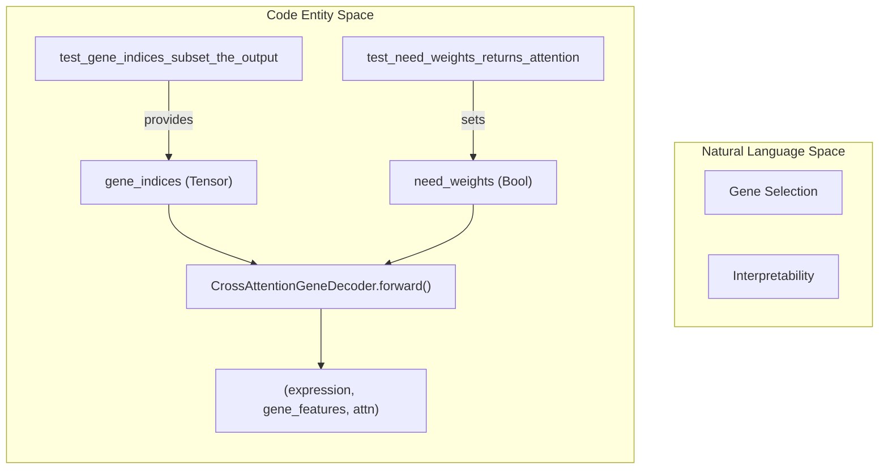
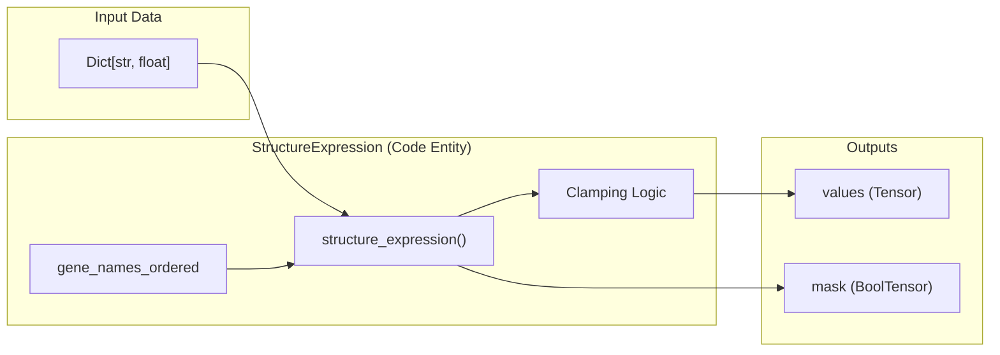

# Unit Tests: Decoder, StructureExpression, and Utils

Relevant source files

The following files were used as context for generating this wiki page:

- [tests/test_decoder.py](tests/test_decoder.py)
- [tests/test_structure_expression.py](tests/test_structure_expression.py)
- [tests/test_utils.py](tests/test_utils.py)

This section covers the unit testing suite for the core gene decoding logic, the vocabulary mapping system, and the image preprocessing utilities. These tests ensure the mathematical contract of the decoder is maintained, the packaged gene assets are valid, and the multi-format image pipeline is robust against varying input types.

## Decoder Contract and Integrity

The tests in `test_decoder.py` validate the `CrossAttentionGeneDecoder` without requiring large pretrained checkpoints. They focus on the output shapes, the behavior of gene subsetting, and the consistency of the modality registry.

### Decoder Output Contract
The `forward` method of the `CrossAttentionGeneDecoder` is required to return a specific three-tuple: `(expression, gene_features, attn_weights)` [tests/test_decoder.py:46-49]().
*   **Expression**: A tensor of shape `(batch, n_requested_genes)` [tests/test_decoder.py:51]().
*   **Gene Features**: A tensor of shape `(batch, gene_embed_dim)` representing the aggregated query features [tests/test_decoder.py:52]().
*   **Attention**: Defaults to `None` unless `need_weights=True` is passed for interpretability paths [tests/test_decoder.py:53, 80-87]().

### Subsetting and Ordering
The decoder supports a `gene_indices` argument which allows for efficient computation of only a subset of the vocabulary. The tests verify that:
1.  **Subsetting**: Passing a tensor of indices returns only those specific genes, matching the values produced in a full forward pass [tests/test_decoder.py:57-65]().
2.  **Ordering**: The order of columns in the output tensor strictly follows the order of indices provided in the `gene_indices` tensor [tests/test_decoder.py:68-78]().

### Modality Registry Consistency
The system maintains a mapping between data sources and modalities. The tests ensure that every entry in `MODALITY_BY_SOURCE` maps to a valid entry in `MODALITY_VOCABULARY` and that "dna" remains the canonical first entry (index 0) for one-hot encoding stability [tests/test_decoder.py:89-93]().

### Decoder Testing Logic
The following diagram illustrates the relationship between the test fixtures and the decoder's internal logic.

**Decoder Test Flow**

**Sources:** [tests/test_decoder.py:1-93](), [src/deepspotm/modules.py:1-50]()

---

## StructureExpression and Vocabulary

`test_structure_expression.py` validates the `StructureExpression` class, which handles the conversion of raw gene-expression dictionaries into fixed-length tensors compatible with the model's vocabulary.

### Vocabulary Integrity
The tests verify that the packaged `tokens.csv` is correctly resolved and loaded. The standard vocabulary size is expected to be exactly **19,338** genes [tests/test_structure_expression.py:12-15](). It also ensures that special tokens like `<pad>` are filtered out of the `gene_names_ordered` list [tests/test_structure_expression.py:16-17]().

### Mapping and Masking Logic
The `structure_expression()` method performs several critical operations:
*   **Placement**: Maps gene symbols to their correct index in the output tensor [tests/test_structure_expression.py:20-31]().
*   **Masking**: Generates a boolean mask where `True` indicates the gene was present in the input dictionary [tests/test_structure_expression.py:32-33]().
*   **Clamping**: Ensures all expression values are non-negative by clamping values below zero [tests/test_structure_expression.py:37-45]().
*   **OOV Handling**: Out-of-vocabulary (OOV) symbols are silently ignored and do not corrupt the resulting tensor or mask [tests/test_structure_expression.py:47-54]().

**Vocabulary Mapping System**

**Sources:** [tests/test_structure_expression.py:1-54](), [src/deepspotm/modules.py:1-50]()

---

## Image Preprocessing Utilities

`test_utils.py` covers the `get_eval_transforms` and `get_normalize_params` functions, which form the entry point for all image data into the model.

### Multi-Format Input Pipeline
`get_eval_transforms` is designed to be polymorphic. The test suite uses a parameter matrix to ensure that the following input types all result in a standardized `(3, 224, 224)` float32 tensor [tests/test_utils.py:26-48]():
*   **Numpy (uint8)**: Standard HWC image arrays.
*   **Numpy (float32)**: Normalized arrays.
*   **PIL Image**: Standard Python Imaging Library objects.
*   **Torch Tensor**: CHW formatted tensors.

### Constraints and Errors
*   **Normalization**: The tests verify that if `mean` and `std` are provided, the output is standardized; otherwise, it is scaled to `[0, 1]` [tests/test_utils.py:56-65]().
*   **Validation**: The transform rejects unsupported types (e.g., strings) with a `TypeError` [tests/test_utils.py:50-54]().
*   **Configuration**: `center_crop=True` requires a valid `target_img_size` to be specified, or it raises an `AssertionError` [tests/test_utils.py:68-72]().

### Parameter Recovery
`get_normalize_params` is tested for its ability to extract normalization constants from two distinct sources:
1.  **Torchvision Pipelines**: Introspecting a `transforms.Compose` object to find a `Normalize` step [tests/test_utils.py:74-82]().
2.  **HuggingFace Processors**: Reading from a dictionary containing `image_mean` and `image_std` keys [tests/test_utils.py:90-95]().

| Input Source | Recovery Method | Expected Result |
| :--- | :--- | :--- |
| `transforms.Compose` | Search for `transforms.Normalize` | `(mean, std)` |
| `dict` | Key lookup (`image_mean`) | `(mean, std)` |
| `Compose` (no Norm) | Exhaustive search | `(None, None)` |

**Sources:** [tests/test_utils.py:1-95](), [src/deepspotm/utils.py:1-50]()

---